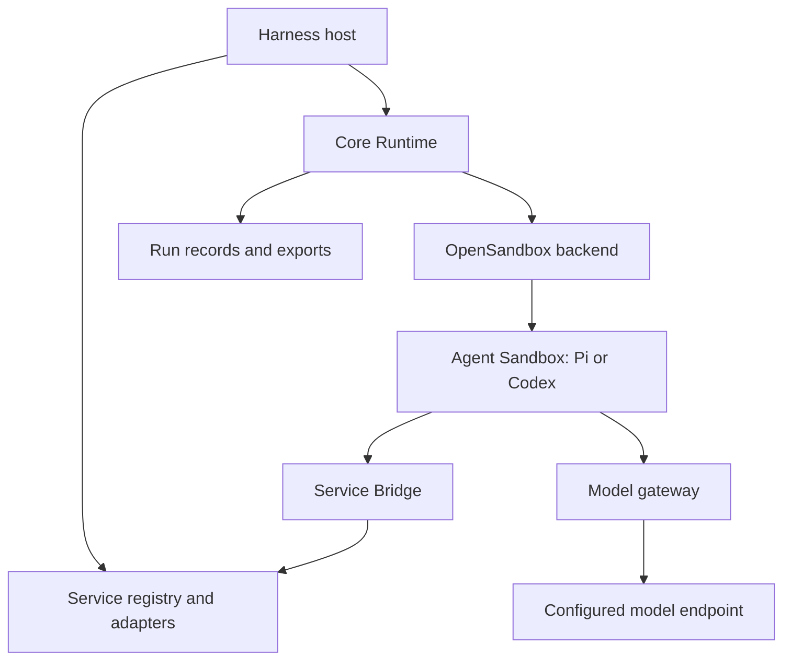

# 00. System overview

murm separates the collaboration policy from Agent execution. A host program, called a Harness, decides who works, how work is shared and what counts as success. It uses the public Core SDK to create a Runtime, connect Services and run Agents. The Runtime handles isolation, authenticated calls, input delivery, execution records and resource cleanup.

A Runtime can run a single Agent, a parent with children, a fixed peer pool or a task-driven team. It does not require a Mission, Task pool, shared Git branch or leader. Those are choices made by the Harness and its Services. Start with [Runtime](../en/runtime.md) and [Build a Swarm Harness](../en/build-your-harness.md) for a runnable application; this chapter explains the implementation boundaries behind it.

## Components and ownership

| Component | Owns | Does not decide |
| --- | --- | --- |
| Harness | Team structure, work routing, Service composition, business results and run-level finalization. | The executor's internal Agent loop. |
| Core Runtime | Agent identity and Slots, frozen Profiles, input admission, observation, Bridge access, file controls and cleanup. | Which research task or collaboration strategy is valuable. |
| OpenSandbox backend | Sandbox allocation and guest transport, executor capability checks, Session archives, file collection and destruction receipts. | A universal task or messaging protocol. |
| Pi or Codex executor | The conversation, model/tool loop and native input processing inside an Agent. | Host Service credentials or host authority. |
| Service adapter | The named operation's implementation and domain state, in process or behind a configured external endpoint. | Agent resource lifecycle unless explicitly delegated by a Harness. |
| Model gateway | Host-owned model routing, credentials, access policy and traces. | Service manifests or task completion. |

The public package entry is `@luna-shi/murm`. It supplies Sandbox and Runtime assembly, Service author interfaces and public types. The [Core chapter](15-core-runtime.md) describes each contract.

## Repository layout and application ownership

The public SDK is implemented in `src/core/`. Shared project capture, host/RPC, reporting and resource helpers live in `src/harness/`; these are private implementation support, not a collection of built-in collaboration policies. The five mechanism applications live in `examples/subagents`, `examples/taskpool`, `examples/peermesh`, `examples/substrate` and `examples/lead-worker`. PeerMesh, Substrate and Lead-Worker keep their controllers and Services under their own `harness/` directories. Subagents and TaskPool keep the corresponding modules directly in their example directories.

The `murm --harness` names are CLI aliases for those ordinary example modules. The same loader can select a local module or installed package. The aliases do not make TaskPool, a Board, or another example's Services part of Core. The older TaskPool/PeerMesh foreground dispatch lives in `src/cli/foreground-harnesses.ts`, separate from common host support. `examples/messages` and `examples/notes` are smaller Service tutorials; `examples/services` holds optional integration examples.

Shared deployment under `deploy/` prepares OpenSandbox and the Worker image. Each Runtime starts its own Bridge, Model Gateway and built-in `agent` Service without another container. Examples assemble their own in-process Services and explicitly configured external facilities. Mathlib Search belongs to `examples/services/mathlib-search` and is optional for Lean workloads; it is unrelated to PeerMesh's MySQL Board database. [Deployment ownership](../../deploy/README.md) and the [example index](../../examples/README.md) list the actual prerequisites.

This layout change does not yet make every example a standalone SDK consumer. TaskPool still uses domain modules under `src`, and the examples still use private host helpers. The [repository implementation plan](../designs/repository-layout.md) separates the completed moves from the remaining domain extraction, public Harness contract and outside-checkout package verification.

## One complete Run

### 1. The host assembles the application

The host registers Service manifests and adapters, chooses named Profiles, supplies the model and OpenSandbox configuration, and creates a Sandbox configuration handle. `createRuntime` uses that configuration and captures the Profiles and Service registry. The host also specifies capacity and an output root. After assembly, the host can register Profiles, register or retire Services, and change an Agent’s Service-operation grants through [Runtime management](15-core-runtime.md#runtime-management).

A Service can be a local function, an HTTP JSON v2 endpoint, or a custom adapter for an existing application. The adapter keeps its remote credential on the host. Agent Profiles seed the operations each Agent may call. The Bridge enforces each Agent’s current access. [Services](04-services.md) explains validation, caller identity, cancellation and commit guards.

### 2. The Runtime prepares each Agent

`spawn` validates a named Profile and a request ID, reserves a Slot, then asks the backend to allocate the Sandbox and initialize the executor. Host-supplied files or workspace settings are applied through controlled paths. Startup prepares the Service CLI, model route and selected executor's instructions. The default backend connects to OpenSandbox through its API, including an existing reachable deployment. A trusted Sandbox Provider can supply a different integration. Strict same-host Docker isolation is optional; executor capabilities are checked independently.

A successful spawn receipt identifies a ready Agent. Startup can have an uncertain outcome if the host's wait expires after work began. The original Runtime retains the request and resource identity for reconciliation. Retrying with a fresh identity may create another Agent. [Backend](16-pi-opensandbox-backend.md) covers allocation, guest startup and failure cleanup.

### 3. The Harness submits work and observes activity

Register `runtime.onEvent` before sending work and use `get/list/state` for current views. Public events report output, execution boundaries, errors, exits and query invalidation. The ordered Worker and operation evidence is preserved in Run records for offline inspection.

`send` submits text with a request ID and a delivery mode. Its receipt reports whether the input was accepted, not whether the task is finished. The default mode is `steer`; `followUp` requests a later execution opportunity. Several inputs can contribute to an execution, so an execution-settled event is not a general one-to-one input completion receipt.

Agents use tools in their private working directories and invoke named Service operations through `swarm`. The Bridge authenticates the Agent, checks the Profile and input schema, and calls the adapter with trusted caller context. The model loop and Service calls have separate records. The Harness can join these observations to its own operation IDs and domain results. [Runtime evidence](17-harness-reporting.md) describes the records and runnable handoff examples.

### 4. The Harness checks the result

An Agent can settle and remain idle with the same Session and files. It still occupies its Slot. The Harness may send more work, inspect or publish artifacts, consult Service state, or decide to finish. Its business checks determine success.

In the Messages SDK example, the host observes a successful write and read, then verifies the reader's exported file against the value it seeded. In TaskPool, task ownership, public revisions and Mission acceptance add different checks. The Core does not turn a settled execution, a Service call or an artifact count into a successful research result.

### 5. Finalization records results and resource state

Public close returns Core execution and cleanup receipts. The host verifies exported bytes, records business and persistence results, and closes its own facilities. Bundled Harnesses use shared private report helpers.

Core close stops admission and tracks in-flight work. Agent cleanup and endpoint shutdown can proceed concurrently; each Agent's cleanup confirms execution stop before archiving its Session, collecting configured files and deleting the Sandbox. Required export failures retain the Sandbox. Backend closure waits for Agent cleanup, and report/trace failures remain explicit in the receipt. The timeout of a host wait never establishes physical deletion. [Core Runtime](15-core-runtime.md), [backend cleanup](16-pi-opensandbox-backend.md) and [finalization](17-harness-reporting.md) describe the full failure paths.

## Where the five Harnesses add policy

| Harness | Policy added above Core | Implementation explanation |
| --- | --- | --- |
| Subagents | Parent-scoped creation and routing, context fork where supported, input/mailbox behavior. | [Runtime evidence and host examples](17-harness-reporting.md) |
| TaskPool | Exclusive Task take, Execution ownership, Materials, versioned Workspace and final Mission checks. | [Execution](02-execution.md), [Mission/Task](03-mission-task.md), [Workspace](05-workspace-continuity.md) |
| PeerMesh | Peer identities, Board, communication and Git integration. | [PeerMesh](18-peermesh-harness.md) |
| Substrate | Fixed peers, contribution publication, search, reading and reuse evidence. | [Substrate](19-substrate-harness.md) |
| Lead-Worker | A fixed or dynamic lead/helper team, Board transactions, feedback and Git deliveries. | [Lead-Worker](20-lead-worker-harness.md) |

The retained domain Runtime and TaskPool-specific mechanisms are documented in chapters 01–07. They remain callable implementation paths and must not be confused with mandatory Core objects. Historical timestamp resume, old benchmark assembly and removed schemas are described only where needed to explain retained records; they are not current SDK features.

## Current implementation and evidence

This manual follows the source inventory in [source-map.json](source-map.json). Generated references reproduce prompt, Service, storage and type declarations; they do not prove every branch has been executed. Issues and PRs preserve acceptance evidence, while [experiments](https://github.com/LuNa-shi/murm/blob/207be6356c16e5fb60c4b3c5b236d7a98383f991/docs/experiments/INDEX.md) retain the settings and results of their own revisions.

The [known boundaries](09-known-boundaries.md) belong to the current contract. The [dynamic Lead-Worker design](../designs/dynamic-lead-worker.md) records the approved acceptance requirements. Runtime registration and access APIs and the optional dynamic Harness are implemented; [the Lead-Worker chapter](20-lead-worker-harness.md#dynamic-orders-mode) explains their scope, trusted deployment and remaining evidence requirements.
