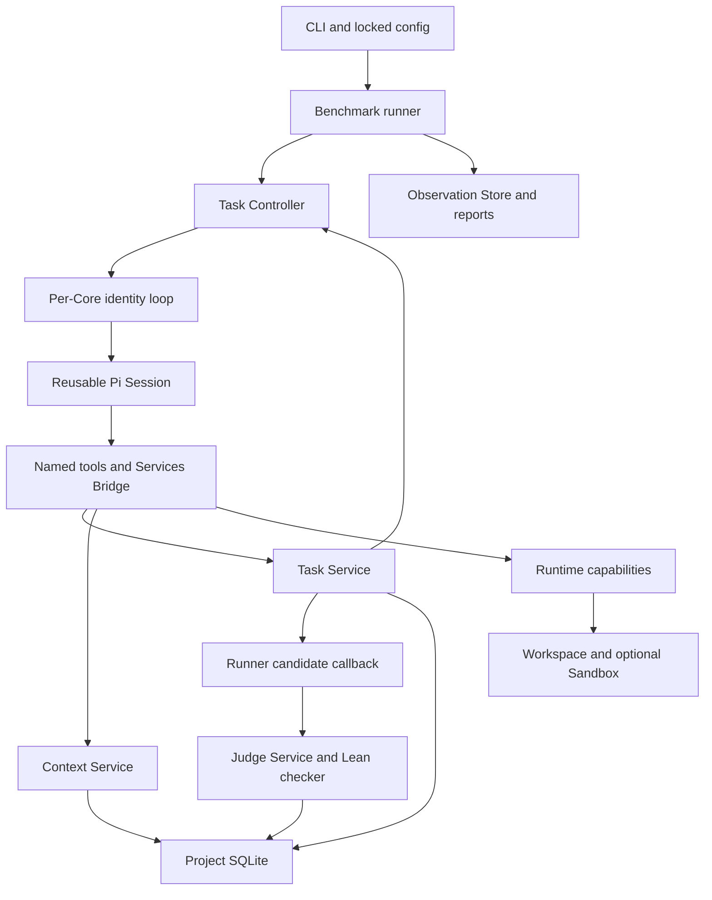

# 00. System ownership and a complete run

SwarmEnv gives several reusable Agent identities a shared objective, durable units of work, versioned evidence and checking tools. Each Agent chooses research actions within its authorized tools. The host manages ownership, process capacity, durable state, input boundaries, recovery and reporting. It does not contain a central Agent choosing every mathematical route.

This chapter follows the actual benchmark composition at the [reviewed baseline](INDEX.md). [Launch and configuration](07-run-configuration.md) describes startup and shutdown in detail. The flat model is explained first; the legacy branch still present in the code is described separately below.

## Entities and authority

| Entity | Meaning and lifetime | Authoritative owner |
|---|---|---|
| Experiment / project run | One configured problem and its time/resource boundary; a batch can contain several isolated projects | Runner and recorded metadata |
| Mission | Shared goal and acceptance conditions in the flat model | Task Service / SQLite |
| Task | Durable responsibility and completion contract | Task Service / SQLite |
| Execution | Durable authorization to act on a Task, with versions, owner, Core and Workspace binding | Task Service; Runtime drives physical lifecycle effects |
| Core | Physical lane with at most one current bound responsibility | Runner, Runtime capacity and identity loop |
| Session | Pi process/conversation attached to a reusable identity; can span several Executions or be replaced within one Execution | Adapter / Runtime; transport and in-memory state |
| Material | Versioned shared evidence, producer provenance and optional content/reference | Context Service / SQLite |
| Workspace | Private mutable files and revision/Git lineage for an Execution | Workspace Manager / filesystem; binding on Execution |
| CheckResult | A check of a Candidate against supplied target/input/checker metadata | Judge Service / SQLite |
| Observation | Projection for inspection, dashboards and analysis | Observation Store; not independent domain authority |

A GitHub Issue is a development-management object, not a runtime Task or Mission. `DONE` on an independent Task, a compiling Candidate, a busy Core and a completed experiment are different facts.

## Actual component connections

The candidate callback is deliberate: the registered tool is named `judge.submit_candidate`, but the baseline first updates submission state in Task Service and then invokes runner orchestration to call Judge Service. [Services](04-services.md) describes this coupling; [Issue #117](https://github.com/LuNa-shi/SwarmEnv/issues/117) tracks the redesign.

Registry and capability profiles describe the tool surface. The Pi extension registers allowed named tools; Bridge supplies the lane identity and current authorization envelope. Workspace/Sandbox operations are local Runtime capabilities. Domain services can have HTTP adapters, but the runner retains local control-plane services and a synchronous local router. Remote URLs alone do not replace all local authoritative state.

## One flat run, step by step

### 1. Prepare the problem and durable environment

The CLI reads `.env` without replacing existing environment values, parses arguments, validates the locked configuration and checks the PutnamBench checkout. It loads all twelve formalizations even when selecting one problem. Each project receives its own database, Workspace root and log directories. Input source and checker/toolchain identity are recorded; the initial Workspace carries an unsolved formalization, not a supplied solution.

The runner creates Context, Task and Judge services, registers capabilities, then creates a Mission and its first Task. This first Task is the implementation's shared Mission Task; there is no dedicated `is_shared` flag. The initial normal flat benchmark has one Task. Agents may later create independent responsibilities. [Mission and Task](03-mission-task.md) specifies the fields and exceptions.

### 2. Make physical lanes available

The runner constructs four Core records, each with one Runtime worker slot, Workspace Manager and Services Bridge. Their managers point at a common project Workspace root, while each Execution owns a unique Workspace. Bridges can start before Pi Sessions; Agent startup is demand driven.

Task Controller reconciles durable readiness and wakes idle identity loops. Each loop sees a bounded candidate set. The Agent chooses one listed Task and calls `task_take`. The Controller does not claim on the Agent's behalf. The standalone `Scheduler` class remains for other callers and tests; the production benchmark does not instantiate it. A report field named `scheduler` is a compatibility projection.

### 3. Bind the Task on the same identity

Task Service validates the claim and creates or resumes the permitted Execution. Shared Mission work can have concurrent Executions; an ordinary Task normally admits one active Execution. Bridge's Core identity is authoritative, so a payload cannot choose another physical lane.

Runtime prepares/restores the private Workspace, binds current versions and starts the Execution. The normal benchmark discovery turn continues on the same Pi Session. Binding uses `sendInitialPrompt: false` to avoid overlapping prompts. A logged composed initial-prompt snapshot is consequently not proof that the full snapshot was sent. [Prompt delivery](08-prompts.md) identifies messages for discovery, continuation, recovery and rotation.

### 4. Work, share evidence and create responsibilities

The bound Agent obtains current Workspace paths through its tools, reads files and Materials, edits its candidate through allowed capabilities and publishes findings. The claim result itself retains the pre-activation Execution snapshot; [08](08-prompts.md) explains that boundary. A write changes Workspace; publishing creates Material; linking attaches it to a Task with role `input`, `response`, `handoff` or `experience`; consuming records a reader's stated use. Progress and candidate output are content/workflow concepts, separate from this link-role enum. These are separate calls and records.

`task_register` can create an independent responsibility with a stable responsibility key. `take: true` performs the permitted same-lane switch, subject to handoff/progress requirements. Creating work alone does not give its creator management authority, prove another Agent accepted it, or show that the result was reused. Readiness events wake other loops. Admission/idempotency rules are in [03](03-mission-task.md); full input/output contracts are in [10](10-service-api-reference.md).

### 5. Submit and interpret a Candidate

The Agent publishes a Candidate Material with valid provenance and calls the registered submission tool. Bridge and Task Service check authorization/submission state; the runner resolves content, verifies applicable input boundaries, invokes Judge Service and applies the result to Task Service. Feedback returns through the tool result and may also become a linked Material.

A source failure is feedback for another attempt in the current Execution. An infrastructure failure follows retry/health/dependency handling. A passing check is scoped to that Candidate and check. The baseline Lean adapter compiles a standalone Candidate after checking the locked environment; it does not prove theorem-statement equivalence between arbitrary Candidate code and the original Mission. Explicit completion and automatic check application also have different gates. [Services](04-services.md) and [Known boundaries](09-known-boundaries.md) explain these limits.

### 6. Continue or release the responsibility

An Agent turn settling does not finish its Task. The runner can send another follow-up while the Execution remains `RUNNING`. A source-level Judge failure therefore need not create a repair Task or a new Session.

Completion, handoff, typed dependency block, deadline fencing and identity rotation have different effects. Handoff preserves useful work and ends the current Execution while leaving appropriate work claimable. Blocking shared Mission work does not block the whole Mission. Identity rotation replaces the Session and normally retains the Execution ID. Runtime fences stale authorization and releases capacity; the reusable Session can take another Task when that lifecycle permits. [02](02-execution.md) and [05](05-workspace-continuity.md) specify each path and fallback.

### 7. End the run and preserve evidence

The outer loop reacts to Task events and performs periodic repair. Heartbeat, watchdog and Execution-timeout sweeps are separate timers. The run reaches its deadline, or can stop earlier when the programmatic `stopOnSolved` option is enabled. Shutdown stops supervisors, drains Bridge work, fences/releases Executions, stops Sessions and writes sanitized reports.

The execution timebox excludes initial setup and has additional cleanup grace. `made_progress` is an activity predicate; `solved` is a runner projection subject to audit checks. A large Material count or high Core utilization does not establish useful collaboration. [06](06-observability-experiments.md) explains the meaning and limitations of metrics, raw logs, SQLite records and observation projections.

## Compatibility still in the reviewed tree

| Surface | Current behavior |
|---|---|
| Task model | `legacy` is the CLI/programmatic default; flat requires explicit selection |
| Legacy structure | Root/Child trees, branch/required-subtask structure, parent review and old waiting paths remain on relevant interfaces |
| Benchmark treatments | Direct, semantic and root-only alter instructions/contracts; separate from Task representation |
| Generic SDK and fixtures | Compatibility operations extend beyond the normal flat Agent profile |
| Script and real-Agent probes | Controlled fixtures use legacy-style proposal/claim flows; they are not the autonomous four-Core flat benchmark |
| Historical report fields | `child_task_count` and `scheduler` remain when reporting flat Tasks and identity-loop statistics |

These paths should disappear from the implementation and reference inventory together when approved removal lands.

## Evidence and implementation links

Sources: [CLI](../../scripts/run-putnambench-benchmark.mjs), [runner](../../src/benchmark/putnam-runner.js), [identity loop](../../src/runtime/identity-task-loop.js), [Controller](../../src/runtime/task-controller.js), [Runtime](../../src/runtime/runtime.js), [Task Service](../../src/task/task-service.js).

Verification seams: [runner tests](../../test/putnam-runner.test.js), [orchestration](../../test/orchestration-roles.test.js), [flat Tasks](../../test/task-oriented-flat.test.js), [shared blocking](../../test/shared-mission-block.test.js), [end-to-end fixtures](../../test/e2e.test.js). Their presence is not a claim that every test or real experiment was executed for this documentation change; actual validation belongs in STATUS and the PR.
