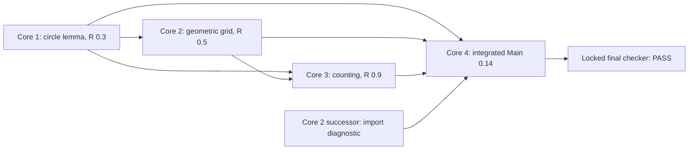

# EXP-20261115-08: One-hour maximum continuous-Core behavioral acceptance

Status: PASS (all four behavioral criteria; early trusted Mission acceptance)
Approved GitHub Issue: [#122 latest acceptance decision](https://github.com/LuNa-shi/SwarmEnv/issues/122#issuecomment-6896946332), [continuous Core loop and startup staggering](https://github.com/LuNa-shi/SwarmEnv/issues/122#issuecomment-6896808817).
Implementation: `77f716c`; independent Spec and Standards reviews passed, including the startup-after-stop race and per-wait cancellation cleanup. Final full tests passed before launch: 614 total, 605 PASS, 9 SKIP, 0 FAIL. Documentation generation/check and diff checks also passed.
Preceding evidence: [EXP-06](EXP-20261115-06-single-problem-30m.md) accepted its Mission in 462,488 ms under the previous prompt/runtime; [EXP-07](EXP-20261115-07-single-problem-2h.md) was interrupted after a final-check timeout and no-work quiescence. Neither validates this revised continuous-Core implementation.

## Setup

This is a natural-model run on the same authorized single problem. Each Core owns a sequence of finite Bots. A replacement prefers suitable existing work; an unfinished Mission with no suitable Task requires useful gap discovery and proposal, followed by take and execution. An empty queue or all existing Tasks being done cannot permanently park the Core. Real selection/lifetime expiry allows cleanup and bounded rediscovery. The Runtime does not invent Tasks. The first Bot on each Core is staggered by one minute; replacements do not repeat that stagger. No server-side semantic deduplication was added.

| Item | Fixed value |
|---|---|
| Source | Runtime `77f716c`; exact clean launch commit recorded in private metadata. Registration-only changes do not alter runtime. |
| Agent image | `swarmenv/agent:issue122-continuous-77f716c`; `sha256:7279b7649251f820e95c0a9977fc6ff94bc454d1cf11f263298aaf98be266e71`; Pi 1.3.0 |
| Problem | Only `putnam_2025_b1`; PutnamBench `a635813f5edf297d928f9bd5ef8324a26bdde09c`; input SHA256 `80d035ae3e86493d3a09f8acc39601e6dba4e380e217c085c491e202b7ced6c7` |
| Checker | Lean 4.33.1; Mathlib `0df444a360eaa60ab8c11dca51a86af692955474`; comparator `3927ad383f208ae977c340a91c48ac9b497d2097`; exporter `15f6055e299ad5b89345e533cc2192f4cc00f659` |
| Artifact lock | `4286e094c584f324873da37a04ab452946619489f2694f4c3fb15d9da79d7c0a`; checker implementation, fixture, dependencies and resource caps unchanged from EXP-06/07 |
| Provider/model | Real `gpt_proxy/gpt-6.1-sol`, host-held upstream credentials, revocable per-Bot gateway tokens; no scripted model replies |
| Prompt identity | Manifest `834274b44467635a6a9a770084e0822f369ccfa9586d5f642fa8e244e7a21a82`; system `304c03fb6c5e7e5e53980adf1b2977ae57f7d51215cf6412733f9b8d71ddff90`; plan-task `c369dce0c2f77d597d4f199c6b767c57ac4cea2b9b7bb5fdd069b7f8e77ef695`; CLI `419c6f9823975f16330aa1f82f2f0c5a2904bbe38aea3d94d2706ac1c878d7ba` |
| Concurrency/time | 4 independent Cores, 1 project; Mission maximum 3,600,000 ms including setup; first discovery offsets 0/60/120/180 seconds from orchestration start; Bot/Execution maximum 1,800,000 ms; selection/turn setting 180,000 ms; shared cleanup grace 30,000 ms |
| Model bounds | Time-bounded gateway, request hard limit 180,000 ms intersected with lifecycle limits; output request cap 32,768 tokens; currency cost unknown, no substituted local estimate |
| Isolation | OpenSandbox release-1.2.0, local Docker allowlist, per-Bot 100,663,296 bytes / 8,192 inodes writable; coordination permission only `mission_submit` |
| Judge bounds | 20 ordinary admissions / 2 simultaneous; 4 final admissions / 1 simultaneous; checker absolute 120,000 ms; zero retries of the same snapshot after final infrastructure failure. A timeout is not scientific FAIL. These limits are unchanged. |
| Checker process | systemd user cgroup: 4 GiB RAM, zero swap, max 64 tasks, 200% CPU, 1 s termination grace |
| Deployment config | Nonsecret private overlay SHA256 `eee79495a2e8e955ca79320421506011a66ce142efac3f90845075666cf36ee4`; unchanged locked 12-problem catalog selected with `--problem` |
| Evidence | Ignored `experiments/EXP-20261115-08/` and `reports/EXP-20261115-08/`; automated and independent content/lifecycle analysis under local `analysis/` |

Invocation uses verified private `DEPLOYMENT_CONFIG` and `PUTNAMBENCH_ROOT`:

```sh
SWARMENV_SANDBOX_ENABLED=true \
SWARMENV_SANDBOX_PROVIDER=opensandbox \
SWARMENV_SANDBOX_IMAGE=swarmenv/agent:issue122-continuous-77f716c \
SWARMENV_OPENSANDBOX_URL=http://127.0.0.1:8080 \
SWARMENV_OPENSANDBOX_ENDPOINT_HOST=127.0.0.1 \
SWARMENV_BRIDGE_HOST=172.17.0.1 \
SWARMENV_BRIDGE_PUBLIC_URL='http://172.17.0.1:{port}' \
node scripts/run-putnambench-benchmark.mjs \
  --problems "$DEPLOYMENT_CONFIG" --putnambench-root "$PUTNAMBENCH_ROOT" \
  --problem putnam_2025_b1 --cores 4 --project-parallelism 1 \
  --timebox-ms 3600000 --initial-bot-stagger-ms 60000 \
  --bot-max-ms 1800000 --selection-timeout-ms 180000 \
  --execution-timeout-ms 1800000 --turn-timeout-ms 180000 \
  --provider gpt_proxy --model gpt-6.1-sol \
  --observability-metadata experiments/.observability/time-bounded-server.json \
  --experiment-dir experiments/EXP-20261115-08 --report-dir reports/EXP-20261115-08
```

Stop at trusted Mission acceptance or the run deadline, then bounded cleanup. Stop and diagnose a systemic authorization, transport or lifecycle failure. Ordinary source rejection and a properly bounded final-check timeout are distinct from systemic failure; inspect subsequent autonomous work within the unchanged policy. Do not change a running experiment's limits or inject operator-authored Tasks to make it pass.

## Results

单项目 Putnam 2025 B1，四 Core，运行启动提交 `2d02d43`，Runtime `77f716c`。项目正式时钟从 15:41:47.809 到 15:52:53.487 UTC，共 **665,678 ms（11 分 05.678 秒）**。本轮配置一小时上限，独立最终验收已通过，按设计提前停止。首次 Bot 注册偏移约 0、60、120、180 秒，后继没有重新等待首次启动间隔。初始 Task 0，8 个 Task 均由已注册 Bot 提出并全部 DONE，8 个 E 都有已受理并关闭的 finish，12 个 Bot 均 CLOSED。7 个 E 由提案 Bot 自己接手，1 个由独立后继接手。

Core4 的 `integrated-mission-014` 固定公共主版 **0.14**，15:50:48.112 发起，15:52:42.614 获独立 `lean-final-tree` PASS，结果 `treecheck:c6945aa4`。提交已有最终回执，无待释放冻结或待停止工作。报告记录 `protocol_valid=true`、`solved=true`、`ended_early=true`、`deadline_reached=false`、`cleanup_errors=[]`。源文件 Judge 记录含 11 PASS、3 源失败，0 基础设施失败，独立最终 checker 仅实际受理 1 次。8 份 Material，16 条带具体影响的确切版本使用记录。

| Core 与 Bot | Task、实际操作和交付 | 结束状态与判断 |
| --- | --- | --- |
| 1 · `1af6d4dc` | 自提自接 `7d2df8f5`，证明圆周上三个互异点不能全与中心异色。固定起点 0.1，两次源检查中由失败修到 PASS；交付 0.3，合入为 0.6，发布 `e48453b9@1`。 | DONE。先产生了可复用的数学接口，网格、计数和整合都实际使用。 |
| 2 · `c287c250` | 读首个 Task 后另提并领取 `234be5cc`，限定为双圆心 5×5 交点网格。由 0.1 保存 0.4、修到 0.5 PASS，再将 0.5 与 0.6 合成 0.7。消费圆周引理，明确将其用于交接中的行列单射论证，发布 `f7f7fe06@1`。 | DONE。一次 finish 将未建立 Task link 的 Material 一并提交被拒，改用检查和修订回执完成。 |
| 3 · `39bc51f1` | 自提自接 `591943b8`，聚焦布尔矩阵计数矛盾。固定起点 0.6，消费两份几何 Material 后，把半径和行列单射接口接入条件包装。0.9 源检查通过，合并到 0.11，发布 `539adb74@1`。 | DONE。有限计数与几何证明互补，生成了后续直接调用的条件包装。 |
| 4 · `b4f3a9c1` | 查阅已有三项分工，自提自接 `fa2b8705`。以 0.6 take，apply 公共版本，采用源检查可用的内联路线，逐项摄入两条几何引理、计数包装和受控导入试验结论。0.12 开始保存整合树，纳入公共 0.11 并通过 0.13 合到 0.14，发布 `e3e7bd46@1` 并送交固定树验收。 | DONE。真正将不同 Bot 的代码组合成目标证明。最终通过后持久 finish 在 15:52:52.442 受理，Bridge 一条晚回执为 NOT_ALLOWED，E 最终正常关闭。 |
| 1 · `02c59afd` | 轮替后读公开 Task、Material、Workspace。新提 `e3ad61c1`，目标是核对锁定声明和真实最终验收证据。本 Bot 没有生成 E，提案仍由后继发现。 | 触及 180 秒选工硬界，15:48:33.374 关闭。5.026 秒后同 Core 新 Bot 注册。它交付的是一个公开 Task。 |
| 2 · `d9f94bac` | 自提自接 `effcaf2d`。在 0.7 基础上重用两条公开几何引理，受控比较 Workspace 局部 import 与内联版。0.10 内联版通过，局部 module import 在该单文件检查环境无法解析，发布 `1b2de6a4@1`。 | DONE。它改变了 Core4 的实际打包选择；结论限于当轮检查环境。 |
| 3 · `1bb7b38c` | 自提自接 `79dac7bb`，消费三份已有交接，拿公开修订与整合树比较三段 helper 的来源，记录六个 private 修饰符及包装差异，发布 `5a7c2f67@1`。 | DONE。独立溯源审计完成。未观察到它继续改变此轮证明树。 |
| 2 · `0b23d3a7` | 自提自接 `2e9fd232`，检查 0.14 内联完成后的辅助文件布局和 import 边，复用导入探针以避免重复通路实验。两次 CHECKER_BUSY 后继续，四文件各自检查通过，发布 `253431da@1`。 | DONE。确认辅助文件可留在最终树。其检查不替代独立最终评审。 |
| 1 · `6ae3bc27` | 先读现有 `e3ad61c1` 及 Core4 整合 Task，接手前任提案，不重开 Task。固定 0.11 输入，跟踪后续 0.14，消费计数交接、导入诊断和整合交付。核对目标声明、源检查与最终冻结身份，发布 `30d1cacb@1`，注明当时最终验收仍 pending。 | DONE。实际证明既有 Task 优先路线和终止后接续。审计提出的状态判断与当时服务一致。 |
| 3 · `6a3e6c39` | 15:51:09 注册，读已有 Tasks、数份发布材料、公共源码和 diff；整合 E 与 checker 尚在推进。未提 Task 或 take。 | 15:52:53 终局关闭。少于 180 秒选工预算，无永久等待证据。 |
| 1 · `cde58bf0` | 15:51:37 注册，检查文件和公开 Task/Material，重新阅读相关三个 Task 与当前公共源。未提 Task 或 take。 | 15:52:53 终局关闭，未过选工预算。 |
| 2 · `3d9f40db` | 15:52:05 注册，两轮检查 Task、Material 和公共 Workspace，仍在检查前任交付时得到最终接受。未提 Task 或 take。 | 15:52:53 终局关闭，未过选工预算。 |

The accepted Workspace commit is `bb6d9da9df921c1b5dbe6326e3240006737b186c`, Git tree `5ba31c8204cf50ec5cc3f4b5fb716c87103aee1f`; independent final result `treecheck:c6945aa4-a53e-4b93-a868-3864b76234b7`. The authoritative accepted record and actual public Git main agree. Final checking took 114.502 s under the unchanged 120 s bound.

Gateway usage: 196 admitted requests, 194 with terminal usage, two unknown and zero pending. Observed input 4,580,476 tokens, output 40,784 tokens; actual currency cost unknown. Both unknown requests were in selection: one canceled at the actual selection deadline, one during accepted-Mission closeout. All 109 work requests completed with usage. No unknown usage was filled as zero. The ordinary Judge database records 14 checks (11 PASS, 3 source FAIL); generic `check_count=0` in the project report is not the authoritative count for this Workspace-check path.

Independent provider checks confirmed all 12 scoped Sandbox IDs returned HTTP 404. Cleanup took 1,033 ms with no errors. Bot, Task, Execution and finish-intent states all reached their stated terminal outcomes. The late finish tool response does not overwrite its earlier durable accepted receipt; the shipped finish skill documents that the Bot process may close before the full response arrives.



## Analysis

- **稳定推进通过。** 按持久 E 的启动至 finish 受理时间计算，15:50:00.431 至 15:51:08.567 四个不同 Core 同时运行 E，共 68,136 ms。若把收尾阶段也计入，则到首条 E 于 15:51:09.109 关闭，共 68,678 ms。报告中的 213,052 ms 统计所有四 Core 处于 Agent turn 的窗口，包含尚未 take 的发现阶段。首批四个 Bot 确实各自提案并接手，Core1 的首条 E 已于 Core4 的首条 E 启动之前结束。首轮之外的真实选工超时只涉及 `02c59afd`，其任务已独立被取走，循环继续推进。三条终局无 E Bot 的退出标签为 `benchmark_deadline_cleanup`，但主报告显示独立验收导致提前停止，实际一小时 deadline 未触达。两条模型调用记录为 `transport_interrupted` 且 usage 未知，未发现持续中断。两个 CHECKER_BUSY 在源诊断路径正常恢复。
- **有效分工通过。** 前三个 Bot 的责任分别是几何例外界、网格存在性、有限计数矛盾，第四个接整合。此顺序让后启 Bot 能看见先启责任。后续有针对性的工具行为试验、来源审查和最终证据审查。最晚阶段两类审查的价值是证据审计，未观察到它们改变最终数学结果。末三 Bot 在一项真实最终验收正在运行的短窗口内查公开状态，本轮没有测到最终 checker 超时后是否主动另开有效 Task。
- **下游实际接续通过。** Git 父节点链显示先合 0.3 到 0.6，再以 0.5、0.6 合 0.7，以 0.7、0.9 合 0.11，最终将原始几何和计数、组合证明汇于 0.14。Core4 的确切版本消费记录和公开当前树用途相吻合。Core2 后继确定局部导入的限制，Core4 采用内联而非另立局部模块。Core1 从已结束且未 take 的身份接走审计 Task。保留了公开内容与新 E 的接续证据。
- **Mission 通过。** 已锁定的独立 checker 只对一份固定的 0.14 提交运行，结果 PASS 后写入 accepted，收尾完毕。此前的 source FAIL 和 PASS 都是诊断证据。本轮验证的是在一小时预算内完成并停机。持续满一小时和无最终 PASS 时整小时的重复选工均未实测。
- **交付操作仍有一个可修正的提示缺口。** Core2 的错误原因是 `task.complete can reference only linked Materials`。实际 finish skill 教 publish、核对、finish，未明确自动 producer provenance 与 Task link 的区别，也没有链接后声明 Material 的例子。它在下一次 finish 中保留 0.5 和 checker 回执，省略材料列表，任务正常完成，公开产物本身没有丢失。

## Next steps

The two independent observers judged this fixed run PASS on stable useful progress, differentiated responsibility, concrete continuation and trusted Mission acceptance. This evidence supports the owner’s latest behavioral acceptance decision. It does not establish population-level improvement, guarantee absence of semantic duplicates, or cover one-hour continuous load. The run ended early under the approved success stop rule; there was no reason to keep spending after acceptance.

[Issue #127](https://github.com/LuNa-shi/SwarmEnv/issues/127) records the recoverable Material-link guidance/terminology gap. [Issue #125](https://github.com/LuNa-shi/SwarmEnv/issues/125) retains previously unexercised provider fault variants. The final checker passed with about 5.5 s of remaining time; its timeout and retry policy were not changed. A different proof can still time out, as EXP-07 demonstrated. Any proposal to change that policy remains separate from this result.

## Evidence and limitations

The repository analyzer completed with exit 0, full local evidence, eight Executions and zero warnings. Local `analysis/experiment-analysis.md`, `analysis/bot-observation.md` and `analysis/system-observation.md` contain the automated, semantic and system reconstructions. Private metadata fixes clean launch commit `2d02d43`, runtime/image identity and pre-launch review/test evidence. Actual sent messages, exact Workspace versions, durable receipts, provider resource absence and separate Judge state support the observations.

Raw conversations, reasoning, proof source, credentials, stdout/stderr and private databases remain ignored local evidence. No raw proof or conversation is published here. Unknown upstream billing remains unknown. Selection, productive execution and cleanup are different intervals. Four active Agent turns for 213.052 s includes discovery; four productive E intervals overlap for 68.136 s, or 68.678 s including closeout ownership. This natural run did not exercise recovery after a final-check timeout or untriggered fault variants. Controlled regressions cover the relevant quiet-queue and startup-stop cases without being relabeled natural-model evidence.
