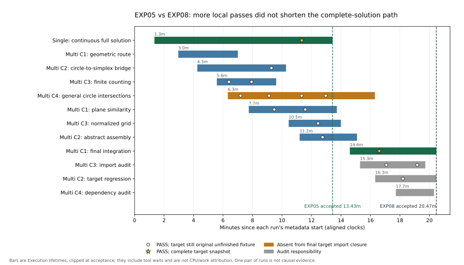

# EXP05 / EXP08 trajectory comparison: why the single solver finished sooner

Retrospective analysis of existing evidence, requested by the owner after EXP08. No new model run, research condition, checker change or implementation requirement is introduced.

Parent context: [Issue #130](https://github.com/LuNa-shi/SwarmEnv/issues/130) and the independent baseline's [Issue #129](https://github.com/LuNa-shi/SwarmEnv/issues/129). Primary reports: [EXP05, fixed baseline report](https://github.com/LuNa-shi/SwarmEnv/blob/56ae6722d9a83826e17bb904bc2f7c258eeeca08/docs/experiments/EXP-20261116-05-pass-k-1-1h.md), [EXP08](EXP-20261116-08-judge-queue-1h.md). [EXP07](EXP-20261116-07-centralized-judge-1h.md) supplies historical context; EXP08 is the main comparison because it has no ordinary quota rejection or upstream HTTP failure burst.

## Setup

Reconstruct observable tool actions, immutable source snapshots, Task/Execution intervals, Material use, Bridge receipts and trusted final acceptance. Keep private model reasoning outside the analysis. EXP05 used runtime `2edb9b0` / clean launch `f1cde74`; EXP08 used runtime `1c2d5d5` / clean launch `0cfca57`. Both solved the same original B1 theorem with the pinned Lean/Mathlib and trusted final theorem/axiom/kernel acceptance path.

The conditions are not identical. EXP05 has one host-created complete-solution Task, one continuous solver, a short solver contract, no Task/Material permissions, zero startup stagger and coordinated services. EXP08 has autonomous bounded-Task discovery, replacement Bots with fresh contexts, four staggered Cores, independent services, and a larger operating contract. EXP05's post-acceptance lifecycle defect makes its protocol invalid; its durable mathematical acceptance still supports the latency comparison. This is one successful sample per condition, not a controlled causal experiment.

## Results

**The single solver reached acceptance in 13m25.609s; Swarm took 20m28.100s, 7m02.491s longer.** The gap is not explained by a Judge queue: EXP08 queued zero ordinary requests and its peak active checks was three. All 289 model HTTP responses were 200.

| Nonoverlapping interval | EXP05 single | EXP08 multi | Extra time in multi |
|---|---:|---:|---:|
| Metadata start → first Execution | 80.892 s | 177.890 s | 96.998 s |
| First Execution → accepted main merge receipt | 621.825 s | 881.419 s | 259.594 s |
| Merge receipt → final submission | 0.085 s | 16.920 s | 16.835 s |
| Final submission → trusted acceptance | 102.807 s | 151.871 s | 49.064 s |
| **Total** | **805.609 s** | **1,228.100 s** | **422.491 s** |

About 61% of the observed gap falls in proof construction/checking/integration, 23% before the first Execution, 12% in final verification and 4% between merge and submission. This is time accounting, **not** attribution of 61% to pure coordination waste: the construction interval contains necessary mathematics, model processing and checker waits too.

The figure aligns metadata starts. Bars are Execution lifetimes, including tool waits, clipped at acceptance. White circles are ordinary PASS receipts whose target file still matches the original unfinished fixture. Stars identify the checked complete-target snapshots; the post-acceptance audit PASS is outside the figure. Bar overlap does not mean independent proof progress.

| Observable amount | Single | Multi |
|---|---:|---:|
| Tasks / Executions / Bots | 1 / 1 / 1 | 11 / 11 / 13 |
| Model requests | 44 | 289 |
| Recorded input tokens | 1,150,502 | 8,744,105 |
| Recorded output tokens | 11,378 | 59,020 |
| Ordinary durable checks | 10 | 33 |
| Ordinary PASS | 1 | 16 |
| Saves / merge calls | 9 / 1 | 40 / 12 |
| Task-list / Task-detail calls | 0 / 0 | 45 / 31 |
| Material-list / exact Material reads | 0 / 0 | 19 / 21 |
| Service-metadata calls | 0 | 21 |
| Native Bash calls containing `--help` | 3 | 38 |
| Mathlib searches | 11 | 11 |

Input token totals count repeated context and do not measure unique information or currency cost. The request count is about 6.6 times larger; input tokens about 7.6 times and output tokens about 5.2 times. These differences demonstrate extra total work, not an additive wall-time penalty. Native tools and Bridge calls are different layers and must not be summed as one call count.

## Analysis

### 1. Most PASS receipts were not complete-solution milestones

The exact original target SHA256 is `80d035ae3e86493d3a09f8acc39601e6dba4e380e217c085c491e202b7ced6c7`. Reading that file from each checked immutable Git commit establishes:

- **14 of EXP08's 16 PASS snapshots still contain that exact original target**, whose proof is unfinished. This is a byte-identity finding, not a guess from a filename or a raw-text comment match.
- Eleven PASS receipts concern helper work; three additional PASS receipts concern audit branches that still have the old target. Project diagnostics may compile an unfinished target with a warning so that useful intermediate modules can be developed. Receipts explicitly carry `mathematical_outcome=unassessed`; their `checked_paths` may include the target without establishing its proof.
- The first complete-target PASS is `70810f9e` on revision `0.39`, completed at **09:47:35.361**, **16m35.755s after startup**. Do not confuse its request start at 09:46:57.038 with its completed PASS.
- The other complete-target ordinary PASS, `1dc23828` on `0.47`, completed at **09:51:59.065**, after trusted acceptance at 09:51:27.706. It cannot explain reaching acceptance earlier.

By comparison, the single solver's only ordinary PASS, `b3350333` on `0.10`, directly checks the completed target at **07:14:32.942**, **11m20.354s after startup**. Acceptance follows 2m05.255s later. EXP08's completed-target PASS is followed by 3m52.345s of merge, submission and final verification.

PASS count therefore substantially overstates apparent end-to-end progress in this comparison. The helper receipts are valid for their stated scope; the missing connection is from those scopes to a current, integrated complete theorem. Three late audit PASS snapshots still contained the original target even while a different branch had already completed it.

### 2. The proof idea was similar; the multi-Agent route did more general construction

Both accepted sources use a finite five-by-five grid and a counting contradiction constrained by monochromatic circumcenters. The baseline did not skip the final verification or solve an easier target. It kept the coordinate construction, circle reasoning, finite counts and final theorem in one file and one continuous context.

The single accepted project has one Lean file, 162 lines. EXP08 has eight Lean files, 571 lines; seven files/421 lines are in the final target's transitive local import closure. Line counts are descriptive, not an efficiency score. They do show that parallel work produced a larger implementation rather than simply dividing the same fixed amount of work.

The clearest excess branch is **CircleIntersections** (Task `2fb037a9`, Execution `ed6293ed`):

- It ran **09:37:19.214–09:47:17.641**, about 9m58s, and obtained **four ordinary PASS** receipts.
- Its Bot used **41 model requests**, 1,402,020 input tokens and 10,968 output tokens. The entire single-solver attempt used 44 requests and 11,378 output tokens.
- It developed general two-circle intersection results and an alternative grid construction. The final target's formal import closure does not use this module.
- Stronger than merely inspecting imports: the final integrator's `0.39` already has a complete-target PASS **without CircleIntersections present**. Its tree differs from accepted main only by the later inclusion of CircleIntersections and its interface note. The selected final proof did not require this module.
- The NormalizedGrid Execution's observed tool actions use the geometric route Material and directly construct fixed finite coordinates; no read/import of CircleIntersections was observed in that work window.

This does not prove the exploration had zero conceptual or future value. Nor can its ten minutes simply be subtracted from wall time: it ran in parallel. It does establish a substantial branch of formal work that was not needed by the chosen final proof, still occupied a Core, participated in merges and remained in the whole-project builds.

### 3. Responsibility boundaries created a staged path and context transitions

The main construction was not four independent complete solutions racing. It was a pipeline of bounded contributions:

- Core 1: geometric route, 09:33:57–09:37:59; new Bot for PlaneSimilarity, 09:38:44–09:44:42; another new Bot for final integration, starting **09:45:35**.
- Core 3: finite counting, then NormalizedGrid starting 09:41:26; its checked grid passes at 09:43:26 and merges at 09:44:30.
- Core 2: CircleBridge, then AbstractGrid starting 09:42:11; its module passes at 09:43:44 but reaches main only at 09:45:32 after merge retries.

**The dedicated final-integration Execution starts 14m36.098s after metadata start—after the single solver has already reached trusted acceptance at 13m25.609s.** This is a directly observed late integration point. Useful reasoning may exist earlier in Materials; the comparison does not assert that nobody considered the final theorem before then.

There are seven same-Core transitions from a predecessor's terminal Execution row to the next Execution activation: **44.433, 52.842, 55.375, 73.902, 50.863, 77.880 and 85.431 seconds**. They include replacement startup, selection, context acquisition and preparation, not just an HTTP dispatch. They overlap across Cores and are not additive wall time. Core 1 alone has two gaps totaling 97.275 seconds; even that is not a guaranteed saving if removed, because other prerequisites may still be unfinished.

The contracts help explain the observed behavior. The solver is instructed to continue the full solution to acceptance. The Swarm contract emphasizes a bounded local contribution; a Bot may take one Task, finish ends the Bot, and successors inherit public artifacts rather than the private session. Consequently, a locally successful handoff can end the context that would otherwise continue the solution. The direct evidence is repeated discovery, help/contract reads, new task selection and explicit public-artifact acquisition—not inferred hidden reasoning.

### 4. Compilation success did not eliminate interface and publication work

The independently developed CircleBridge and PlaneSimilarity modules each declared the shared `Plane` name. Both could pass separately; their combined import path failed. The final integrator and an independent import auditor then repaired the overlapping interface problem separately. Audit revision `0.38` fails, `0.40` passes, but `0.40` and later audit `0.44` are not ancestors of the accepted main. The accepted final-integration revision already contains the necessary repair.

Merge contention is also concrete. AbstractGrid's first PASS completes **09:43:44.550**. Its merge attempts at 09:43:52 and 09:44:20 are rejected after main advances; the third succeeds at **09:45:32.261**. That is **1m47.711s from PASS to main** for this prerequisite, although other useful work overlaps the interval. Across the run there are four `MAIN_MOVED` failures and one merge rejected by the submission freeze; safety guards worked as designed.

This means “helper done” leaves several steps: publish the exact usable interface, bring the desired source revision into the consumer's working tree, resolve combined imports, check the merged tree, win main's conditional publication and finally submit it. Increasing ordinary checker concurrency does not remove those steps.

### 5. Audit work and checking cost continued around the final submission

Three later responsibilities are import compatibility, target regression and source-dependency documentation. Their Bots account for **63 model requests** in total, including selection. Some review can be valuable; the data does not label all of it waste. However, the source-dependency report is not a formal dependency of the accepted theorem, and the target audit's final PASS arrives after acceptance. Neither should be counted as progress that shortened this particular acceptance time.

There are **36 model requests starting after final submission**, with 35 recorded-usage requests totaling 1,411,682 input and 6,674 output tokens; the remaining request is the known post-acceptance cancellation with unknown usage. This is work during final checking, not automatically extra delay. Resource contention is possible but not established by these traces.

Final verification itself takes 151.871s versus 102.807s in the baseline. Ordinary checks and merge checks also build increasingly large immutable projects, including the non-imported module. The size and concurrent workload are plausible contributors; no replay experiment isolated their individual effects. Zero Judge queue time does not mean zero compiler or verification time.

## Next steps

The evidence supports the owner's suspicion that task decomposition introduced overhead. More precisely, it changed the work into a larger staged solution with generalization, unused formal branches, fresh-context handoffs and integration repair. It does **not** support attributing the entire seven-minute gap to messaging or asserting that multiple Agents are generally slower.

The following are proposals for owner selection, **not approved changes or a new experiment allowance**:

1. Preserve one continuous end-to-end solution owner through the first complete-target check and submission; give other Bots narrowly scoped, actively requested prerequisites or independent alternatives. A Core label alone does not preserve context.
2. Establish a minimal shared interface before helper implementation: common types/names, expected lemma signatures, and a skeleton that imports them together. Observe the earliest integrated target milestone, not the number of isolated PASS receipts.
3. Reassess exploratory branches when a different construction suffices. Deliver the smallest lemma needed by the current proof before expanding a reusable general library. Do not require unused research files to be merged merely to declare local completion.
4. Separate acceptance-critical checks from optional audits/documentation. Audit the exact current candidate or frozen submission; a PASS on an older unfinished branch is not verification of the final proof.
5. If a performance follow-up is selected, control model/provider, prompt goal, startup/stagger and final verifier, then compare persistent ownership plus helpers against the existing policy over more than one attempt. The present observations identify hypotheses and concrete failure modes, not a measured guaranteed speedup.

## Evidence and limitations

Private reproducible extraction: EXP08 `analysis/compare-trajectories.py` → `analysis/trajectory-comparison.json`; figure generator `analysis/plot-trajectories.py`. These read both pinned runs without changing them. Primary evidence is each run's metadata, Tasks/Executions/Bots, Judge receipts, model-attempt rows, immutable Workspace Git commits and canonical `rpc_record` tool events (not the duplicate stdout stream). Helper/target classifications are backed by exact original-file hashes and accepted-source imports; merge timing uses Bridge completion receipts.

No raw conversations, proof source, credentials or private absolute paths are included in this report or figure. Ordinary PASS, original-target hash equality, actual import use and final trusted acceptance are separate facts. Same-Core gaps and parallel branch durations cannot be summed into wall-time savings. Prompt/permission/deployment differences and single-sample model variation remain important confounders. No new paid run or product behavior change was made for this analysis.
