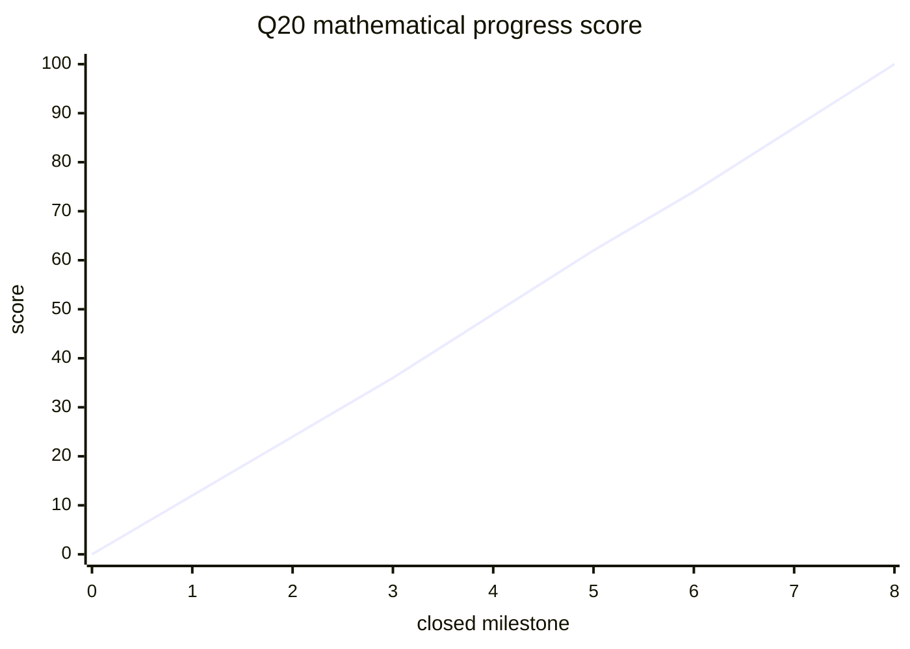

# Q20 progress score proposal

## Scoring rule

The score follows the mathematical dependency chain of
`FreyPackage.frey_reducible_hasCofixedLine`. It does not follow the order in
which an experiment happened to generate files. Each milestone earns its
points only after the corresponding Lean conclusion passes the Judge and is
present in the experiment's main Workspace.

| Stage | Required mathematical conclusion | Canonical proof anchor | Points |
|---|---|---|---:|
| M1 | The Frey curve is elliptic because its discriminant is nonzero | `freyCurve_discriminant` | 12 |
| M2 | The p-torsion module is finite, has cardinality `p²`, and is nontrivial | `card_torsion_of_isAlgClosed` | 12 |
| M3 | Reducibility yields a nonzero proper Galois-stable submodule `N` | `GaloisRepIsIrreducible` unfolded at the target | 12 |
| M4 | Local inertia control proves that the action is trivial on `N` or on the quotient, including the `p` and `2` cases | `frey_inertia_at_p_trivial_on_submodule_or_quotient` and the `2`-adic case | 13 |
| M5 | The local control transfers to a global fixed-or-cofixed alternative | `frey_stable_submodule_fixed_or_cofixed` | 13 |
| M6 | A fixed branch supplies a fixed nonzero p-torsion point | `Submodule.ne_bot_iff` plus the fixed branch | 12 |
| M7 | Every Galois-fixed p-torsion point on the Frey curve is zero | `frey_torsion_fixed_eq_zero` | 13 |
| M8 | The remaining branch is a Galois-stable cofixed line for the target | `frey_reducible_hasCofixedLine` | 13 |

The weights sum to 100 and stay between 12 and 13 points. The score gap
between adjacent mathematical milestones is therefore small and fixed before
an experiment is evaluated.

An alternative proof route may replace a canonical theorem, but it must close
the same mathematical conclusion in the table. Several helper lemmas proving
the same conclusion count once. A saved candidate without main integration
earns zero points until the exact statement is integrated and rechecked.

## Mathematical score curve

The curve is the cumulative score after each required conclusion closes.

| Closed milestones | Score |
|---:|---:|
| 0 | 0 |
| M1 | 12 |
| M1–M2 | 24 |
| M1–M3 | 36 |
| M1–M4 | 49 |
| M1–M5 | 62 |
| M1–M6 | 74 |
| M1–M7 | 87 |
| M1–M8 | 100 |

For each run, the evaluator projects the evidence at time `t` onto this fixed
curve. A run that ends before a milestone is observed keeps that milestone
open. The score is independent of Task count, Material count, helper-file
count, model-token count, or the order in which Agents explored the proof.

## Current Q20 runs

Both existing Q20 runs finish with M8 open because the target was not accepted.
Their exact intermediate score requires replaying the exact statement hashes
and main revisions against this milestone table. The reports remain useful as
evidence sources, but their activity totals do not determine a score.

The one-hour and eight-hour reports are diagnostic comparisons. The eight-hour
run changed duration-linked execution and checker budgets, so this curve does
not estimate a duration-only causal effect.

The machine-readable mathematical curve is stored in
[q20-score-curve.csv](q20-score-curve.csv).
