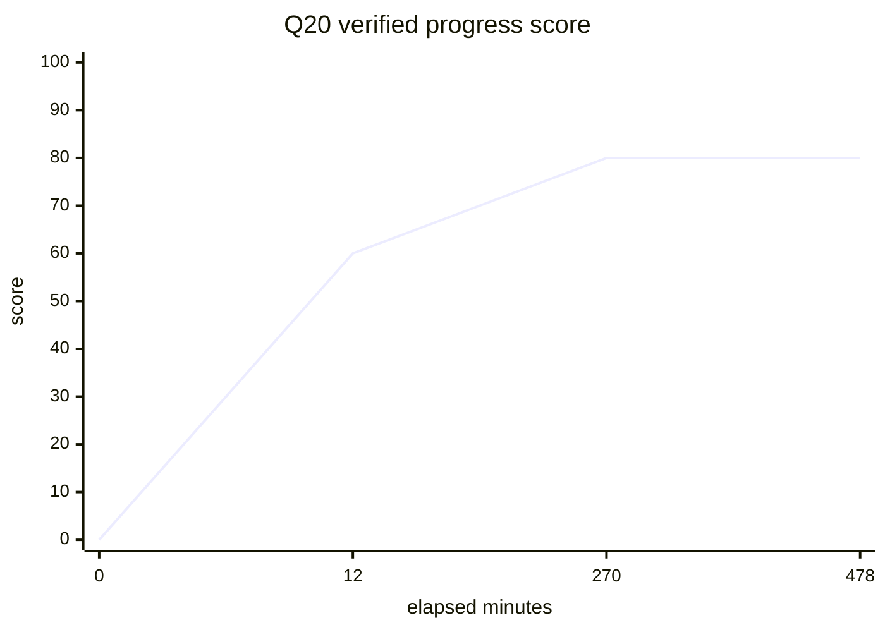

# Q20 progress score proposal

## Score

Q20 receives 100 points through five proof milestones. A milestone earns its points only when the corresponding Lean statement has a Judge PASS, no forbidden placeholder, and is present in the experiment's main Workspace.

| Stage | Proof milestone | Points |
|---|---|---:|
| 1 | Frey curve non-singularity and elliptic setup are proved | 20 |
| 2 | Reducibility is converted into a proper stable-submodule or cofixed-interface obligation | 20 |
| 3 | The required p-torsion finiteness and non-triviality obligations are proved | 20 |
| 4 | The general cofixed arithmetic endpoint is proved and integrated into main | 20 |
| 5 | `FLT10Bench.q20_frey_reducible_hasCofixedLine` is submitted and trusted-accepted | 20 |

The score is cumulative. A saved candidate that has not entered main contributes zero points. A local Judge PASS contributes evidence for later review, but does not move the main score. A theorem that only supports an unfinished milestone is recorded under that milestone and is not counted again.

## Retrospective curve

The 8-hour run provides the clearest milestone timestamps. Its Mission began at 02:50:06 UTC. The first three milestones were integrated during the first 12 minutes. The cofixed endpoint was integrated at 07:20:35 UTC, about 270 minutes into the Mission. The target remained unaccepted at the end of the 478-minute research window.

| Elapsed time | Score | Evidence |
|---:|---:|---|
| 0 min | 0 | Fresh Q20 Mission |
| 12 min | 60 | `FreyNonsingular`, `Reduction`/`CofixedCriterion`, and `TorsionNontrivial` were checked and integrated. [Bot audit B001–B036](EXP-20261117-03-bots-b001-b036.md) |
| 270 min | 80 | `AbsoluteCofixedEndpoint` reached main at 07:20:35 UTC. [Bot audit B073–B108](EXP-20261117-03-bots-b073-b108.md) |
| 478 min | 80 | Q20 target remained open and no Mission submission was accepted. [EXP-20261117-03 report](EXP-20261117-03-q20-subtree-8h.md) |

The one-hour run ends at 40 points under the same coarse mapping. Its report confirms the discriminant/arithmetic foundation and checked reuse of a quotient-character/cofixed criterion. The report does not retain the exact milestone receipt for every stage, so this point is marked retrospective and provisional until the raw evidence is replayed.

| Run | Research window | End score | Root accepted |
|---|---:|---:|---|
| [`EXP-20261116-14`](EXP-20261116-14-q20-subtree-1h.md) | 1 h | 40 provisional | No |
| [`EXP-20261117-03`](EXP-20261117-03-q20-subtree-8h.md) | 8 h | 80 | No |

The two runs are diagnostic comparisons. Both original reports carry protocol-invalid findings. The 8-hour run also changed duration-linked execution and checker budgets, so the curve describes observed proof progress and does not estimate a duration-only causal effect.

## Score data

The machine-readable points are stored in [q20-score-curve.csv](q20-score-curve.csv).
