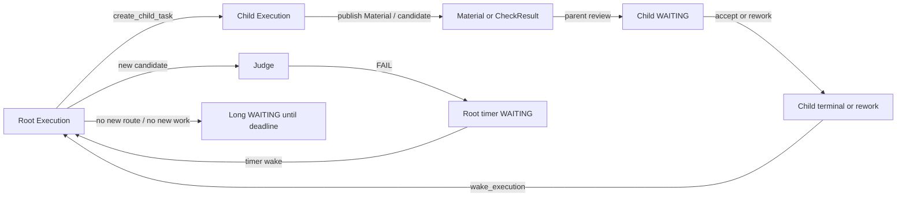

# 8 小时 PutnamBench Execution 展开分析

本报告分析 `issue-33-long-8h-20261022-b` 中三个完整结束的项目。报告只使用 Task/Execution/Material/CheckResult/operation/parallelism 事实，不导出 Agent transcript、候选源码或证明内容。

## 总体结论

三题都运行到约 8 小时 deadline，协议有效、heartbeat 正常、清理正常；但三个 Root 都没有 PASS。长 wait 主要不是单一的 wake 故障，而是三类行为叠加：

1. 正常的 `parent_review` / `child_task_terminal` wait，在 child 交付或终止后被唤醒；
2. Root 在失败后主动设置的短 timer wait，用于延迟下一次行动；
3. 后期没有新的可执行任务或路线，Root/Child 保持 WAITING，runner 继续维持实验直到 8 小时结束。此时等待是合法的生命周期状态，却没有被“无进展停滞”机制升级为可操作诊断。

三题的平均活跃 Core 只有 0.856–0.884，最大同时活跃 Core 为 2；大量 Core 时间落在 WAITING。系统稳定地保持责任，但没有把稳定运行转化为 Root verified progress。

## 可视化：状态闭环

## 项目一：putnam_2025_b1

Root Task `d148b4c3-e6ad-48b8-997f-50a0a6506c41`；Root Execution `33278bff-ad5e-49a6-b0f2-c8681521cabe`，owner `agent:core-2`。

### Execution 展开

| 时间 UTC | 事实 | Execution / Task | 结果 |
| --- | --- | --- | --- |
| 16:15:45 | Root claim/start | `33278...` / `d148...` | Root 开始执行 |
| 16:18:41 | 创建两个 research child | `73c1...`, `c942...` | 两个 child 并行进入队列 |
| 16:23:14–16:23:22 | Root candidate + Judge | Root | FAIL |
| 16:24:23 | Root wait | Root | 等待 `children_all_terminal` |
| 16:27:27 / 16:27:40 | 两 child wait | `4c05...`, `5d409...` | 等待 `parent_review` |
| 16:27:40 | Root wake | Root | child 条件满足 |
| 16:29:33 | accept 两 child | 两 child | 两个 child SATISFIED |
| 16:31:00 | 创建 research child | `2425...` | 新一轮研究 |
| 16:32:53 | Root wait | Root | 等待 `child_task_terminal` |
| 16:40:31 | child wait + Root wake | `955279...` / Root | child 等待 review，Root 被唤醒 |
| 16:43:40 | accept child | `2425...` | SATISFIED |
| 16:45:41 | Root timer wait | Root | deadline 16:55 |
| 16:55:00 | timer wake | Root | 继续执行 |
| 16:55:47 | 创建 research child | `1b3f...` | 新一轮研究 |
| 16:56:11 | Root wait | Root | 等待 child terminal |
| 17:00:15 | child wait + Root wake | `4ae249...` / Root | parent review |
| 17:01:40 | accept child | `1b3f...` | SATISFIED |
| 17:03:30–17:20:02 | Root timer waits/wakes | Root | 7 分钟、10 分钟 timer |
| 17:20:40 | 创建 research child | `17db...` | 新一轮研究 |
| 17:20:49 | Root wait | Root | 等待 child terminal |
| 17:35:10 | child wait + Root wake | `01ea...` / Root | parent review |
| 17:37:46 | accept child | `17db...` | SATISFIED |
| 17:39:22 | 创建最后 child | `c6bc...` | child 开始 |
| 17:39:35 | Root wait | Root | 等待 child terminal |
| 17:44:32 | child wait + Root wake | `ee24...` / Root | child 进入 parent review |
| 17:44:32 后 | 无新的 Root candidate 或 accept | Root | Root 没有继续形成可验证进展，等待到 deadline |

### 结果

- 6 个 child；5 个 SATISFIED，最后一个 child 为 WAITING/parent_review。
- Root 只有 1 次 candidate check，结果 FAIL。
- Root Workspace revision 21，但没有 PASS。
- Root 的 `children_all_terminal` 和 `child_task_terminal` wait 都能被唤醒，说明这部分不是 lost wake；问题是被唤醒后缺少持续有效的 Root 路线。
- 长 wait 的直接原因是最后 child 交付后没有形成新的 Root candidate/accept，系统继续保留 WAITING 责任直到 deadline。

## 项目二：putnam_2025_b4

Root Task `82859ddf-02c6-476c-b771-553d3a02f290`；Root Execution `bc86f190-ced2-47b7-aa4d-76e196f283eb`，owner `agent:core-4`。

### Execution 展开

| 时间 UTC | 事实 | Execution / Task | 结果 |
| --- | --- | --- | --- |
| 16:15:49 | Root claim/start | `bc86...` / `8285...` | Root 开始执行 |
| 16:21:14 | 创建 research child | `b4a8...` | child 开始 |
| 16:24:50–16:24:58 | Root candidate + Judge | Root | FAIL |
| 16:26:49 | Root wait | Root | 等待 child terminal |
| 16:31:38 | child candidate/check | `ceff...` / `b4a8...` | FAIL，CheckResult 为 RECEIVED |
| 16:34:33 | child wait + Root wake | child / Root | parent review |
| 16:39:13 | accept child | `b4a8...` | SATISFIED |
| 16:41:36 | 创建 proof child | `57e3...` | proof child 开始 |
| 16:41:53 | Root wait | Root | 等待 child terminal |
| 16:49:17–17:03:58 | child 连续提交 4 次 | `709838...` / `57e3...` | 4 次 FAIL |
| 16:52:08 | child wait + Root wake | child / Root | parent review |
| 16:54:36 | request_rework | `57e3...` | child 被要求重做 |
| 16:55:20 | Root wait | Root | 再次等待 child terminal |
| 16:59:28–17:03:58 | child 重做 | `709838...` | 3 次 FAIL |
| 17:04:52 | child wait + Root wake | child / Root | parent review |
| 17:06:21 | 创建 research child | `ba89...` | 并行/后续研究 |
| 17:08:56–17:09:05 | Root candidate + Judge | Root | FAIL |
| 17:10:01 | request_rework | `57e3...` | 再次重做 |
| 17:10:29 | Root wait | Root | 等待两个 child terminal |
| 17:11:36 | `ba89...` child wait | `5db9...` | parent review |
| 17:14:56–17:21:43 | `57e3...` child 再提交 2 次 | `709838...` | 2 次 FAIL |
| 17:18:26 | accept `ba89...` | `5db9...` | SATISFIED |
| 17:19:04 | request_rework | `57e3...` | 第三次 rework |
| 17:19:20 | Root wait | Root | 等待 `57e3...` terminal |
| 17:22:45 | child wait + Root wake | `709838...` / Root | parent review |
| 17:25:38 | Root timer wait | Root | deadline 17:45 |
| 17:45:01 | timer wake | Root | 继续执行 |
| 17:45 后 | 无新的 candidate | Root | 等待到 deadline |

### 结果

- 3 个 child；2 个 SATISFIED，proof child 最终 WAITING/parent_review。
- Root 2 次 candidate，均 FAIL；proof child 6 次 applied FAIL，另有 1 次 RECEIVED FAIL。
- 3 次 request_rework 没有产生 PASS，也没有可审计的路线终止或替代路线门槛。
- 这是最清楚的“失败反馈被处理为继续重做，但没有形成路线变化”的案例。
- 工具错误类别包含 `STALE_VERSION`、`CONFLICT`、`INVALID_CONTRACT`、`NOT_ALLOWED`；这些错误没有使 protocol invalid，但增加了恢复成本。

## 项目三：putnam_2024_b4

Root Task `3921de9f-0967-4065-b41a-8a7b8ffd43f8`；Root Execution `ed748e8f-1e2b-4696-b17a-5cd132c52d00`，owner `agent:core-2`。

### Execution 展开

| 时间 UTC | 事实 | Execution / Task | 结果 |
| --- | --- | --- | --- |
| 16:15:39 | Root claim/start | `ed748...` / `3921...` | Root 开始执行 |
| 16:17:55 | 创建 research child | `7d1c...` | child 开始 |
| 16:20:22–16:20:29 | Root candidate + Judge | Root | FAIL |
| 16:22:29–16:22:38 | Root 再次 candidate + Judge | Root | FAIL |
| 16:24:38 | child wait | `ca8e...` | parent review |
| 16:25:57 | Root wait + wake | Root | child terminal 条件 |
| 16:29:34 | request_rework | `ca8e...` | child 重做 |
| 16:30:21–16:30:29 | Root candidate + Judge | Root | FAIL |
| 16:30:59 | Root wait | Root | 等待 child terminal |
| 16:37:35 | child wait + Root wake | child / Root | parent review |
| 16:40:25 | request_rework | `ca8e...` | 第二次重做 |
| 16:41:02 | Root wait | Root | 等待 child terminal |
| 16:45:50 | child wait + Root wake | child / Root | parent review |
| 16:47:40 | accept child | `ca8e...` | SATISFIED |
| 16:51:49–17:11:56 | Root 连续 4 次 candidate | Root | 4 次 FAIL |
| 16:53:12–17:00:02 | Root timer waits/wakes | Root | 3 分钟 timer 两次 |
| 17:11:56 后 | 无新的 candidate/child | Root | 等待到 deadline |

### 结果

- 1 个 child，最终 SATISFIED；Root 7 次 candidate check 全 FAIL。
- child 的两次 rework 后被 accept，但没有改变 Root 的 proof trajectory。
- 17:11:56 之后没有新的 candidate、child 或 review 事实，说明剩余近 7 小时主要是无进展占用，而非有效协作。

## 为什么出现长时 wait

### 已被证实的原因

- `parent_review` wait：child 交付后必须等待 Root accept/rework；这是有依赖条件的合法等待。
- `child_task_terminal` / `children_all_terminal` wait：Root 主动等待 child 结束；child 结束后有对应 `wake_execution`，不是 lost wake。
- `timer` wait：Root 在失败或当前没有立即可做工作时设置数分钟到 20 分钟的 timer；timer 到期后能 wake。
- deadline tail：后期没有新的 candidate、child、accept/rework 或 PASS，Execution 仍保持责任，直到 8 小时 cleanup。这是当前最大的长 wait 来源。

### 尚不能仅凭现有证据断言的原因

- `ready_unassigned_ms` 只能看到 201–277 秒，且 classification coverage 为 0，因此无法把这些区间可靠归因于 discovery、long turn、available Core dispatch、wake 缺失、claim conflict 或 insufficient decomposition。
- `eligible_window_ms=0` 不能直接证明 scheduler 失效；它可能表示没有足够的独立工作供给。当前系统缺少把这个判断重建出来的 ready sample 证据。
- Agent 是否在长 timer 后重复了同一数学路线，sanitized report 只能通过候选 fingerprint/diagnostic metadata 判断，不能读取 transcript 语义；需要将 route fingerprint 和 failure-to-route-change 作为正式事实。

## 直接的系统问题

1. **没有长时程停滞状态**：合法 WAITING 可以持续到 deadline，没有 `last_root_progress_at`、stagnation window 或 bounded stop。
2. **失败反馈没有路线门槛**：`request_rework` 能反复发生，但没有要求新 snapshot、新 Workspace revision 或不同 route fingerprint。
3. **parent review 只证明交付被处理**：child 被 accept 不代表结果改善了 Root candidate；accepted child 到 Root action 的链路需要单独记录。
4. **调度证据不完整**：ready-unassigned 时间没有原因分类，无法判断调度器问题还是任务供给不足。
5. **实验继续策略放大无进展尾部**：为观测生命周期而保留 8 小时是合理的，但必须把“继续观测”与“Root 无进展”分开计量，否则 WAITING 时间会掩盖实际失败模式。

## 下一步迭代方向

- 加入 `last_root_progress_at`、`stagnation_window`、`stagnation_observed` 和 bounded route decision。
- 每次 FAIL 记录 candidate snapshot fingerprint、Workspace revision、diagnostic class 和 route fingerprint；重复失败必须触发 route change 或 bounded stop。
- 每个 ready sample 记录 ready tasks、idle Cores、active turns、claim/wake 状态和 reason，保证 `ready_unassigned` 分类覆盖率为 1。
- 单独记录 `child_delivery -> parent_consumption -> parent_action -> root_progress` 四段延迟。
- 报告 15 分钟、1 小时、4 小时、8 小时 checkpoint，明确最后一次 Root-relevant progress 后的 tail duration。
- 下一轮实验前先用 fixture/integration test 验证上述事实，再做短时程回归；在这些验收通过前不启动新的 8 小时实验。
