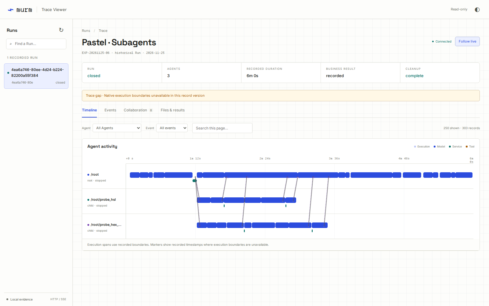

# Open a Run in Trace Viewer

## Replay the included demo

From a built checkout on Linux or WSL with Node.js 22.19 or later, start the built-in Viewer directly. The [included Run](../../test/fixtures/trace-viewer/runs/release-notes/) is ready to view offline and requires no Sandbox or model credentials.

```bash
npm run build
node dist/scripts/murm.js trace --root test/fixtures/trace-viewer/runs --port 8787 --open
```

Open [the demo Run](http://127.0.0.1:8787/#run=release-notes). The synthetic Subagents Run covers about 19 seconds. The Root and Child work in parallel to verify a CSV export change and write a release note. On **Timeline**, scroll over the swimlane to zoom around the cursor, drag or swipe horizontally to pan, or drag the overview minimap window (`W`/`S`/`A`/`D`/`0` shortcuts also navigate the timeline). Under **Collaboration**, select **Inspect handoff** or **Core input admission** on the `result` card and follow the first **Actual model context** link to Root request 5. In **Files & results**, open `release-note.md`. The directory includes the Core lifecycle ledger, Bridge Service calls, all six model exchanges, both Session archives, and the exported note.

## Run from an installed `@luna-shi/murm` CLI

The Trace Viewer is bundled directly inside `@luna-shi/murm` (`src/trace-viewer/`) with zero extra dependencies:

```bash
npm install -g --ignore-scripts @luna-shi/murm
murm trace /path/to/private/runs --port 8787 --open
```

Open `http://127.0.0.1:8787`. A configured root (passed via `--root <dir>` or as a positional argument) may be a Core Run directory containing `runtime.json` or a parent output directory. The Viewer opens on an empty parent directory and discovers new Runs there. It needs the saved Run files and Node.js. Core, the executing Harness, Sandbox services and model credentials are independent.

## Server launch and local browser

Install and start the Viewer on the server that holds the Run files. From the server's Viewer installation directory, run the following command.

```bash
./node_modules/.bin/murm trace --root /path/to/remote/runs --port 8787
```

On the machine where you will open the browser, use SSH to forward the server's loopback port. When the Viewer starts in an SSH session, it prints a forwarding command you can adapt to your SSH destination.

```bash
ssh -N -L 8787:127.0.0.1:8787 user@server
```

Open [the forwarded Viewer](http://127.0.0.1:8787) in your browser. The browser machine needs only an SSH client and a browser. Anyone with access to the loopback listener can view the selected private traces. Use a dedicated Run root and keep the listener behind the SSH connection. Stop the Viewer with Ctrl+C. The Harness continues on its own lifecycle.

## Examples

Use the example's configured `outputDir`. The default output roots are relative to the directory that launched the example.

| Example | Default root |
| --- | --- |
| [Notes](../../examples/notes/README.md) | `./notes-runs` |
| [Subagents](../../examples/subagents/README.md) | `./subagents-runs` |
| [PeerMesh](../../examples/peermesh/README.md) | `./peermesh-runs` |
| [Substrate](../../examples/substrate/README.md) | `./substrate-runs`. The FATE launcher uses `./experiments/substrate-fate` by default |
| [Lead-Worker](../../examples/lead-worker/README.md) | `./lead-worker-runs` |
| TaskPool foreground Harness | `outputDir` from the host configuration |

Service calls appear across Harnesses. Subagents adds caller and destination links backed by the saved evidence. Read the [Architecture chapter](../architecture/06-observability-experiments.md) for the timing and status semantics.

## Replay the private Pastel Run

Use a saved `output` directory from a completed Run. Set `PASTEL_RUN_DIR` to that private Run directory before running the viewer command.

```bash
./node_modules/.bin/murm trace --root "$PASTEL_RUN_DIR" --port 8787
```

This Run predates native execution tracing. Compare overlapping recorded model request intervals, then open the child handoff, corresponding Root model request, and archived result or file. The separately recorded checks concern the Pastel subtask and its seven reference cases.

The saved Core format is schema 1, Core 0.2.0, with historical `bots` and `botId` fields. The viewer recovers three Agent lanes, 35 model request intervals, two spawn links, four explicit messages, two archived result returns and three Session files. The two children's captured model intervals overlap for 102.262 seconds. The first HSL child message appears in Root model request 15. The saved export includes `delivery/pastel.js` at 4,091 bytes. The independent receipt records seven reference matches and invalid-color rejection.

To check the snapshot identity, calculate this manifest digest from the parent directory of the original Run.

```bash
cd "$(dirname "$PASTEL_RUN_DIR")"
find 4ea6a746-80ee-4d24-b224-82200a55f384 -type f -print0 |
  LC_ALL=C sort -z | xargs -0 sha256sum | sha256sum
```

The expected SHA-256 is `b70f92951a44462efcf31ddae036fe6643474a58970c5ee10fa3ffbf8f3fd355`.



The screenshot shortens the Run title and hides the event ledger. It shows the recorded timing and collaboration relationships.
