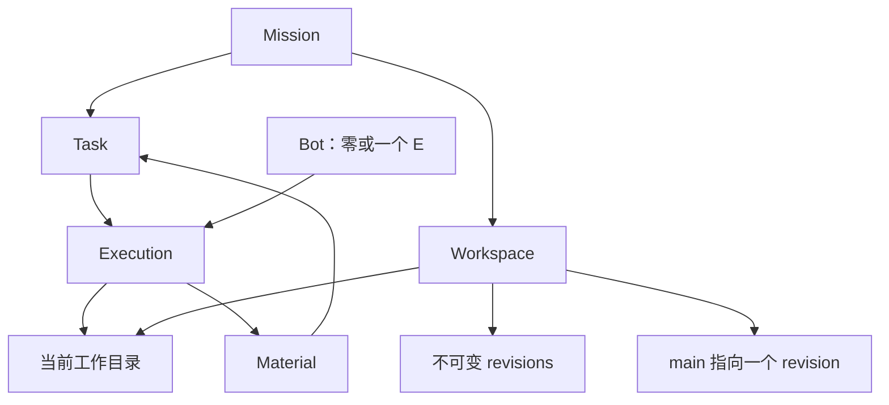
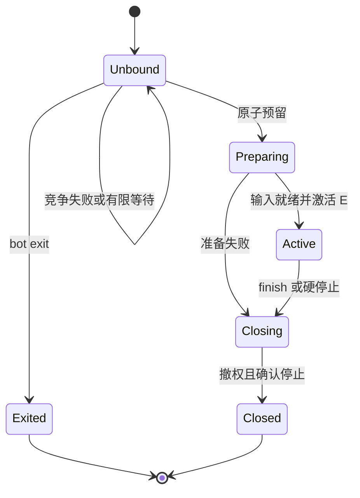

# 01 · Core Runtime：Mission、Core、Bot 与 Execution 生命周期

> 设计 Issue：[#122](https://github.com/LuNa-shi/SwarmEnv/issues/122) · 决策来源：[#120](https://github.com/LuNa-shi/SwarmEnv/issues/120)。本文描述经本轮决定修订的目标合同，不代表已实现或通过真实运行验收；当前实现仍以 [architecture](../../architecture/INDEX.md) 为准。
>
> Mission 共享，Task 独占；一个 Bot 在独立 sandbox/Pi 中运行，最多产生一个 Execution，也可以未 take 就正常退出。take 依次准备输入、激活 E、开放目录写权限、交付绑定。结束时先完成有限收尾，再接受 finish、撤权、停止全部进程和安全解绑。研究内容通过 Material 接续，项目文件通过公开 Workspace revision 接续。

## 阅读目录

- [对象与关系](#对象与关系)
- [组件各自负责什么](#组件各自负责什么)
- [一次 Mission 的启动](#一次-mission-的启动)
- [每个 Core 的循环与停止条件](#每个-core-的循环与停止条件)
- [take 前后的权限](#take-前后的权限)
- [take 的完整顺序](#take-的完整顺序)
- [普通 Service 调用与 Execution 结束](#普通-service-调用与-execution-结束)
- [Task 完成、超时与 Bot 结束](#task-完成超时与-bot-结束)
- [Mission 提交、验收与停止](#mission-提交验收与停止)
- [运行轨迹与验收入口](#运行轨迹与验收入口)
- [最小配置与可观测记录](#最小配置与可观测记录)

## 对象与关系

| 对象 | 定义与存在时间 | 第一版关系和边界 |
|---|---|---|
| Mission | 全体 Bot 可见的共同目标、约束、最终验收和资源范围 | 与一个 Workspace 一对一；不被 take，不伪装成 Task |
| Task | 具有稳定目标、交付与完成条件的局部责任 | 属于 Mission/Workspace；同时最多一个当前 E；可由不同 Bot 先后接续 |
| Material | 明确发布、可持久读取的研究内容及来源 | Bot 产物绑定产生它的 Task/E；初始化资料使用 input 来源；纠错规则见 [04](04-material.md) |
| Workspace | 位于 sandbox 外、由 Runtime 管理底层 Git 的持久项目仓库 | 保存不可变 revision、文件树、来源和实际 parents；为每个 E 准备独立工作目录 |
| revision / main | revision 标识一份不可变文件树；main 是指向某个 revision 的共享分支 | save 也产生 revision；编号在 Workspace 内唯一，不表示线性继承；main 不是 Material |
| Core | 可复用的计算槽位 | 不代表固定研究角色；停止或隔离旧 Bot 后才能安全补位 |
| Bot | 在一个 Core 上启动的一次自主运行 | 对应一个新 sandbox/Pi，具有零个或一个 E；未 take 的阅读期也是 Bot 生命周期的一部分 |
| Execution（E） | 一个 Bot 对一个 Task 的一次排他执行及其授权、输入和记录 | 每个 E 恰好属于一个 Bot；Bot 最多一个 E；一个 Task 可有多次历史 E |
| Session | Pi 的底层会话 | 一个 Bot 创建一份新 Session；可先读后 take，但不跨 Bot 或第二个 Task 复用 |
| Sandbox | 每个 Bot 的临时第三方隔离环境 | 固定预留受保护的项目目录；take 后开放当前 E 的工作目录；Bot 退出后销毁 |

candidate 仅是 Workspace 某 revision 中用于表达候选成果的普通文件，以 `(workspace_id, revision, path)` 引用。它不新增 Candidate 实体、ID、专用存储或 CLI。保存文件树、显式应用版本和更新 main 的完整合同在 [05](05-workspace.md)。

Task 的创建来源不产生永久经理或父任务控制权。需要并行工作时提出各自有交付的 Task；新发现的前置工作通过 [03](03-task.md) 的动态等待关系表达，不修改原 Goal、Deliverable 或 Completion condition。

`handoff` 是保存可接续工作并结束本次 Bot 的行为，不是自动转移私有 Session。后继读取 Material 与明确 Workspace revision；未发布的文件、对话、缓存和审计存档不会成为研究输入。

Material→Task 表示显式使用关系。Material 发布不会修改 main；Workspace save 保存整个一致文件树并产生不可变 revision，也不会自动推进 main。初次 take 固定的输入保留审计，但当前工作版本可以在同一 E 内通过显式 `workspace apply --from R/main` 改变；Runtime 不在后台悄悄更新工作目录。

## 组件各自负责什么

| 组件 | 权威事实 | 不承担的判断 |
|---|---|---|
| Task / Mission 协调模块 | Mission 配置、Task 合同与等待关系、当前 owner、E 授权、finish 与最终 submission 记录 | 不自动判断所有任务价值，不把任务数等同于 Mission 成功 |
| Workspace 模块 | revisions、文件树及 parents、main、save/apply/merge 和条件更新记录 | 不自动认定科研内容正确，不要求固定整合 Bot |
| Context Service | Material 内容、来源、检索、实际使用和修正关系 | 不因发布者自称正确就认证结论 |
| Runtime | Core/Bot/Pi/sandbox 绑定、可信启动、权限开放、预算、收尾和对账 | 不硬编码全部任务拆分或永久角色 |
| Judge / 领域 Service | 自己受理的输入、具体长操作、结果与费用 | 不作为所有 Task 的强制完成裁判 |
| CLI | help、参数、稳定请求标识、传输、结果和错误呈现 | 不构成授权权威或绕过服务检查 |
| Pi / Bot | 阅读、提出与选择工作、操作项目文件、调用服务、保存与使用成果 | 不直接管理 Git、写共享 refs、访问 provider 管理面或服务数据库 |

v1 的 Task/Mission 协调模块与 Workspace 模块位于同一协调进程、一致性域；main merge 与 Mission 验收冻结使用同一串行化边界。Git refs 和元数据的崩溃对账见 [05](05-workspace.md)，不把它们假装成天然的同一事务。Context、Judge 和领域服务通过各自 API 接入，不跨库访问。

## 一次 Mission 的启动

1. **操作者提供 Mission。** 固定目标、验收配置、可用服务、初始输入、资源上限和停止条件。Core 数是配置，不是固定四路算法。
2. **初始化 Workspace。** 在 sandbox 外导入初始项目，保存可物化的初始 revision 并让 main 指向它。空项目也有明确初始文件树；不从旧 Bot 的私有目录猜测起点。
3. **允许零 Task。** 不创建隐藏 Mission Task 或计费占位任务。
4. **启动 Bot。** 每个 Core 创建新 Bot ID、sandbox 和 Pi。四 Core 的错峰运行把每个 Core 的首个 Bot 分别安排在编排开始后的 0、60、120、180 秒获得启动资格。获得启动资格的时点与其他 Core 是否已 take 或 finish 无关；每个 Core 到点后可独立发现并并行执行。此间隔不用于后继 Bot，后继按原有生命周期和有界退避调度。到点前不创建该 Bot 或其环境。等待包含在 Mission 墙钟额度内；单 Bot 的选工与生存预算从实际注册开始。预留空的、由可信身份控制的 `/workspace/project`；Pi 会话、缓存和临时文件放在另外的运行目录。take 前项目浏览通过 `workspace files/read/search --at R` 等只读 API 完成。
5. **发送初始输入。** 提供 Mission、Bot/Core、Workspace 版本、服务/skill 目录和预算快照。完整文本由 [06](06-prompts-and-skills.md) 定义；启动快照不能替代操作前的服务查询。

## 每个 Core 的循环与停止条件

这个循环适用于首个 Bot 和所有补位 Bot。首 Bot 遵守启动错峰；补位只遵守常规清理与有界退避。四个 Core 独立推进，不等其他 Core 完成。

1. **确认旧环境已经关闭。** 上一 Bot 的进程和 sandbox 必须确认停止或隔离，Runtime 才能释放该 Core 并补位。finish 已受理或停止请求已发出时，清理尚未确认的 Core 继续由旧 Bot 占用。
2. **重新检查 Mission 和运行额度。** Mission 仍开放且未耗尽本次运行额度时，在启动资格到达后注册全新 Bot，创建新的 sandbox 和 Pi。处于退避或错峰等待的 Core 也遵守这一检查。正常停止新增 Bot 的条件是 Mission 验收通过、Mission 被停止或本次运行期限耗尽。不能恢复的运行错误单独记录；清理责任仍保留。
3. **优先已有工作，默认补缺。** Bot 读取当前 Mission 验收、Workspace main、相关 Task 和 Material。找到合适可领 Task 时优先 take；没有合适项时，默认从公开证据找出与验收相关的缺口，提出有边界且可验证的新 Task，再 take 并执行。未解问题可形成有区分价值的调查任务；Runtime 不代为创建占位 Task。具备协调权限的 Bot 也可以提交已经准备好的 Mission 成果。
4. **结束本次尝试并重新检查。** 已 take 的 Bot 通过 finish 或到期停止结束 E。尚未 take 的 Bot 若实际耗尽选工额度或生存额度，只结束该 Bot。释放 Core 后，应在 Mission 和运行额度允许时让后继 Bot 重新读取最新公开状态再选工。Task 队列为空、现有 Task 全部 done、单 Bot 退出都不终止 Core 循环，也不能作为 Mission 通过的证据。

Bot 在提案和 take 前刷新相关 Task 查询。现有 request ID、显式责任身份和同 Task 单 owner 合同继续生效。错峰减少首批 Bot 同读空列表的机会；不同责任标识的并发提案仍可能表达重叠工作。此轮未增加服务端语义去重。[Issue #122 的 Core 循环决策](https://github.com/LuNa-shi/SwarmEnv/issues/122#issuecomment-6896808817)

### 未绑定 Bot 的等待与正常退出

未 take 的模型调用、检索和等待费用归 Mission/Bot/Core，不虚构 E。开放且未接受的 Mission 仍有选工预算时，当前队列无合适责任意味着 Bot 应继续诊断并提案。选工预算实际耗尽且无未决 take 时使用 `swarm bot exit --reason selection-budget`。Mission 已接受或停止时停止扩展责任。此操作持久记录原因，结束整份 Bot/sandbox，不产生 Task 或 E，也不表示 Mission 成功。

Runtime 根据 Task 可领性变化、材料/Workspace 更新、服务恢复或有上限的退避定时重新评估启动。仅因 Core 空闲，不立即重复创建相同 Bot。事件要合并，定时要有退避和总预算约束；不能用模型忙轮询或 sandbox 热重启代替等待。有明确服务等待条件时，Bot 可在有限窗口内暂停模型调用，等待 Runtime 唤醒。空队列时仍在选工的 Bot 应按上述循环主动查找缺口。等待或退出的原因与资源用量必须可观察。

`bot exit` 仅适用于没有 E、也没有未决 take 的 Bot。有 take 结果未知时先恢复该请求；已有 E 时必须走 task finish，不能通过 bot exit 绕过 Task 收尾。

## take 前后的权限

| 操作 | 未绑定 Bot | preparing | active E | closing / closed |
|---|---|---|---|---|
| 读取 Mission、Task、Material、公开 Workspace revision | 按 Mission 权限可读 | 可读 | 可读 | 不保留 Bot 执行能力 |
| propose / take | 协调凭据允许；先核对已有工作 | 不并发 take | 可提出后续 Task，不再 take | 拒绝结束 Bot 的新协调变更 |
| 失效依赖修复 / 无 owner Task cancel / 获准的 Material unsupersede / Mission submit | 按明确的 Mission 协调权限与各自合同 | 不与 take 激活交叉发起 | 按各自合同 | 新请求拒绝；已受理的独立操作按记录继续 |
| 项目文件修改 | 空预留目录，OS 拒写 | OS 拒写 | grant 成功后只写本 E 目录 | finish 后不再接受贡献，停止全部进程 |
| 会话、日志、缓存、临时文件 | 独立运行目录可写 | 同左 | 同左 | 仅受控审计存档 |
| Material publish、Workspace save/apply、领域贡献 | 无贡献权限 | 无贡献权限 | 按 E 权限和预算 | 新贡献拒绝 |
| main merge | 无权 | 无权 | 按 Workspace 合同；Mission 验收冻结时拒绝 | 旧 E 无权 |
| bot exit | 无未决 take 且预算已耗尽或 Mission 已停止时允许 | 不允许 | 不允许，使用 task finish | 外部查询最终结果 |
| 其他 E 私有文件、管理面、服务数据库 | 不提供权限 | 同左 | 同左 | 同左 |

“只读”保护项目目录和研究贡献接口，不等于禁止操作系统中的所有写入。必要缓存可写，因此不声称能阻止每一段提前计算；系统保证贡献归属、受控保存和费用归属。获准的 unsupersede 仅按 04 撤销匹配的替代关系，不允许未绑定 Bot 发布正文、修改来源或自行获得其他 Material 写权限。

软收尾不等于 closing：E 在有界收尾窗口内仍有效，只允许保存已有工作、发布已有内容和 finish，禁止扩展工作、提交新计算或 merge main。接受 finish 或到达硬停止边界才撤权进入 closing。Sandbox 强制措施见 [02](02-sandbox-runtime.md)。

## take 的完整顺序

Task 状态为 `ready / running / blocked / done / cancelled`；E 内部状态为 `preparing / active / closing / closed`。Task 在准备和未安全解绑的收尾期间保持 running，并展示 E 子状态。

唯一顺序为：**准备输入 → E active → grant 本地写权限 → 交付贡献绑定并返回成功。** 内部 active 不等于 take 已经向 Bot 成功返回。

1. **请求去重。** CLI 保存稳定 request ID。一个 Bot 只能产生一个 E；并发或重复 take 不能得到第二个 E，也不能在关闭第一个 E 后再次 take。
2. **原子预留。** 检查 Mission 允许继续、Task 合同/等待关系版本、状态和 owner、Bot 未绑定且未退出；创建 preparing E，写 current owner，使 Task running。
3. **准备输入。** 解析指定 revision 或当时 main 的实际 revision/commit；从外部 Workspace 向受保护的 `/workspace/project` 导出文件树，验证清单/摘要。记录初始 Workspace、Material 版本和环境配置。预览与实际输入不一致时，返回差异并要求重读。
4. **激活 E。** 协调域将准备好的 E 设为 active，固定初始输入、身份、预算和生命周期版本。贡献凭据此时仍由 Runtime 持有，目录仍不可写。
5. **grant 写权限。** 可信 Runtime 在核对同一生命周期版本仍可授权后开放目录。即使 take 前启动的后台进程立即写入，也已经处于当前有效 E 的归属范围。
6. **交付绑定。** 原子更新受保护的绑定文件，允许 CLI 取得 E 贡献身份，返回实际目录、初始 revision、输入版本、权限、预算和变化摘要。只有这一步完成才报告 take 成功。

每个 sandbox 的 grant、abort、finish 必须顺序处理，并携带生命周期版本。active 到 grant/绑定交付之间失败时，立即关门、转 closing、撤销 E 资格并清理；不得把 active 字段当成授权已经完成的证据。迟到 grant 不能重新开放已关闭环境；不可取消的 provider 调用必须等待结果后继续清理，不能重新分配该环境。

| 情况 | 处理 |
|---|---|
| 竞争 take 失败 | 没产生 E；保留未绑定 Bot，刷新事实 |
| 预留前 bot exit | 不创建 E，不产生待补偿 Task owner |
| 已预留但输入/权限准备失败 | closing，拒绝贡献，停止环境；确认停止后条件清除自己的 owner |
| take 响应丢失 | 查询/重试同 request ID，恢复既有结果；不换 ID 认领别的 Task |
| E active 后 grant 或绑定失败 | 关闭补偿，不返回成功，不留长期半激活 E |
| Runtime 重启 | 按持久 Bot、可选 E、request、sandbox ID 和资源标签对账，不重复激活或提前释放 |

只有旧执行已停止或隔离、Task 当前 owner 仍是本 E，才能清除认领。迟到清理不能擦掉后继 owner。

## 普通 Service 调用与 Execution 结束

普通 CLI 对应普通 Service API；服务端验证可信调用身份和该操作要求的 Mission/Bot/E 状态后执行，不引入通用 pending/permit/acceptance 协议。未绑定 Bot 的协调操作与 active E 的研究贡献是两种明确权限，不能只用“是否存在 E”判断所有命令。

- 普通读取遵守资源可见性。
- 同步贡献写入在服务的写入边界验证当前 E 与权限；closing 后到达的新贡献请求被拒绝。
- 必要重试使用稳定请求标识，响应丢失不被改写成确定失败。
- 已完成写入不因 Bot 结束而回滚。
- 某个具体服务确实需要长操作时，由该服务在受理前持久保存输入、操作状态和费用上限；Bot 退出不隐式取消它。Mission 最终检查是其中一种明确操作，并非通用 Job 平台。

## Task 完成、超时与 Bot 结束

一个 Bot 最多执行一个 Task。四种 finish 结果由 [03](03-task.md) 定义：done、incomplete、blocked（附等待 Task）、cancelled（附原因及可选替代 Task）。

### 先收尾，再接受 finish

1. **正常完成或软限制提醒。** Bot 在仍有效的 E 内保存整个一致文件树为 Workspace revision，发布有用 Material，确认外部可读取，并准备 finish。不是每个 E 都必须同时保存文件和发布材料。
2. **持久受理 finish。** 在 Task 协调事务内验证 owner、结果和结构条件，原子保存结束意图、动态等待关系/替代指向、request ID，并将 E 转 closing。该事务之后新贡献被拒绝。
3. **停止整份 Bot。** Runtime 独立于 CLI 连接停止 Pi、实际启用的模型路由扩展、Bash 和全部子进程，销毁或隔离 sandbox。
4. **安全解绑。** 确认停止且 owner 仍是本 E 后，关闭 E，清除认领；Task 按已持久结果变为 done、cancelled，或按全部有效等待关系变为 ready/blocked。此前保持 running/closing。
5. **留存与补位。** 保留 Material、全部已保存 revisions、main、调用结果和受控审计记录。Mission 仍运行且存在启动条件时，再按事件/退避启动新 Bot。

finish 的 CLI 可以在返回前被销毁，外部请求记录决定最终结果；不要求 Bot 在 finish 后再执行上传。接受 blocked 与记录等待关系必须原子完成，不能留下“Bot 已退出、任务却错误 ready”的窗口。

### 硬停止、compaction 与未完成工作

软阈值要早于硬上限，并预留明确的收尾时间/费用。软提醒期间不撤销必要的 save/publish/finish 权限；硬上限、崩溃或强制隔离则立即走关闭流程，只承认已经成功持久化的成果。Runtime 不为硬停止自动公开全部私有目录，不编造空 Material，也不宣称未完成上传已经交接。

compaction 次数、上下文阈值和收尾额度均来自启动配置及适配器实际信号；“三次”“80%”不是固定算法。后继读取公开 Task/Material/Workspace 状态；同一 E 内显式 apply 的记录与最初 take 的输入都保留，二者不能互相覆盖。

## Mission 提交、验收与停止

Task done、Material publish、Workspace save、main merge 与 Mission accepted 分别记录。最终验收必须针对固定交付，不能用空队列、任务数或某 Bot 的文字声明代替。

### 提交入口与不可变输入

`swarm mission submit --materials M1,M2` 使用有效 Mission 协调身份；未绑定 Bot 也可以提交已经存在的公开交付，无须为此虚构 Task 或 E。若有当前 E 则记录来源；如果没有，E 为空。命令不授予项目写权限，也不修改 Mission 验收标准。仅以文件验收的 Mission 可以明确提交空 Material 集合，不为最终提交编造材料。

服务固定并持久保存：

- Workspace ID、当前 main 的精确 revision/commit；
- 明确指定的 Material ID、不可变内容版本/哈希；
- Mission 验收配置、checker 和环境版本；
- 提交者、可选 Task/E、稳定请求标识；
- 检查的时间与费用上限，以及后续结果。

读取 Material 或保存输入失败不能开始检查。验收输入不能在运行中改读“最新版本”；历史记录按精确版本解释，Material 的默认隐藏/纠错规则仍由 [04](04-material.md) 决定。

### 验收期间冻结 main merge

同一 Mission 同时最多一份活跃 submission。受理入口在与 main merge 相同的协调边界固定 main、登记 submission 及其冻结归属；已经开始的 merge 也必须在最终接纳时检查冻结，不能穿过该边界。输入准备和检查都有有限超时。

检查期间：

- main merge 暂停，返回可理解的验收中错误；main 保持在提交的 revision；
- 读取、现有 E 的本地工作、Workspace save 和 Material publish 可以继续，但不改变当前验收清单；
- 新的独立 submission 被拒绝并返回当前 submission；重复同 request ID 返回原记录；
- `swarm mission submission view <id>` 查询持久结果，提交者退出也不丢失状态。

没有配置可执行 checker 时，不自动宣告成功；按已固定的人工验收入口记录结果和有界等待。不得在检查途中让 Bot 改写 checker 或降低验收标准。

### 成功、失败、超时与并发边界

| 结果或并发情形 | 必须行为 |
|---|---|
| 检查 PASS | 仅当前有效 submission 可完成；再次确认 main 仍为提交版本、Mission 未取消/停止、验收配置匹配，记录 accepted revision 与完整输入清单，进入正常停止 |
| 检查未通过 | 保存反馈；仅释放本 submission 的冻结。Mission 未停止且没有其他有效冻结时才恢复 main merge，允许修复和以后提交；迟到结果不能改变较新提交 |
| 输入准备/检查错误或超时 | 记录 error/timed_out，不冒充研究失败；释放自己的冻结，若 Mission 未停止则继续运行 |
| 重复请求 | 同 request ID 只对应一次受理；同一完整快照与 checker 配置复用已完成的验收结果，不能换 ID 重复检查直到偶然 PASS；基础设施 error/timeout 不作为科学 FAIL 缓存，可按预配置策略重新受理并记录关联尝试和费用 |
| 受理与 task finish 并发 | 以协调域持久受理顺序为准：finish 先结束 Bot 则新提交拒绝；submission 已受理则成为服务持有的检查，不因提交者随后 finish 而丢失或撤销 |
| 受理与 bot exit 并发 | 同样按持久顺序处理；退出 Bot 的协调凭据不能开启新检查，已受理检查继续可查询 |
| 人工取消、硬预算停止、检查取消后迟到 PASS | 保留迟到结果作审计，不恢复已结束 Mission，不释放后续 submission 的冻结，不覆盖已终结的检查记录 |
| Runtime 重启 | 按 submission、冻结归属、deadline 和服务操作记录对账；不遗留永久冻结，不重复开始收费检查 |

检查重试限于已配置、可判定的基础设施失败策略；次数和成本计入同一 submission。旧结果必须匹配 submission ID、生命周期版本和当前状态；不能仅凭“收到 PASS”就变更 Mission。该具体异步合同不扩展为其他服务的通用许可平台。

### 接受交付后的停止与费用

PASS 持久记录后，main 的验收冻结转为 Mission 停止约束，不出现重新开放 merge 的空档。Runtime 禁止新 take、新提案和新研究计算，按已批准的有限收尾窗口允许现有 E 保存/发布已有增量及 finish，再撤权并销毁全部 Bot。验收中或停止中的 Mission 不阻止当前 E 合法 finish；服务按操作区分停止新研究与完成已有收尾。收尾保存形成其他 revisions 时，不改变已经接受的 revision。

Mission 成功不会替未完成 Task 标 done。保存它们当时的实际完成度、结束原因及“Mission 已停止”的可领性门槛。预算到期、人工取消和失败停止也有独立原因；硬停止不保证最后一次保存成功。

已受理的外部长期操作按原服务合同取消或完成，费用仍归原 Mission；停止 sandbox 不等于费用归零。检查、模型和收费服务均须有有限且单位明确的额度，计入并发已承诺消耗及收尾额度。实现门槛是证明总额度不会因并发接纳或退出后尾部操作失去约束，而不是让模型估计余额；不新增通用 permit 平台。

## 运行轨迹与验收入口

[07 验证](07-validation-and-research.md) 维护四 Bot 轨迹与工程验收。本章至少要求检查：零 Task 启动、未绑定退出与退避、take 竞争/响应丢失、active 到 grant 失败、动态阻塞和失效依赖修复、同 E 显式 apply、软收尾与硬停止、Mission submit 与 merge/finish/exit/取消的竞态。

[03](03-task.md) 解释具体责任与等待，[04](04-material.md) 解释研究内容，[05](05-workspace.md) 解释文件树、parents、save/apply/merge。各模块使用同一生命周期合同，不再在不同章节定义相反的授权顺序。

## 最小配置与可观测记录

启动前固定 Core 数、镜像/CLI/API 版本、工具和网络范围、Mission/单 Bot/选工额度、有限上下文与收尾阈值、操作 deadline/重试上限、空闲退避、合入检查和最终验收配置。数值和单位必须明确；实现 PR 提供实际配置和验证证据，不再把这些已确定原则写成待拍板架构问题。

| 事件/对象 | 至少记录什么 | 用途 |
|---|---|---|
| Bot 启动/退出 | Mission/Core/Bot、sandbox/Pi、模板/skill、初始消息、选工费用、退出原因和重启条件 | 无 E 也能追踪完整生命周期 |
| take | request、Task/合同与关系版本、E、初始输入、预留/激活/grant/交付时间 | 区分竞争、准备和实际执行 |
| 工作版本变化 | 初始 revision、显式 apply 来源、工作基线、save revision、parents、文件变化与来源 | 不把当前版本覆盖为“从未变化的初始输入” |
| 服务操作 | request/具体 operation、可信身份、输入、状态、费用上限与实际费用 | 解释响应未知、撤权与尾部操作 |
| Task 结束 | outcome、动态等待/替代关系、撤权时间、停止证据、条件解绑 | 防止伪完成、重复认领和迟到清理 |
| Material / 文件成果 | 内容版本、Task/E 来源、使用/修正记录；Workspace revision 与 path | 追踪公开成果，不另造 Candidate ID |
| Mission submission | 固定清单、checker/environment、冻结归属、deadline、verdict、accepted revision、费用 | 还原最终交付与并发边界 |

运行消息、工具结果、skill 全文和 compaction 事件是受控证据，公开仓库只保留模板、合成例子和脱敏摘要。只保存 prompt 哈希不足以重建输入，组合文本也不证明实际发送；[06](06-prompts-and-skills.md) 定义发送记录。

Sandbox 的完整进程、文件系统、凭据、网络和 provider 验收见 [02](02-sandbox-runtime.md)。以上均是目标设计合同，不是已通过的实现或研究结论。
