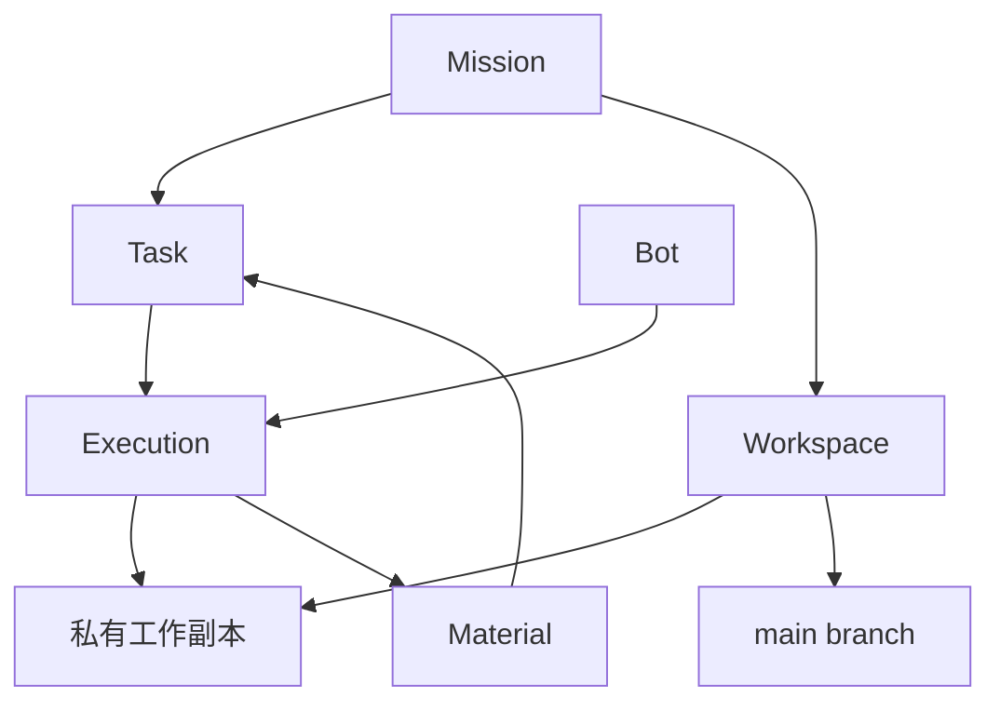
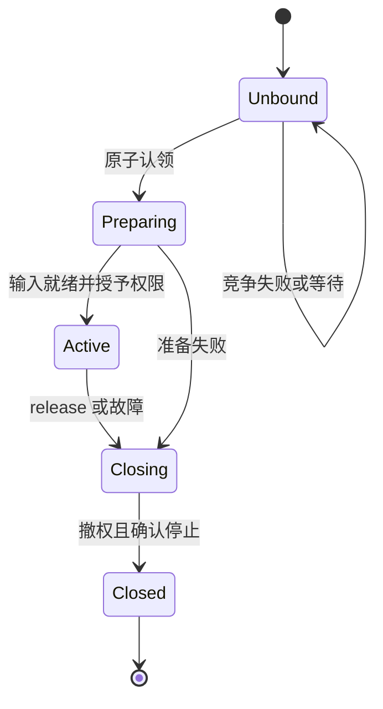

# 01 · Core Runtime：Mission、Core、Bot 与 Execution 生命周期

> 设计 Issue：[#122](https://github.com/LuNa-shi/SwarmEnv/issues/122) · 决策来源：[#120](https://github.com/LuNa-shi/SwarmEnv/issues/120)。本文是待审目标设计，当前实现仍以 [architecture](../../architecture/INDEX.md) 为准。
>
> 已确认：Mission 共享、Task 独占、Workspace 与 Mission 一对一、每个 Bot 最多执行一个 Task；Bot 生命周期与一次 Execution 对齐；take 前在独立 sandbox 中只读，take 后 Runtime 开放当前 Execution 工作目录写权限，完成/超时后结束 Bot 和 sandbox、跨 Execution 只通过 Material 接续。本文只讲 Core Runtime 如何组织 Mission、Bot 和 Execution；Sandbox 细节见 [02](02-sandbox-runtime.md)，Task 合同见 [03](03-task.md)，Material 见 [04](04-material.md)，Workspace 见 [05](05-workspace.md)。

## 阅读目录

- [对象与关系](#对象与关系)
- [组件各自负责什么](#组件各自负责什么)
- [一次 Mission 的启动](#一次-mission-的启动)
- [take 前后的权限](#take-前后的权限)
- [take 的完整顺序](#take-的完整顺序)
- [服务请求与撤权的先后关系](#服务请求与撤权的先后关系)
- [release 与异常退出](#release-与异常退出)
- [四个 Bot 的具体轨迹](#四个-bot-的具体轨迹)
- [最小配置与可观测记录](#最小配置与可观测记录)
- [Runtime 与 Sandbox 的边界](#runtime-与-sandbox-的边界)

## 对象与关系

| 对象 | 定义与存在时间 | 第一版关系和边界 |
|---|---|---|
| Mission | 全体 Bot 可见的最大共同目标、约束、最终验收和资源范围 | 一个 Mission 与一个 Workspace 一对一绑定；不被 take，不伪装成 Task，也没有隐藏 Mission Task |
| Task | 具有局部目标、交付和完成条件的基本工作单元 | 属于 Mission 和一个 Workspace；同一时刻最多一个当前 Execution；可多次尝试，也可由不同 Bot 接续 |
| Material | 明确发布、可持久读取的内容及来源 | Bot 产物绑定产生它的 Task/E；可以被其他 Task 使用。初始化资料有 input 来源，不伪造执行来源 |
| Workspace | 与 Mission 一对一绑定的项目工作环境，由 Runtime 管理底层 Git Repository | 位于 sandbox 外并跨 Task、Bot、Execution 存在；Runtime 为每个 Execution 准备独立工作目录 |
| main | Workspace Git Repository 中的共享主分支 | 就是 Git branch `main`；每次更新产生新 commit，并推进 Workspace revision。main 不是 Material |
| Core | 一个可复用的计算槽位 | 例子配置四个；不再另造 Core lane；不代表某个固定研究角色 |
| Bot | 在一个 Core 上启动的一次自主运行实例 | 一个 Bot 最多 take 一个 Task；完成或超时/handoff 后结束，新的 Bot 可接续同一个 Task |
| Execution（E） | 一个 Bot 对一个 Task 的一次实际执行及其权限、输入和运行记录 | v1 与 Bot 生命周期一对一；一个 Task 可跨多个 Bot/Execution 接续 |
| Session | Pi 的底层会话实现 | 每个 Bot 创建新的 Pi Session；只服务一个 Task Execution；Bot 完成/超时后销毁 |
| Sandbox | 第三方隔离执行环境 | 每个 Bot/Execution 独立临时 sandbox；take 前项目目录只读，take 后当前 Task 工作目录可写；Task 完成/超时后销毁；细节见 [02](02-sandbox-runtime.md) |

Task 的创建关系只说明“谁提出了它”；依赖关系说明“什么前提满足后才值得执行”。两者都不产生永久经理、父任务控制权或同 Task 的多个执行者。需要并行工作时提出有各自交付的不同 Task。

`handoff` 是“发布可接续的工作并结束当前执行”的行为，不是必须新增的对象或自动转移私有 Session。Progress Material、Feedback、CheckResult 可以作为内容/服务响应或内部审计记录，不进入本阶段的核心对象表。不要用 `workspace lineage` 统称不清楚的继承关系；明确写基准版本、来源 Material、产生它的 Task/E 和后续使用关系。

图中的 Material→Task 表示显式使用关系。Material 与 Git 分开：Material 保存可独立引用的研究内容及来源；Workspace 的 main branch 保存项目文件树。Material 可以被某个 Execution 应用到 worktree，但发布 Material 不会自动修改 main。每个 E 的工作目录由 Runtime 从 Workspace 基线创建，Bot 只通过基础文件工具操作当前目录，不直接管理 Git。

## 组件各自负责什么

| 组件 | 权威事实 | 不承担的判断 |
|---|---|---|
| Task Service | Mission/Task 合同、Task 当前执行者、E 状态/授权与请求记录 | 不替 Bot 自动发现所有高价值工作，不凭任务数判定 Mission 完成 |
| Workspace 逻辑模块 | Workspace 配置、main 当前版本、合入请求及条件更新记录 | 不自动理解科研内容真假；不要求固定整合 Bot |
| Context Service | Material 实际内容、不可变来源、检索/使用/修正关系 | 不因为某 Bot 声称正确就认证知识正确 |
| Runtime | Core、Bot/Pi/sandbox 绑定、可信启动、权限切换、预算监督、停止和对账 | 不硬编码任务拆分或给四 Bot 固定研究角色 |
| Judge / 领域 Service | 自己受理的输入、操作状态、检查/计算结果与费用 | 不作为所有 Task 的强制“完成裁判”，不经 runner 私有回调补齐真正功能 |
| CLI | 帮助、参数、请求 ID、传输、结果和错误呈现 | 不持有最终授权权威，不通过隐藏命令实现安全边界 |
| Pi / Bot | 读 Mission、选择/执行 Task、使用工具、发布与引用成果 | 不持有 provider 管理权限，不直接写共享 main 或服务数据库 |

v1 建议 Workspace 逻辑模块与 Task Service 同一协调进程、一致性域部署，以便 E 有效性和 main 条件更新在本地事务内检查；内容通过 Context API 读取，不跨服务打开数据库。不因增加 Workspace 概念而强制新增一个微服务。Task、Context、Judge 的外部独立部署仍承接 [阶段 01](../0001-sandbox-services-cli.md)。

## 一次 Mission 的启动

1. **操作者提供 Mission。** 包含目标、验收方式、可用服务、初始输入、资源上限和停止条件。本文的四路只是示例并发配置，不是每个 Mission 的固定算法。
2. **初始化 Workspace W。** 在 sandbox 外创建本地 Git Repository，并导入用户/项目提供的初始文件；建立 `main` branch 和初始 commit，并初始化 Workspace revision（例如 `0.1`）。空项目也要显式创建空基线与说明。记录工具链/镜像版本；不从任意旧 E 私有目录猜测起点。
3. **Task Service 可以仍为空。** 不生成共享 Mission Task，也不生成用于计费的占位 Task。
4. **Runtime 填充四个 Core。** 每槽创建新的 sandbox、Pi 和 Bot。准备可读的 main 快照、任务/材料/API 读取入口、固定 CLI/help 和 skill 文本。模型运行目录与项目目录分开。
5. **发送完整初始 prompt。** 先加载稳定规范，再提供准确的 Mission、Bot/Core、Workspace 版本、服务/skill 目录和预算快照。见 [04](06-prompts-and-skills.md)。这些是启动时的快照，不能替代新操作前的服务查询。
6. **Bot 自行发现工作。** 读取 Task Service 各状态、有关材料与项目内容，先复用已有任务，再提出有局部交付的新 Task，选择并 take。

启动后未 take 的模型调用、目录读取和等待也有成本，计入 Mission/Bot/Core，不需要虚构 E 或 Mission Task。没有可领任务时，Bot 给出阻塞原因，由 Runtime 有间隔地刷新或等待事件；无需持续调用模型或反复重建 sandbox。空列表或所有任务暂时 blocked 都不自动表示 Mission 已完成。

## take 前后的权限

| 操作 | 未绑定 Bot | preparing | active E | closing / closed |
|---|---|---|---|---|
| 读取 Mission、所有 Task 状态、可见 Material、已发布 main | 按 Mission 权限可读 | 可读 | 可读 | Runtime 终止 Bot；不保留执行能力 |
| 提出 Task、尝试 take | 协调凭据允许；提案前先核对已有工作 | 不再并发 take 其他 Task | 可提出后续 Task；不能再 take | 拒绝来自结束 Bot 的新协调变更 |
| 修改项目文件/目录 | OS 强制拒绝 | OS 强制拒绝 | 只写本 E 私有副本 | 不接受新贡献；停止所有本地进程 |
| Pi 会话、日志、必要缓存、临时文件 | 独立运行目录可写 | 同左 | 同左 | 仅保留受控审计存档 |
| 发布/关联 Material、提交 Judge 新计算 | 无贡献权限 | 无贡献权限 | 使用当前 E 的范围和预算 | 撤权后不再受理新操作 |
| 领域资料查询 | Mission 配置允许的只读查询 | 同左 | 依服务权限 | 结束后拒绝新调用 |
| main 更新 | 无权 | 无权 | 必须通过 Workspace 条件更新合同 | 不得以旧 E 更新 |
| 其他 E 私有文件、管理 API、服务数据库 | 不提供访问权限 | 同左 | 同左 | 同左 |

这里的“只读”有明确范围：**保护项目工作副本与业务贡献接口**。允许运行目录写日志、缓存、临时文件，意味着不能技术性禁止所有提前计算。Prompt 要求先 take 再做正式贡献；系统保证的是贡献归属和受控写入，而不是判断每一段思考是否属于“做题”。若未来需要更严格的临时计算限制，另立假设和成本评估。

Sandbox 的 OS 权限、mount、身份、凭据和网络边界统一由 [02 Sandbox 文档](02-sandbox-runtime.md) 定义；Runtime 不在本文件重复描述 provider 细节。本文只要求 Runtime 在 E active 前确认 Sandbox 已按该合同准备完成，closing 时确认整个 sandbox 已停止或隔离。

## take 的完整顺序

建议用户可见 Task 状态为 `ready / running / blocked / done / cancelled`。E 内部状态为 `preparing / active / closing / closed`，不是再给用户增加几种 Task。Task 在准备和安全解绑前的收尾阶段都保持 `running`，并展示 E 子状态供排障。

`Unbound` 是尚未绑定 Execution 的逻辑 Bot 阶段；sandbox/Pi 在此前已启动并保持项目只读；成功预留产生 E 后进入 `preparing`。take 前 Bot 已在 sandbox 中只读研究；take 成功后 Runtime 在当前 sandbox 中准备当前 Task 的独立工作目录并授予写权限。只有工作目录和权限准备完成，才返回 E `active`。这样即使准备失败，也能追踪一次已取得排他资格的尝试，不把它和单纯抢占失败混淆。

1. **请求去重。** CLI 为 take 保存 request ID。Task Service 对 Bot 的未决请求及活跃 E 做约束：同一个 Bot 不能通过并发两个 take 获得两个活动 E；Bot ID 是否跨顺序 Execution 保留，待统一定义。
2. **原子预留。** 在一个 Task 事务内检查 Mission 允许继续、Task 规格版本/依赖/状态、无当前执行者、Bot 未绑定；建立 `preparing` E，写入 `current_execution_id`，Task 变为 `running`。并发失败者收到明确 conflict，仍是原只读 Bot。
3. **准备输入。** Bot 启动时 Runtime 已创建 sandbox/Pi Session 和只读项目目录；take 时核对/准备选定的 main 版本、Task 输入 Material 和服务配置，保存 E/Bot/Core/sandbox/私有副本对应关系。预览版本与此时版本不同时，take 结果必须说明变化，要求重读受影响文件；保留 Pi 不等于此前假设仍有效。
4. **激活执行。** Task 协调域把 E 置为 active；绑定的身份、规格版本、Workspace/base 和预算确定。贡献凭据此时仍由可信 Runtime 持有。
5. **开放本地写。** Runtime 对准备好的项目目录授权。此时即使旧的本地后台进程立即尝试写，它也已经处于这个有效 E 的归属范围。操作只能由可信生命周期控制器执行。
6. **提供贡献绑定并返回。** 原子替换受保护的绑定文件，允许 CLI 获取当前 E 的贡献身份，返回 Task/E/Workspace/base/输入版本/权限/预算及变化摘要。一个 Bot 只执行一个 Task；完成或超时/handoff 时关闭 Execution，停止 Pi/全部子进程并销毁 sandbox。后继 Bot 使用新 sandbox/Pi，从 Task、Material 和 Workspace 公开成果接续。

每 sandbox 的 grant、abort、release 顺序执行，并带生命周期版本；关闭之后到达的迟延 grant 不得重新开放权限。若实际 provider 调用无法被取消，Runtime 必须等待其结果并继续停止该环境，不能把同一环境重新分配。

### 失败不能混为一种重试

| 情况 | 结果与处理 |
|---|---|
| 另一个 Bot 已 take | 没产生 E；保留只读 Pi，刷新任务列表再选 |
| 主动取消发生在原子预留前 | 未绑定 Bot 可以结束；没有 Task 认领要补偿 |
| 已预留但输入/权限准备失败 | E 进入 closing，拒绝贡献、停止环境；确认停止后条件清除自己的认领，原 Bot 不继续换 Task |
| take 响应丢失 | 结果未知；用同 request ID 查询/重试，恢复既有 E 结果；不能另造第二个请求抢新任务 |
| E active 但授权或绑定文件更新失败 | 走同一关闭/补偿路径；不能返回成功或留下长期半激活 Bot |
| Runtime 重启 | 以持久请求、provider 资源标签和 E 绑定对账；状态未明确前不重复创建/激活，也不释放仍可能运行的执行者 |

确认有 E 的请求失败后，Task 只有在旧本地执行已经停止/隔离、且当前 owner 仍是这个 E 时才回到可领状态。用条件更新防止迟到清理擦掉新 owner。

## 普通 Service 调用与 Execution 结束

第一版不为每次 CLI 调用引入独立的 pending/permit/acceptance 协议。一次 CLI 命令对应一次普通 Service API 请求：CLI 发送请求，服务端验证调用身份、当前 Execution 是否有效及该操作所需权限，然后直接执行并返回结果。客户端提供的 Task ID 只能作为请求参数，不能代替可信身份。

- 普通读取按资源可见性执行。
- 普通同步写入在处理时验证当前 E 有效且有权操作，然后完成写入并返回。
- Execution 结束后，旧 E 发起的新写请求被拒绝。
- 如果某个服务操作确实需要在客户端/sandbox 结束后继续运行，且输入已被服务持久接收，则该具体服务可以定义自己的异步受理与查询接口；这不是所有 CLI 调用的通用前置协议，也不属于 v1 必须新增的 Job 平台。

因此，Execution 结束不回滚服务已经完成的普通写入，也不自动取消服务明确接纳的独立长操作。具体服务按自己的 API 合同返回成功、失败或处理中状态。详见 [03](05-workspace.md)。

## Task 完成、超时与 Bot 结束

v1 一个 Bot 最多执行一个 Task。Task 完成或 Bot 超时/handoff 时，当前 Execution 结束，Bot 生命周期随之结束；不在同一个 Pi/Sandbox 中 take 第二个 Task。Task 未完成时保持可由新 Bot 接续的状态。Bot 应在调用前发布交付或有用的部分材料，核对其实际可读性和任务关联。

1. **外部持久接收。** Task/Runtime 接收 `task finish`（或 Runtime 超时终止）请求，校验当前 E；只有满足 Task 完成条件才能标记 done，否则以 incomplete/blocked 等结果结束本次 Execution，不默默记 done。
2. **撤销新操作资格。** E 转为 closing，记录结束原因；后续新贡献请求被拒绝。
3. **终止整份 Bot。** Runtime 独立于 CLI 连接停止 Pi、NuRouter、Bash 和所有子进程，并销毁/隔离 sandbox。不要只给 Pi 发送一个“请停止”的文本消息。
4. **确认停止后解绑。** 只有明确确认旧进程不能继续执行，且 Task 当前 owner 仍是本 E，才清除认领、关闭 E。符合完成条件的 Task 转 done；未完成 Task 按前提转 ready/blocked。未确认停止时保持 running/closing，不重叠启动同一 Task 的新 E。
5. **留存与补位。** 外部保存已发布 Material、已保存的 Workspace Candidate/main commits、调用结果和受控审计存档。Core 在清理到可安全复用的边界后启动新 Bot/sandbox/Pi；新 Bot 可接续同一个未完成 Task。已确认隔离的残留资源可继续异步重试清理，不能丢失其记录。

finish CLI 可能在返回完整响应前因自己的 sandbox 被停止而断开。收尾不依赖 Bot 执行下一条命令，操作者/Runtime 可用 request ID 查询最终结果。服务已经受理的长期工作按上一节继续；release 不是对所有副作用的回滚，也不默认取消所有服务作业。

### 研究接续和 compaction

需要交接时，Bot 发布一份普通 Material：当前 Task/版本、已验证结论、明确的不确定性、失败尝试及原因、实际附件/版本、推荐下一步和仍在服务端运行的操作 ID。后继读取并验证材料，再 take 原 Task 或提出不同的补充 Task。不能只写“去看前任目录”，也不提供通用私有状态恢复入口。

compaction 次数、上下文阈值、单 Bot 预算和保留的收尾额度是启动配置。例如“最多三次 compaction、接近 80% 时准备交接”只是讨论中的可选配置，不能写成提供方通用定律。Runtime 必须使用适配器实际能观测的上下文/compaction 信号；到达提前停止阈值时发送收尾通知，给予已配置的有限发布机会，硬上限到达后执行同一关闭流程。Task 完成或 Bot 主动结束也可以提前结束 Bot 生命周期。

崩溃或预算耗尽时可能没有有用的新 Material。不要为了满足统计强制伪造研究产出，也不由 Runtime 把所有私有文件自动公开。未发布工作会丢失其研究可用性，审计存档不等于可接续成果；这是显式发布策略的真实代价。

### Mission 的停止

Task done、Material publish、Workspace integrate 分别是局部责任、内容可用和共享版本更新的事实。Mission 是否达成，由启动时声明的验收方式决定，可能是固定 checker，也可能需要操作者审核；没有已配置的自动验收时不能自动宣布成功。预算到期、人工取消和失败停止也应有独立结束原因。Mission 停止先禁止新的 take/贡献，再收尾活跃 E 和按合同处理外部操作，保留费用和未完成状态。

## 运行轨迹的边界

完整四 Bot 例子放在 [Overview](README.md)，Task/Material/Workspace 的具体交付过程分别见 [03](03-task.md)、[04](04-material.md) 和 [05](05-workspace.md)。本文件只约束 Runtime 的共同行为：每个 Bot 最多执行一个 Task；take 在 Bot 已启动的只读 sandbox 中由 Runtime 准备独立 Execution 工作目录并切换权限；Task 完成或超时/handoff 后 Bot/Sandbox/Pi 结束。新 Bot 可从公开 Task/Material/Workspace 成果接续。新 Bot 不继承前任私有会话或目录。

## 最小配置与可观测记录

启动配置至少要确定：Core 数、固定 sandbox/镜像/CLI/API 版本、工具/网络范围、Mission 与单 Bot 预算、上下文/compaction 阈值、收尾额度、操作超时/重试上限、空闲刷新间隔、main 合入检查和 Mission 验收方式。未填关键预算或验收不能用模型临时猜测的默认值掩盖；实现 PR 应列出每项实际默认值与来源。

| 事件/对象 | 至少记录什么 | 用途 |
|---|---|---|
| Bot 启动 | Mission/Core/Bot、sandbox/Pi、模板和 skill 版本、基线、实际初始消息引用、预算 | 重建它究竟看到了什么 |
| take | request ID、Task/规格、E、输入材料版本、Workspace/base、预留/激活/授权时间 | 区分抢占失败、准备失败、真正执行 |
| 服务操作 | request ID（若需要重试）、调用者、E 或协调身份、输入摘要、结果/费用 | 排查撤权竞态、重试和长期操作 |
| Material | 内容 ID/哈希、Task/E 来源、输入引用、Agent Evidence 自述、争议/修正关系 | 检查实际复用与错误传播 |
| main 更新 | 旧 revision、candidate commit、检查绑定、新 revision、来源 Task/E、更新结果 | 验证累积与防覆盖 |
| 退出/清理 | 原因、撤权时间、进程停止证据、Task 条件更新、存档/残留资源、补位 Bot | 不将逻辑释放当作真实停止 |

完整运行消息、工具结果、加载的 skill 原文和 compaction 事件属于受控运行证据；公开仓库只放模板、合成示例和脱敏摘要，不能公开凭据或原始私有会话。只有 prompt 哈希不够重建输入，只有存了一份组合文本也不证明它真正发给 Pi；[04](06-prompts-and-skills.md) 定义记录和发送的对应关系。

## Runtime 与 Sandbox 的边界

Runtime 在 Bot 生命周期开始时创建独立第三方 sandbox 和 Pi Session。Bot 在 take 前已经运行于该 sandbox 中，读取 Mission、Task、Material 和 Workspace；此时项目目录只读，贡献型服务写操作未授权。take 成功后，Runtime 在当前 Bot sandbox 中建立 Execution 绑定、创建 Task 专属工作目录并开放权限；Task finish/超时/handoff 时停止全部进程并销毁 sandbox。后继 Bot 从全新 sandbox/Pi Session 开始。

Sandbox 创建、挂载、文件权限、网络、凭据、provider 选型和失败回收的完整设计见 [02](02-sandbox-runtime.md)。本文件不重复这些细节。

**仍待确认：** Bot ID 是否与单个 sandbox 生命周期一一对应，以及 Bot 生命周期何时结束。已确认v1 一个 Bot ID 对应一个 sandbox/Pi 生命周期和一个 Execution；Task 可以由多个 Bot 先后接续。超时/handoff 结束当前 Bot，Core 启动新 Bot。
