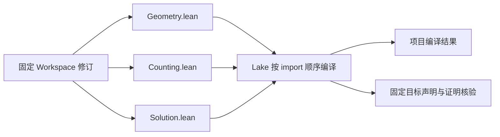

# Workspace 项目检查调查

> 状态为研究依据与接入方案。关联 [Issue #122](https://github.com/LuNa-shi/SwarmEnv/issues/122)；后续[用户决定](https://github.com/LuNa-shi/SwarmEnv/issues/127#issuecomment-6906617716)已批准独立 PR 实现、审核、实验及通过后合入。范围是提交固定 Workspace 修订、编译多个 Lean 模块，并保留最终证明核验。本文基于官方资料、部署版本源码和局部验证，不将设计或局部验证当作正式实验通过。

本文的“现有入口”分析以合并基线 `c987a44` 为起点；后续实现的实际请求、存储、权限、检查和清理流程见 [Architecture Services](../../architecture/04-services.md#locked-lake-project-preparation-and-compilation)。局部探针记录保留当时验证范围。

设一个 Bot 写 `Mission/Geometry.lean`，另一个写 `Mission/Counting.lean`，第三个在 `Mission/Solution.lean` 中引用两份结果。

```lean
import Mission.Geometry
import Mission.Counting
```

Judge 可以接收整个已保存修订，用 Lake 先编译几何和计数模块，再编译总证明。Lean 的 `import Mission.Geometry` 读取该模块编译得到的 `.olean`，因此不需要复制证明正文。`lake build +Mission.Solution` 是固定部署版本支持的模块目标写法，Lake 会构建项目中的递归导入依赖。若 `Counting` 也导入 `Geometry`，Lake 会按依赖顺序构建。项目内的模块排成无循环依赖。 [固定版 Lake CLI 源码](https://github.com/leanprover/lean4/blob/819816b2e0a3bf405af45ae5c7af2491d8f5bee6/src/lake/Lake/CLI/Help.lean#L100-L151) · [固定版模块构建源码](https://github.com/leanprover/lean4/blob/819816b2e0a3bf405af45ae5c7af2491d8f5bee6/src/lake/Lake/Build/Module.lean)



## Lean 项目怎样组织

| 文件或配置 | 所管内容 |
| --- | --- |
| `lean-toolchain` | Elan 用它选择 Lean/Lake 工具链。Judge 可直接调用已锁定的工具链。 |
| `lakefile.toml` 或 `lakefile.lean` | 指定包、依赖和构建目标。证明源码可以组织为 `lean_lib`，可执行程序通常声明为 `lean_exe`。Lean 形式还可声明自定义构建目标和脚本。 |
| `lake-manifest.json` | 固定直接和传递依赖的具体版本。Lake 会按清单同步依赖，缺少本地依赖时可能尝试获取。 |
| `Mission/*.lean` | Git 中可共享的证明源码。Lake 根据模块名和源码布局定位 `import`。 |
| `.lake/build` | 产出所在目录，可含 `.olean`、`.ilean` 和中间文件。Judge 自行生成本项目的产出。 |

Mathlib 的固定版本就是例子。它的默认目标 `Mathlib`、独立的 `Archive`、`Counterexamples` 和 `MathlibTest` 是不同的库目标。对本项目也一样，运行裸 `lake build` 会选择默认目标及其覆盖的模块。如果另有 `Mission/Unused.lean`，既没被导入也没被配置选中，构建 `+Mission.Solution` 可以成功，`Unused.lean` 仍未检查。全项目检查需要 Judge 定义所有纳入检查的源码路径，再把它们都作为模块目标，或者配置覆盖这些源码的库目标。Lake 的模块 glob 支持选择某个根及其子模块，或只选择其子模块。外部的 Mathlib 等依赖可由已固定的构建产出提供。 [Lake 参考手册](https://lean-lang.org/doc/reference/latest/Build-Tools-and-Distribution/Lake/) · [固定版 Lake Glob 源码](https://github.com/leanprover/lean4/blob/819816b2e0a3bf405af45ae5c7af2491d8f5bee6/src/lake/Lake/Config/Glob.lean#L17-L55) · [固定版 Mathlib 项目](https://github.com/leanprover-community/mathlib4/blob/0df444a360eaa60ab8c11dca51a86af692955474/lakefile.lean#L50-L90) · [Mathlib 工具链](https://github.com/leanprover-community/mathlib4/blob/0df444a360eaa60ab8c11dca51a86af692955474/lean-toolchain) · [Mathlib 依赖清单](https://github.com/leanprover-community/mathlib4/blob/0df444a360eaa60ab8c11dca51a86af692955474/lake-manifest.json)

现有部署固定 Lean 4.33.1，提交为 `819816b2e0a3bf405af45ae5c7af2491d8f5bee6`。本机帮助记录 Lake 为 `5.0.0-src+819816b`，支持 `lake build` 和 `lake lean`。`lake check-build` 只检测默认构建目标是否已配置，不能拿其成功退出作为项目编译通过。最新版官方手册中的 `lake check`、`lake comparator` 未出现在该部署的帮助中。可使用已有的 `lake build` 与 SwarmEnv 的最终核验入口。 [部署版本](../../../src/judge/final-tree-deployment.js) · [固定版 Lake 命令帮助](https://github.com/leanprover/lean4/blob/819816b2e0a3bf405af45ae5c7af2491d8f5bee6/src/lake/Lake/CLI/Help.lean#L13-L71) · [最新版 Lake 证明核验命令](https://lean-lang.org/doc/reference/latest/Build-Tools-and-Distribution/Lake/#lake-comparator)

同版本的本地小型验证使用 `globs = ["Proof.+"]` 覆盖 `Proof/` 内的模块。`Proof/Main.lean` 导入 `Proof/Geometry.lean` 成功编译。加入有错误的 `Proof/Unreferenced.lean` 后，即使没有模块导入它，构建也失败。把该文件换成含 `sorry` 的定理后，构建发出警告并成功退出。如果使用 `Proof.*`，Lake 还会查找根文件 `Proof.lean`。这个验证只涵盖小项目的构建和 import 行为。

## 接入 SwarmEnv 的建议

1. **从公共修订取完整源码。** Bot 先保存，再提交固定 revision。当前 `readWorkspaceCheckSource` 已经从公共 Workspace 导出树并核对 Mission 和权限，随后只返回 `--path` 指向的文本。因此项目诊断可以沿用这个导出入口，扩展成向 Judge 传递固定文件树的合同。Mission 最终提交已经把 `workspaceId`、固定修订、Git tree 和文件树交给 checker。 [Workspace 源检查入口](../../../src/runtime/runtime.js#L757) · [Mission 最终检查入口](../../../src/runtime/mission-submission.js#L390)
2. **Judge 决定构建范围。** 建议由可信部署中的规则规定项目源码目录、必需目标和锁定题目路径。Judge 枚举该范围内的 Lean 源码，在私有构建目录生成或注入受信 Lake 配置，将全部预期模块交给 Lake，并报告实际检查的文件。若一个未被任何模块导入的文件也属于项目源码范围，它的语法错误同样应使项目检查失败。Bot 不能通过改 `defaultTargets`、删掉根文件中的导入或换成只编译空库绕过这一范围。开发者可以基于同一规则在自己的工作环境迭代。 [Lake 默认目标与模块 globs](https://lean-lang.org/doc/reference/latest/Build-Tools-and-Distribution/Lake/)
3. **在隔离环境构建。** Lake 的 Lean 配置支持自定义构建代码，模块 elaboration 本身也可以执行代码。由 Judge 提供受信配置、固定工具链与只读依赖，隔离网络、私有文件和宿主权限，构建输出写入临时目录。预先准备受信依赖，校验版本、清单和产出，检查阶段离线运行。`--no-cache` 控制构建缓存下载，不能代替网络隔离，依赖材料也仍需齐备。Bot 上传的 `.olean`、原生插件、可执行配置和共享缓存不进入受信核验。 [Lake 配置及缓存](https://lean-lang.org/doc/reference/latest/Build-Tools-and-Distribution/Lake/) · [固定版 CLI 选项](https://github.com/leanprover/lean4/blob/819816b2e0a3bf405af45ae5c7af2491d8f5bee6/src/lake/Lake/CLI/Help.lean#L43-L71) · [现有隔离构建](../../../src/judge/lean-final-tree-verifier.js#L237)
4. **编译和最终证明分别出结果。** 项目编译可告诉 Bot 哪个模块或 import 出错。提交 Mission 时，在同一个固定树上完成构建后，从隔离环境导出目标证明，与可信题目声明比对，并沿用允许公理检查和 kernel replay。`sorry` 可以只产生警告，额外公理可能藏在被导入的辅助模块里，因此普通构建成功不能单独作为 Mission PASS。现有最终检查已能处理完整树和配置中固定顺序的 `localModules`，项目构建要替换的是候选模块的准备与编译方式，独立证明核验可以保留。 [Lean 官方证明验证说明](https://lean-lang.org/doc/reference/4.33.0/ValidatingProofs/) · [现有最终核验](../../../src/judge/lean-final-tree-verifier.js#L263)

普通诊断可以保留按单模块检查的入口供快速定位，另支持同一修订的项目检查。项目诊断、合并时的组合树检查和最终验收应使用一致的源码布局、模块发现和依赖环境。各阶段判定的对象仍各自固定。记录 Workspace ID、revision、Git tree、检查范围、目标模块、工具链与依赖身份、状态和诊断。这样 Bot 能区分“旧修订曾通过”“合并后整个项目通过”和“这一固定版本的 Mission 已验收”。现有 Task 文件交付还会匹配指定路径和 CheckResult 的实际路径。若后续允许项目 CheckResult 作为交付回执，需检查该指定路径属于实际编译范围，并继续验证所有现行绑定。 [现有 Task 交付校验](../../../src/task/task-service.js#L3581)

B1 的锁定入口目前是 `lean4/src/putnam_2025_b1.lean`。项目模式保留这个位置，把锁定入口所在目录作为源码根，接受根下可映射到 Lean 模块名的 `.lean` 文件。Workspace 根的 `lakefile.lean` 作为提交者配置忽略，其他非源码文件不参与构建，根目录之外的 Lean 源码或与依赖保留命名空间冲突的源码会收到范围错误。Lake 会给子进程设置自己的模块路径，从 shell 继承旧单文件检查的 `LEAN_PATH` 曾导致 `import Mathlib` 失败。新版路径为每个已加锁的预编译库生成本地 Lake 路径依赖，库产出只读挂载。真实隔离小项目已经验证 Mathlib、两个互相导入的辅助模块和目标证明参与一次构建，且之后能在同一个候选环境导出目标模块供独立核验。 [B1 固定目标配置](https://github.com/LuNa-shi/SwarmEnv/blob/dc011003fa0354a881b7a3ba9ba901fe36cbcac9/config/putnambench-12.json#L9) · [固定版模块构建源码](https://github.com/leanprover/lean4/blob/819816b2e0a3bf405af45ae5c7af2491d8f5bee6/src/lake/Lake/Build/Module.lean)

工程验证首先需要固定同一小项目，覆盖两份辅助文件被总证明引用、未被引用的项目源码有错误、缺失或循环 import、旧修订与新修订结果分开、目标类型改变、辅助模块引入禁用公理以及超时取消。项目源码目录、是否允许留有草稿的非交付目录、过渡期保留哪种快速诊断入口，以及普通检查是否按冷启动与热启动分别设限，属于待定方案。
