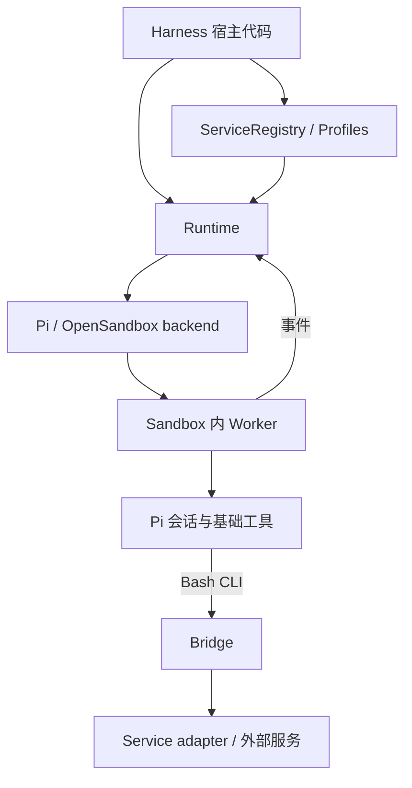

# Core 设计：Minimal Multi-Agent System Harness

> Phase 0005 · 本阶段目标规范 · 2026-11-23
>
> 来源：[Notion Core 设计](https://app.notion.com/p/4214e07aa023818d80cdd0a88891299c)，源修订时间 `2026-11-23T11:10:12.147Z`。
> 固定实现基线：`fcbe0107d8b4b204db0bcfa2a1ad1b2339c6293e`。本文完整保留正文与 API 附录；入库不表示代码已实现或真实验证通过。

## 设计概览

murm Core 是面向开发者的 minimal multi-agent harness。它负责运行独立 Agent、提供连续输入和运行事件、落实执行隔离与能力授权。Harness 通过公开模块编写协作逻辑，组合任务池、消息、公共成果库或其他共享服务。

**文档状态：本阶段目标规范；新接口与迁移尚待实现和验收。** 更新：2026-11-23。Q1–Q8 为已确认产品决策；精确 API、类型、manifest v2 与 backend 迁移是实施目标。它们尚未作为新版本实现，示例不构成真实 backend 验收证据。本阶段权威关系与变更规则见[阶段入口](README.md)。

配套阅读：[2026-11-23｜Harness 设计：Build your own swarm](02-harness.md)。本文是公共 API 的定义来源；配套文档展示五种 Harness 的装配、协作流程和验收。


## 1. 目标、范围与职责

### 1.1 已确认的产品约束

- 面向需要设计协作方式的开发者，提供稳定、可导入的模块和代码 API。
- 每个 Agent 默认拥有独立模型会话、sandbox 和私有 `workDir`；共享 Git 与具体协作设施按 Harness 需要配置。
- 模型基础工具保持 `read / write / edit / bash`；扩展能力以 Bash 命令接入。
- Harness 由开发者编写代码与配置，Core 封装资源管理、Worker 控制和内部状态。
- **Q8 已确认：一周版最低交付是 `flat + agensh + 最小开发者接入示例`，三者复用同一 Core。** `subagents / flat / Substrate / agensh / Lead-Worker` 保留为完整示例目标。
- 定向用户输入优先；全群反馈和完整交互产品暂缓。等待、唤醒与长命令托管按实际成本另行评估。**Q4 已确认：`send` 省略 mode 时默认 `steer`；调用方可显式选择 `followUp`。** 示例继续显式填写 mode，方便核对投递时机。

### 1.2 模块职责

| 范围 | Core 的职责 | Harness / Service 的职责 |
| --- | --- | --- |
| Agent 生命周期 | 身份、容量、创建、状态、输入、停止、资源回收 | 启动数量、角色、替换策略、何时结束 |
| 输入与事件 | 向指定 Agent 提交输入；回报接纳状态与执行事件 | 输入来源、收件人、合并、排序、续轮、结果回传 |
| 执行资源 | sandbox、Worker、目录准备、权限、受控导出 | 镜像、初始文件、所需网络目标、保留哪些产物 |
| Service 接入 | 注册表装配、发现、CLI、可信身份、操作权限与 schema 校验 | 数据模型、事务、记录归属、业务幂等与外部账户 |
| 运行结束 | 关闭本次 Runtime 的新工作入口，覆盖在途创建和所有 Agent | 停止 router / timer，判断业务完成，关闭自建共享设施 |

协作政策的变化应集中在 Harness 和相应 Service。新增一个 mode 不应要求 Core 增加按 mode 名称分支的逻辑，也不应要求无 Task 的 Agent 创建虚构的 Mission 或 Execution。

## 2. 系统组成与运行模型

### 2.1 核心对象

| 名称 | 定义 |
| --- | --- |
| Core | 可导入的库模块、公共类型和接口 |
| Runtime | `createRuntime` 返回的宿主对象，管理一次运行中的多只 Agent、记录与关闭状态 |
| Harness | 使用 Core 编写的宿主模块，组合 Profiles、Services、controller / router、输入和结束政策 |
| Agent | 独立身份、模型会话和私有工作目录；存活期间可连续处理输入 |
| Profile | 角色 prompt、模型、镜像、资源默认值及可调用能力的配置 |
| Service | 提供业务操作、维护业务数据的组件；可在宿主内执行，也可通过 adapter 连接外部设施 |
| Worker | sandbox 内的受信控制进程，管理 Pi 子进程、转发 RPC / 事件、执行受控文件操作 |
| Slot | 本 Runtime 的 Agent 容量单位；本稿建议 idle、exited 和清理 pending 的 Agent 继续占用 |

一个 Core 包可被多个程序使用；一个程序也可创建多个 Runtime。**本稿建议一个 Harness 运行使用一个 Runtime，里面管理多只 Agent。** 容量 `maxAgents` 属于该 Runtime；跨 Runtime 的全局调度不在首版范围内。

`Session` 指 Agent 的底层模型会话；`settled` 指一次执行收束；`Task / Execution / Mission / Material / Workspace` 保留 TaskPool 的领域含义。Workspace 专指 TaskPool 的公共 Git 项目；Agent 私有目录统一称为 `workDir`。旧容量字段 `coreId` 在迁移时改用 Slot 含义，不能与新 `Runtime.id` 混用。[现有术语](https://github.com/LuNa-shi/SwarmEnv/blob/fcbe0107d8b4b204db0bcfa2a1ad1b2339c6293e/GLOSSARY.md)

### 2.2 执行与调用链



Runtime、Bridge 和 Harness 在同一宿主进程内运行；业务 Service 可以在进程内或外部部署。Worker 与 Pi 位于每个 Agent 的 sandbox。当前 Worker 启动低权限 Pi 子进程，提供 `/start`、`/rpc`、`/events`、`/stop` 和受控文件入口；管理凭据不传给 Pi。协作决策与事件路由由 Harness 实现。[Worker 启动](https://github.com/LuNa-shi/SwarmEnv/blob/fcbe0107d8b4b204db0bcfa2a1ad1b2339c6293e/services/opensandbox-agent/Dockerfile) · [Worker 实现](https://github.com/LuNa-shi/SwarmEnv/blob/fcbe0107d8b4b204db0bcfa2a1ad1b2339c6293e/scripts/opensandbox-agent-worker.mjs)

## 3. 公开模块与装配

### 3.1 模块入口

| 建议入口 | 提供内容 |
| --- | --- |
| `@murm/core` | `createRuntime`、Runtime、Profile、事件、资源和操作回执类型 |
| `@murm/core/services` | ServiceRegistry、manifest / adapter 合同、createInProcessAdapter |
| `@murm/core/backends/pi-opensandbox` | 当前 backend 工厂及其配置类型 |
| Core 内部 | Agent 登记、Worker RPC、Bridge、模型 token、网络/磁盘隔离、在途请求与清理记录 |

包名是建议名，尚不表示已发布。首版可在一个 npm 包中使用多个 exports；物理拆包不影响这里的依赖方向。**Q1 已确认：首版仅支持 Pi 1.3.0 + OpenSandbox，不公开通用第三方 backend 插件接口。** Backend 作为内部执行边界和工厂返回的不透明句柄使用，以后扩展其他执行器不属于首版验收。一个 backend 句柄由一个 Runtime 持有；多个 Runtime 分别创建句柄。

### 3.2 创建 Runtime

```ts
import { createRuntime } from "@murm/core";
import { ServiceRegistry } from "@murm/core/services";
import { createPiOpenSandboxBackend }
  from "@murm/core/backends/pi-opensandbox";

const services = new ServiceRegistry();
// 在这里注册 Harness 的 manifest + adapter。
const runtime = await createRuntime({
  backend: createPiOpenSandboxBackend(config.backend),
  profiles: {
    worker: {
      prompt: "完成明确的工作，保留可检查的结果。",
      model: "default", image: config.image,
      writable: true, services: {},
    },
  },
  services, maxAgents: 2, outputDir: config.outputDir,
});
```

`createRuntime` 完成以下装配后返回：取得注册表与 Profile 的不可变快照；合入内置 Agent Service 并拒绝保留 ID `agent` 被覆盖；校验 Profile 引用的操作和可 spawn 的角色；校验 backend 能力、模型与部署配置；创建本次记录目录、Bridge 和模型访问入口。它尚未分配 Agent sandbox。

**Q2 首版：ServiceRegistry 和 Profile 在 `createRuntime` 前装配，运行中不可增删/修改，Runtime 使用冻结快照。** 运行时仍可按已注册 Profile 动态 spawn Agent，并由宿主向具体 Agent 提供 spawn 允许的初始输入、文件、bindings 或 secretEnv；这不等于修改 Profile 或注册表。动态轮换已存活 Agent 的凭据不在首版范围。

[#235 的 Q2 后续扩展](06-lead-worker-dynamic.md)规定运行中的受控 Profile/Service 新增、Service 退役与实例级授权。静态装配仍使用独立快照，新增与退役经公开 Runtime 接口提交。

### 3.3 当前 backend 的部署与模型配置

`createPiOpenSandboxBackend(config)` 返回配置句柄，由 createRuntime 启动需要的内部入口。Profile.model 是 models 表的键；Profile.image 选择每个 Agent 的镜像。工厂的完整类型在附录 A，参数分组如下。

| 配置组 | 必填内容 | 可选内容与用途 |
| --- | --- | --- |
| sandbox | lifecycleBaseUrl | apiKey、execdToken、endpointHost、resourceLimits、commandTimeoutMs；映射已有 OpenSandboxManager 配置 |
| bridge | host、publicUrl | publicUrl 使用当前部署支持的 `{port}` 占位，必须从 Agent 网络可达 |
| modelGateway | host、advertiseHost | requestTimeoutMs、maxOutputTokens；实际请求期限再受 Core/领域授权收紧 |
| models | 别名 → provider、model、upstream.url/headers | upstream 凭据仅在宿主持有；Profile 只引用别名 |
| isolation | network=`local-docker`、disk.bytes/inodes | 声明当前网络与磁盘执行前提 |

这些分组是对现有装配参数的包装。当前 backend 首版范围是 Pi 1.3.0、OpenSandbox 的本地 Docker 部署、现有 HTTP(S) `/v1/responses` 模型路径和时间上限模式。它依赖宿主对本地 sandbox 网络/磁盘的受控操作，不承诺任意远程 OpenSandbox、任意 Pi 协议或所有 provider 已可直接使用。模型别名必须与镜像内经过校验的 catalog 匹配；额外模型和其他预算策略按明确合同扩展。

createRuntime 内部建立 Bridge、模型入口和记录目录，spawn 才分配 sandbox。模型 gateway 的 upstream headers、provider 管理凭据、内部 token 不进入 Profile.env 或 Agent 的 secretEnv。当前 manager 将 image 固定在构造器；迁移时需按 Profile 选择资源配置，不能静默让所有角色使用同一镜像。

来源：[现有 runner 装配](https://github.com/LuNa-shi/SwarmEnv/blob/fcbe0107d8b4b204db0bcfa2a1ad1b2339c6293e/src/benchmark/putnam-runner.js)、[OpenSandboxManager](https://github.com/LuNa-shi/SwarmEnv/blob/fcbe0107d8b4b204db0bcfa2a1ad1b2339c6293e/src/runtime/opensandbox-manager.js)、[模型访问入口](https://github.com/LuNa-shi/SwarmEnv/blob/fcbe0107d8b4b204db0bcfa2a1ad1b2339c6293e/src/agent/bot-model-access.js)。

### 3.4 模型调用的领域授权接缝

现有 AgentModelAccess 直接读取 TaskService、Mission、Execution、lease 和 deadline。仅将 Runtime 与 Bridge 去 Task 化，独立 Agent 的模型请求仍会被旧校验拒绝。因此 Core 的基础身份与存活校验必须独立；TaskPool 的领域限制通过可选 `modelAccessPolicy` 接入。

| 接口 | 合同 |
| --- | --- |
| `authorize(caller)` | 同步返回 ModelPermit 或 null；caller 的 Runtime/Agent/Profile/model 由 Core 确定 |
| `ModelPermit` | phase、有限 deadlineAt；需要持续核验归属时提供 lease.key/version/expiresAt；两个时间戳均为 Unix epoch 毫秒 |
| `withCommit(commit)` | 同步、恰好一次执行 commit；不得 await、延后执行或重复提交 |

未配置 policy 时，Core 执行自身的身份、存活、关闭、模型配置和请求期限检查，采用 work 阶段，不要求任何 Task。配置 policy 后，在同一个 withCommit 窗口内先检查 Core 状态，再读取领域 permit、预留请求账本并启动 upstream 请求，退出窗口后才等待网络 IO。policy 返回 null、抛错或 permit 无效均拒绝调用。

有 lease 的模型流持续复核授权；key/version 变化、租约或期限失效时中止原请求。Core stop 和 token revoke 也主动中止自己管理的请求。TaskPool 将当前 validateAgent 逻辑提取成 policy，映射原有 Execution ID/fencing/lease；withCommit 复用 `TaskService.withServiceLifecycleWrite`。该同步窗口保护授权与提交的先后，不宣称数据库与 HTTP 具有原子事务。[当前 gateway 授权与账本](https://github.com/LuNa-shi/SwarmEnv/blob/fcbe0107d8b4b204db0bcfa2a1ad1b2339c6293e/src/agent/responses-budget-gateway.js) · [Task 生命周期窗口](https://github.com/LuNa-shi/SwarmEnv/blob/fcbe0107d8b4b204db0bcfa2a1ad1b2339c6293e/src/task/task-service.js)

## 4. Runtime API 与状态

### 4.1 公共接口索引

| API | 作用 | 成功回执 |
| --- | --- | --- |
| `createRuntime(options)` | 装配本次运行 | 可接纳 Agent 的 Runtime |
| `spawn(options)` | 创建身份、资源、bindings 和会话，**不提交工作输入** | 就绪的 AgentInfo |
| `get(agentId)` | 读取当前保存的状态 | AgentInfo；关闭后记录仍可读 |
| `send(agentId, input, {requestId, mode?})` | 提交输入；省略 mode 默认 `steer`，显式 `followUp` 等当前工作收束 | InputReceipt，说明接纳结果 |
| `onEvent(handler)` | 订阅运行事件 | 取消订阅函数 |
| `files.prepare(agentId, options)` | 准备空且只读的工作目录 | PreparedFiles，含版本与摘要 |
| `files.grant(options)` | 对当前 prepared 资源开放写权限 | GrantReceipt |
| `stop(agentId, {timeoutMs})` | 停止一个 Agent 并收尾 | StopReceipt，分开报告执行与清理 |
| `close({timeoutMs})` | 关闭本 Runtime 并收尾全部登记资源 | CloseReceipt，含所有 Agent 与 Runtime 自身的清理结果 |

精确类型集中在附录 A。`spawn → 建立 Harness 路由 → send` 是所有宿主示例的启动顺序。这样可以分别处理资源创建失败和输入接纳未知，避免初始输入掩盖已创建的 Agent 身份。

### 4.2 Agent 状态

| 状态 | 含义 | 是否可 send |
| --- | --- | --- |
| starting | 已登记、预留容量，资源正在建立 | 否 |
| idle | 会话就绪且当前空闲 | 是 |
| running | 会话正在处理工作 | 是，省略 mode 默认 steer，也可显式选择 followUp |
| exited | 执行进程已退出，资源尚可能存在 | 否 |
| closing | 输入已关闭，正在收尾或等待重试 | 否 |
| closed | 所需采集和资源销毁已确认，容量已释放 | 否 |

**Q5 已确认：** `settled` 通常使 running 回到 idle，保留 Session、workDir 和 Slot；既不关闭会话，也不代表业务任务完成。意外进程退出使 Agent 进入 exited；Harness 根据事件调用 stop，或由整体 close 收尾。已处于 closing 的 Agent 发出 exit 后继续完成清理，不退回可执行状态。

Core 在调用 provider 创建资源之前分配 agentId、预留容量并登记请求。部分启动失败仍属于本次 Runtime 的资源；即使 spawn 未返回 AgentInfo，错误回执和 close 也能覆盖它。父子关系在执行任何 child 输入前登记；宿主指定 parentId 时同样校验它属于本 Runtime，且处于 idle/running。父 Agent 停止不隐含级联停止所有 child；Subagents Harness 决定树级结束，Runtime.close 覆盖整个运行。

### 4.3 错误与幂等

公共错误使用稳定 `code`、操作名与对象身份，详情包含可检查的原因。参数、权限、状态与版本冲突在已知未执行时直接报错；外部调用已经发出而结果无法确定时报告 unknown / pending，不把连接失败等同于远端未执行。

createRuntime、spawn、files.prepare/grant 与 send 的单次宿主等待也必须有上限；本稿统一建议默认 60 秒，底层较短的超时仍适用。到期时，资源操作通过 ResourceError 报告 pending/OPERATION\_UNKNOWN，send 返回 unknown；这是观察上限，不是远端取消或整个 Harness 的总预算。底层重试不能无限延长这个上限。

已有 Runtime 继续接管迟到的资源结果，后续 close 覆盖它们。createRuntime 失败时尚无可用 Runtime，由工厂内部保留初始化与清理记录、接收迟到结果并收尾，通过 ResourceError 提供 pending 状态和可用的报告位置。首版资源 API 不接 AbortSignal；Harness 的取消在该有界操作返回后进入收尾。

| 错误类别 | 典型情况 |
| --- | --- |
| INVALID\_CONTRACT | 参数、Profile、manifest 或部署配置无效 |
| NOT\_FOUND / NOT\_ALLOWED | 对象不存在、跨 Runtime 或调用者无权访问 |
| CONFLICT | 容量不足、状态冲突、requestId 参数冲突或资源版本冲突；details 说明类别 |
| SERVICE\_TIMEOUT / SERVICE\_UNAVAILABLE | backend 或 Service 调用失败；是否可重试仍要结合提交状态 |
| OPERATION\_UNKNOWN | 资源变更可能已发生，需保留请求身份核对 |

请求去重键为 `runtime + caller + operation + target + requestId`。相同键与相同参数复用同一次提交，参数不同报冲突。send 的重试用于读取同一提交记录；unknown 在取得新证据后可以更新，但不能因此再次写入 Pi。并发 stop / close 复用同一收尾流程，后续调用可重试 pending 项。

去重必须贯穿 Core、adapter 和 Worker。现有 adapter 会在部分超时后重试，而 Worker 只缓存完成结果，存在进行中请求被再次提交的窗口；迁移时需加入进行中请求复用，或禁用未知结果的透明重投。[adapter RPC](https://github.com/LuNa-shi/SwarmEnv/blob/fcbe0107d8b4b204db0bcfa2a1ad1b2339c6293e/src/agent/opensandbox-agent-adapter.js) · [Worker RPC](https://github.com/LuNa-shi/SwarmEnv/blob/fcbe0107d8b4b204db0bcfa2a1ad1b2339c6293e/scripts/opensandbox-agent-worker.mjs)

## 5. 输入、事件与完成语义

### 5.1 输入时机

**Q4 已确认：`steer` 为 `runtime.send` 及 Agent Service `send` 的默认输入模式。** 省略 mode 与 `mode: "steer"` 等价；`followUp` 需显式指定。这里的 steer 是在 backend 可处理输入的执行边界加入，并非立即打断正在执行的 Bash，也不等于 abort/interrupt。PeerMesh 的串行 router 必须明确传 `followUp`，以保持每批输入的整轮完成边界。

| Agent 状态 | followUp | steer |
| --- | --- | --- |
| idle | 在原 Session 开始工作 | 在原 Session 开始工作 |
| running | 排队，待当前工作本来准备结束时处理 | 排队，在 backend 支持的执行边界加入当前工作 |
| starting / exited / closing / closed | 拒绝 | 拒绝 |

当前 Pi 的 steer 在工具执行边界交付，不能立即打断正在运行的长 Bash。followUp 可在同一次底层 run 中继续被消费，因此不能假定每条输入之间都有一个 settled。interrupt 涉及取消队列和当前执行，保持为单独的后续扩展。[Pi RPC 输入](https://github.com/earendil-works/pi/blob/71023aec1546d6d677a65669c5665c0927ce0dd0/packages/coding-agent/docs/rpc-commands.md) · [Pi 会话执行](https://github.com/earendil-works/pi/blob/71023aec1546d6d677a65669c5665c0927ce0dd0/packages/coding-agent/src/core/agent-session.ts)

### 5.2 接纳与完成

- `accepted`：取得 backend 的接纳回执。`started` 表示开始执行，`queued` 表示进入队列，`handled` 表示已由扩展处理，未必产生模型执行。
- `unknown`：请求可能已交付，当前没有确定回执；保留 inputId，不能换 ID 自动重发。
- `settled`：当前会话执行收束。事件携带这一执行的 outcome、output 与 error 快照；`completed` 只表示执行收束成功，业务是否完成由 Harness 验收。

**本稿的最低合同不承诺每条 inputId 对应独立完成事件。** inputId 用于提交身份、去重和排查；多条输入可能被合并处理。精确追踪每条输入消费与完成属于更强的后续合同，不以事件 cursor 推测。

需要“提交一项工作并等待”的 Harness，可在唯一输入源、初始 idle、无待消费输入和自动续轮的条件下，将一次新 send 与后续 settled 关联。这个有期限 helper 放在 Harness；PeerMesh 的串行 router 可使用该条件。多来源子结果和实时纠正不能直接套用它。实现与限制见配套 Harness 文档。

### 5.3 事件合同

| 事件 | 内容与用途 |
| --- | --- |
| output | 一条已形成的 assistant 文本输出；不把底层任意 token 增量作为稳定 API |
| settled | 本次执行 outcome=`completed / failed / aborted`，及对应 output/error 快照 |
| error | 错误快照与 fatal 标记；fatal 表示当前 Agent 无法继续正常执行 |
| exit | 执行进程已确认退出；expected 区分受控停止与意外退出，不代表 sandbox 已删除 |

每个 Agent 的 seq 单调递增。Core 先更新状态、cursor 和结果，再同步通知订阅者。订阅者抛出的异常被记录，不能中断 Core 或其他订阅；Core 不等待 handler 发起的异步业务。Harness 自己管理任务队列、错误、去重和取消。

订阅是本次宿主进程内的实时事件出口，不保证任意历史重放或跨进程恢复。backend 在首次模型执行前完成事件绑定；事件通道出现不可恢复缺口时必须报告错误，不能继续伪造完整执行序列。Subagents 回传使用 settled 的输出与错误快照，`get.lastError` 仅供诊断。

## 6. Profile、Service 与权限

### 6.1 Profile 的配置边界

Profile 由宿主建立并冻结。`model` 选择 backend 配置中的模型别名；`image` 包含角色所需私有命令；`writable` 和 collect 是资源默认值；`services` 列出可调用的 Service operations。宿主 spawn 可覆盖本稿明确开放的资源参数；Agent 不能通过工作输入修改这些政策。

`Profile.env` 是宿主显式给该角色的非秘密环境变量；不会任意继承宿主环境。`SpawnOptions.secretEnv` 是宿主发给特定 Agent 使用的受限凭据。目标 Agent 能读取这些凭据；其值不进入 AgentInfo、事件和普通日志。真正的模型 upstream 凭据、Worker 管理 token 和 Core 保留字段由受信侧管理，禁止覆盖。

`Profile.network.allow` 指定额外目标；Bridge 与模型 gateway 自动加入。当前 backend 首版只接受非 loopback IPv4 字面量的 HTTP(S) origin，按目标 IP/port 放行。Gitea 同一端点的 REST 操作仍受该账户的 upstream ACL 约束，不提供 Git-only 路径限制。此能力需要修改当前只允许 Bridge 与 gateway 的网络规则。[当前网络隔离](https://github.com/LuNa-shi/SwarmEnv/blob/fcbe0107d8b4b204db0bcfa2a1ad1b2339c6293e/src/runtime/docker-bot-network.js)

#### Core 启动提示与 Service 发现

Core 统一装配普通 Agent 的初始 system prompt。开头介绍隔离 Sandbox 和 `swarm` CLI，随后在 `<tools>` 中列出四项原生工具，并在 `<services>` 中列出已注册且当前 Profile 获准调用的操作。目录使用与 `swarm service list` 相同的权限过滤，显示 Service 用途、操作命令和简短说明。详细参数通过操作命令的 `--help` 或 `swarm service view <id>` 查阅。Bridge 调用仍按可信身份与当前权限校验。普通启动不注入 Pi 开发文档目录。

`Profile.prompt` 可选，默认留空。Harness 需要角色或协作说明时，Core 将其追加为 `<added_system_prompt>`。项目、Mission 或子任务通过后续 user message 发送。[已确认规范](https://github.com/LuNa-shi/SwarmEnv/issues/202#issuecomment-7163618408)

### 6.2 Service 注册与可信调用

采用 `ServiceRegistry.registerService({manifest, adapter})` 和 `adapter.invoke(request)`。注册表装配、操作发现与 Bash 入口沿用现有结构。HTTP 接入遵循同一个 ServiceAdapter 合同，由 Harness 选择和配置具体实现。新通用 manifest 的合同版本在附录 A 标为 `2`：保留操作名、schema、help、side\_effect、idempotent 与错误定义，将旧 `bound / recovery` audience 和 Task/Execution 上下文校验交还 TaskPool 兼容适配。旧 v1 manifest 必须显式转换，不能静默忽略领域授权。[Registry](https://github.com/LuNa-shi/SwarmEnv/blob/fcbe0107d8b4b204db0bcfa2a1ad1b2339c6293e/src/sdk/service-registry.js) · [manifest](https://github.com/LuNa-shi/SwarmEnv/blob/fcbe0107d8b4b204db0bcfa2a1ad1b2339c6293e/src/sdk/service-manifest.js)

标准调用顺序：

1. Agent 通过 `swarm <service> <operation>` 提交参数和 request-id。
2. Bridge 从当前连接恢复可信 Agent 身份，检查 Runtime / Agent 状态与 Profile 操作权限。
3. Registry 执行实际 `input_schema` 校验；仅有 schema 声明不算验证。
4. Bridge 生成 caller；Registry 完整转发到 adapter。HTTP adapter 通过受信连接传递等价上下文。
5. Service 检查记录归属、业务状态、事务与重试，返回结果；Registry 校验输出合同并将违规报告为 Service 错误。

`caller` 包含 runtimeId、agentId、profile，以及当前 Service 的 binding。bindings 是宿主预置的身份引用；Bridge 只传当前 Service 对应的一个引用，不能把其他 Service 的凭据一起暴露。输入 JSON 和 envelope 中的同名字段都不能覆盖 caller。旧 Registry 和 HTTP adapter 会重新组装请求，所以 caller 的迁移必须覆盖整条链路。[当前 adapter](https://github.com/LuNa-shi/SwarmEnv/blob/fcbe0107d8b4b204db0bcfa2a1ad1b2339c6293e/src/sdk/service-adapter.js)

读操作可在其合同允许时重试；写操作的业务幂等由 Service 自己实现。schema 校验失败发生在调用前；输出校验失败可能发生在业务写入后，必须保留 operation\_id，不能因返回格式不符自动重做写操作。

### 6.3 Agent-facing 控制能力

| 操作 | Agent 可提交字段 | Core 的可信处理 |
| --- | --- | --- |
| agent spawn | profile、request-id；可选 input 与 mode，省略 mode 默认 steer | 检查 `services.agent` 和 spawnProfiles；parentId 取真实 caller；使用目标 Profile 的资源默认值 |
| agent get | agent-id | 检查同一 Runtime，目标为自己或直接 child |
| agent send | agent-id、input、request-id、可选 mode（默认 steer） | 检查同一 Runtime，目标为自己或直接 child，按 send 合同提交 |
| agent stop | agent-id、request-id | 检查目标为直接 child；返回子 Agent 的停止回执 |
| files.prepare/grant、bindings、secretEnv、collect 覆盖 | 不通过 Agent Service 暴露 | 仅宿主 API 使用 |

Agent Service 的 spawn 是便利组合：先创建 Agent，再按指定 mode 提交初始输入；未提供 mode 时按 Q4 使用 steer，返回 `AgentSpawnReceipt`。其中 initialInput 在未提供 input 时为 null，提交后为 InputReceipt，明确拒绝时为 `{status: "rejected", error}`。输入未知或被拒绝仍保留 `agent.id`，不能把它误报成资源未创建。相同 spawn requestId 复用同一个 child 与初始输入提交，不重新创建或换 ID 重发。全局 child 事件处理器必须先安装。

动态 child 使用目标 Profile 的资源默认值，不继承 parent 的 bindings 或 secretEnv。本稿 Agent Service 不包含动态外部账户分配；需要独立外部身份的 Agent 由宿主完成账户准备并通过 spawn 注入。

首例不提供通过 agent stop 同步关闭调用者自身的语义，避免在 Bash 回执发出前杀死调用进程；既有 `agent exit` 的兼容行为留在 TaskPool adapter。宿主始终可 stop 任意本 Runtime Agent。父 Agent 权限、递归深度与资源默认值由 Profile/Harness 决定。

## 7. 文件准备、授权与产物

### 7.1 初始文件与准备回执

FileSeed 是相对于 workDir 的普通文件集合，支持 utf8 / base64 内容及 `0644 / 0755` 模式，默认 0644。拒绝绝对路径、路径逃逸、越界链接和未支持的特殊文件。摘要覆盖规范路径、实际字节和模式；既有文件大小限制由 backend 明确校验，不得静默截断。

spawn 的 files 在模型工作前安装；writable=true 的 Agent 完成准备与授权后才返回 idle。`files.prepare` 用于后续准备尚为空且只读的目录，允许 TaskPool 的发现会话正在等待 take 调用返回；文件操作由受信 Worker 暂停相关写入者并执行。它不承担任意覆盖运行目录的职责。

prepare 返回 `{agentId, version, digest}`。grant 只接受 Core 已登记的当前有效回执，校验 Agent、版本、摘要和关闭状态；调用者伪造的同形对象不能获得权限。重复 requestId 返回原回执。授权与关闭共享状态检查；结果未知时进入核对或停止，不继续正常交接。

<a id="72-与-flat-的交接"></a>

### 7.2 与 TaskPool 的交接

TaskPool 决定 Task 认领、Workspace revision、Execution lease/fence、输入来源和失败补偿；Core 只执行确定的文件准备和权限操作。Task fencing version 与 PreparedFiles.version 分别表示领域归属和资源版本，由 TaskPool 保存映射，不能互相代替。

TaskPool 在 prepare 期间保留租约检查；在 start\_execution 前停止准备期 heartbeat、刷新领域版本，再调用 grant，并进行授权后的领域复核。失效或结果未知时先 stop Agent，确认 execution=stopped 后再释放任务归属。此过程不声称 Task 数据库与文件系统具有跨组件原子事务。[现有 prepare/start/grant](https://github.com/LuNa-shi/SwarmEnv/blob/fcbe0107d8b4b204db0bcfa2a1ad1b2339c6293e/src/runtime/runtime.js)

### 7.3 收尾采集

**Q3 已确认：Agent 间不直接共享 workDir；Git、Service 或显式 artifact 才是跨 Agent 成果交接通道。**

collect 在分配资源前登记并在 Agent 生命周期内固定，所有 stop/close 路径使用同一政策。paths 相对于 workDir；includeGit 明确是否包含 Git 历史；maxBytes 是硬上限；required 指定失败是否阻止资源删除。省略 collect 时仅保留 Core 运行记录，不承诺私有目录中的文件会自动保存。

includeGit 与 paths 的组合应得到可解释的归档清单；超限或文件缺失明确报告，不截断后宣称成功。导出在 Agent 进程停止后由仍存活的 Worker 执行，结果写到本次 outputDir 的 Agent 子目录。启动凭据置于进程环境或受信位置，不作为普通 FileSeed 混入 workDir；Agent 自行写入工作目录的内容仍属于其文件，不能声称归档会自动识别并删除所有秘密。

现有 Workspace snapshot 排除 `.git`，要求 ACTIVE Execution，并有限额；新的 Agent 收尾导出必须有独立的 Agent 资源授权，支持 closing 状态。[当前 snapshot](https://github.com/LuNa-shi/SwarmEnv/blob/fcbe0107d8b4b204db0bcfa2a1ad1b2339c6293e/scripts/sandbox-project.mjs)

## 8. 停止、关闭与记录

### 8.1 停止执行、保存成果、删除运行环境

**Q6 已确认：如果事先标记为 required 的成果导出失败，停止 Agent 执行后保留对应 sandbox 与 Slot，报告 cleanup=pending，允许后续排查和重试。** 可选采集失败仍按相应政策清理，不代表所有错误都无限保留容器。

以 PeerMesh 为例：Agent 的私有目录里可能有尚未提交的代码，也可能有已经 commit、尚未 push 到 Gitea 的提交。结束本次运行时，需要把事先指定要保留的这些成果保存到 sandbox 外，再删除运行环境。

正常收尾按以下顺序执行：

1. 目标 Agent 进入 closing，关闭它的新工作入口；停止模型执行和它启动的相关命令，确认文件不再被这些进程修改。
2. 保留 Worker 的受控文件连接，按 collect 保存指定文件、所需 Git 历史、输出与错误，并记录保存位置。
3. 必须保存的成果已保存成功后，销毁 sandbox、撤销访问并确认结果，最后释放 Slot。

collect.required 表示 Harness 在启动前声明“这些成果必须保存”。**已确认：如果 Agent 已停止，但这些 required 成果没有保存成功，就暂时保留该 sandbox 和 Slot，报告失败原因，排查后可重试 stop/close。** 好处是避免直接删除尚未保存的成果；代价是该资源和容量暂时不能释放，可能影响后续 Agent 启动。保留现场的范围与期限由宿主后续处置，首版不增加自动恢复系统。

已推送到共享 Git、已写入公共 Service 的数据按 Harness 的保留政策处理。本节主要解决仍在 Agent 私有目录中的成果。可选采集失败会保留错误记录，并允许继续销毁；若连 Agent 是否已停止都无法确认，则记录 execution=unknown，不能按“已停止”释放领域工作。

当前 kill、session.stop 和 manager.stopAgent 会分别触发删除或释放 Worker 连接。迁移时将这些动作拆开，由 Runtime 唯一组织停执行、导出、销毁，防止外层采集之前底层已删除资源。[adapter 停止](https://github.com/LuNa-shi/SwarmEnv/blob/fcbe0107d8b4b204db0bcfa2a1ad1b2339c6293e/src/agent/opensandbox-agent-adapter.js) · [manager 停止](https://github.com/LuNa-shi/SwarmEnv/blob/fcbe0107d8b4b204db0bcfa2a1ad1b2339c6293e/src/runtime/opensandbox-manager.js)

### 8.2 有期限的 close

关闭操作的等待时间有上限，避免一次保存或删除故障让宿主程序一直卡住。stop/close 的 timeoutMs 必须为正且有限；省略时本稿建议最多等待 60 秒。时间到了就返回当前进度与未完成项，后续可以检查原因并重试；超时本身不表示操作已经成功，也不表示远端请求已取消。

回执中的状态分别回答两个问题：

| 字段与值 | 含义 |
| --- | --- |
| execution=stopped | 已确认 Agent 和相关执行停止；成果保存或资源删除仍可能未完成 |
| execution=unknown | 暂时无法确认是否已经停下，例如没有取得远端回执 |
| cleanup=complete | 必须保存的成果与资源清理已按约定完成 |
| cleanup=pending | 收尾尚未完成；可能卡在保存成果，也可能卡在删除资源，报告须写出具体原因 |

Core 继续保存已发出的请求及待处理资源身份，迟到的创建结果仍纳入收尾。进程崩溃后的自动恢复不属于本稿最低保证，记录需支持人工核对。

close 先关闭本 Runtime 的新 spawn/send/resource 请求，再收尾登记 Agent 与在途创建；即使部分失败也汇总其他对象的结果。CloseReceipt 的 cleanup 同时覆盖 Agent、Bridge、内部模型入口和 backend 资源。普通清理失败以回执报告；意外异常也不能使 Harness 丢失原始业务错误。

Harness 先停新事件与续轮，取消未提交工作；所有异步等待都有期限或 AbortSignal。Runtime.close 返回后，Harness 根据回执结束剩余等待并保存业务结果、cleanup 与清理异常，再关闭自己拥有的 Service。未知执行状态所需的依赖保留并记录；不靠一次 exit 事件推断全部资源已释放。

### 8.3 可检查记录

outputDir 为本 Runtime 的独立记录位置，保存配置摘要、Agent/父子身份、输入来源与 requestId、事件、Service 调用结果索引、产物清单和清理回执。环境变量和凭据按用途脱敏，不记录 secretEnv 值。

ResourceError 在已创建身份时提供 runtimeId/agentId/requestId，并尽量提供 reportPath；若 outputDir 本身无法建立，错误必须直接携带 details，不能声称日志已落盘。清理 pending 的原因和下一步所需对象可以从报告定位。永久超限等错误不应靠无限自动重试解决；调整导出或放弃产物属于显式宿主处置。

## 9. 实现迁移与证据

固定核查基线：murm `fcbe0107d8b4b204db0bcfa2a1ad1b2339c6293e`；Pi 1.3.0 / `71023aec1546d6d677a65669c5665c0927ce0dd0`。这里说明可复用部分和必须迁移的行为，不表示新 API 已存在。

| 当前模块 | 迁移目标 | 重点约束 |
| --- | --- | --- |
| Runtime / TaskService Agent 登记 | 通用身份和资源进入 Runtime；领域关联留 TaskPool | 不重复维护两套资源生命周期；保留在途启动与 shutdown 追踪 |
| Pi / OpenSandbox adapter | backend 内部 | 暴露统一接纳回执、事件、退出；保留同一 Session |
| AgentModelAccess / ResponsesBudgetGateway | 通用模型身份与 TaskPool 授权适配分离 | 无 Task Agent 可请求模型；TaskPool 保留本版的时间/输出上限、lease、fence 与生命周期提交检查 |
| Bridge / Registry / adapters | 通用 Service 接入 | caller 贯穿整条链；执行 schema 校验；v1 TaskPool 授权显式兼容 |
| agent contract / Worker 资源校验 | Profile 装配 | 受信资源与镜像验证保留；角色 prompt 可配置 |
| sandbox-project / manager | prepare/grant 与独立收尾导出 | Agent 资源版本替代通用路径中的 Task 授权 |
| public/secret env 过滤 | 显式宿主配置 | 保留键不能覆盖；合入 Git token 的位置不能再被旧 allowlist 删除 |
| DockerAgentNetwork / 磁盘隔离 | 当前 backend | 保留本地身份校验，增加 Profile 端点；拒绝未支持部署 |
| Task loop / controller / notification / watchdog | TaskPool Harness | 选工、续轮、stall 判断与 Task 完成规则不进入 Core |
| kill / session.stop / stopAgent | 统一 stop/close | 停执行、导出、销毁拆开；删除只有一个组织入口 |

源码入口：[Runtime](https://github.com/LuNa-shi/SwarmEnv/blob/fcbe0107d8b4b204db0bcfa2a1ad1b2339c6293e/src/runtime/runtime.js)、[模型访问](https://github.com/LuNa-shi/SwarmEnv/blob/fcbe0107d8b4b204db0bcfa2a1ad1b2339c6293e/src/agent/bot-model-access.js)、[Service Bridge](https://github.com/LuNa-shi/SwarmEnv/blob/fcbe0107d8b4b204db0bcfa2a1ad1b2339c6293e/src/agent/services-bridge.js)、[Profile](https://github.com/LuNa-shi/SwarmEnv/blob/fcbe0107d8b4b204db0bcfa2a1ad1b2339c6293e/src/agent/capability-profile.js)。

## 10. 验收与待确认项

### 10.1 Core 完成标准

| 验收 | 必须观察到的结果 |
| --- | --- |
| 无 Task 启动 | 不建立 Mission/Execution 即可创建 Agent、调用模型并使用自定义 Service |
| 连续输入 | 同一 Agent 两次工作共享 Session/workDir；默认 steer 与显式 followUp 的接纳、执行边界正确 |
| 权限 | Profile 不允许的操作被拒，caller 不可伪造；子 Agent 不能覆盖宿主资源政策 |
| 文件交接 | TaskPool 的只读发现、prepare/grant、失败停执行与补偿保持原行为 |
| 请求重试 | 回执延迟或丢失不会导致同一 input 重复提交 |
| 事件与结束 | 快速完成、fatal、意外 exit、宿主取消均有确定报告；不无限等待 |
| 资源收尾 | 部分创建失败、创建与关闭并发、必需导出失败均无未登记资源或提前删除 |
| 仓库外使用 | 独立目录导入 Core，注册自定义 Service 与 Harness，不修改 Core 内部代码 |

**Q8 首版验收以 `flat + agensh + 最小开发者示例` 为准。** 其中 PeerMesh 必须有两个 peer 的实际协作闭环，最小示例必须从仓库外导入 Core 并能调用自定义 Service。上述验收门槛仍须在实施后真实运行；文档审阅、类型核对与局部检查不能替代真实 backend 验收。

### 10.2 已确认的产品决策与待实施合同

2026-11-23 用户已确认 Q1–Q8，首版范围和外部可见行为以此为准。下面的精确新类型、manifest v2、故障注入及 backend 迁移仍是需要实现和测试的工程合同，并非已经有真实代码支持。

| 决策 | 已确认的选择 |
| --- | --- |
| Q1 底层 Agent | A：首版仅 Pi + OpenSandbox；内部保留 backend 边界，不公开多执行器插件 |
| Q2 运行中配置 | A：Profile 与 Service 启动前注册并冻结；允许按已有 Profile 动态创建 Agent |
| Q3 文件共享 | A：各 Agent 独立 sandbox/workDir，不提供共享目录；通过 Git/Service/显式 artifact 协作 |
| Q4 输入默认值 | B：默认 steer；显式 followUp 可用，PeerMesh 串行 router 选择 followUp |
| Q5 idle 状态 | A：Session/workDir/Slot 持续保留，直到明确 stop |
| Q6 导出失败 | A：预先标为 required 的成果导出失败时保留 sandbox/Slot 并报告 pending |
| Q7 PeerMesh 范围 | A：验证 Git/PR、peer message、共享上下文与事件续轮核心闭环；不要求首版完整复现原版细节 |
| Q8 首版完成标准 | A：TaskPool + PeerMesh + 最小开发者接入示例，实际运行通过验收；其他三个 mode 后续交付 |

### 10.3 尚待实现的接口细节与后续扩展

| 项目 | 当前状态与本稿推荐 |
| --- | --- |
| 产品方向、四个基础工具、稳定模块、Harness 编写代码 | 已确认；保留 |
| 一周最低 TaskPool + PeerMesh，五种累计目标 | 已确认 PeerMesh 为第二个验收案例；其余三种模式按各自验收累计交付 |
| 同进程库 + 一个 Runtime 管理一次运行的多只 Agent；公共 API、Service v2 与当前 backend 合同 | 首版按本文接口方案实施；具体签名、compat 与异常路径须在类型测试及真实联调中核验，不把提案当作现有实现 |
| 输入时机 | Q4 已确认省略 mode 默认 steer；允许显式 followUp。每个 inputId 的独立完成关联仍未纳入首版最低合同 |
| 结束运行与成果保存 | Q6 已确认：先停执行，再导出 required 成果，成功后删除 sandbox；required 导出失败保留资源。有限等待、实际报告 unknown/pending 作为正确性合同；超时具体数值由实现配置 |
| 扩展范围 | interrupt、通用 wait/wake、长命令托管、运行时 Profile/Service 变更另行评估 |

### 10.4 尚未解决的实质性工程问题

以下不是新增产品 A/B 决策，而是已经确定首版方向后必须实现、验证的技术闭环。若其中一项无法达到合同，实施时须报告影响并回到设计评审，不得默认为已解决。

| 尚未完成的交接 | 风险与完成条件 |
| --- | --- |
| 无 Task 的模型访问与 TaskPool 兼容 | 把 AgentModelAccess 的 Mission/Task/Execution 检查从通用 gateway 移到 TaskPool policy；无 Task Agent 真正调用模型，TaskPool 的 lease/fence/时间与输出限制回归通过 |
| Service 身份及 v1/v2 兼容 | caller 在 Bridge→Registry→in-process/HTTP adapter 中不丢失；schema 校验实际执行；TaskPool 原领域授权不能因升级 manifest 被绕过 |
| send 幂等和事件边界 | Pi/Worker/adapter 对同一在途 requestId 不重复投递；accepted 不能被误认为执行完成；PeerMesh 串行批次的 followUp 与 settled 在真实运行中正确关联 |
| TaskPool 的文件交接与关闭竞争 | Task 认领、准备期 heartbeat、文件版本、grant、租约失效和 runtime.close 并发时不出现越权写入或双 owner；失败先停执行再补偿 |
| 受限导出与 pending 处置 | 拆开 stop、导出和 sandbox 删除；能保存未 push Git 历史及未提交文件；required 导出失败保留现场；关闭后能根据报告发现与人工处置残留资源 |
| 仓库外开发者入口 | 新包 API 与类型实际可用，独立目录中的最小示例可以注册自己的 Service、驱动 Agent 两轮并取得产物和清理回执 |

### 10.5 本轮交付边界

2026-11-24 owner 确认的[本轮范围调整](README.md#2026-11-24-owner-确认的本轮范围调整)将 #197 的生产 live capture 接线及五种 Example 的统一符合性核对延后。该限定不新增 `Runtime.files.snapshot` 等公共接口，不把 #196 草稿视为已批准合同；本章其余 Core 权限、文件准备、停止后导出和实际验收合同继续适用。

Q1–Q8 已批准为首版产品决策；上述工程合同仍需实现与验收。本次将两篇设计及推进计划纳入仓库，作为本阶段权威规范；合入 main 后据固定文档版本建立总 issue 与分阶段执行 issues。需求变更先更新本目录，再同步受影响任务。

## 附录 A：公共类型参考

以下类型属于本稿提出的新 API，按模块实现时可拆分文件；公共含义以正文行为合同为准。ServiceManifest v2 与 Backend 配置同样是待实施合同。

```ts
// Proposed public contracts. This file does not implement the Core runtime.
export type InputMode = "followUp" | "steer";
export type JsonValue = null | boolean | number | string | JsonValue[] | { [key: string]: JsonValue };

declare const backendBrand: unique symbol;
export interface Backend { readonly [backendBrand]: true }

export declare class ServiceRegistry {
  registerService(registration: { manifest: ServiceManifest; adapter: ServiceAdapter }): void;
}
export interface ServiceManifest {
  id: string;
  title: string;
  purpose: string;
  provider_version: string;
  contract_version: "2";
  endpoint: { transport: "in-process" } | { transport: "http-json"; url: string };
  capabilities: readonly ServiceCapability[];
}
export interface ServiceCapability {
  name: string;
  operation: string;
  description: string;
  side_effect: "read" | "write";
  idempotent: boolean;
  help: { when: string; ref?: string };
  input_schema: Record<string, unknown>;
  output_schema: Record<string, unknown>;
  errors: readonly { code: string; retryable: boolean }[];
  path?: string;
}
export interface ServiceCaller {
  runtimeId: string;
  agentId: string;
  profile: string;
  binding?: string;
}
export interface ServiceRequest {
  manifest: ServiceManifest;
  capability: ServiceCapability;
  input: JsonValue;
  envelope: { operation_id: string; [key: string]: unknown };
  caller: ServiceCaller;
  signal: AbortSignal;
}
export interface ServiceAdapter {
  invoke(request: ServiceRequest): JsonValue | Promise<JsonValue>;
}
export declare function createInProcessAdapter(implementation: ServiceAdapter): ServiceAdapter;

export interface Profile {
  prompt: string;
  model: string;
  image: string;
  writable: boolean;
  services: Readonly<Record<string, readonly string[]>>;
  spawnProfiles?: readonly string[];
  collect?: CollectionSpec;
  env?: Readonly<Record<string, string>>;
  network?: { allow: readonly string[] };
}
export interface CreateRuntimeOptions {
  backend: Backend;
  profiles: Readonly<Record<string, Profile>>;
  services: ServiceRegistry;
  maxAgents: number;
  outputDir: string;
  modelAccessPolicy?: ModelAccessPolicy;
}
export interface ModelCaller {
  readonly runtimeId: string;
  readonly agentId: string;
  readonly profile: string;
  readonly model: string;
}
export interface ModelPermit {
  phase: "selection" | "work" | "closeout";
  deadlineAt: number;
  lease?: { key: string; version: number; expiresAt: number };
}
export interface ModelAccessPolicy {
  authorize(caller: ModelCaller): ModelPermit | null;
  withCommit<T>(commit: () => T): T;
}

// Exported by @murm/core/backends/pi-opensandbox.
export interface PiOpenSandboxBackendConfig {
  sandbox: {
    lifecycleBaseUrl: string;
    apiKey?: string;
    execdToken?: string;
    endpointHost?: string;
    resourceLimits?: { cpu: string; memory: string };
    commandTimeoutMs?: number;
  };
  bridge: { host: string; publicUrl: string };
  modelGateway: {
    host: string;
    advertiseHost: string;
    requestTimeoutMs?: number;
    maxOutputTokens?: number;
  };
  models: Readonly<Record<string, {
    provider: string;
    model: string;
    upstream: { url: string; headers: Readonly<Record<string, string>> };
  }>>;
  isolation: {
    network: "local-docker";
    disk: { bytes: number; inodes: number };
  };
}
export declare function createPiOpenSandboxBackend(config: PiOpenSandboxBackendConfig): Backend;
export interface FileEntry {
  encoding: "utf8" | "base64";
  data: string;
  mode?: 0o644 | 0o755;
}
export type FileSeed = Readonly<Record<string, FileEntry>>;
export interface CollectionSpec {
  paths: readonly string[];
  includeGit: boolean;
  maxBytes: number;
  required: boolean;
}
export interface SpawnOptions {
  requestId: string;
  profile: string;
  parentId?: string;
  writable?: boolean;
  files?: FileSeed;
  bindings?: Readonly<Record<string, string>>;
  secretEnv?: Readonly<Record<string, string>>;
  collect?: CollectionSpec;
}
export interface ErrorInfo {
  code: string;
  message: string;
  retryable: boolean;
}
export interface ResourceError extends Error {
  code: string;
  operation: string;
  runtimeId?: string;
  agentId?: string;
  requestId?: string;
  cleanup: "complete" | "pending";
  reportPath?: string;
  details: readonly ErrorInfo[];
}
export interface AgentInfo {
  id: string;
  profile: string;
  parentId?: string;
  status: "starting" | "idle" | "running" | "exited" | "closing" | "closed";
  cursor: number;
  latestOutput?: string;
  lastError?: ErrorInfo;
  lastStop?: StopReceipt;
}
export type InputReceipt =
  | { inputId: string; status: "accepted"; disposition: "started" | "queued" | "handled" }
  | { inputId: string; status: "unknown" };
export type AgentInitialInputResult =
  | InputReceipt
  | { status: "rejected"; error: ErrorInfo }
  | null;
export interface AgentSpawnReceipt {
  agent: AgentInfo;
  initialInput: AgentInitialInputResult;
}
export type AgentEvent = { agentId: string; seq: number } & (
  | { type: "output"; text: string }
  | { type: "settled"; outcome: "completed" | "failed" | "aborted";
      output?: string; error?: ErrorInfo }
  | { type: "error"; error: ErrorInfo; fatal: boolean }
  | { type: "exit"; reason: string; expected: boolean }
);
export interface PreparedFiles {
  agentId: string;
  version: number;
  digest: string;
}
export interface GrantReceipt {
  agentId: string;
  version: number;
  writable: true;
}
export interface StopReceipt {
  agentId: string;
  execution: "stopped" | "unknown";
  cleanup: "complete" | "pending";
  artifacts: readonly string[];
  errors: readonly ErrorInfo[];
}
export interface CloseReceipt {
  agents: readonly StopReceipt[];
  cleanup: "complete" | "pending";
  errors: readonly ErrorInfo[];
  outputDir: string;
  reportPath?: string;
}
export interface Runtime {
  readonly id: string;
  spawn(options: SpawnOptions): Promise<AgentInfo>;
  get(agentId: string): Promise<AgentInfo>;
  send(agentId: string, input: string, options: {
    requestId: string; mode?: InputMode; // omitted => steer
  }): Promise<InputReceipt>;
  onEvent(handler: (event: AgentEvent) => void): () => void;
  stop(agentId: string, options?: { timeoutMs?: number }): Promise<StopReceipt>;
  close(options?: { timeoutMs?: number }): Promise<CloseReceipt>;
  files: {
    prepare(agentId: string, options: { requestId: string; files: FileSeed }): Promise<PreparedFiles>;
    grant(options: { requestId: string; prepared: PreparedFiles }): Promise<GrantReceipt>;
  };
}
export declare function createRuntime(options: CreateRuntimeOptions): Promise<Runtime>;
```

## 附录 B：输入参考与设计依据

| 参考接口 | 可核实的输入行为 | 本稿的使用方式 |
| --- | --- | --- |
| Pi 1.3.0 prompt | followUp 排队继续；steer 在执行边界加入；RPC preflight 早于整轮完成 | 复用底层能力，区分接纳与执行收束 |
| Codex v1 send\_input | 默认 interrupt=false，但仍走 start-or-steer；true 先中断 | 不按名称推断它等于 Pi followUp |
| Codex app-server | turn/steer 带 expectedTurnId；turn/start 与 interrupt 分离 | 为未来更强的目标轮次校验提供参考 |
| Codex v2 | send\_message 不唤醒 idle；followup\_task 可开启新 turn；busy 时均可及时交付 | 保持消息存储与执行触发的区别 |
| Claude Agent SDK | next 在工具边界，later 等当前 turn；now 有条件地中断或转后台 | 仅作官方 SDK 语义参照，不声称核验了 Claude Code 内部调度 |

Claude 的后台转移还依赖 human origin、版本与工具支持。其输入 uuid / result.user\_message\_uuids 可关联合并输入；Pi 适配若要提供同类保证，需要额外实现，不能直接从 settled 推导。

来源：[Pi RPC](https://github.com/earendil-works/pi/blob/71023aec1546d6d677a65669c5665c0927ce0dd0/packages/coding-agent/src/modes/rpc/rpc-mode.ts)、[Codex send\_input](https://github.com/openai/codex/blob/a1604a8c0554c09c1be45e5a121bb1889b4d9a50/codex-rs/core/src/tools/handlers/multi_agents/send_input.rs)、[Codex 控制](https://github.com/openai/codex/blob/a1604a8c0554c09c1be45e5a121bb1889b4d9a50/codex-rs/core/src/agent/control.rs)、[Codex v2](https://github.com/openai/codex/blob/a1604a8c0554c09c1be45e5a121bb1889b4d9a50/codex-rs/core/src/tools/handlers/multi_agents_spec.rs)、[Claude 输入指南](https://code.claude.com/docs/en/agent-sdk/streaming-vs-single-mode)、[Claude SDK 类型](https://code.claude.com/docs/en/agent-sdk/typescript#sdkusermessage)。

库与运行对象的装配参考：[Pi SDK](https://github.com/earendil-works/pi/blob/71023aec1546d6d677a65669c5665c0927ce0dd0/packages/coding-agent/src/core/sdk.ts)、[Codex TypeScript SDK](https://github.com/openai/codex/blob/a1604a8c0554c09c1be45e5a121bb1889b4d9a50/sdk/typescript/src/codex.ts)。Managed Agents 保留为后续托管能力的接口参照，当前验收以本文的独立运行和可替换协作为准。[Managed Agents](https://www.anthropic.com/research/managed-agents)

## 附录 C：已确认约束与修订记录

下表保留原决策 ID，方便核对已确认约束。它记录产品与评审要求，不将本稿新增的具体签名标为已批准。

| ID | 已确认内容 |
| --- | --- |
| D1 | 面向开发者的 minimal multi-agent harness，支持 build your own swarm |
| D2 | 一周内至少形成一版，优先整理现有实现 |
| D3 | 示例名称固定为 Subagents / TaskPool / Substrate / PeerMesh / Lead-Worker |
| D4 | 四个基础工具 read/write/edit/bash，扩展经 Bash 接入 |
| D5 | Core 承载 Agent 运行和执行控制，按 Profile 配置能力与权限 |
| D6 | 每种 Harness 写清配置、Service、启动、workflow、输入、结束与清理 |
| D7 | 优先明确接收者的用户输入；全群反馈、Mission 热更新与完整交互产品暂缓 |
| D8 | 等待/唤醒与长命令按实现成本评估，具体支持范围另定 |
| D9 | 用户决策与作者提案分开记录，术语统一，表达简洁 |
| D10 | 首版最低 TaskPool + PeerMesh 共用 Core；用户已选定 PeerMesh 为第二个案例，五种完整目标保留 |
| D11 | Core 优先，接口明确后各 Harness 可并行开发；“前三天形成 Core”为期望节点，非已完成承诺 |
| D12 | 关键设计经用户确认并核对后进入执行；此前采用每轮 3–4 项的讨论方式 |
| D13 | Core 以多个组件/模块及稳定代码 API 对外 |
| D14 | Core 封装可由自己管理的运行内部细节 |
| D15 | 前一阶段默认值待定；本轮 Q4 已决定默认 steer，仍允许显式 followUp（后续决策覆盖前一未定项） |
| D16 | 提供具体接口、模块关系和 Harness 使用示例，再批准实施细节 |

修订记录：2026-11-23 Q1–Q8 全部确认；明确首版 Pi/OpenSandbox、配置冻结、私有 workDir、默认 steer、idle 持有资源、required 导出失败保留现场、PeerMesh 核心闭环与 TaskPool+PeerMesh+最小示例交付。此前将对话式章节重排为架构、API、生命周期、迁移与验收；统一 spawn/send、事件结果、Service 身份与文件合同；补齐模型访问的 Task 依赖、原生 Git 凭据接入和有期限收尾。Worker 命名沿用当前执行组件，旧 Sidecar 命名背景移出正文。2026-11-23 用户进一步要求先通过文档 PR 入库 main，再按本阶段权威设计建立总 issue 与执行 issues；此前“暂不创建 issue”的操作状态由本次要求替代。
