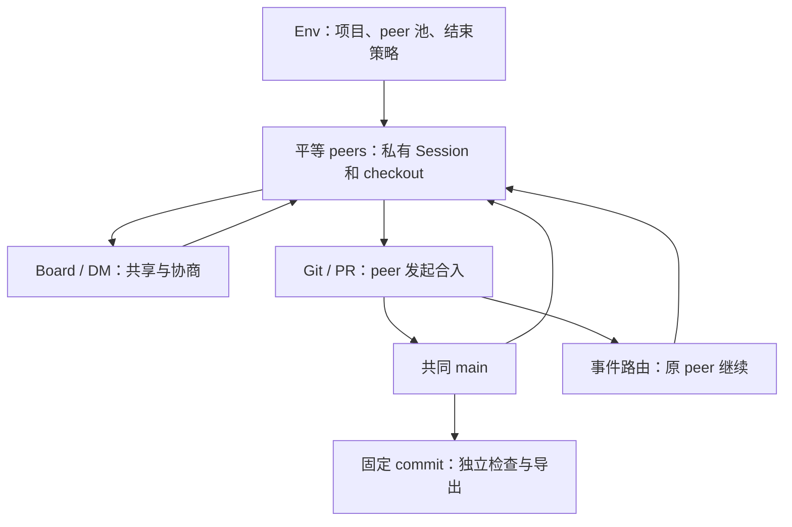

# #201 Agensh：完整流程核对、实现取舍与补齐方案

对应 [Agensh #201](https://github.com/LuNa-shi/SwarmEnv/issues/201)，结构参照 [Subagents #199 的审核样例][E-template]。

**审核结论：现有身份、设施、独立 peer、串行事件路由、Board 和关闭导出可以保留；主要工作是把这些能力接成一个可正常使用的项目协作循环。** 用户给出项目和目标，平等的 peers 自己选工、协商、开发、验证、发起 PR 合入，再继续下一项工作，最后交付共同 main。当前普通入口尚未形成这条完整流程。

本文回答四个问题：**原版怎样运行；当前普通入口实际做了什么；哪些保留、哪些修改、哪些可以省；怎样判断这个 example 真正修好了。** 差异清单用于发现遗漏，不等于逐项复制所有上游功能。

**状态：源码审核与建议设计。** 本轮没有修改运行代码，没有新增模型调用或运行验收。下文明确区分源码事实、历史证据和建议实现；发布本评论不自动改写 Phase 0005 的已批准范围，也不表示 #201 已完成。

| 核对对象 | 固定版本与用途 |
| --- | --- |
| 上游 Agensh | [`2dae4e14`][U-root]。主要以 **ProgramBench task pack** 的平等 peer 工作循环作行为基线；通用 router、Board、身份与 Git 设施一并核对。 |
| SwarmEnv 当前实现 | [`ce3e503`][S-root]。检查普通安装入口、全部 Agensh 模块、相关测试及 #211 新增 benchmark。引用当前 TypeScript 文件，不能沿用旧文件名判断最新实现。 |
| 已有范围 | [Phase 0005 §8][S-design] 与 [Q1–Q8][S-decisions]。Q7 的首版门槛仍是 Git/PR、peer messages、shared context、事件续轮；完整 mid-turn notices 和 ACP/MCP 运维细节不作首版阻塞项。 |
| Core 状态 | [#208 已合并][E-core]。后续主体直接接已有 Core，不再以“等待 #198 提供基础 API”解释普通 Env 的缺口。 |

## 一、原版完整流程是什么

### 1.1 这套模式由谁决定下一步

上游的核心是一个**固定规模、成员平等、持续工作的 peer 团队**。宿主决定项目、资源和何时结束；每只 peer 决定自己做什么、怎样与别人协调、何时提交和合入。

ProgramBench pack 为项目准备初始内容、任务说明和参考程序。peer 观察参考行为，在自己的 checkout 中实现，经 PR 将成果合入 main，并反复开展下一项工作。任务包还定义最终导出与独立评测；这些准备、导出、评测 hooks 由确定性程序执行。[上游团队提示][U-agents] · [工作循环][U-cycle] · [任务包][U-pack]

| 事情 | 决策者 | 运行时应发生什么 |
| --- | --- | --- |
| 项目、目标、peer 数量、时间预算 | 用户 / Env | 所有 peers 获得同一整体目标；宿主创建固定池。 |
| 下一块工作及拆分方式 | peer | 读任务、main 和共享信息，自己选择工作，必要时创建 issue。 |
| CLAIM 重叠怎么处理 | 涉及的 peers | 通过消息协商调整工作；没有统一分配者替它们裁决。 |
| 写代码、跑检查、开 PR | peer | 在私有分支实际执行；将结果交给共享 Git。 |
| 何时申请合入、合入失败后怎么办 | peer | 发起 PR 合入；遇到冲突则同步 main、修改、重验，再尝试。 |
| 是否允许这次 Git 写入 | Git 设施 / 可信适配层 | 执行账户权限、分支规则及准确 head 的检查。 |
| 最终是否满足任务、何时收尾 | 事先配置的任务检查与 Env | 固定最终 main，独立验证，保存结果并关闭资源。 |

**peer 决定合入，不等于取消 main 的保护。** 上游 bootstrap 限制直接 push main 的账户，同时允许 coders 经 PR 合入，默认不要求另一名 peer 审批。提示要求合入前同步最新 main，但默认配置没有机械强制“分支必须已经追上 main”；应区分工作规则和设施硬约束。[上游分支保护][U-protection]

### 1.2 一次工作怎样变成持续协作

1. **准备项目与身份。** 创建 Git 仓库、任务 issue、讨论频道、共享 Board 和各 peer 的账户；任务包提供初始项目及任务说明。peers 使用独立会话和 checkout。
2. **自己寻找工作。** 阅读全局任务、当前代码和 Board。选择一个有价值的部分，发布 CLAIM。CLAIM 是工作意向，带 TTL，允许重叠；不是 Flat 的排他 take。
3. **实现并形成可用信息。** 调用参考程序、修改代码、运行检查。及时发布 FACT、OBSERVED、FAIL；具体证据放在 detail，其他 peer 可 grep、read、unfold。
4. **协商冲突。** 若两只 peer 要改相同内容，使用 DM 及时协商。一般进度发频道；有后续价值的发现进入 Board。
5. **由 peer 交付。** push、开 PR、发起 merge。失败后更新自己的分支、解决问题并重验。成功后写 PATCH_SUMMARY，并重新选择下一件工作。
6. **事件让原 peer 继续。** 每个 worker 有自己的 dispatcher。它可以在一次执行中做多项工作，也可以在执行收束后收到下一批事件继续；没有“所有成员都完成后，宿主才统一开启下一波”的必要条件。
7. **按任务包导出与检查共同成果。** 达到预算等结束条件后，从共同 main 导出交付并运行任务检查，单只 peer 的 final 回复并不等于项目完成。上游正常 finalize 先执行 export，再 quiesce；异常 teardown 的顺序不同。因此不能假定原版导出时所有写入者都已停止。本地在 §3.5 明确提出先停止新合入、再固定最终 SHA 的收尾方式。[工作循环][U-cycle] · [dispatcher][U-dispatch] · [导出][U-export] · [评测][U-evaluate] · [上游收尾顺序][U-finalize]

Board 中的 FACT、FAIL 等是 agent 发布的信息类型。上游的 `verified` 标记来自确定性文本准入检查，不能据此认定结论已经过独立测试。实际采用与正确性仍需看运行证据。[Board 实现][U-board] · [准入检查][U-verifier]

### 1.3 信息什么时候送达：原版也有明确边界

| 信息 | 上游固定版的主要路径 | 对本地适配的意义 |
| --- | --- | --- |
| 普通 Git / 频道事件 | 进入 worker 的待处理队列，由 dispatcher 在完整执行边界取下一批。群聊另有压缩与上下文限额。 | 保留每 peer 串行接力，允许不同 peers 并行；不照搬每个限额值。 |
| DM | 属于待处理消息；worker 忙碌时，notice shim 可以提前显示；idle 时可进入下一轮。 | 要有 peer 可调用的发送、可信定向路由和去重。仅有 channel 发帖不足以替代。 |
| Board 新条目 | 下一轮读取共享上下文；忙碌时也可由 shim 读取新的 gist。Board 写入本身不是独立的 dispatcher 唤醒事件。 | 轮次开始读 Board 是基础；自动中途 gist 是另一个分支，不能与普通队列混为一谈。 |
| 中途 notice | shim 在它包装的基础设施 MCP 工具成功返回内容时附加通知，并处理显示/确认状态。 | 不是任意时刻打断模型，也不意味着每次 Bash 返回都有通知。Pi 安全边界的 steer 只能称为适配。 |

上游普通队列批次与 group-message 压缩有不同规则；不能简单写成“所有消息一批最多 32 条”。同样，上游 listener 的部分追赶游标仍在进程内，不能把它描述为已经提供任意重启后的无丢失恢复。[dispatcher][U-dispatch] · [队列状态][U-state] · [notice shim][U-shim] · [Mattermost listener][U-mm]

### 1.4 选定基线，避免把不同 task pack 的要求混起来

同一上游还有 software-project pack，包含 CI gate、长期维护、用户介入等额外流程。它可以作为未来适配的参考，但**不能把不同 pack 的所有能力并成这个 example 的必做清单**。本次保留 ProgramBench 所体现的平等协作、共享成果、持续 PR 与独立最终检查；不要求复刻完整 ProgramBench、全部任务包及运维系统。[ProgramBench pack][U-pack] · [software-project pack][U-software]

## 二、当前普通入口实际执行了什么

### 2.1 从启动到关闭的真实路径

当前普通路径是：

**配置 → foreground host → createAgenshTeam → 准备设施与 peer 身份 → Core 创建独立 Bot → 每 peer 注册 router / 事件订阅 → 宿主 kickoff → 串行事件续轮 → stop / close / 报告。**

它已经支持向指定 peer 追加输入，也具有真实账户绑定、独立目录、Board 访问与关闭逻辑。问题集中在任务装配、协作操作和项目交付没有贯通。[前台入口][S-entry] · [团队装配][S-team] · [示例配置][S-config]

普通 provision 仍创建 `acceptance.txt` 和固定验收 issue；公共 peer prompt 明确要求遵循固定验收输入，禁止 peer 合入或改变 main。替换 kickoff 的任务文字，并不能消除这些下层条件。[设施准备][S-provision] · [当前提示与 Profile][S-profile]

### 2.2 关键对照：已有能力、真实缺口和影响

| 环节 | 已有实现 | 具体缺口与运行影响 |
| --- | --- | --- |
| 普通任务 | 安装入口、配置、kickoff、定向输入、状态与停止。 | provision 和公共 prompt 仍夹带固定验收内容；没有一条从普通项目输入到最终项目检查的默认路径。 |
| 平等 peer 池 | 独立 Profile、账户、Session、目录和分支；当前团队范围为 2–8 peers。 | 固定规模本身符合原版。需要改的是宿主预定分工/交付流程，不必为此加入动态 spawn 或层级 leader。 |
| 项目发现与讨论 | Service 能读单个 issue、创建/更新 issue、创建 PR。 | 普通 Service 尚缺项目列表、评论、PR 详情/状态和合入等必要操作；模型不能通过这套公开能力走完项目循环。 |
| shared context | 已接原生 Board 的 read/write/grep/unfold，保留 FACT/FAIL/CLAIM 等类型与可信 worker 身份。 | 应沿用；需要验证实际采用和 CLAIM 协商，不应改成一个新的排他任务系统。 |
| DM | event-source 能接收宿主显式传入的 DM channel，并验证频道参与者。 | 默认 DM 列表为空；message Service 只向固定 run channel 发帖，没有 peer 寻址、DM 创建/发送的完整路径。不是“完全没有 DM 代码”，而是可用闭环未接通。 |
| 持续合入 | `delivery.ts` 已检查作者、分支、固定 head，并在写回执未知时读回 PR。 | 普通 team 没有接入 delivery；测试/benchmark 由宿主调用。每 peer 第一笔非 rejected 交付会阻挡下一笔；同 PR 更新 head 也被判冲突。 |
| 普通事件 | 每 peer 独立队列、稳定 batch/request ID、内容冲突检查、完成后续批、未知结果停止派发。 | 仍使用旧 `send(followUp)` helper；没有运行中 notice 通道。新 steer 不能直接插在旧 helper 旁边。 |
| 持续监听 | 真实轮询 Gitea 评论、Mattermost 频道/已配置 DM；有去重与目标检查。 | 只读第一页 50 条，页面满即报错并停止团队；默认 120 次 poll 后不再自动调度。缺少分页和增量游标。 |
| 来源信息 | 事件保留 source、eventId、kind、正文和目标 worker。 | 上游作者 ID 在转换时被缩减成 self 判断，正文未带可信发送者；也需补事件对象位置和时间，便于理解及复盘。 |
| 项目结果与关闭 | required 私有文件/Git 导出；Core 未完全关闭时保留设施依赖；共享数据标为 retained。 | 普通入口没有统一固定最终 main 与独立 checker。临时设施包装还必须遵守同一个数据保全门槛。 |

依据：[Service 操作全集][S-services]、[事件源][S-events]、[router][S-router]、[合入模块][S-delivery]、[关闭与资源所有权][S-team-close]。

合入模块有两处应直接处理的限制：

- 当前记录以 `peerKey:PR number` 为键，既不能把同一 PR 的新 head 当作新尝试，也限制同一 peer 连续交付。
- 原有的固定 head 校验和 unknown 读回仍然有价值。修改目标是支持正常迭代，不是去掉幂等和冲突检查。[合入限制与读回][S-delivery]

还有一个权限事实需要纠正：当前 provision 给 peer 仓库写权限，但没有配置 main 分支保护。因此，“禁止改 main”目前主要是 prompt 规则，不能宣称已经由设施强制实现。接入 peer 发起的可信 merge 时，应同时配置真实分支权限，保证模型不能绕过既定合入路径直接改 main。[当前账户权限][S-provision] · [上游分支保护][U-protection]

### 2.3 历史验收成立，但不能替普通入口完成新的目标

| 历史证据 | 已经证明 | 本次不能据此宣布完成的部分 |
| --- | --- | --- |
| #179 真实 Kimi K3 双 peer | 五个固定批次、重叠 CLAIM 协商、B 读取采用 A 的 FACT、两个 PR 进入共同 main、定向事件让原 A 续做、归档与清理。 | 该次合入由宿主逐份核验并执行，未证明普通 peer 自主持续交付。 |
| #185 八 peer 一小时 | 原八个 Bot 完成有效一小时、40 份 Git 贡献与成果交接，原始归档随后通过独立复核。 | 这是固定工作负载的耐久证据，不等于普通项目循环。外层脚本最初的报告文件名错误与后续复核都应保留。 |
| #211 新增 Pastel benchmark | 有完整项目材料、固定 commit 的源码读取、Git blob 校验、候选封存，以及受控原生预检。 | runner 仍固定 A/parser、B/formatter、C/integration，宿主等待并合入 A/B 后才启动 C。它没有修好普通 Env 的自主组织。 |

真实模型与耐久证据见 [#179 回执][E-dual]、[#185 回执][E-hour]；benchmark 的固定流程见 [工作分配与合入][S-pastel]。**不能把现状说成“只有 mock 测试”，也不能把固定 fixture 的成功扩大解释成普通项目已经可用。**

已记录的真实 Pastel Agensh 运行中，A 的 PR 被宿主合入，B 到期限仍未完成，C 虽已就绪却从未收到集成输入，最终没有按时封存候选或获得官方分数。这说明当前 runner 确实存在“等齐前两方，最后一方才开工”的依赖；它是这条固定运行路径的观察，不足以归因为 Agensh 模式本身失败。[原始运行报告][E-pastel]

## 三、保留什么，具体改什么

### 3.1 本例的实现取舍

| 处理 | 内容 | 原因 |
| --- | --- | --- |
| **必须保留并补完整** | 平等 peer、共同目标、独立 checkout、自主选工、软 CLAIM 与消息协商、Board 分享、PR 合入、持续续做、最终共同成果。 | 这些决定这个 example 是否体现 Agensh 的主要协作方式。 |
| **直接复用** | 设施/账户所有权、可信 binding、Git credential helper、原生 Board、串行 router 的稳定请求、unknown 处理、Core 生命周期与 Trace、required 导出。 | 已有实现和历史证据有价值；不重新造一套基础设施。 |
| **采用有限适配** | 四工具 + Bash Service；固定小 peer 池；每 peer 一个可复用工作分支；默认按轮次边界投递通知；有限的项目/PR/DM 操作。 | 保留可用协作效果，控制示例复杂度。分支复用必须同步最新 main，连续 PR 仍需可用。 |
| **单列后续适配** | 忙碌 peer 的 DM 安全边界 steer、自动 Board gist。 | 值得评估，但要先建立输入关联，不能破坏已有串行完成判断。完整通知机制不提高 Q7 的首版门槛。 |
| **本例不实现** | ACP/MCP 逐字段兼容、全部通知位置和配置组合、完整 Gitea/Mattermost API、所有 task pack、动态层级组织、千 peer 扩展、跨宿主恢复/Replay、全套运维 UI。 | 对一个自包含、可正常使用的小型 Agensh example 没有必要。未实现项如实记录，不算支持。 |

**不引入新的 leader 或“宿主先批准每份工作”规则。** 可信 Service 执行 peer 的合入请求，是权限与一致性边界；选择工作、准备 PR、请求合入和解决冲突仍由 peer 完成。是否每次合入都跑某个项目检查，由任务配置明确；不凭审核给上游增加强制另一 peer 审批或 LLM Judge。

### 3.2 一个统一结构，把现有模块接起来

建议只保留一套普通装配和输入路径。固定测试场景使用同一套 Env/Service，另提供测试任务数据。

| 位置 | 改造职责 | 状态归属 |
| --- | --- | --- |
| `examples/agensh-environment/config.ts`、README、普通入口 | 接项目来源/固定 revision、完整任务、peer 数量、模型、预算、停止策略、交付位置与检查命令。保持 input/status/stop 可用。 | 本次任务配置和结束政策。 |
| `provision.ts`、`index.ts` | 将固定文件/issue/prompt 移至 fixture；导入真实初始项目，创建共同任务；配置 main 保护与账户。prompt 说明完整工作循环。 | 项目/账户/频道/Board 的真实身份与所有权。 |
| `team.ts` | 装配固定 peer 池、Services、router、交付与结果检查；在全部订阅 ready 后向每个 peer 提交同一整体目标。统一结束流程。 | 运行是否接纳新工作、peer 映射、最终结果及收尾。 |
| `services.ts` | 补足项目发现、评论、PR 读写/状态/合入、run 内 peer 目录和 DM；复用 Board；新增能力同步进 Profile 和 help。 | 可信 caller 到上游账户/目标的映射；写请求回执。 |
| `delivery.ts` | 成为 peer 可调用的合入执行层；允许连续 PR 和同 PR 新 head；处理冲突与未知写回执；固定最终 main。 | 每次合入尝试、PR/head、实际 merge commit 与待核对状态。 |
| `event-source.ts`、`router.ts` | 分页增量读取、可信来源、去重、原 peer 路由、串行接力、预算与有限 idle nudge；记录事件和输入关联。 | 收到的事件、游标、批次、派发/未知/停止状态。 |
| 已有 Core / Backend / Worker | 继续承担真实执行、Session、目录、输入回执、归档和资源清理。 | Bot 的真实执行状态；不放 Agensh 项目和消息业务。 |

这些是同一个 example 内的模块，不要求为每一行另建微服务。也不增加与 Core 竞争的第二套 Bot 状态机：Env 根据 Core 实际状态组织输入，自己只拥有项目与路由状态。[现有团队装配][S-team] · [Core 公共合同][S-core-types]

这是建议补齐后的关系。宿主不预定谁负责 parser、谁最后集成；任何 peer 都可以读取现有 main、发现缺口、继续完善成果。

### 3.3 先让“选择工作—交付—再选工作”完整运行

**项目输入。** 提供固定来源的初始仓库或明确的 seed，写入完整任务 issue。各 peer 收到相同目标、项目位置、团队目录和协作规则。业务目标可替换；不要求使用 `acceptance.txt`、固定暗号、固定角色或固定回合。

**协作 Service。** 只补当前工作循环所需操作：列举/读取 issue 与 PR、创建/更新 issue、读写评论、创建 PR、读状态、请求合入；消息侧提供按可信 peer 身份发送 DM 与频道讨论。原生 Git 仍承担 fetch、diff、commit、push，不做一整套 Git 内容 API。DM 的 target 必须映射到本次运行的 peer，发送者从 caller 取得；不让模型通过 JSON 冒充他人或指定任意外部频道。

**持续合入。** 复用 delivery 的固定 head 检查和写后读回。每次尝试关联可信 peer、PR、head 和稳定请求身份；同一请求重试返回原结果。原尝试明确失败后，修订过的 head 可以建立新尝试；第一份 PR 合入后，同一 peer 可以提交下一份。unknown 先查原 PR 的权威状态，不能盲目换 ID 重发。返回冲突、过时 head 或项目检查失败时，原 peer 负责修正。

复用工作分支时，先确认上一笔合入已获得明确结果，再 fetch 最新 main，将下一次工作建立在更新后的基线上，并保留尚未提交或推送的内容。合入回执仍未知时，保留原 PR/head 的尝试身份；即使 PR 当前 head 已变化，也不能据此认定旧写入失败。读回要核对实际 merge commit 与原尝试的关系，确认后才自动开启新的合入尝试。

**共享 main。** direct push 的权限与 PR merge 的权限分别落实。peer 发起请求，可信适配层执行；宿主不替 peer 选择提交内容。多只 peer 同时申请合入时，应由 Git/适配层确认每次真实结果，必要时串行执行写入，但不串行安排它们的研发工作。

**成果采用。** 另一个 peer 从 Board/DM 得到信息后，通过 Git 取得实际代码，在自己的修改或验证中使用。Board 里的文件名只是指引；最终应能把消息、读取、后续行为、Git 提交和检查结果连起来。不要把“最后写了 adopted_files”当作充分证据。[已有 delivery][S-delivery] · [现有 benchmark 的源码核验与采用检查][S-pastel]

### 3.4 事件与通知：先保住清楚的完成边界

本例建议的默认配置继续采用**每 peer 串行批次，通知在下一轮送达**。这在 Q7 范围内，也让输入、失败和重试可以明确解释。与原版中途通知的差异必须写入 README 和 prompt，不能声明自动即时送达。

需要一起补的运行能力是：

- 用分页和增量游标持续取事件，替换“第一页满就停止”。保留队列、上下文与总预算上限；达到真正的资源上限要明确报告。
- 记录稳定事件 ID、可信发送者、目标、来源对象和时间。收到、提交给 Core、执行收束分别记录；正文中的自称不是身份。
- 普通批次使用已有 `runtime.start`，保持同 peer 的独占输入路径。现有 `send(followUp)` 的行为基础可保留，不需要重写 Core。
- 保存必要的事件、批次与消费位置记录，支持审计和原请求核对。可以采用本地有界日志；不由此承诺跨进程自动恢复或 Replay。
- 连续工作由 peer 自己的循环、外部事件及有预算的 idle nudge 支持。没有工作时允许等待；不要求为了“持续运行”反复产生无用消息。
- 启动、结束、unknown 和监听耗尽都要有明确状态，不能出现 peer 仍活着但自动监听已经悄悄停下的情况。[当前事件限制][S-events] · [串行 router][S-router]

对 #201 要求评估的 mid-turn 分支，结论如下：

| 分支 | 可行适配及本例判断 |
| --- | --- |
| 普通事件 | 直接接串行 start，是默认正式路径。 |
| DM 在 peer 工作中到达 | Core 的 steer 提供适配基础，且 DM 本来可以启动 idle peer；不需要引入 Subagents 的“通知绝不唤醒 idle”要求。建议主循环完成后再接一个有限的安全边界通知模式。 |
| Board 新 gist 在工作中到达 | 可评估按当前执行状态读取增量并 steer，但默认保留轮次开始读取与主动 read。不要因为 gist 改变就无条件唤醒 idle peer，进而声称与上游相同。 |
| MCP 工具返回位置、pending/shown 完整机制 | 不做逐项复刻。若提供 steer 模式，应说明它在 Pi 支持的边界生效，验证其真实输入位置及去重。 |

**不能在原 router 旁边加一个 steer 调用就宣布完成。** 当前 `runInput` 依赖“开始时 idle、只有一个输入方、这一批独占下一次 settled”。Core 的 settled 不包含“哪些 inputId 已被消费”的保证。加入中途通知后，同一个输入协调对象必须分别拥有工作批次与 notice，保持原请求核对，明确未确认输入的处理；旧 helper 不能继续把任意 settled 当作各条通知都处理完。[现有等待 helper][S-run-input] · [Core 输入合同][S-core-input]

验收也应分开：**接纳回执、正文进入真实模型请求、信息实际影响工作**。未知结果保持 unknown；模型已读但没有采用可以如实记录。这些不能用一次 completed 事件合并判定。

### 3.5 最终交付和收尾沿用已有正确顺序

普通 `team.close` 已经在 Core 或事件源 pending 时保留设施依赖，这部分应保留。新增的交付层先停止新的 merge 请求，确认在途写入已收束，再固定最终 main SHA；之后在新的检出目录运行独立检查，保存源码归档和检查结果。若合入仍然 unknown，可以保存当时观测到的固定 commit 并检查该候选，但必须同时报告未决合入，不能称为已经稳定的最终 main 或完整结束。检查始终使用固定 commit。[现有 close][S-team-close]

peer 私有目录的未 push commit、未提交/未跟踪文件与 Session 仍按已有 required collect 保存。失败时遵循 Q6，保留相应 sandbox/Slot，并报告 pending。对尚未激活、没有 Git checkout 的 peer，收集合同应明确记录实际空目录/未创建仓库及其 Session；或在声明需要 Git 归档前完成 checkout 准备。不能通过关闭 required 或事后删除容器来抹去真实导出失败。

共享 Git、Board、消息数据应继续可取回；若使用会被销毁的临时设施，Env 要先核实其数据已保留或导出。Core 的可选 `exportState` 观察钩子不自动承担“所有共享业务数据都已保全”的强制门槛。[Service 状态导出][S-service-trace]

#211 的临时 stack 包装在 finally 中继续调用 stack.close，与普通 team.close 的保留条件不同。复用 benchmark 代码时应修正这层包装，不能把它当作普通关闭逻辑已经无条件安全的证据。[benchmark 包装][S-pastel-close]

### 3.6 补齐按三段完成，不按差异行数拆补丁

| 顺序 | 一次完成的工作 | 可检查的阶段结果 |
| --- | --- | --- |
| 1. 普通项目循环 | project 配置、去 fixture、完整 peer prompt、必要 Services、peer 发起 merge、连续 PR。 | 两个平等 peer 能从同一项目出发，各自贡献到 main；不用宿主逐份安排和合入。 |
| 2. 持续协作与失败 | DM、分页/游标、可信来源、start/批次关联、冲突/unknown、预算与结束。按选定范围评估有限 notice。 | 同一 peer 能被真实事件唤起继续；重复和未知结果不造成盲目重做；一个成员慢不会让其他成员被全局等待卡住。 |
| 3. 完整交付与普通使用 | 固定 main、独立 checker、共享与私有成果保存、安装入口、README、Architecture 和完整 prompt 清单。 | 从普通入口运行到用户取得最终项目与结果报告，关闭状态可核对。 |

每段都沿用同一 Env/Service；不新增第二套“正式 runner”和“验收 runner”的业务实现。新能力写入受影响的 Architecture，建议稿与已经实现的行为保持区分。

## 四、怎样判定真实 example 修好了

### 4.1 运行时应该能够看到什么

| 运行维度 | 应观察到的行为 | 证据与失败判定 |
| --- | --- | --- |
| 平等自主 | peers 根据相同任务和项目状态选择工作；没有固定集成人在宿主闸门后等待。 | 真实模型/Service 调用表明选择来自 peer；宿主固定 A/B/C 剧本不能计入。 |
| 有效并行 | 至少两只 peer 的模型或工具工作时间实际重叠。 | 两个容器存在、或一只只在 idle，并不足以证明。 |
| 软 CLAIM | 重叠可以被记录；需要时双方沟通并调整。 | 不应出现排他锁式拒绝。冲突条件未在自然任务中出现时，另做受控验证。 |
| 持续交付 | peer 发起合入；原 peer 可以在合入后继续选工并交付。 | 核对调用者、PR/head、merge commit 与下一次工作，不能用宿主 merge 代替。 |
| 信息被采用 | A 的发现/代码进入 B 的上下文，并改变 B 的实现、检查或整合。 | 串起消息/Board ID、真实请求或工具读取、后续提交与功能检查；仅有引用文本不足。 |
| 事件续做 | 定向评论或 DM 进入正确 peer，原身份、Session 和目录继续。 | botId、会话、工作目录连续；其他 peer 不应收到错误定向输入。 |
| 没有全局等齐 | A 已交付或仍在工作时，B 能独立继续；局部失败有明确处理。 | 不预设“等齐所有 peer 后才集成”；真正的业务依赖仍允许等待。 |
| 完整结束 | 共同 main、未合入私有成果和运行记录有位置；每个资源有结果。 | execution、cleanup、导出与共享设施逐项核对；pending 不能写成完成。 |

这些描述的是运行效果，不要求每条真实任务故意触发每一种边界条件。

### 4.2 T1：用普通入口完成一项完整、有限的项目

建议先采用一个独立可检查的小型工程任务，例如：**为一个离线颜色转换 CLI 实现公开范围内的 hex / rgb / hsl 转换、参数校验、错误退出码和可重复构建，附测试与使用说明。** 可以复用 #211 已准备的参考程序与公开材料，但先冻结有限输入范围和预期行为；这不是完整 Pastel/ProgramBench 通过声明。

任务提供一个整体目标、初始仓库及必要约束，不规定谁写 parser、谁做集成、何时开 PR、每人必须做几次调用。默认用两只同级 peer，所有人从启动时就能为项目工作。

运行中通过普通入口或真实 Git/消息事件提交一条与任务相关的反馈，例如独立检查发现的边界输入错误，让原 peer 继续处理。宿主可以给业务反馈，不替它拆任务、补源码或发起合入。

最后从固定 main 在全新目录离线构建、运行事先冻结的独立检查。检查器及其预期结果由验收侧维护，不能让候选通过修改自己的测试宣布成功；参考程序可以用于观察行为，不得代替交付程序完成检查。

这仍是**建议的验收任务**，本轮没有选择新模型、扩大预算或启动实验。完整 ProgramBench 和跨模式效果比较继续按相应实验票处理，不成为本例的附加范围。

### 4.3 T2 / T3 补条件性行为，避免把测试剧本写回普通模式

| 场景 | 要验证的组合 | 方法与边界 |
| --- | --- | --- |
| **T1：普通真实项目** | 自主选工、真实并行、双方贡献进共同 main、至少一条真实信息采用、原 peer 续做、最终独立任务检查。 | 真实模型 + Pi/OpenSandbox + 正常 Env/Service；不能以 scripted 回答证明自主行为。 |
| **T2：协作与持续交付** | 重叠 CLAIM 与 DM；同一 peer 两个 PR；同 PR 修改 head 后再尝试；冲突重验；超过一页的事件；重复/错目标；合入回执丢失。 | 使用同一实现，以真实设施和必要的原生受控 Responses 稳定触发条件。纯 mock 不能代替 Git/消息/Worker 组合。 |
| **T3：失败与收尾** | 输入 unknown、停止时在途合入、required 导出失败后保留与重试、共享数据可取回、从未激活且没有 Git checkout 的 peer。 | 最后一项覆盖 Pastel 已记录的 C 导出问题；不以物理删除容器补写成功的 Core 导出回执。 |

若 T1 自然出现连续多个 PR、CLAIM 重叠或分页，直接使用其证据；未出现则由 T2 验证。**“至少一只 peer 可以连续交付多个 PR”是能力要求，不应为了凑次数强迫所有真实任务切成多份 PR。**

若后续启用中途 notice，再在 T2 增加：busy 时实际到达的边界、idle DM 的续轮、与普通批次同时到达、重复、刚结束时的竞争、stop 后未消费信息归属。未启用就明确记录时机差异，不能标记这一分支已经通过。

### 4.4 最终分别给出三个结果

| 结果 | 通过条件 |
| --- | --- |
| **任务交付** | 最终固定 main 的源码在独立目录可构建，满足公开任务范围及反馈要求；归档、说明、检查结果可取回。 |
| **协作行为** | 本次真实任务中双方有实际贡献；信息进入接收方上下文并实质影响最终工作；自主合入与原 peer 续做有证据。 |
| **完整结束** | 执行停止、必需产物成功保存、共享结果保留、cleanup complete；unknown/pending 明确列出，不能算完全通过。 |

一只 peer 独自完成项目只能算任务结果通过，不能替双 peer 协作验收；工具调用很多但最终程序错误，也不能算项目通过。一次通过证明这条路径在该配置下成立，不证明多 Agent 比单 Agent 更快，也不证明千级扩展效果。

复盘采用已有证据：Runtime/事件记录、Session、Model Gateway 真实请求/响应、Service 调用流，再加 Env 的事件/合入记录、固定 Git revision、源码摘要和外部检查输出。为信息采用挑一条完整证据链：

**A 的发现或贡献 → B 确实读取 → B 的后续工作改变 → 变化进入固定 main → 独立检查执行对应行为。**

必要时，对被采用的组件做一个局部移除/替换对照，辅助判断它是否真的影响结果；无需新建评分平台，也不强制字节完全不变。

**后续回填 #201 的内容应是：实现 commit、普通运行命令、选定通知策略、T1/T2/T3 各自证据、最终成果位置和未通过项。** 本文给出取舍与补齐方案；旧证据保留，新闭环尚待实现和验证。

---

## 审核范围与来源说明

引用均固定到本次核对的源码或已有评论，可从 [上游源码][U-root] 和 [SwarmEnv 源码快照][S-root] 继续复核。正文中引用的历史运行数据来自原回执，本轮未重跑。

[U-root]: https://github.com/microsoft/Agensh/tree/2dae4e14a653da48549fd9aa093f834841475d6c
[U-agents]: https://github.com/microsoft/Agensh/blob/2dae4e14a653da48549fd9aa093f834841475d6c/prompts/agents.txt#L7-L71
[U-cycle]: https://github.com/microsoft/Agensh/blob/2dae4e14a653da48549fd9aa093f834841475d6c/tasks/programbench/prompts/work_cycle.txt
[U-pack]: https://github.com/microsoft/Agensh/blob/2dae4e14a653da48549fd9aa093f834841475d6c/tasks/programbench/pack.toml
[U-protection]: https://github.com/microsoft/Agensh/blob/2dae4e14a653da48549fd9aa093f834841475d6c/docker/bootstrap/bootstrap.sh#L281-L318
[U-dispatch]: https://github.com/microsoft/Agensh/blob/2dae4e14a653da48549fd9aa093f834841475d6c/mini-router/src/dispatcher.ts
[U-state]: https://github.com/microsoft/Agensh/blob/2dae4e14a653da48549fd9aa093f834841475d6c/mini-router/src/state.ts
[U-shim]: https://github.com/microsoft/Agensh/blob/2dae4e14a653da48549fd9aa093f834841475d6c/mini-router/mcp_notice_shim.cjs
[U-mm]: https://github.com/microsoft/Agensh/blob/2dae4e14a653da48549fd9aa093f834841475d6c/mini-router/src/listeners/mattermost/listener.ts
[U-board]: https://github.com/microsoft/Agensh/blob/2dae4e14a653da48549fd9aa093f834841475d6c/board-service/shared_lessons.py
[U-verifier]: https://github.com/microsoft/Agensh/blob/2dae4e14a653da48549fd9aa093f834841475d6c/board-service/verifier.py
[U-export]: https://github.com/microsoft/Agensh/blob/2dae4e14a653da48549fd9aa093f834841475d6c/tasks/programbench/hooks/export.sh
[U-evaluate]: https://github.com/microsoft/Agensh/blob/2dae4e14a653da48549fd9aa093f834841475d6c/tasks/programbench/hooks/evaluate.sh
[U-finalize]: https://github.com/microsoft/Agensh/blob/2dae4e14a653da48549fd9aa093f834841475d6c/agensh/team_run.py#L1072-L1198
[U-software]: https://github.com/microsoft/Agensh/blob/2dae4e14a653da48549fd9aa093f834841475d6c/tasks/software-project/pack.toml
[S-root]: https://github.com/LuNa-shi/SwarmEnv/tree/ce3e503ba534d2b9cf42423aa0cdcdcc80766828
[S-design]: https://github.com/LuNa-shi/SwarmEnv/blob/ce3e503ba534d2b9cf42423aa0cdcdcc80766828/docs/phases/0005-core-environment/02-environment.md#8-agensh
[S-decisions]: https://github.com/LuNa-shi/SwarmEnv/blob/ce3e503ba534d2b9cf42423aa0cdcdcc80766828/docs/phases/0005-core-environment/README.md
[S-entry]: https://github.com/LuNa-shi/SwarmEnv/blob/ce3e503ba534d2b9cf42423aa0cdcdcc80766828/src/environments/shared/foreground-host.ts#L40-L73
[S-config]: https://github.com/LuNa-shi/SwarmEnv/blob/ce3e503ba534d2b9cf42423aa0cdcdcc80766828/examples/agensh-environment/config.ts
[S-provision]: https://github.com/LuNa-shi/SwarmEnv/blob/ce3e503ba534d2b9cf42423aa0cdcdcc80766828/src/environments/agensh/provision.ts#L67-L79
[S-profile]: https://github.com/LuNa-shi/SwarmEnv/blob/ce3e503ba534d2b9cf42423aa0cdcdcc80766828/src/environments/agensh/index.ts#L8-L18
[S-team]: https://github.com/LuNa-shi/SwarmEnv/blob/ce3e503ba534d2b9cf42423aa0cdcdcc80766828/src/environments/agensh/team.ts#L76-L136
[S-team-close]: https://github.com/LuNa-shi/SwarmEnv/blob/ce3e503ba534d2b9cf42423aa0cdcdcc80766828/src/environments/agensh/team.ts#L54-L70
[S-services]: https://github.com/LuNa-shi/SwarmEnv/blob/ce3e503ba534d2b9cf42423aa0cdcdcc80766828/src/environments/agensh/services.ts#L32-L103
[S-events]: https://github.com/LuNa-shi/SwarmEnv/blob/ce3e503ba534d2b9cf42423aa0cdcdcc80766828/src/environments/agensh/event-source.ts#L6-L82
[S-router]: https://github.com/LuNa-shi/SwarmEnv/blob/ce3e503ba534d2b9cf42423aa0cdcdcc80766828/src/environments/agensh/router.ts
[S-delivery]: https://github.com/LuNa-shi/SwarmEnv/blob/ce3e503ba534d2b9cf42423aa0cdcdcc80766828/src/environments/agensh/delivery.ts#L16-L59
[S-run-input]: https://github.com/LuNa-shi/SwarmEnv/blob/ce3e503ba534d2b9cf42423aa0cdcdcc80766828/src/environments/shared/run-input.ts#L11-L79
[S-core-types]: https://github.com/LuNa-shi/SwarmEnv/blob/ce3e503ba534d2b9cf42423aa0cdcdcc80766828/src/core/types.ts
[S-core-input]: https://github.com/LuNa-shi/SwarmEnv/blob/ce3e503ba534d2b9cf42423aa0cdcdcc80766828/src/core/index.ts#L491-L561
[S-service-trace]: https://github.com/LuNa-shi/SwarmEnv/blob/ce3e503ba534d2b9cf42423aa0cdcdcc80766828/src/core/service-trace.ts#L27-L52
[S-pastel]: https://github.com/LuNa-shi/SwarmEnv/blob/ce3e503ba534d2b9cf42423aa0cdcdcc80766828/benchmarks/programbench-pastel/pastel-open-agensh.ts#L14-L155
[S-pastel-close]: https://github.com/LuNa-shi/SwarmEnv/blob/ce3e503ba534d2b9cf42423aa0cdcdcc80766828/benchmarks/programbench-pastel/pastel-open-agensh.ts#L158-L164
[E-template]: https://github.com/LuNa-shi/SwarmEnv/issues/199#issuecomment-7151673865
[E-core]: https://github.com/LuNa-shi/SwarmEnv/pull/208
[E-dual]: https://github.com/LuNa-shi/SwarmEnv/issues/179#issuecomment-7121725977
[E-hour]: https://github.com/LuNa-shi/SwarmEnv/issues/185#issuecomment-7124839747
[E-pastel]: https://github.com/LuNa-shi/SwarmEnv/blob/ce3e503ba534d2b9cf42423aa0cdcdcc80766828/docs/experiments/EXP-20261125-programbench-pastel.md#L44-L64

