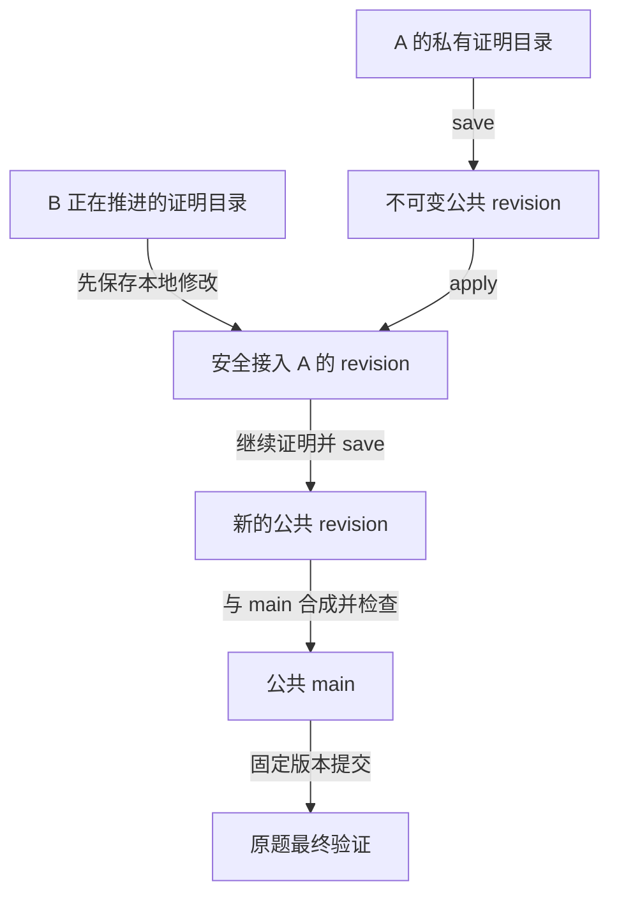

# Flat 数学形式化协作样例：原版与当前实现对比

**审核日期：2026-11-24。** 目标是判断当前 Flat 能否承接“多个 Bot 围绕同一个数学问题合作完成形式化证明”，说明与原版相比保留了什么、缺了什么，以及怎样补到一个可用的完整样例。

## 1. 结论与修复范围

**当前 Flat 保留了相当完整的任务、材料、版本和检查底座，但普通入口还没有恢复原版的数学协作流程。仅接上 `files.snapshot`，不足以完成这次目标。**

原版已经能从一个完整数学问题和空 Task 池启动，让 Bot 自主提出、认领和推进任务；工作中的 Bot 可以纳入别人保存的证明文件；局部检查、合入检查和最终原题验收各有独立路径。当前最明显的收缩发生在模型可调用的接口和宿主装配上，而不只是数据存储层。[原版启动][old-runner] · [原版选工][old-discovery] · [当前装配][new-env]

建议围绕下列六项收口：

| 要补齐的行为 | 当前判断 | 建议处理 |
| --- | --- | --- |
| Bot 从总问题中发现和提出工作 | 底层仍支持创建 Task，Flat 对模型没有开放；发现列表另有已知错误 | 恢复受信的创建接口，接入已有列表修复，更新选工提示 |
| 真实证明文件能成为公共版本 | Core 已有活 Bot 快照，Flat 仍要求外部注入旧格式捕获函数 | 完成正式适配，并处理稳定请求、字节校验和未知回执 |
| 工作中的 Bot 能接续别人的文件 | 原版 `workspace apply` 已从当前活动路径移除 | 恢复安全纳入固定 revision 的最小完整路径，保留版本来源和冲突 |
| 新成果能到达正在工作的相关 Bot | 发布、关联、反馈都有，普通成果通知没有接成自动投递循环 | 接回定向通知，按当前 Task owner 投递并保留处理回执 |
| 数学工具作为一个正常样例启动 | Judge、checked merge、最终 Lean verifier 已有，但需宿主分别装配 | 提供一个普通数学入口，固定题面、工具链、检索、三层检查和预算 |
| 完成状态准确表达“原题证明通过” | 当前按 Task 池终态结束；Mission accepted 还可能被映射成业务失败 | 以固定最终 submission 的验收结果判成功，单独报告资源收尾 |

这六项直接影响协作方式或最终正确性，应列为数学样例的核心工作。旧 Runtime 的内部组织、完整旧 UI、逐字提示词、所有查询选项和历史实验续跑，可以独立处理，不必为了“复原”全部搬回。

### 1.1 本次使用的固定版本

| 层次 | 固定版本或记录 | 本文怎样使用 |
| --- | --- | --- |
| 原版 Flat | `fcbe0107d8b4b204db0bcfa2a1ad1b2339c6293e` | #200 指定的迁移参考；核对实际运行流程和代码 |
| 上轮审核的实现 | `ec4d286f1f452eb03bb11113ff9c48234c1357c1` | 解释旧结论和历史运行，不能代替当前主线 |
| 本次当前实现 | `ce3e503ba534d2b9cf42423aa0cdcdcc80766828` | 本次读取的 main；源码已迁为 TypeScript，链接使用 `.ts` |
| 共用 Core | #208 已合并，merge commit `ded4cd2c32772b46a5ea581499c60c2fcf97d210` | `files.snapshot`、输入原语和 Trace 已在主线；Flat 适配仍需单独核验 |
| Task 列表修复 | #210，候选 `6500944c999d2b6600d516d6dad44b7d6286eccb` | 核查时仍是未合并 draft，不能计入 main 已完成 |

本次完成源码、设计和已记录验收证据的对照，没有启动新模型任务，也没有把历史测试结果记作当前版本的新验收。[#200][issue-200] · [#208][pr-208] · [#210][pr-210]

还有一个范围区别：当前 Phase 0005 文档曾明确允许无 live capture 的受限 Flat，并将生产接线延后。因此，“当前受限模式按既定范围交付”与“已经能复原数学协作”是两回事。本文指出的功能收缩和补齐建议，不应反过来改写当时的验收结论。[阶段范围调整][phase-scope]

## 2. 原版究竟怎样合作完成一道数学题

下面用“主定理 T、过程中发现的引理 L”解释流程。T 和 L 是说明用的名称，不代表宿主预先把任务拆好。

### 2.1 先有共同问题，再由 Bot 形成 Task

普通数学 runner 创建 Mission 和与之对应的公共 Workspace，把原题及项目上下文放进初始版本，同时固定目标声明、原始题面摘要和最终 checker。普通 swarm 路径初始没有 Task；独立 solver 和显式测试播种是例外。Bot 先看 Mission、已有工作、公开文件和材料；发现缺口后提出一个有具体交付条件的 Task，任何符合条件的 Bot 都可以认领。[原版 runner][old-runner] · [零 Task 启动][old-zero]

原版允许尚未认领工作的 Bot 提出多个任务，也允许正在做 T 的 Bot 另提 L 的工作；提出者不必认领自己的提案，ACTIVE Bot 也不会因此换掉当前责任。Task 之间的依赖表示真正的先决条件，不形成父子管理树；priority 仅供选工参考。Controller 维护可用工作和运行状态，不替模型决定数学路线。[原版 Task 创建][old-task-create] · [选工与责任提示][old-prompt]

### 2.2 take 是责任和文件权限的一次交接

Bot 初始处于只读状态，不能向自己的项目目录写证明。它通过真实 CLI 认领 Task；领域层原子确认唯一执行者，形成 Execution。Runtime 固定输入 revision，在准备期间续租，安装文件、激活 Execution、开放写权限，最后才返回成功。原 Bot 在原 Session 中继续工作。[原版 take 交接][old-take]

一个 Bot 最多对应一个 Execution，不等于它只能进行一轮推理。只要该责任仍在运行，它可以反复编辑、检查、接收反馈和纳入其他成果。Task 结束后才关闭该 Bot，由新 Bot 从公共状态接续。

### 2.3 写入文件、保存版本和合入 main 是三件事

Bot 在私有目录中编辑 `.lean` 文件。`workspace save` 从真实目录捕获字节，产生不可变公共 revision；其他 Bot 随后可以读取，但 main 不会自动前进。Material 解释这份证明的内容、适用条件、检查结果和未完成事项，引用确切 revision/path。[原版文件与材料合同][old-prompt] · [原版保存实现][old-save]

如果 B 正在证明 T，而 A 已经保存了 L，原版 B 可以先保存自己的修改，再执行 `workspace apply --from R`。系统在 B 的原 Execution 内做三方整合，保留来源版本和冲突信息。main 前进不会暗中覆盖 B 的目录；是否纳入由 B 明确发起。[原版 apply][old-apply] · [三方接续][old-plan-apply]

合入公共 main 则通过 `workspace merge --from R`：系统先构造 R 与当前 main 的合成树，按配置检查这棵完整树，确认 main 没有在此期间变化后，再推进 main。某个 Bot 不需要预先拥有“整合者”角色才可以发起这项操作。[原版合入][old-merge]

### 2.4 Material 不只存下来，还要到达相关执行者

原版 A 可以把 Material 关联到 B 的 Task。TaskService 生成 `material_available` 通知，Runtime 把它送给该 Task 当前的 Execution；B 读取后记录接受、质疑或其他处理，并在真正采用时登记它对后续工作的影响。通知、反馈、使用记录与成果本身是不同事实。[原版通知产生][old-notification-create] · [原版通知投递][old-notification-send] · [原版使用记录][old-consume]

这条链能回答“B 有没有机会看到 L、怎样回应、后来改了什么”。一条 `consume_materials` 记录仍然是使用声明，最终还要核对 B 的实际证明文件和验收结果。

### 2.5 数学验证有三个层次

| 检查 | 解决的问题 | 不能由它推出的结论 |
| --- | --- | --- |
| 日常 Judge 诊断 | 某个固定 revision 的模块或项目是否能编译，错误在哪里 | 不能直接推出原题证毕 |
| 合入检查 | main 与待合入 revision 合成后的完整项目是否满足合入政策 | 不能把局部引理的整合当成最终原题通过 |
| Mission 最终验收 | 固定 main 是否证明了原题指定声明，且符合受信公理和环境要求 | 不能由其他 revision 的 PASS 代替 |

原版 Bot sandbox 明确不提供 Lean/Lake/Mathlib 运行环境，Lean 检查走集中 Judge。普通工作循环是“编辑 → save → judge check → 读诊断 → 修改”。runner 同时为合入配置项目检查，为最终提交配置严格的原题 verifier。[原版数学提示][old-prompt] · [原版 checker 装配][old-checkers]

最终 verifier 不是只执行一次 `lake build`：它固定原题路径、目标声明和 fixture hash，比对原题与候选声明及相关定义，检查目标证明的传递公理依赖，并在受信环境中进行 kernel replay。Mission submission 另外负责固定当前 main 和显式材料集合、冻结合入、保存最终结果。[原版最终验证][old-final] · [原版 submission][old-submission]

### 2.6 结束一项工作，不等于证明已经完成

`done / incomplete / blocked / cancelled` 分别表达合同完成、尚未完成、有必要前置、责任撤回。finish 被接受后不再补交文件；先确认执行停止，再释放责任和资源。后继 Bot 有新身份、新 Session，读取公开 Task、Material 和 revision，不继承前任的私有对话或未保存文件。[原版结束与交接][old-prompt] · [原版停止顺序][old-stop]

原版最终停止还取决于 Mission acceptance 或运行预算，而不是“当前列出来的 Task 都处理完了”。空队列也不能代替原题验收。[原版发现策略][old-discovery] · [原版最终收尾][old-runner-close]

## 3. 当前实现的逐项对照

以下“已有”表示源码具备相应能力。它可能需要明确配置，不能直接等同于正常数学入口已经跑通。

| 功能或运行行为 | 原版 | 当前 main | 判断 |
| --- | --- | --- | --- |
| 完整数学问题入口 | runner 统一装配问题、Workspace、Judge、检索和最终检查 | `runFlatEnvironment` 接收宿主提供的 stores、prompt 和可选服务；没有对应的完整数学 example 装配 | 补一个正常数学入口，复用现有组件 |
| 从空 Task 池启动 | Bot 自主发现缺口并提案 | controller 会发现工作，但模型接口没有 `task_create` | 核心协作能力收缩 |
| 提案、优先级、依赖 | 领域层支持 | 底层仍在，创建接口未接出；依赖处理、revise/cancel 已部分接入 | 接适配和权限，无需重写任务数据库 |
| 读取运行中的任务列表 | 正常流程需要跨状态发现 | `current_execution` 直接嵌入 SQLite 行，可被 Core Bridge 拒绝为无效输出 | 已知实际错误，#210 尚未合并 |
| 排他 take 和一 Bot 一 Execution | 已有 | 已有领域校验与宿主交接 | 保留，做当前入口回归 |
| 只读到可写、准备期续租 | 旧 Runtime 实施 | `task-handoff` 调用公开 Core prepare/grant，保留前后检查和停止补偿 | 主体已迁移 |
| 模型调用的领域授权 | 依赖 Task/Execution 状态 | 独立的 model access policy 接回 Core | 保留，不能只检查 CLI 权限 |
| Material 发布、读取和来源 | 已有 | 已注册 publish/view/list/consume，保留真实 Task/Execution 归属 | 已有可用底座 |
| Material 质疑与更正 | 已有 | dispute/supersede/unsupersede 已接入，窄授权仍生效 | 不是待从零实现 |
| 运行中可信 save | 旧 Runtime 直接捕获 | 无 `snapshotProject` 就明确隐藏 save/status/current-diff；标准 Core 尚未自动接入 | 生产接线仍缺 |
| 捕获回执未知时恢复 | 旧实现本来有限制 | 仍将 capturing 异常记 failed，要求新请求；新 Core 可重放能力未利用 | 旧限制在新接口下需要修正 |
| 同一 Execution 纳入公共 revision | 有三方 apply、安装和恢复 | 活动 apply/planApply 已删除，保留的历史恢复分支不构成可调用能力 | 实质功能缺口 |
| 公共文件检索 | 较完整的 history/files/read/search/diff | 普通注册主要是 view/read/files；若干查询 helper 仍在 | 可分层恢复，不全是阻塞项 |
| 普通成果通知 | 生成后由 Runtime 投递给当前 Execution | link 和 feedback 已接；controller 只明确自动投递 handoff warning | 中间投递步骤缺失 |
| 用户定向反馈 | 核验当前 Task owner | `feedback` 默认 steer，发送前再次核验归属 | 已有；保留并核对模型实际输入 |
| Judge | 数学 runner 常规装配 | 可选 `judgeService`；项目/模块模式需 `workspaceProjectCheck` | 能力已有，数学配置必须显式接好 |
| 检查后合入 main | 构造合成树后检查 | 可选 `workspaceMergeChecker`；仅 Mission/Task 要求时实际检查 | 已有，必须核对政策与配置是否匹配 |
| 原题最终验收 | runner 装配 submission 与最终 verifier | `missionCoordination`/Mission Service/verifier 均在，但为可选装配 | 补数学接线与宿主结束规则 |
| 完成状态 | Mission acceptance 与 Task finish 分开 | 全 Task DONE/CANCELED 可返回成功；Mission accepted 又可能进入业务失败分支 | 必须修正数学结果表达 |
| 预算、替补、清理 | 按不同预算和状态运行 | 有完整策略，但默认执行 60 秒、Bot 硬预算 300 秒等不适合作为数学默认 | 做统一配置，验实际行为 |
| Trace 与运行报告 | 有领域与实验记录 | Core 增加 Session/Gateway/Service Trace，Flat 有输入、决策和收尾报告 | 保留，补与最终证明的关联视图 |

主要依据：[当前装配][new-env]、[Task 接口][new-task]、[take 交接][new-handoff]、[成果服务清单][new-publication]、[Controller][new-controller]、[Mission 服务][new-mission]、[合入检查][new-merge]、[#210][pr-210]。下文解释影响最大的差异和具体补法。

## 4. 影响数学协作的具体问题

### 4.1 自主提出 Task：底层保留了，模型入口没有

当前 `task-service.ts` 的公开操作主要是 list/view/take/revise/cancel，另按权限开放 dependency replacement；没有 `task_create`。底层 `TaskService` 仍支持真实 Bot 的创建、Mission gap、优先级、输入 revision 和依赖。当前服务目录甚至明确写着 Task creation is host-owned，所以这是当前受限模式的真实合同，不是单纯提示词漏写。[当前 Task adapter][new-task] · [底层创建能力][new-task-domain] · [当前服务指导][new-bot-contract]

对数学样例的影响是直接的：B 做主定理时发现需要 L，无法通过普通接口建立供其他 Bot 认领的责任。启动时给几个预设 Task 可以测试领取流程，却不能复原原版“边证明、边形成工作”的行为。最新 Pastel driver 仍由宿主预建 parser、formatter、integration 三项工作，不能作为自主提案已完成的证据。[Pastel driver][new-pastel]

**建议补法：** 把现有领域创建能力接入 Flat Service，由可信 caller 注入 Mission/Bot/Execution；允许 UNBOUND 提案和 ACTIVE 在当前责任之外提案，保留一个 Bot 最多一个 Execution。模型只填写任务内容，不能自行选择身份、扩大预算或更改受信 checker。恢复原版的核心选工指导即可，不必逐字复制旧 prompt。

同时先解决 `task list` 的已知错误：当前返回的 `current_execution` 是 SQLite 原始行；Core 的严格 JSON 检查会拒绝这种嵌套对象。#210 已给出修复和 public CLI 回归，但核查时仍未合并。不要把“列表返回失败”误诊成模型不会选工。[当前列表投影][new-list] · [修复 PR][pr-210]

### 4.2 save：不只是把一个回调改名

当前没有可信捕获函数时，Env 会省略 save 和依赖它的私有状态命令。这是正确的能力边界；问题在于数学样例需要真实文件发布，而标准 Core 的快照能力尚未接成这条路径。[装配开关][new-env] · [捕获适配][new-publication]

目前有四个具体接缝：

1. **请求身份没有传到底。** Flat save 已有稳定 request ID，但 `ExecutionWorkspace.#capture` 只传 executionId，外层 snapshot 回调只收到 botId/executionId/fencingVersion。无法直接利用 Core 对同一次捕获的稳定回执。
2. **两侧返回格式不同。** Core 返回 botId/requestId/version/digest 和 FileSeed；Flat 旧解码器要求 execution_id/binding_version/state、base64 文件 map、manifest 和 content_hash。
3. **两个版本号表达不同事实。** Core 文件 version 描述资源操作，Execution 的 fencingVersion 描述当前责任归属，不能直接互填。Core digest 还包含文件 mode 等规则，也不能直接冒充 Flat manifest 的摘要。
4. **未知回执被当成确定失败。** 当前 capturing 阶段异常会记为 failed 并要求新 ID；若 worker 已捕获、只是响应丢失，改用新 ID 可能取得后来已变化的另一份文件。

这些行为分别可见于 [ExecutionWorkspace][new-execution-workspace]、[Core FileSnapshot][new-core-types]、[Core 文件控制][new-file-controls] 和 [FileSeed 摘要][new-file-seed]。其中第 1、4 项在原版也已存在，应归为接新 Core 时要修的既有限制。[原版捕获限制][old-capture-limit]

**建议补法：** 让一次 save 的稳定身份贯穿到 Core snapshot；捕获前后重新检查当前 Bot/Task/Execution 归属；逐文件解码并核对字节、摘要和路径，再生成 Flat 所需的可信记录；把未确定的捕获保留为待核对状态，用原 ID 查询或重放。已经进入 captured 阶段的发布恢复应继续复用，不要推倒重做。

数学配置还应明确捕获范围：保存项目源码和必要的任务资产，不把整个 Mathlib 缓存纳入每次快照。当前 Core 有每文件 2 MiB、合计 16 MiB 的 FileSeed 上限；固定工具链和 Mathlib 应作为受信环境依赖处理。[字节边界][new-file-seed]

### 4.3 apply 缺失：B 能读到 A 的文件，尚不等于能安全接入

原版 apply 包含三方整合、未保存修改保护、固定来源、冲突信息和同一 Execution 内的安装。当前 `ExecutionWorkspace.dispatch` 只接受 save/status/diff，`MissionWorkspace.planApply` 活动实现也已删除。历史 installing/installed 恢复代码仍在，不表示可以发起新 apply。[原版 apply][old-apply] · [当前 Workspace 操作][new-execution-workspace]

让模型通过 `workspace read` 把几份文件复制到本地，可以形成一种有限的采用方式，但当前 save 不会自动把所读取 revision 写成 Git 父版本。后续三方合并可能缺少真实的版本关系；遇到双方修改同一证明文件时，尤其不能把这种复制视为原版接续已恢复。

**建议恢复一个受控的最小路径：** 当前 Bot 先保存自己的进度；选择固定公共 revision；检查本地没有尚未保存的变化；三方整合并保留冲突；安全安装到同一 workDir；保留原 Session；随后继续证明并 save。无需恢复全部旧选项和内部字段，但这些行为应保留。

这里确实涉及 Core 的边界：当前 `files.prepare` 对已经可写的 workDir 会拒绝，不能简单再次调用 prepare 完成运行中安装。下一步应先确定受信安装、暂停写入和确认回执的通用资源能力；revision、三方合并、Task 归属和冲突政策仍归 Flat。直接访问某个 backend 的私有目录，不应成为普通 example 的正式接法。[Core 文件准入][new-file-controls]

如果第一版选择仅让新 Bot 从新 main 接续，工程上可以缩小范围，但要明确记录“同一 Execution 内的文件接续未复原”。它不能满足原版 B 在原 Session 中持续采用新引理的行为。

### 4.4 成果通知：发送端和反馈端都有，中间仍断着

当前 `task_link_material` 会产生 `material_available`，`task_feedback` 也已注册，通知文本构造函数同样存在。但普通 Flat controller 只明确处理 handoff warning，没有接回原版一般成果通知的订阅或投递循环。Task view 返回的任务、材料和执行历史，也不等价于携带 notification ID 的待处理通知。[通知生成][new-material-link] · [当前 Controller][new-controller] · [通知文本][new-bot-contract]

结果是：A 可以发布 L 并关联到 B 的 Task，B 仍可能持续工作而不知道有新材料；接口层的 publish、link、feedback 单独成功，不能证明协作信息已经流动。

**建议补法：** 从现有持久通知记录路由到当前 owner，发送前重新核验 Task/Execution；记录投递尝试、已投递和模型处理结果，避免每轮重复提醒。普通成果可以先保留原版在合适边界送达的方式；用户定向反馈继续用现有默认 steer。需要立即打断的纠正，再明确它的投递政策，不必把所有材料都变成强制中断。

当前 `feedback` 已经默认 steer，内部继续调用兼容的 `runtime.send(..., {mode})`。只因为函数名不是新 `runtime.steer`，不能判定功能缺失。更值得验证的是：身份是否由可信宿主生成、来源是否真正出现在模型可见正文、消息是否到达原 owner，以及结束后是否拒投。[当前 feedback][new-feedback]

### 4.5 数学工具：应该复用已有 verifier，补正常装配

当前已有可选 Judge、合入检查和 Mission Service；最终 Lean verifier 也保留了固定题面、目标声明、公理检查与 kernel replay。没有必要另造一个只检查终端输出的弱 checker。[当前可选装配][new-env] · [最终 verifier][new-final] · [Lean 内核验证][new-final-proof]

数学入口需要明确装配以下内容：

| 配置 | 应有内容 | 当前应避免的误判 |
| --- | --- | --- |
| 题目 | 固定原题文件、目标 declaration、源摘要、必要参考材料 | 不能只给一句自然语言目标后由候选自行定义题目 |
| 工具链 | 固定 Lean、Mathlib、最终 verifier 和部署版本 | 已有部署约束可复用，不是从零建立 |
| 日常 Judge | 真实 checker、固定 Workspace source；需要时启用 project/module 模式 | 只传 `judgeService` 不等于所有项目模式都已开启 |
| 合入检查 | 配置 checker，并在 Mission/Task 中声明匹配的检查政策 | 仅传入 `workspaceMergeChecker` 并不保证每次实际检查 |
| 最终提交 | `missionCoordination`、明确的提交授权、固定 main 和材料集合 | Task done、merge 成功不能替代 Mission PASS |
| Mathlib 查询 | 与 checker 相同版本的源码检索或等价受控读取 | 原版已有；当前数学装配需接回，不能假设 sandbox 自带 Mathlib |

当前 `workspaceProjectCheck` 默认为 false；`workspace-check-source` 对 lean-project/lean-module 和文件路径有不同要求。合入服务只有在 Mission 的 `merge_required_check` 或 Task 的交付合同要求检查时才调用 checker。数学配置必须把这些条件一起锁定。[Judge source 适配][new-check-source] · [合入政策][new-merge]

三层检查也不能合并成一项。现有测试代码明确区分两种预期行为：含 `sorry` 的中间项目可以在项目编译诊断中 PASS，而最终原题验证 FAIL；本轮没有重新运行这项原生 Lean 测试。这允许局部成果积累，但不允许把未完成证明报告为解题成功。目标证明的传递依赖不得包含未允许公理；“整个项目连未使用的草稿都不许有洞”则是另一项可选的 `requireCompleteProject` 政策，不是现有默认。[对应测试][new-sorry-test] · [最终验证配置][new-final]

建议第一版沿用集中 Judge；同版本 Mathlib 源码查询足够先恢复基本可用性。是否把 Lean 安装到每个 Bot sandbox，是额外的执行模式选择，不是恢复旧版所必需。

### 4.6 结束规则存在双向错配，必须单独修

当前有两个明确的源码条件：

- `controller.refill()` 发现非空 Task 池中所有 Task 都是 DONE 或 CANCELED，就结束为 `all-tasks-terminal`；`runFlatEnvironment` 允许该状态且无 failures 时返回业务成功。这里没有要求最终 Mission accepted，所以“所有任务被取消”也不能被解释为数学成功。
- `TaskService.isMissionStopped()` 包含已 accepted 的 Mission。若最终检查成功并落库，仍在运行预算内，且 controller 尚未被其他停止条件关闭，下一次 reconcile/refill 会结束为 `mission-stopped`；`runFlatEnvironment` 又只接受 `all-tasks-terminal`，因此这条路径会被记录为 `FLAT_BUSINESS_FAILED`。

这是基于代码条件推导出的正常入口行为，本轮没有另跑复现测试。[Task 的停止判定][new-mission-stop] · [Controller 结束分支][new-controller] · [Env 成败映射][new-env] · [业务失败报告][new-run-report]

**数学样例应单独回答四个问题：**

1. 指定原题的固定最终 submission 是 PASS、FAIL、ERROR，还是尚未获得确定结果？
2. 运行为何停止：证明通过、预算到期、用户停止，还是基础设施失败？
3. 保存了哪个公共 main、哪些未合入 revision 和材料？
4. Bot 执行、checker 和资源清理是否分别完成？

Task 池暂时清空但 Mission 未通过时，仍应允许在剩余预算内继续发现工作；如果确实需要提前结束，也应报告“未证明”，而不是把任务池终态当作成功。Mission 已通过时应停止新研究并进入正常收尾，最终 PASS 不应因普通停止分支而变成业务失败。

### 4.7 预算和实际运行行为不能只看 API 完整性

当前 Task adapter 默认 `executionTimeoutMs=60_000`，controller 默认 selection 60 秒、Bot hard budget 300 秒、stall 120 秒；前台宿主还有独立的默认 120 秒 timeout。它们各自有合理用途，但对数学任务只改“总时长”是不够的。[Task 默认值][new-task] · [Controller 默认值][new-controller] · [前台宿主][new-foreground]

最近的 Pastel 真实运行提供了具体反例：在 3 个并发槽位、30 分钟窗口内，Flat 累计启动 34 个 Bot，31 次 take 对应的 Execution 全部因 60 秒 domain deadline 结束；期间出现 46 次 task_list 无效响应，没有 Material，也没有最终候选。该运行固定在 `ec4d286`，不能把它说成当前主线的新实验。[真实运行记录][pastel-report]

当前 benchmark driver 已显式把 Task execution timeout 设置为运行 duration；另一个受控 Responses 跟进同时使用列表修复和 90 秒限制，确实形成了候选。这证明已修配置下的受控路径可以继续，不证明真实模型在当前数学入口已经验收通过。[当前 driver][new-pastel] · [跟进证据范围][pastel-report]

**建议数学入口集中配置并展示这些预算：** 总运行、选工、单次 Execution、Bot 硬上限、软收尾、Judge 调用和最终验收。报告实际触发的限制和剩余时间，避免用“新 Bot 一直被创建”误判为正常的探索接续。

## 5. 哪些应保留，哪些可以简化

### 5.1 保留已有实现，不重造领域模型

- **认领与授权：** 排他 take、一个 Bot 一个 Execution、prepare/heartbeat/activate/grant、模型调用的领域授权，以及确认停止后才释放责任。
- **公共成果：** 不可变 revision、Material 的真实来源、固定内容摘要、使用记录，以及既有纠错关系。
- **检查与合入：** 当前 Judge adapter、完整合成树检查、main 的条件更新、Mission 冻结和最终 Lean verifier。
- **失败表达：** unknown/pending、原请求身份、captured 后恢复、导出失败保留资源，以及业务结果与清理结果分开报告。

这些组件已经承担了容易出错的边界，数学样例主要应把它们接成连续的工作流程。[take][new-handoff] · [publication][new-publication] · [merge][new-merge] · [mission][new-mission-coordination] · [Core][pr-208]

### 5.2 第一版必须补齐的语义

自主提出工作、可信保存、真实采用他人的证明文件、必要反馈到达、原题最终验收和准确的结束状态，直接决定这是一个数学协作样例还是几个 Agent 分别运行的演示，应作为本轮核心范围。

“apply”的内部协议可以重新设计，但安全接入公共成果的行为不能悄悄省略；任务预拆可以用于确定性机制测试，但正常样例不应强制预定引理数量、执行轮数或某位 Bot 的固定角色。

### 5.3 可以延后或采用较简单实现

| 项目 | 第一版可接受的处理 |
| --- | --- |
| 旧 Runtime/Controller 的类和文件结构 | 只保持行为，继续使用新的 Core/Env 分界 |
| 旧提示词与四份技能文档 | 保留问题、预算、权限、版本和交接指导；无需逐字照搬 |
| 所有 Workspace 查询选项 | 先保证固定版本查看、文件读取、必要来源/差异；高级搜索和复杂分页 UI 后补 |
| Material 更正的交互体验 | 当前底层和授权保留；先完善发布、通知、读取和真实采用 |
| 本地 Lean 与集中 Judge 双模式 | 第一版沿用集中 Judge |
| 任意时间历史续跑 | 属于既有研究能力，但独立验证迁移，不阻塞第一次完整数学样例 |
| Web 可视化和大规模并发 | 先用保存的运行报告和 Trace 验证少量 Bot 的真实闭环 |
| 整个仓库绝无 `sorry` 的更严政策 | 先保证最终目标及传递依赖符合现有 verifier；额外政策单列 |
| 证明进展评分、协作收益研究 | 不作为这次功能恢复的隐含要求；另行制定研究实验 |

## 6. 建议按四个完整阶段补齐

下面是实施顺序建议，不是已经执行的改动，也不是按天排满的任务表。

### 阶段一：正常发现工作，正确运行与结束

处理 #210 的列表输出问题；接出已有 Task 创建；补 Mission 与预算信息、选工提示；统一数学运行预算。与此同时，将 Mission accepted、任务池清空、预算到期和资源清理分开处理。

**阶段成果：** 从一个 Mission 和空 Task 池启动，Bot 能自行形成责任、竞争认领、执行和结束；不能因空队列或全部取消而声称原题已证明，Mission PASS 也不会被误报为失败。

### 阶段二：证明文件能保存并接续

完成 Core snapshot 与 Flat save 的正式接线、原请求恢复和内容校验；恢复同一 Execution 内安全纳入公共 revision 的路径；保留已实现的公共读取、合入与来源记录。

**阶段成果：** A 在真实 sandbox 写出的文件可成为固定公共版本；A 退出后仍可读；B 在自己的工作中纳入该版本、解决冲突并产生后续 revision，版本来源可追踪。

### 阶段三：把数学工具和成果通知接成日常循环

用普通配置统一装配 Judge、同版本 Mathlib 检索、合入检查和最终 verifier；恢复 Material 定向通知、反馈和采用记录。让文档中的每条命令都来自实际注册能力，而不是旧帮助文本。

**阶段成果：** Bot 在正常入口完成“修改—保存—检查—读错误—修正”，并能因其他 Bot 的成果或纠正改变自己的工作。局部检查、合入检查、原题最终检查都有独立回执。

### 阶段四：用一个完整数学任务验收

选择一题有明确题面和可核验最终目标、适合在预算内形式化的真实问题。可以提供同一份参考证明或论文作为任务材料，但不由宿主事先规定每个 Bot 必须证明哪个引理、完成几轮。

**阶段成果：** 从普通数学配置启动，留下固定最终 main、独立原题检查结果，以及至少一条可核对的跨 Bot 采用链。若未证明成功，应能从记录中区分能力不足、协作未形成和基础设施/预算问题。

## 7. 验收应观察到什么行为

### 7.1 少量受控场景验证机制

这些场景用于稳定触发边界。它们不替代完整数学任务，也不必每次都调用付费模型。

| 场景 | 必须观察到的行为 | 主要证据 |
| --- | --- | --- |
| 空 Task 池 | Bot 通过普通 CLI 创建真实 Task 并认领；ACTIVE Bot 可提新责任但不能换当前 Execution | Service 调用、任务来源、实际模型输入 |
| 并发 take | 两 Bot 竞争同一 Task，只有一个有效 owner；落败者仍可继续发现工作 | Task/Execution 状态、双方回执 |
| 有运行中 Task 的发现 | take 后 list/view 可以正常返回，模型能看到已有工作 | 真实 Bridge/CLI 返回，#210 回归 |
| 可信保存 | Bash 写随机文本与二进制；save 后从公共 revision 回读字节一致，原 Session 继续 | snapshot 回执、manifest/hash、公共读取 |
| 丢失捕获回执 | worker 已捕获后响应丢失；改写本地文件再以原 ID 重试，仍恢复原捕获或明确 unknown | 稳定请求身份与前后字节；不产生伪成功 |
| 公共成果接入 | B 有自己的修改，先 save 再纳入 A 的 revision；冲突不静默覆盖，来源保留 | 原 Bot/Session、父版本、冲突与后续源码 |
| 成果到达和反馈 | A 关联材料后，B 的实际模型请求含可信通知；B 读取并处理；重复/迟到投递正确 | 通知账本、Gateway 输入、feedback、文件变化 |
| 三层检查 | 中间项目诊断、合成树检查、最终原题验收分别记录；错误目标或未允许公理不能最终 PASS | 固定 revision/tree、checker 身份、verifier 结果 |
| 结束与替补 | 全部取消不算证明；Mission PASS 正确报告；确认执行停止后才释放 owner/补位 | 业务结果、Bot/Execution、独立 cleanup 回执 |

保留现有领域回归即可；不要为了形式上“每个 function 都对齐”重做整套测试。新增测试应围绕实际缺口、完整入口和容易混淆的状态。

### 7.2 完整数学任务验收

建议团队共享一个固定原题、初始项目和参考材料，先用少量并发 Bot。模型、预算和检查配置在运行前固定并记录，保持每 Bot 私有目录。团队自己发现任务、提出引理、认领、纠错和整合。

除了最终原题 PASS，应追出这样一条实际链路：

1. A 保存一个有用引理或模块，并得到固定 revision 和可读说明。
2. B 实际读取该成果，在自己的证明中纳入它，形成新的源码变化。
3. 变化进入最终候选 main。
4. 独立 checker 对这个固定候选验证原题。

核验采用时，优先检查最终证明项或依赖图中是否实际使用相关引理，并结合源码变更和保存版本追踪来源。如果成果经过实质改写，则审阅具体改变及其对应检查。仅含 Material ID、粘贴同一段文字、存在 import，或登记 consume，都不能单独证明证明已经因此向前推进。

固定的双 Bot/三 Task 编排可以作为机制测试。完整任务验收则应记录实际形成的 Task 图和成果关系，不能靠宿主提前安排一条成功接力来证明自主协作。

### 7.3 运行报告至少回答的六件事

| 读者要知道什么 | 报告应展示什么 |
| --- | --- |
| 它在证明什么 | 原题、目标声明、初始 Workspace、Lean/Mathlib/checker 固定版本 |
| 谁决定做哪些工作 | Task 创建者、gap、依赖、owner 和变更原因；宿主预拆条件如实列出 |
| 成果怎样被积累 | save revision、Material、公共读取/接入、后续版本、main 合入 |
| 为什么在继续或停止 | 续轮、反馈、软收尾、具体 deadline、原题接受、失败或用户停止 |
| 最终到底得到什么 | 固定最终候选、PASS/FAIL/ERROR/unknown，局部未合入成果另列 |
| 资源有没有真正收完 | Bot 执行、sandbox、必需导出、Judge 和合入 checker 各自的结果 |

新 Core 的 Trace 可以支持这些核对，但需要 Flat 将同一次工作中的 Bot、Task、Execution、request、revision、submission 对应起来。工具回执“accepted”只证明请求被接纳；实际模型输入、后续源码和固定 checker 结果才回答它有没有起作用。[Core 新基线][pr-208] · [当前运行记录][new-controller] · [运行报告说明][reporting]

## 8. 现有证据应怎样使用

| 证据 | 能支持的结论 | 不能据此宣称 |
| --- | --- | --- |
| [#176 两/四 Bot 领域回归][evidence-flat-controlled] | 实际 Core/Bridge/CLI 和领域存储下的认领、续轮、反馈、材料、替补与清理 | 标准 Core 的 live save 和完整数学入口已跑通 |
| [#176 原生短测][evidence-flat-native] | 真实 Pi/OpenSandbox 中的预览、并发 take、文件准备/授权、原 Session 与物理清理 | 模型上游是 4 个固定本地响应；未覆盖生产 live save 到公共 revision 的完整链 |
| 可信宿主注入 snapshot 的测试 | 注入合同下的捕获、发布、固定 revision 读取和恢复 | 新 Core snapshot 已经接入普通 Flat |
| [#185 既有 Flat 长跑][evidence-flat-hour] | 固定 Core `7643cf1`、宿主 `e388064`；17 次程序输入/Materials、5 个 DONE Task、替补采用与清理 | `liveCapture:false`、公共候选宿主预置；不是从原题自主拆分、真实保存或最终 Lean 证明完成 |
| [长跑停止后的回读][evidence-flat-readback] | 17 revision、156 次 blob 出现的字节与摘要、材料和来源关系可核对 | 回读完整不改变宿主预置这一原始条件 |
| #208 原生验收 | 新 Core 在真实 Pi/OpenSandbox 与受控模型上游下的输入、文件和清理能力 | 五个 Env 各自的真实模型任务已经通过 |
| Pastel 真实运行 | Flat 曾出现短执行预算反复终止与列表输出错误，且未发布成果 | 当前完整数学例子能够成功或必然失败 |
| Pastel 受控跟进 | 列表修复、较长执行预算下的固定 Task 路径可形成候选 | 真实模型数学协作和生产 live save 已验收 |

有关历史证据分别见 [#176][issue-176]、[#185][issue-185]、[#197][issue-197]、[#208][pr-208] 和 [Pastel 报告][pastel-report]。各记录仍属于它们原来的 commit、入口和工作负载。

旧票的关闭也不能直接读成全部验收通过：相关最后说明明确将剩余工作移交 #200，并保留注入与预置路径的限制。[#176 范围移交][evidence-flat-transfer] · [#197 范围移交][evidence-capture-transfer]

## 9. 建议的完成定义

**Flat 数学样例完成，应当意味着：用户提供一个固定数学问题和项目配置后，团队能在普通入口中自主形成工作，通过受信文件与材料服务持续接续证明，最终提交一个可独立验证的固定版本，并如实报告未完成、失败和资源状态。**

为达到这个定义，优先补“建任务—保存文件—纳入他人成果—获取反馈—最终原题验收”这条连续流程。已经具备的事务、来源、检查和清理机制继续复用。后续源码修改时，再把这里的范围建议收敛进阶段设计和 #200 的验收条件；本次对比不需要先复原所有旧实现细节。

---

## 附录：关键源码导航

### 原版 `fcbe0107`

| 阅读目的 | 入口 |
| --- | --- |
| 数学任务与最终验证怎样装配 | [putnam-runner.js][old-runner] |
| Bot 实际收到哪些协作规则 | [system.txt][old-prompt]、[IdentityTaskLoop][old-discovery] |
| 自主提案与任务责任 | [TaskService 创建][old-task-create] |
| 认领后的目录授权 | [Runtime take 交接][old-take] |
| 保存、应用和恢复 | [ExecutionWorkspace][old-apply]、[MissionWorkspace 三方接续][old-plan-apply] |
| 成果通知怎样送达 | [Runtime 通知循环][old-notification-send] |
| 数学正确性怎样验证 | [最终 verifier][old-final]、[Mission submission][old-submission] |
| Mathlib 怎样进入普通入口 | [Mathlib 装配][old-mathlib] |

### 当前 `ce3e503`

| 阅读目的 | 入口 |
| --- | --- |
| 普通 Flat 暴露什么能力 | [environment.ts][new-env]、[task-service.ts][new-task]、[publication-services.ts][new-publication] |
| 身份与资源交接 | [task-handoff.ts][new-handoff]、[prepare-inputs.ts][new-prepare] |
| 文件捕获与请求恢复 | [execution-workspace.ts][new-execution-workspace]、[file-controls.ts][new-file-controls] |
| 运行驱动、反馈、停止 | [controller.ts][new-controller]、[foreground-host.ts][new-foreground] |
| Judge 与合入 | [workspace-check-source.ts][new-check-source]、[workspace-merge.ts][new-merge] |
| 最终 Mission 验收 | [mission-service.ts][new-mission]、[mission-coordination.ts][new-mission-coordination] |
| 原题固定与 kernel replay | [lean-final-tree-verifier.ts][new-final]、[final-tree-proof.lean][new-final-proof] |
| 真实运行最近暴露的问题 | [Pastel 报告][pastel-report]、[#210][pr-210] |

[issue-200]: https://github.com/LuNa-shi/SwarmEnv/issues/200
[issue-176]: https://github.com/LuNa-shi/SwarmEnv/issues/176
[issue-185]: https://github.com/LuNa-shi/SwarmEnv/issues/185
[issue-197]: https://github.com/LuNa-shi/SwarmEnv/issues/197
[evidence-flat-controlled]: https://github.com/LuNa-shi/SwarmEnv/issues/176#issuecomment-7107392427
[evidence-flat-native]: https://github.com/LuNa-shi/SwarmEnv/issues/176#issuecomment-7119663719
[evidence-flat-hour]: https://github.com/LuNa-shi/SwarmEnv/issues/185#issuecomment-7127873712
[evidence-flat-readback]: https://github.com/LuNa-shi/SwarmEnv/issues/176#issuecomment-7128143896
[evidence-flat-transfer]: https://github.com/LuNa-shi/SwarmEnv/issues/176#issuecomment-7134046577
[evidence-capture-transfer]: https://github.com/LuNa-shi/SwarmEnv/issues/197#issuecomment-7134063455
[pr-208]: https://github.com/LuNa-shi/SwarmEnv/pull/208
[pr-210]: https://github.com/LuNa-shi/SwarmEnv/pull/210
[phase-scope]: https://github.com/LuNa-shi/SwarmEnv/blob/ce3e503ba534d2b9cf42423aa0cdcdcc80766828/docs/phases/0005-core-environment/README.md#2026-11-24-owner-确认的本轮范围调整
[old-runner]: https://github.com/LuNa-shi/SwarmEnv/blob/fcbe0107d8b4b204db0bcfa2a1ad1b2339c6293e/src/benchmark/putnam-runner.js#L1765-L1806
[old-zero]: https://github.com/LuNa-shi/SwarmEnv/blob/fcbe0107d8b4b204db0bcfa2a1ad1b2339c6293e/src/benchmark/putnam-runner.js#L1874-L1896
[old-discovery]: https://github.com/LuNa-shi/SwarmEnv/blob/fcbe0107d8b4b204db0bcfa2a1ad1b2339c6293e/src/runtime/identity-task-loop.js#L13
[old-prompt]: https://github.com/LuNa-shi/SwarmEnv/blob/fcbe0107d8b4b204db0bcfa2a1ad1b2339c6293e/src/agent/bot-contract/system.txt
[old-task-create]: https://github.com/LuNa-shi/SwarmEnv/blob/fcbe0107d8b4b204db0bcfa2a1ad1b2339c6293e/src/task/task-service.js#L1183-L1343
[old-take]: https://github.com/LuNa-shi/SwarmEnv/blob/fcbe0107d8b4b204db0bcfa2a1ad1b2339c6293e/src/runtime/runtime.js#L786-L873
[old-save]: https://github.com/LuNa-shi/SwarmEnv/blob/fcbe0107d8b4b204db0bcfa2a1ad1b2339c6293e/src/runtime/mission-workspace.js#L459-L487
[old-apply]: https://github.com/LuNa-shi/SwarmEnv/blob/fcbe0107d8b4b204db0bcfa2a1ad1b2339c6293e/src/runtime/execution-workspace.js#L181-L312
[old-plan-apply]: https://github.com/LuNa-shi/SwarmEnv/blob/fcbe0107d8b4b204db0bcfa2a1ad1b2339c6293e/src/runtime/mission-workspace.js#L569-L624
[old-merge]: https://github.com/LuNa-shi/SwarmEnv/blob/fcbe0107d8b4b204db0bcfa2a1ad1b2339c6293e/src/runtime/runtime.js#L672-L734
[old-notification-create]: https://github.com/LuNa-shi/SwarmEnv/blob/fcbe0107d8b4b204db0bcfa2a1ad1b2339c6293e/src/task/task-service.js#L1493-L1587
[old-notification-send]: https://github.com/LuNa-shi/SwarmEnv/blob/fcbe0107d8b4b204db0bcfa2a1ad1b2339c6293e/src/runtime/runtime.js#L1344-L1417
[old-consume]: https://github.com/LuNa-shi/SwarmEnv/blob/fcbe0107d8b4b204db0bcfa2a1ad1b2339c6293e/src/context/context-service.js#L476-L520
[old-checkers]: https://github.com/LuNa-shi/SwarmEnv/blob/fcbe0107d8b4b204db0bcfa2a1ad1b2339c6293e/src/benchmark/putnam-runner.js#L1704-L1712
[old-final]: https://github.com/LuNa-shi/SwarmEnv/blob/fcbe0107d8b4b204db0bcfa2a1ad1b2339c6293e/src/judge/lean-final-tree-verifier.js#L544-L618
[old-submission]: https://github.com/LuNa-shi/SwarmEnv/blob/fcbe0107d8b4b204db0bcfa2a1ad1b2339c6293e/src/runtime/mission-submission.js#L204-L369
[old-stop]: https://github.com/LuNa-shi/SwarmEnv/blob/fcbe0107d8b4b204db0bcfa2a1ad1b2339c6293e/src/runtime/runtime.js#L1074-L1110
[old-runner-close]: https://github.com/LuNa-shi/SwarmEnv/blob/fcbe0107d8b4b204db0bcfa2a1ad1b2339c6293e/src/benchmark/putnam-runner.js#L2775-L2902
[old-mathlib]: https://github.com/LuNa-shi/SwarmEnv/blob/fcbe0107d8b4b204db0bcfa2a1ad1b2339c6293e/src/benchmark/putnam-runner.js#L1836-L1872
[old-capture-limit]: https://github.com/LuNa-shi/SwarmEnv/blob/fcbe0107d8b4b204db0bcfa2a1ad1b2339c6293e/src/runtime/execution-workspace.js#L86-L204
[new-env]: https://github.com/LuNa-shi/SwarmEnv/blob/ce3e503ba534d2b9cf42423aa0cdcdcc80766828/src/environments/flat/environment.ts
[new-task]: https://github.com/LuNa-shi/SwarmEnv/blob/ce3e503ba534d2b9cf42423aa0cdcdcc80766828/src/environments/flat/task-service.ts
[new-task-domain]: https://github.com/LuNa-shi/SwarmEnv/blob/ce3e503ba534d2b9cf42423aa0cdcdcc80766828/src/task/task-service.ts#L1211-L1370
[new-list]: https://github.com/LuNa-shi/SwarmEnv/blob/ce3e503ba534d2b9cf42423aa0cdcdcc80766828/src/task/task-service.ts#L1478-L1484
[new-handoff]: https://github.com/LuNa-shi/SwarmEnv/blob/ce3e503ba534d2b9cf42423aa0cdcdcc80766828/src/environments/flat/task-handoff.ts
[new-prepare]: https://github.com/LuNa-shi/SwarmEnv/blob/ce3e503ba534d2b9cf42423aa0cdcdcc80766828/src/environments/flat/prepare-inputs.ts
[new-publication]: https://github.com/LuNa-shi/SwarmEnv/blob/ce3e503ba534d2b9cf42423aa0cdcdcc80766828/src/environments/flat/publication-services.ts
[new-controller]: https://github.com/LuNa-shi/SwarmEnv/blob/ce3e503ba534d2b9cf42423aa0cdcdcc80766828/src/environments/flat/controller.ts
[new-feedback]: https://github.com/LuNa-shi/SwarmEnv/blob/ce3e503ba534d2b9cf42423aa0cdcdcc80766828/src/environments/flat/controller.ts#L256-L272
[new-bot-contract]: https://github.com/LuNa-shi/SwarmEnv/blob/ce3e503ba534d2b9cf42423aa0cdcdcc80766828/src/agent/bot-contract.ts
[new-material-link]: https://github.com/LuNa-shi/SwarmEnv/blob/ce3e503ba534d2b9cf42423aa0cdcdcc80766828/src/task/task-service.ts#L1521-L1613
[new-execution-workspace]: https://github.com/LuNa-shi/SwarmEnv/blob/ce3e503ba534d2b9cf42423aa0cdcdcc80766828/src/runtime/execution-workspace.ts
[new-core-types]: https://github.com/LuNa-shi/SwarmEnv/blob/ce3e503ba534d2b9cf42423aa0cdcdcc80766828/src/core/types.ts#L51-L78
[new-file-controls]: https://github.com/LuNa-shi/SwarmEnv/blob/ce3e503ba534d2b9cf42423aa0cdcdcc80766828/src/core/file-controls.ts
[new-file-seed]: https://github.com/LuNa-shi/SwarmEnv/blob/ce3e503ba534d2b9cf42423aa0cdcdcc80766828/scripts/core-file-seed.ts
[new-check-source]: https://github.com/LuNa-shi/SwarmEnv/blob/ce3e503ba534d2b9cf42423aa0cdcdcc80766828/src/environments/flat/workspace-check-source.ts
[new-merge]: https://github.com/LuNa-shi/SwarmEnv/blob/ce3e503ba534d2b9cf42423aa0cdcdcc80766828/src/environments/flat/workspace-merge.ts
[new-mission]: https://github.com/LuNa-shi/SwarmEnv/blob/ce3e503ba534d2b9cf42423aa0cdcdcc80766828/src/environments/flat/mission-service.ts
[new-mission-coordination]: https://github.com/LuNa-shi/SwarmEnv/blob/ce3e503ba534d2b9cf42423aa0cdcdcc80766828/src/environments/flat/mission-coordination.ts
[new-mission-stop]: https://github.com/LuNa-shi/SwarmEnv/blob/ce3e503ba534d2b9cf42423aa0cdcdcc80766828/src/task/task-service.ts#L565-L572
[new-final]: https://github.com/LuNa-shi/SwarmEnv/blob/ce3e503ba534d2b9cf42423aa0cdcdcc80766828/src/judge/lean-final-tree-verifier.ts
[new-final-proof]: https://github.com/LuNa-shi/SwarmEnv/blob/ce3e503ba534d2b9cf42423aa0cdcdcc80766828/src/judge/final-tree-proof.lean
[new-sorry-test]: https://github.com/LuNa-shi/SwarmEnv/blob/ce3e503ba534d2b9cf42423aa0cdcdcc80766828/test/lean-final-tree-verifier.test.ts#L381-L389
[new-foreground]: https://github.com/LuNa-shi/SwarmEnv/blob/ce3e503ba534d2b9cf42423aa0cdcdcc80766828/src/environments/shared/foreground-host.ts
[new-pastel]: https://github.com/LuNa-shi/SwarmEnv/blob/ce3e503ba534d2b9cf42423aa0cdcdcc80766828/benchmarks/programbench-pastel/pastel-open-flat.ts
[pastel-report]: https://github.com/LuNa-shi/SwarmEnv/blob/ce3e503ba534d2b9cf42423aa0cdcdcc80766828/docs/experiments/EXP-20261125-programbench-pastel.md
[reporting]: https://github.com/LuNa-shi/SwarmEnv/blob/ce3e503ba534d2b9cf42423aa0cdcdcc80766828/docs/architecture/17-environment-reporting.md
[new-run-report]: https://github.com/LuNa-shi/SwarmEnv/blob/ce3e503ba534d2b9cf42423aa0cdcdcc80766828/src/environments/shared/run-report.ts#L23-L28
