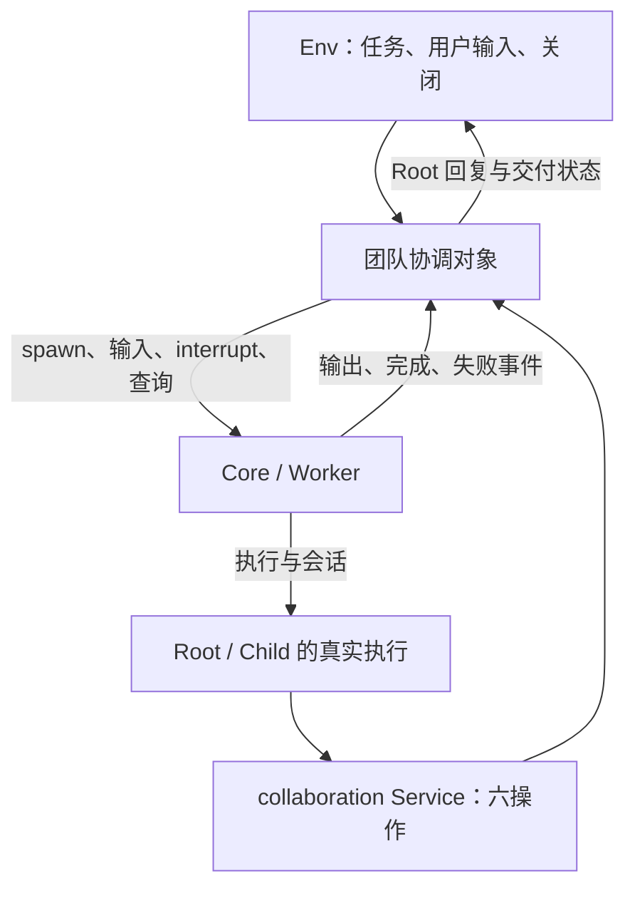

# Codex V2 Subagents：样例设计、实现取舍与功能对照

对应 [#199](https://github.com/LuNa-shi/SwarmEnv/issues/199)。本例的目标是：**用户交给 Root 一项完整任务，Root 能按需要组织一棵可递归的 Agent 团队，成员可以交流、等待、续做和中断，最后交付实际结果；运行中用户仍能补充要求。**

验收侧重这套协作方式及其真实运行效果。完整源码清单用来发现遗漏，**不等于其中每个参数、开关、内部函数和返回字段都必须复刻**。本文先给出取舍、整体结构和运行验收，原来的 41 项功能与 17 项配置对照保留在后面的附录中，并逐项标记本例处理方式。

**文档状态：源码审核与建议设计，尚未实现或运行验收。** 本轮更新不自动改写已批准的 Core 范围。下文仅有一处建议重新评估该范围：C04 的“普通通知只向活动执行交付、不启动 idle”保证；其余主体使用已有 Core 能力。当前代码核对到 [ce3e503](https://github.com/LuNa-shi/SwarmEnv/commit/ce3e503ba534d2b9cf42423aa0cdcdcc80766828)，最新合入的 #211 增加了独立 benchmark，没有补齐普通 Subagents example。

## 1. 做到什么程度

### 1.1 必须保留：决定这个例子是否像 Subagents 的行为

| 能力组合 | 本例要求 | 为什么值得实现 |
| --- | --- | --- |
| 普通任务与持续会话 | 接完整任务；Root 自行决定是否委派、人数和分工；工作中可追加要求；回复后可继续追问。 | 否则普通入口仍是按固定剧本运行的通信测试。 |
| 具名团队与递归 | Root、Child 都能在授权与容量内创建子节点；名称对应真实 Bot 和直接父节点；能查询同树成员。 | 这是动态组织团队的基础，不应停留在 Root 调几个预设 worker。 |
| 真实历史继承 | 支持标准 `all / none`；`all` 使用真实父会话 fork；父子后续独立演化。 | 给 Child 一段摘要不能替代同一历史起点，也不能声称实现了 fork。 |
| 普通通知与追加任务 | 通知不启动 idle；追加任务可以启动原 Agent；工作中的 Agent 能在本地安全边界收到新信息。 | 例如一个成员发现接口假设错误，应能通知仍在实现的成员，避免它沿旧方案做完。 |
| 同一工作过程中的等待 | 可以等待自己的消息；一个结果先到就能继续；用户输入也能结束等待；等待期间系统还能接收输入。 | 协作不能依赖宿主等齐所有 Child，再重新启动 Root。 |
| 可复用、可中断的成员 | 追加任务与中断都保留原身份、会话和工作文件；中断只结束当前工作。 | 已有成果应能继续利用，`stop` 销毁不能替代 `interrupt`。 |
| 自动结果与真实状态 | 完成和失败按真实直接父路由；中断不伪装完成；列表反映真实对象和最近结果。 | 递归团队才能把局部结果逐层整合，失败也有明确去向。 |
| 实际交付与收尾 | Root 交付可核对的答案或文件；资源、等待和证据完整收尾。 | 六个操作返回成功，不代表任务完成，也不代表没有遗留运行。 |

以上是能力组合，不是八个工程阶段。每个操作仍需有可信调用者、明确错误、有限资源和可核对的重试结果；这些正确性要求进入共同实现，不再各做一套基础设施。参考依据见 [六操作合同][U-schema]、[消息与任务模式][U-api]、[等待][U-wait]、[创建与历史][U-thread]。

### 1.2 可以简化：保留效果，减少配置和内部细节

| 维度 | 本例选择 | 不要求复刻的部分与取舍 |
| --- | --- | --- |
| 工具与返回 | 一套 `swarm collaboration <op>` 六操作；清楚返回身份、受理状态、消息或错误。 | 不做原生 function tool / code-mode，不追求空文本、nickname、状态对象的逐字段相同。可信来源、受理与完成的区别仍保留。 |
| 角色与模型 | 宿主启动时配置模型和 Root/Child Profile；递归 Child 使用宿主允许的 Child 配置。 | 本例不开放每次 spawn 的角色目录、model/effort/tier 组合。未支持字段明确拒绝；以后需要异构团队时再扩展。 |
| 历史 | 保留 `all / none` 的真实效果，使用 Pi 的合法历史边界。 | 不做旧正整数参数兼容、Codex retained-items、历史前缀布局与压缩选项矩阵。 |
| 消息和中断时机 | 使用 Pi 可保证的工具批次结束/下一模型请求边界与真实 interrupt。 | 不追求相同 token、reasoning/assistant 输出项位置，不开放 Codex 专有的抢占/中断时机开关。 |
| 资源与状态 | `maxAgents` 包含 Root；idle 保留身份、Session 和 Slot；显示真实状态及最近完成/失败/中断结果。 | 不复刻 execution/resident 双重容量和 idle 淘汰；不把本地 idle 简单当作“完成成功”。 |
| 运行证据 | 利用已有 Session、模型请求/响应、Service 调用流，加上本例协作状态导出和一份简明结果报告。 | 不建设新监控产品，不模拟 Codex UI 活动项；记录只需能解释本次协作与交付。 |

**明确不做：** idle 卸载与冷恢复、跨宿主接管、离线 Replay、额外远程 Message Board、Guardian/UI、动态工具继承、turn/thread 环境切换、子模型上下文窗口重置，以及所有模型/推理等级/tier 的自动枚举。它们保留在附录作差异记录，不是本例未完成的待办。

默认提供六操作即可，不为了原版可配置而加入完整启停开关矩阵。授权限制仍必须执行，例如不能伪造父节点或跨树控制目标。这与“把功能藏在 Prompt 里”不同。[原版可选配置][U-config] · [可选 features][U-features] · [已有 Issue 边界](https://github.com/LuNa-shi/SwarmEnv/issues/199)

### 1.3 实现投入应放在哪里

投入最大的地方应是**一个贯通的协作循环**：创建团队、收发信息、等待与继续、整合成果。接通现有 fork、interrupt、workspace 和 Trace 是第二部分。原版配置兼容和展示细节投入最低，只保留必要接口。

这不是按“差异数量”衡量工作量。比如 nickname 返回值与 busy 消息送达都各占一行，但前者可以省去，后者会影响团队能否及时协作。附录的“必需 / 简化 / 不做分支”区分的是本例目标；“当前情况”仍如实记录尚未接通之处。

## 2. 一个自包含的 example 应该怎样组织

### 2.1 当前需要改变的是组织方式

现在的 `main.ts` 把固定 Child 数量、固定续轮和引用 JSON 检查放进正常流程；`controller.ts` 围绕固定 Root 的直接孩子转发结果，Child 也没有递归协作能力。继续只给这些分支逐个加开关，会把测试脚本扩大成一个不易理解的运行器。[当前入口][S-main] · [当前控制器][S-controller] · [固定提示词][S-prompts]

建议保留一个很容易看懂的例子：**Env 管理一次会话，一个协作 Service 管理团队关系与消息，Core 管理 Agent 的真实执行。** 直接改造现有入口和 controller，不叠加第二套旧/新调度路径。

### 2.2 模块与状态各归一处

| 位置 | 职责 | 拥有的状态 |
| --- | --- | --- |
| `main.ts`：Env 与宿主入口 | 读取任务/配置，装配 Runtime 和 Service，创建 Root，接受 input/status/stop，展示回复，统一关闭和保存报告。 | 本次运行是否接收新工作、Root 身份、回复、任务结果和交付位置。 |
| `controller.ts`：单个团队协调对象 | 实现六操作的共同逻辑；处理用户输入与 Core 事件；统一寻址、授权、消息投递、等待和续做。 | 路径到真实 Bot 的映射、直接父关系、收件箱、活动等待、有限的操作记录及最近结果。 |
| `collaboration-service.ts`：Bash Service 适配 | 定义六操作的参数/帮助/返回，从请求取得可信 caller，将调用交给同一个协调对象。 | 不另建调度状态；不复制一份目录或消息队列。 |
| `config.ts / prompts.ts / README.md` | 给出一个默认可用配置，说明 Root/Child 如何协作、文件如何交付、用户如何运行。 | 启动配置与能力说明；不写固定题目、强制人数、强制操作顺序。 |
| 已有 Core / Backend / Worker | 创建真实 Bot，执行模型与基础工具，承载 Session/fork/文件/输入/中断，归档并清理资源。 | 真实运行状态、原生会话、工作目录、资源和输入回执。 |

前三项是运行实现的主体，不是三个独立服务。协调对象是该 example 的内部实现；其他 Environment 不需要继承这套团队结构。它也不维护与 Core 竞争的第二套 running/idle 状态机：查询状态时，将协作身份与 Core 实际状态、已记录结果组合。

这是拟实现结构。现有公共 [Runtime/Profile/文件合同][S-types] 和 [Service 合同][S-service] 已能承接主体；不需要新增 Core 的目录、mailbox、阶段管理或业务验收 API。

### 2.3 六操作接到同一条协作流程

**创建和目录。** 从可信 caller 确定父节点，先验证并预留名称，再调用 `spawn`，绑定真实 Bot 后提交初始任务。Root 和 Child 走同一条创建路径，因此递归自然成立。名称、树边界、允许的 Profile 和 fork 权限在这里统一检查；自定义 Service 直接调用 Runtime，不意味着旧 `bot.spawn` 的权限检查会自动替它执行。事件订阅在首任务之前建立，避免快完成的 Child 丢结果。

**普通消息和自动结果。** 两者进入同一收件箱，只有来源和类别不同。正在 wait 的收件人由该次 Bash 返回取得正文；idle 收件人只保留消息；正在普通工作中的收件人走 C04 的安全边界交付。Child 结果按真实直接父入箱，不另开一条无条件 `start/steer` 父节点的捷径。每条消息固定身份，同一请求重试不生成另一条。

**追加任务与用户输入。** `followup_task` 与宿主 `input` 共用一个输入协调函数。对 idle 启动原 Agent，对 busy 接现有 `steer`。如果目标正在 wait，先确认正文已排入 Core，再完成仍有效的 wait；wait 只返回“有新任务/用户输入”的原因，不再重复正文。已有 mailbox 若随这次激活送入，预先固定批次，避免又从 wait 交付一遍。未知回执沿同一请求核对，不更换 ID 反复触发。

**等待与中断。** 等待只登记调用者自己的可取消等待，不持有全局长锁，也不堵住宿主 input/status。中断调用已有 `interrupt`，保留身份和文件；同一 Agent 的启动、续做与中断经过同一控制入口。一次中断结果尚未确定时，不启动该 Agent 的下一次工作，先核对原结果。它是防止本例内部交错的设计，仍需验证 #199 所要求的迟到中断情形，不能据此预先宣称底层全部安全。

**回复和关闭。** Root 一轮回复后，交互会话继续；一次性运行则按事先选择的结束策略关闭。关闭只有 Env 一个 owner：停止接收新工作，取消等待，调用 Runtime close，保留事件观察直到收尾与导出结束。清理 pending、必需文件未导出或 Trace 不完整必须留在报告中，不能把进程退出当作完成。

操作记录、短暂名称预留、重试与取消都是这个协调对象的内部保障，先做运行内有界记录即可；不引入数据库、远程总线或跨进程恢复协议。[Core 输入与关闭][S-core] · [Service 取消与导出][S-service]

### 2.4 文件策略选清楚，不再搭一套产物平台

默认各 Bot 私有工作目录；`all` 继承对话不等于共享文件。普通小任务中，Child 可以通过消息提交分析、代码片段或 patch，Root 在自己的目录整合并交付。**Child 只返回自己的私有路径，Root 并不能据此读取文件。**

另提供宿主明确配置的受控共享 workspace，用于适合共享文件的任务；Agent 不能自行申请额外挂载。继续核验 #199 已有的私有/共享两种配置。共享模式固定最终产物前须确认其他写入者已经结束或停止。

当前已有 `files.snapshot` 返回稳定内容与摘要，但“将 Child 文件交给运行中的 Root”仍需具体传递方式。本例不默认增加大型 artifact Service；小任务使用普通消息/patch，共享配置使用真实共享文件。若后续 workload 需要大文件传递，再增加薄适配。Root 的必需交付目录通过现有 `collect` 导出，交付失败与任务失败分开报告。[文件与 workspace 合同][S-types]

### 2.5 Core 到底改不改

| 内容 | 本轮建议 |
| --- | --- |
| 创建、递归、路径、权限、mailbox、wait、结果路由、持续输入、报告 | 改 Env / Service，复用已有公共 API。 |
| 真实 fork、普通 interrupt、私有/共享工作区、完整 Trace | 接通已有 Core 能力，验证组合行为；没有证据表明需要重新实现。 |
| C04：busy 自动收到普通通知，同时 idle 不被通知启动 | **建议保留这个行为；需要评估一处通用条件交付保证。** 它是本次唯一明确提出的 Core 范围调整建议。 |
| F04：迟到中断 | 先采用统一协调入口和原请求核对并验证；底层若仍有反例，再根据具体反例修复，不预设新增 execution-generation API。 |
| 模型 effort/tier、专有输出项抢占等 | 本例不开放，不为这些可选分支改 Core。 |

C04 的原因很具体：现有 `steer` 会启动 idle；先 `get(running)` 再 `steer`，两次调用之间旧执行可能已经结束。Env 加锁只能约束自己的请求，不能阻止原生执行自行结束。

建议的最小语义是：**仅向仍可接收输入的活动执行排入通知；条件不成立就明确未接纳，且不启动新执行，消息留在 Service。** 检查要在 Core/Worker 的真实执行边界成立。默认 start/steer 行为不变；目录、队列和路由仍全部在 example。不预先锁死 API 名称，也不将其描述为已经实现或零成本。

验收还必须覆盖“检查后马上结束”和“已排入后马上结束”。同一输入只交给一个投递路径；未知结果核对原尝试，明确未接纳才回到待投递。接纳不等于模型已读，不能用任一 settled 事件推定消息全部被消费；正常收束前未消费的归属必须能解释。

**完全不改 Core 也有可实施版本**：普通消息只通过 wait 或下次明确激活取出。代价是忙碌但不主动收件的 Agent 暂时收不到纠正信息，C04 只能标“部分适配”。本文倾向保留自动交付，因为它影响实际协作；但 [#198](https://github.com/LuNa-shi/SwarmEnv/issues/198) 曾明确排除 idle 不唤醒分支，因此这里是供审核的一处范围调整建议，不能凭更新本文将其当成已批准事项。其他 Env/Service 主体不依赖先批准一套新 Core 架构。

## 3. 运行时应该能看到什么

功能清单回答“能调用什么”，这一节回答“系统真正工作时是什么样”。下表是运行行为合同，不要求每个任务照表顺序调用，也不要求每条自然任务都触发全部条件。

| 运行维度 | 应该观察到的行为 | 如何判定，不只看 API 回执 |
| --- | --- | --- |
| 自主组织 | Root 根据任务创建实际成员；需要时 Child 再委派；团队大小在上限内变化。 | 创建来自真实模型工具调用，Service caller 与 Core parent 一致；宿主没有预先代为分工。 |
| 有效并行 | 多个成员可以同时做有用工作，Root 也能边做边收结果。 | 两个 Agent 的真实模型/工具工作区间重叠；仅两个容器存在或一个只在 wait 不算并行工作。 |
| 信息影响工作 | 结果、发现或纠正进入收件人的后续上下文，并影响验证、修改或整合。 | 串起消息身份、发送调用、实际模型请求与后续产出；accepted 或最终列出名字不足以证明采用。 |
| 等待与逐步推进 | 一个结果先到即可唤醒父节点；父节点在当前工作中继续；其他节点可以仍在做事。 | 同一次 wait 的工具返回接上后续模型请求；不能用宿主 waitForFinal 或重新 start 冒充。 |
| 用户介入 | Root 工作或等待时，用户仍能追加需求；原 Root 收到并处理。 | 输入接纳没有被等待命令阻塞，正文进入后续真实请求，最终交付体现新增要求。 |
| 身份与成果连续 | 对原成员追加任务或中断后续做时，Bot、Session 和文件保持连续。 | 核对实际 ID、会话和文件；重新创建同名 Bot 不能当作原成员续做。 |
| 失败局部化 | 某个 Child 失败或被中断不会被伪装成成功，也不会无故终止其余团队。 | 错误结果按规则进入父节点上下文；普通中断由调用回执/状态查询确认，不自动伪装完成通知。其他成员继续，可恢复错误由 Agent 决定如何处理。 |
| 收尾完整 | Root 交付与 Runtime 关闭分别成立；全部成员、等待、必需文件和 Trace 有最终状态。 | 检查实际产物与 CloseReceipt；cleanup/证据/导出 pending 时不能宣称完整通过。 |

递归、中断、失败、`all / none` 对照等是条件性行为。正常任务没有理由触发时，由针对性复合场景验证；不往普通 Prompt 中硬写“必须中断一次”“必须创建三层”。

### 3.1 证据从现有记录取得

| 证据 | 用途与限制 |
| --- | --- |
| `runtime.json`、`evidence.jsonl` | 核对真实配置、身份、父子关系、请求、事件和关闭。evidence 不含完整工作输入；settled cursor 不能证明消费了哪条消息。 |
| `model-trace/<attempt>/request.json`，同目录 `response.txt / result.json` | 查看真正送给模型的上下文、真实工具调用、时间和结果；用于消息可见性、并行和自主行为核对。 |
| `service-calls.jsonl`，协作 Service 的 `exportState` | 连接可信 caller、操作 ID、参数/返回与目录、消息、等待原因；区分提交、交付与后续采用。 |
| 各 Bot 的 `session/manifest.json / session/files/` | 核对真实历史、原身份续做和工具调用链。 |
| 文件快照/收集归档、外部检查结果、CloseReceipt | 固定最后交付字节，独立检查任务，并分别确认执行停止、资源清理和证据保存。 |

这些已有公共证据合同，无需新建 Core Trace API。[运行证据说明][S-reporting] · [Service 导出][S-service]。报告只需给出任务结果、关键协作时间线、产物位置和未覆盖项；完整原始记录按仓库规则留在私有运行目录。

## 4. 最后怎样做端到端验收

### 4.1 主验收：普通入口完成一项真实的有限任务

建议采用一个容易客观验证的小型工程任务，例如：依据公开文档和独立参考程序，交付一个离线颜色格式转换 CLI。初始范围为指定输入集合的 `hex / rgb` 格式；运行中用户追加 `hsl` 支持。交付源码、可重复构建脚本、测试和使用说明。

任务说明只写业务要求、输入范围、资源上限和交付标准，**不写 Child 数量、角色、必须调用哪个工具或先后顺序**。具体格式、错误行为和测试范围在启动前说清；超出范围的完整 Pastel 复刻不属于这个小任务。

可以复用最新 [#211 benchmark 的参考材料][S-pastel-readme]，但不能直接拿它的 [Subagents runner][S-pastel-runner] 证明本例已完成：该 runner 仍要求固定两只 Child 和专门的 JSON 源码回传，local runner 使用可控模型响应。这里提议的是正常入口的新验收，不宣称已运行，也不宣称通过完整 ProgramBench。

完整使用路径是：用户启动普通 Env 并提交任务 → 模型自行组织工作 → 用户通过同一入口追加真实要求 → Root 验证、整合并交付 → 宿主按配置结束并导出。用户输入可以选在实际工作已开始后提交；不得由宿主替 Agent 创建成员、发送分工或写候选代码。

### 4.2 一次主验收分三项判定

| 判定 | 通过条件 |
| --- | --- |
| **任务交付** | 最后固定的源码在独立离线目录重建；事先规定的初始需求和追加需求均通过检查；实际源码、测试、说明齐全。检查器只针对公开范围，候选不能借参考程序代答。 |
| **协作行为** | 同一任务轨迹中真实发生自主委派、有效并行、任务相关信息进入上下文、至少一份 Child 贡献被 Root 实质采用，以及运行中用户补充生效。Root 可以改写或修正贡献，不要求逐字引用。 |
| **完整结束** | 本次 Runtime 所有成员纳入 close；执行停止、cleanup complete、pending 为空；必需产物及三类完整 Trace 成功保存。 |

如果 Root 独立完成了任务，可以记“任务通过”，但没有覆盖多 Agent 协作；不能因此把例子的协作验收也打勾。反过来，多次消息/等待都成功但产物不符合需求，也不算完整通过。一次成功轨迹只能证明这次协作有效，不能推导多 Agent 比单 Agent 更快或更准。

自然出现的 wait、原 Child 续做、递归和中断都在本次报告中记录。没有出现的行为写“本次未观察到”，由下述复合场景补验，不能用回执数量或最终回答自述补齐。**主任务必须有贯通的真实协作与交付，条件性操作不必在每次任务里表演。**

### 4.3 保留 #199 已要求的三个复合场景

沿用 #199 的普通入口至少三个复合场景要求，三者都运行真实 Pi/OpenSandbox 与同一 Env/Service。T1 使用真实模型完成任务；T2/T3 可以用可控 Responses 稳定触发条件，纯 mock controller 测试不能替代原生组合验收。各自用途如下：

| 场景 | 要验证的组合 | 不能替代什么 |
| --- | --- | --- |
| T1：上述真实任务 | 普通输入、自主委派、并行、消息采用、中途需求、Root 整合、独立检查和关闭。 | 不能顺便宣称未观察到的递归、中断或每个参数分支都通过。 |
| T2：团队与信息流 | 真实三层关系、`all / none`、目录/权限、idle 通知保留、busy 安全边界交付与 followup。Parent 等待两只仍在工作的 Child，一只先完成即可在原工作中继续，另一只仍可工作；另验消息先到/后到、用户输入、超时与取消。 | 可以用可控响应稳定触发边界；它证明机制，不证明模型自主分工或真实任务效果。C04 必须在接收方未主动 wait 的情况下另行观察。 |
| T3：连续性与结束 | 中断后原身份续做、另一成员继续、私有/共享文件、重复/未知回执、容量/关闭竞争及完整导出。 | 旧请求重放不能替代首次迟到中断检查；普通 Root 回复不能替代资源清理确认。 |

C04 的自动交付验收以 §2.5 的范围决定为准。采用不改 Core 的主动收件版本时，T2 的其他项目分别验收，C04 明确记录为部分适配；不得将其记为自动交付通过，也不据此将 Core 范围调整视为已经批准。

这些场景复用同一个普通 Env 和 Service 实现。测试输入可以固定，普通实现不能为测试人数、题目或操作顺序写分支。参数校验等少量局部回归可在下面补充，不必每条都付出一次完整真实模型运行的成本。模型、预算与运行授权沿用 Issue 的批准范围；本文本身不启动实验。

## 5. 直接对应的补齐工作

| 当前结构问题 | 一次性改到哪里 | 完成后应得到什么 |
| --- | --- | --- |
| 普通入口和固定通信测试混在一起 | 重写 `main.ts / prompts.ts` 的普通运行流程；原固定题目与检查器迁入独立测试入口。 | 任意正常任务可进入，人数/分工由 Agent 决定；一次性和交互使用都清楚。 |
| 目录、输入、结果只围绕固定 Root | 将 `controller.ts` 改为上述单个团队协调对象；六操作共用路径、消息、等待与重试记录。 | 递归树、直接父结果、消息/任务差别及原身份续做成为一个完整流程。 |
| 模型只看到旧 bot 操作，Child 无法协作 | 增加薄 `collaboration-service.ts`，按真实权限装配 Root/Child Profile 与帮助。 | 普通模型可以发现并调用六操作；无硬编码的另一套测试工具路径。 |
| Core 能力存在但 example 未连接 | 接现有 fork、steer、interrupt、workspace、collect 与 Trace；C04 单列范围建议，F04 按具体反例判断。 | 大多数工作留在 example；未通过的底层边界明确可见。 |
| 安装、交付、文档缺少完整普通路径 | 更新编译/包入口、README、受影响 Architecture 和 Prompt 清单；仅使用公开包入口。 | 仓库外用户能运行自包含样例，并根据文档理解其结构和交付方式。 |

工作按这个整体结构补齐后，再用附录逐项检查遗漏；不会把 41 行拆成 41 个独立补丁。完成项回填 #199 的代码和验证证据。workload/domain 适配保留为任务、初始文件、工具权限、预算与检查器等输入；完整跨领域对比和未知 MAS 检验继续归 [#205](https://github.com/LuNa-shi/SwarmEnv/issues/205)。

---

## 附录：完整功能对照

以下保留源码级细节，供实现者查遗漏。**“原版有”不自动等于“本例要做”。** 功能表中的“必需”指保留行为，“简化”指采用本文明确的本地形式；配置表另外标出不做的可选分支。原版事实、当前代码和建议目标分开阅读。

<strong>附录 A：原版六项操作的参数与返回</strong>

## A. 原版六项操作的参数与返回

| 操作 | 参数 | 原版成功返回 |
| --- | --- | --- |
| spawn_agent | task_name、message；可选 fork_turns，以及按配置开放的 agent_type/model/reasoning_effort/service_tier | {task_name}；metadata 可见时另有 nickname；不返回最终答案 |
| send_message | target、message | 空文本；表示提交成功，不表示对方已采用 |
| followup_task | target、message | 空文本；同一 Agent 继续，不是另建 Agent |
| wait_agent | 仅 timeout_ms 可选；handler 要整数 | {message, timed_out}；不返回 Agent 名单或正文 |
| interrupt_agent | target | {previous_status}；是提交前状态，不是停止完成的确认 |
| list_agents | path_prefix 可选 | {agents:[{agent_name, agent_status}]} |

`AgentStatus` 包含 `pending_init`、`running`、`interrupted`、`shutdown`、`not_found`，以及带内容的 `{"completed": string|null}`、`{"errored": string}`。没有一个裸 `idle` 状态可以代替所有已结束结果。

上表是原版合同；SwarmEnv 已选择 Bash/Service 形式，可在返回中提供请求回执，wait 也可直接带消息正文。不能把这种允许的适配写成原版原生返回值完全相同。[原版 schema][U-schema] · [消息 handler][U-message] · [wait handler][U-wait]

<strong>附录 B：41 项功能逐项对照及本例决策</strong>

## B. 逐项功能核对

### B.1 普通任务与持续交互

| 编号 | 本例决策 | 应有行为 | 当前情况与补改 | 验收方法 |
| --- | --- | --- | --- | --- |
| A01 | 必需 | Root 接收用户的实际任务，自主决定是否委派及创建数量。 | **不同｜Env。** 移除普通流程的 childCount 下限、精确人数与强制续轮；只保留人数等上限。 | 直接回答、创建一个 Child、递归创建都能被普通入口接纳；无需凑人数。 |
| A02 | 必需 | 任务的最终回答不要求固定题目、固定引用数量或特殊 JSON。 | **不同｜Env。** 把固定题目、checkDelivery 与 stages.ts 留在测试入口；普通回答与可选任务检查器分开。 | 自然回答正常返回；原固定通信测试仍可单独运行。 |
| A03 | 必需 | 用户可以在运行期间补充输入，原 Root 和会话继续。 | **部分｜Env。** 当前 goal + supplements 在启动时统一提交；增加持续输入入口并接等待唤醒。 | Root 未回答前输入补充；同一 Root 在真实模型请求中收到它。 |
| A04 | 必需 | 一轮回答结束后可继续交互；结束整次运行由宿主决定。 | **部分｜Env。** 区分 Root 回复、任务检查结果和全队关闭；等待回复不能阻塞新 input/status。 | Root 回答后能追问；停止时整队收尾，业务失败与清理失败分别可见。 |

依据：[当前入口][S-main] · [固定 Prompt][S-prompts] · [固定阶段脚本][S-stages] · [前台宿主][S-host] · [命令处理][S-commands]。

这里的“固定测试场景”指原来为了测试而规定的题目、人数、轮次和检查器。它们保留在测试入口，普通运行不强制使用；不是简单把同样的限制改写进一个配置文件。

### B.2 spawn_agent：创建、递归和继承

| 编号 | 本例决策 | Codex V2 行为 | 当前情况与补改 | 验收方法 |
| --- | --- | --- | --- | --- |
| B01 | 必需 | task_name 与非空 message 创建一个 Child 并提交首任务；返回身份，不同步等待最终答案。 | **部分｜Service。** 包装现有 runtime.spawn + start；创建身份与首任务是否受理分别记录。 | 调用先返回 Child 身份，Child 随后执行；首任务失败不会丢失已创建的 Bot。 |
| B02 | 必需 | task_name 为小写字母、数字、下划线构成的单段；禁止空、root、斜杠、点段及大写。 | **缺少｜Service。** 增加名称验证和规范路径；实际正例使用 /root/a/b。 | 合法名称成功；非法名称明确拒绝。 |
| B03 | 必需 | 新 Child 的父节点是实际调用者；可形成 Root → Child → Grandchild。 | **缺少｜Env + Service。** Child 获得授权的协作操作；父身份从可信 caller 推导，调用 Core parentId。 | 三层真实 Bot 关系与目录一致，伪造 parent 无效。 |
| B04 | 必需 | 同一父节点下名称不可重复；不同父节点下同名可以存在。 | **缺少｜Service。** 预留规范路径并映射到 Bot ID；同一请求重试继续核对原创建。 | 同父重名拒绝；并发/丢回执不产生两个同路径 Bot。 |
| B05 | 必需 | 可继续使用原 Child；容量限制只约束资源，不要求每次创建满员。 | **部分｜Env。** 用 maxAgents 表示包含 Root 的上限；idle 保留 Slot，复用原 Child。 | 少于上限合法；超过上限拒绝；清理未完成不提前释放容量。 |
| B06 | 必需 | fork_turns 省略为 all，继承当前可用父会话上下文；none 不复制普通父历史。压缩历史、显式 retained items 另有规则。 | **Core 有，Env 未接｜Service。** all 映射真实父 forkFrom；none 不传；检查 fork 权限。 | Child 第一个真实模型请求体现 all/none 差别，工具调用完整，父子独立演化。 |
| B07 | 简化 | 原版可按配置选择角色 agent_type 与模型；这些可选能力需在完整对照中列明。 | **部分｜Env + Service。** 本例只用启动时确定的 Root/Child Profile；不开放每次 spawn 的 agent_type/model/effort/tier。原版配置分支继续记录，详见 C 表。 | 实际请求使用宿主指定的配置；未开放的覆盖字段明确拒绝，不要求测试原版角色/模型组合。 |
| B08 | 必需 | Child 继承授权的运行环境；会话历史继承与工作文件可见性各有明确规则。 | **部分｜Env。** 复用 Core 私有目录与宿主明确配置的共享 workspace，说明实际文件可见性；不把 fork 当文件复制。已有固定副本能力不另设为本例必做模式。 | 分别观察历史与文件；私有目录不凭路径字符串共享，授权共享实际可读，只读不能写。 |
| B09 | 简化 | 原版返回规范 task_name；未隐藏 metadata 时另有 nickname。 | **不同｜Service。** 返回可寻址的 task_name 和必要本地回执；省去 nickname 与 metadata 开关，不把身份或受理回执当最终结果。 | 返回的名称能直接用于后续操作；初始任务受理情况与最终结果区分。 |

依据：[原版创建 handler][U-spawn] · [真实创建与启动][U-thread] · [路径校验][U-path] · [当前入口/权限][S-main] · [旧 Bot Service][S-bot] · [Core 创建与文件接口][S-types]。

名称目录负责协作路径到真实 Bot ID 的映射。Core 的 parentId 和运行状态仍作为真实对象信息，不能另造一棵与 Core 不一致的树。`maxAgents` 是最多允许多少 Bot；不是要求每次把它用满。工作区是文件配置，任务路径则是 Agent 名称，两者不要混淆。

### B.3 send_message：普通消息

| 编号 | 本例决策 | Codex V2 行为 | 当前情况与补改 | 验收方法 |
| --- | --- | --- | --- | --- |
| C01 | 必需 | target 支持同树的 Agent ID、相对名与规范路径；相对名从调用者路径解释。 | **缺少｜Service。** 共用一个目录解析器并验证目标属于当前树。 | /root/a 调用 b 找 /root/a/b；联系兄弟用 /root/b；跨树 ID 也拒绝。 |
| C02 | 必需 | 普通消息可发送给同树 Root、兄弟和自身；发送者身份可信。 | **不同｜Service。** 当前 bot.send 主要限自己/直接孩子；增加 V2 规则，按可信 caller 包装 MESSAGE/NEW_TASK/结果的来源和类别。 | 这些合法目标均可达；模型伪造 from 不能改变真实来源。 |
| C03 | 必需 | 主参考配置下，普通消息入队，不因目标 idle 而主动开启新 Turn。 | **缺少｜Service + Env。** 建立外部收件箱；活动 wait 可返回正文；idle 不直接调用 start/steer。 | 给 idle 发消息后无新模型请求，消息仍在，后续明确消费可读到。 |
| C04 | 必需行为；Core 边界待审 | 运行中的目标在允许的输入边界及时看到消息；旧 Turn 收束时可延后保留。 | **有差距｜Env / Core 接口。** get(running) 后 steer 存在目标已结束的竞态；现有公开 API 无原子“仅运行中注入”。不能以轮询宣称完整支持。 | 同时检查运行中自动送达与不误唤醒；仅靠 wait/主动读取的适配须记录此行尚未完全对齐。 |
| C05 | 必需 | 发送失败向调用者明确报告；成功表示消息提交，不表示对方已经采用。原版成功输出为空文本。 | **需补｜Service。** 保存消息身份和送达状态，Bash 可返回结构化回执；重复请求不变成新消息。 | 坏目标/空消息/权限错误可见；重复投递不重复入队；采用与受理分别有证据。 |

主参考行为采用普通消息不自动唤醒 idle 的配置；wake 和 durable-sleep 的其他分支见配置表。消息写入队列、进入真实模型上下文、模型随后采用它，是三个不同事实。

**C04 的具体差距：** 当前 Core 的 steer 在 idle 时也启动工作。查询到 running 后，目标可能在 steer 到达前结束。只用外部 wait/主动读取收件箱可以保持 idle 不被唤醒，但不能保证一个从不读收件箱的 running Bot 自动收到消息。本文建议保留这两项行为，并只评估实际执行边界上的条件交付保证，见 §2.5。它与 #198 已排除的分支有范围冲突，仍为待审建议；未批准时可采用主动收件版本，但 C04 保留部分适配。

依据：[目标解析/QueueOnly][U-api] · [输入队列与收束期处理][U-queue] · [运行中消息边界][U-turn] · [当前派发][S-controller] · [Core 输入实现][S-core]。

### B.4 followup_task：让原 Agent 继续工作

| 编号 | 本例决策 | Codex V2 行为 | 当前情况与补改 | 验收方法 |
| --- | --- | --- | --- | --- |
| D01 | 必需 | 给 idle 的现有非 Root Agent 一个新任务，启动工作并保留原身份/会话。 | **已有基础｜Service。** 新操作接 runtime.steer，复用原 Child。 | 原 Bot 第二轮继续，能使用原会话和文件。 |
| D02 | 必需 | 目标 busy 时尽早送入当前工作，在允许边界生效，不固定排到下一大阶段。 | **不同｜Service + Env。** 替换当前指定 followUp 的路径；活动 wait 经同一输入入口结束等待。 | busy 的真实后续模型请求收到任务；等待中的目标也能及时继续。 |
| D03 | 必需 | 拒绝 Root；同树其他合法目标可用，不额外禁止合法 Child 给自身 followup。 | **需补｜Service。** 统一解析与授权；不能沿用仅直接孩子的旧规则。 | Root 拒绝；允许的兄弟/self 调用符合参考；跨树拒绝。 |
| D04 | 必需 | 参数为 target、非空 message；原版成功输出为空文本，失败明确返回。 | **需补｜Service。** Bash 回执可适配，但追加任务不等同完成任务；未知结果按同一请求核对。 | 重复与丢回执不重复激活；不能把 accepted 标成任务完成。 |

注意名字区别：原版 followup_task 对 busy Agent 尽早送达，不能直接等同于本地旧的 send(mode: followUp)。后者排到后续大阶段，现有 steer 才更接近所需行为。

依据：[原版 TriggerTurn 与 Root 限制][U-api] · [消息 handler][U-message] · [当前 Prompt][S-prompts] · [Core start/steer][S-core]。

### B.5 wait_agent：等待自己的消息

| 编号 | 本例决策 | Codex V2 行为 | 当前情况与补改 | 验收方法 |
| --- | --- | --- | --- | --- |
| E01 | 必需 | wait_agent 等自己的消息活动，没有“指定 child 列表”参数。 | **缺少｜Service。** 为调用者登记可取消等待；当前宿主 waitForFinal 不充当这个操作。 | 只有 timeout_ms；等待对象来自可信 caller。 |
| E02 | 必需 | 已有消息立即返回；后到消息唤醒；任一 Child 的结果即可让 Parent 继续。 | **缺少｜Service。** 收件箱检查和登记等待之间不丢消息，长等待不占全局锁。 | 先到/后到都通过；一只先完成时 Parent 可继续，不必等齐。 |
| E03 | 必需 | 等待发生在当前执行中，结束后原 Agent 继续。 | **Core 有基础，Env 未接｜Service + Env。** 使用真实 Bash 长调用；返回后继续同一 Pi 工作过程。 | 检查实际工具返回与紧随其后的模型请求，而不是先结束再由宿主 start。 |
| E04 | 必需 | 当前执行收到用户 steer 时，等待也提前结束。 | **缺少组合接线｜Env。** 用户输入与 followup 共用入口；活动 wait 仍有效时，确认 steer 为 accepted/queued 后结束该等待；正文只送一次，unknown 按原请求核对。 | 用户输入和 followup 分别验证：等待及时结束、原会话继续、正文不重复。 |
| E05 | 必需 | 默认 30 秒；最小 10 秒（不足则提升到最小值）；最大 1 小时（超过拒绝）。 | **需补｜Service。** 实现参数规则，并配置相应 Service/传输时限；运行预算可更早结束。 | 省略、过小、超上限、超时和取消各有确定结果，关闭后无残留等待。 |
| E06 | 简化 | 原版返回 {message, timed_out} 摘要；消息正文由原生消息机制消费。 | **已允许适配｜Service。** 本票经 Bash 返回消息正文，保留原因/超时区分；丢响应后同请求返回同一批。 | 摘要/正文消费规则清楚；未确认的响应不造成消息静默丢失。 |
| E07 | 简化 | 用户 steer 与 mailbox 同时待处理时，等待活动优先标记为 Steer；这不是任意优先级消息系统。 | **需补｜Env + Service。** 保留新输入不被普通消息遮住的效果；采用本地 wait 原因和单次正文交付，不复刻原生 Steer 枚举及全部优先级实现。 | 两类输入同时待处理时，wait 以新输入中断的原因返回；输入进入后续模型请求，普通消息仍保留。 |

wait_agent 是 Agent 的工具调用；宿主等待 Root 回复是另一个接口。两者都不应阻塞其他消息或用户输入的接收。长等待使用已有 Service timeout/signal/授权复查能力，不需要把 mailbox 放进 Core。

依据：[原版 wait][U-wait] · [输入类别优先关系][U-queue] · [Service 调用合同][S-service] · [当前宿主 waitForFinal][S-controller]。

### B.6 interrupt_agent：停止当前执行，保留 Agent

| 编号 | 本例决策 | Codex V2 行为 | 当前情况与补改 | 验收方法 |
| --- | --- | --- | --- | --- |
| F01 | 必需 | 中断当前执行后，Agent 仍可收消息和继续任务；不等同销毁 Agent。 | **Core 有，Env 未接｜Service。** 接 runtime.interrupt，不用 bot.stop 冒充。 | 一只 Child 停止后以原身份续跑，Session/文件保留，另一只继续。 |
| F02 | 必需 | 拒绝 Root 和调用者自身；合法已空闲或未加载目标不因中断而被唤醒。 | **需补｜Service。** 检查可信目标；本票不做卸载恢复，对已结束对象正确处理。 | Root/self 拒绝；idle 目标无新模型请求；坏目标明确失败。 |
| F03 | 简化 | 返回发出中断前观察到的 previous_status，使用原版 AgentStatus 语义。 | **Env 未接｜Service。** 用 Core 实际状态和最近结果表达中断前状态；另保留真实中断回执，不要求复制原版 AgentStatus 的 wire 格式。 | 返回此前状态，不能把回执、观测状态、任务最终结果混成一个值。 |
| F04 | 必需（本票要求） | 原版操作只接 target，没有调用方指定的执行代次参数；本项目另外要求迟到中断不误伤新工作。 | **基本能力有，严格边界待核｜Env。** 分别处理旧 ID 重放、Env 内旧任务排队、底层跨执行首次迟到；已有保障不足时才提出具体 Core 修改。 | 分别验证三种迟到；保留 #199 原验收，未解决的情形不算通过。 |

原版 previous_status 是观测状态，不是“底层已经完全停止”的完成回执。本地可以提供更清楚的执行回执。旧请求重放与首次到达但已经跨执行的请求应分别检查；不能把其中一个测试当成另一个的证明。

依据：[原版中断权限与动作][U-interrupt] · [原版状态格式][U-schema] · [Core interrupt][S-core] · [Worker 中断处理][S-worker]。

### B.7 list_agents：真实目录与状态

| 编号 | 本例决策 | Codex V2 行为 | 当前情况与补改 | 验收方法 |
| --- | --- | --- | --- | --- |
| G01 | 必需 | 返回当前树中可见的活 Agent，含可查询的 Root 与其他分支，不限直接孩子。 | **Core 有基础，Env 未接｜Service。** 目录结合 Core list/get；关闭历史不直接混进活列表。 | Child 可见同树其他分支，跨树不可见；与实际 Bot 存活情况一致。 |
| G02 | 必需 | 可选 path_prefix，按规范路径及完整后代段过滤；支持调用者相对路径解析。 | **缺少｜Service。** 共用路径解析和按段前缀匹配。 | /root/a 匹配自身和后代，不匹配 /root/ab；非法路径拒绝。 |
| G03 | 简化 | 返回 {agents:[{agent_name, agent_status}]}，状态区分 pending_init/running/completed/errored/interrupted/shutdown/not_found。 | **部分｜Env + Service。** Core idle 无法单独表达这些结果；结合真实终态和中断记录，不虚构状态。 | 完成、错误和中断可区分并可查对应结果；允许采用本地 status + lastOutcome 等结构，不要求原版字段逐字相同。 |
| G04 | 简化 | 上游实际枚举已加载且可查询的 runtime；持久身份目录不等同 list 的输出。 | **适配｜Service。** 本票 idle 常驻，不实现上游卸载；仍区分身份保留、当前可见、已关闭。 | 列表与寻址不矛盾；不能为了显示完整目录伪造仍活着的 Agent。 |

依据：[原版实际列表][U-control] · [路径规则][U-path] · [状态 schema][U-schema] · [Core list/状态][S-types]。

### B.8 自动结果通知

| 编号 | 本例决策 | Codex V2 行为 | 当前情况与补改 | 验收方法 |
| --- | --- | --- | --- | --- |
| H01 | 必需 | 完成结果自动进入真实直接父的消息队列，即使后续任务由另一分支发起。 | **部分｜Env。** 当前只回固定 Root；改成按可信 parentId 路由。 | 孙节点结果到父节点，父结果到 Root；不是全部平铺给 Root。 |
| H02 | 必需 | Completed/Errored/Shutdown/NotFound 可生成相应通知；普通 Interrupted 不生成同类完成通知。 | **不同｜Env。** 当前把 aborted 也作为结果回传；区分本地事件记录与原版通知条件。 | 完成、错误、退出、中断分别核对；中断不伪装完成，也不额外制造原版没有的完成通知。 |
| H03 | 必需 | 自动结果采用 QueueOnly；关闭 direct message 不会自动取消这条结果通路。 | **不同｜Env + Service。** 与普通消息共用收件箱并替换当前 followUp 派发；结果路由不依赖模型主动 send。本例六操作默认开放，不实现 direct-message 开关矩阵。 | idle 父不被结果强制启动；无需模型额外调用 send，结果即可进入真实直接父的收件箱。 |
| H04 | 简化 | 完成时，原版另给发起者生成活动记录；通知正文仍带真实来源并按直接父路由。 | **部分｜Env。** 保留事件去重、可信来源和发起者审计记录；不复刻 Codex 专属活动通知/UI。活动日志与结果路由分开。 | 重复终态不重复入队；不能伪造发送者；活动记录不改变结果接收者。 |

**纠正此前描述：** 不能把“每次终态，包括普通中断，都自动回父结果”归为 Codex V2 行为。原版格式化器对 Interrupted 返回空；本地仍须记录中断事件，但额外向父发送中断通知属于本地行为选择。

依据：[通知路由][U-completion] · [各状态是否形成通知][U-format] · [当前固定 Root 路由][S-controller]。

<strong>附录 C：17 项原版配置及本例取舍</strong>

## C. 原版配置与可选分支

这些分支属于完整对照的一部分。原版事实保留；本例决策已收敛。写为“不做分支”的内容不纳入本次验收，不因为普通任务通过而算成已支持。表后继承优先级与兼容参数仅供查阅，不是额外待办。

| 功能/配置 | 原版行为 | 本例决策 | SwarmEnv 对照与处理 |
| --- | --- | --- | --- |
| V01 能力启用 | 显式选 V2；disable_native_tools=false 才暴露原生六操作；disable_direct_message 默认 false、wait_agent_enabled 默认 true；Child 模型还须支持 V2。关闭 direct-message 不关闭自动结果。 | 简化 | **Env + Service。** 本例默认开放六操作；只做真实 caller、树与目标权限，不新增完整功能开关矩阵或原生工具切换。若以后确实开放关闭选项，帮助与实际授权必须一致。 |
| V02 角色选择 | agent_type 可按配置暴露；显式角色适用于 all/none。省略角色时，all 不额外应用 default role；none 应用 default role；其他参数仍各自继承或覆盖。 | 不做角色选择分支 | **Env。** 只提供宿主确定的 Root/Child Profile；不暴露 agent_type，不复制省略/显式角色的所有层叠规则。 |
| V03 模型与推理参数 | expose_spawn_agent_model_overrides 默认 true；先取父实际 model/effort，再取显式参数或子 Agent 默认值，最后角色配置仍可覆盖；换模型且显式参数与子 Agent 默认配置都没有 effort 时，才用新模型默认。 | 简化；不做动态覆盖 | **Env。** 使用宿主启动时允许的模型配置，不开放逐次 spawn 的 model/reasoning_effort；当前缺少 effort 的等价公开参数，不为此扩 Core。 |
| V04 service tier | expose_spawn_agent_service_tier 默认 false；schema 还需 model-overrides 开关。原版 tier 开关关闭时会过滤显式请求；开启后才校验。省略走 root/host 通常继承，显式 tier 不直接变成孙代默认。 | 不做 | **本例不开放 service_tier。** 当前没有等价公开配置；明确拒绝传入该未支持字段，记录与原版关闭开关时过滤行为的差异。 |
| V05 metadata 与说明 | hide_spawn_agent_metadata 默认 true，控制 spawn 返回 nickname 等展示；V2 下不等同隐藏 role/model/effort。role 由 agent_roles 暴露，model/effort 有独立开关。 | 不做开关分支 | **Service。** 返回 task_name 与必要回执，省去 nickname；帮助与真实参数固定一致，不做 metadata 展示矩阵。 |
| V06 fork 兼容输入 | 标准 all/none 不区分大小写并去首尾空白；省略、null、空白按 all。旧正整数文本等价 all；0/负数/其他文本拒绝。fork_context 布尔值拒绝，V2 无 items 参数。 | 简化 | **Service。** 支持标准 all/none 与省略默认 all；不支持旧正整数、空白/null 等历史兼容写法，非法值明确拒绝。 |
| V07 idle Root 消息唤醒 | wake_on_agent_messages 默认 false；打开后 idle Root 的自动唤醒仍受未中断状态、模式/预算等约束，不覆盖所有 Child。未结束 durable-sleep 另有唤醒分支。 | 不做可选唤醒分支 | **Env + Service。** 使用默认不唤醒 idle 的普通通知策略；不加入 wake_on_agent_messages/durable-sleep。活动执行交付另按 C04 验收。 |
| V08 运行中消息时机 | defer_mailbox_preemption=false 时在已完成的 assistant commentary/partial-answer 或 reasoning 项边界检查；最终回答收束后可留到下一轮。true 推迟到下一正常输入边界；与 idle 唤醒独立。 | 简化；保留核心交付 | **Env / 可能的 Core 输入补充。** 采用 Pi 可保证的工具批次/下一模型请求边界；C04 不误启动 idle 的保证仍须单独成立。不暴露 defer_mailbox_preemption 或复刻逐输出项抢占。 |
| V09 中断时机选项 | interrupt_at_item_boundary 默认 false；开启仅对 V2 Child 生效：立即取消工具，允许已注册采样在输出项边界收束；没有相应采样状态仍硬中断。 | 不做可选边界 | **Service 接已有普通 interrupt。** 保留真实停止与身份连续性，不开放 interrupt_at_item_boundary，不要求与 Codex 相同输出截断位置。 |
| V10 收件箱与额外 Message Board | 六操作的 mailbox 管理 Agent 输入消息；另有可选 Agent Message Board，能接内存、SQLite、远程/MCP 等设施，它不是六操作 mailbox 的同义词。 | mailbox 必需；额外 Board 不做 | **同一协作 Service 实现本例收件箱。** 不增加 SQLite、远程/MCP Message Board，也不把内存 mailbox 或报告称作跨宿主恢复。 |
| V11 历史前缀与压缩 | preserve_fork_prefix 默认 true；它与 compaction 影响继承历史的布局。完整前缀可含旧 Agent 消息，需重建子身份且不继承活工具会话。 none 也可能保留显式 child_retention 项，因此并非完全空白。 | 简化 | **接已有真实 Pi fork。** 验 B06 的合法历史、身份与独立演化；不增加 Codex retained-items、preserve_fork_prefix 或压缩布局兼容。 |
| V12 容量与深度 | 上游并发配置 4 为 Root 预留 1，非 Root 执行/驻留限制用 3；上游还能卸载 idle。V2 不使用 V1 的 max_depth 门槛。 | 简化 | **Env。** maxAgents 包含 Root，maxDepth 为本地上限，idle 常驻；不实现双重容量与 idle 淘汰，不要求每次创建满额。 |
| V13 工具呈现与可配置提示 | 默认 namespace 为 collaboration；non_code_mode_only 默认 true，可被模型 metadata 覆盖。root/child usage hints、developer instructions、模式提示可独立配置，模型 catalog 还能覆盖工具 schema/说明。 | 简化 | **Env + Service。** 提供清楚的 Root/Child 提示和实际 CLI 帮助；不做原生 code-mode namespace、模型 catalog 的 schema 覆盖及全部提示选项。 |
| V14 native review | 启用相关 Guardian 审查时，spawn/send/followup/interrupt 受原生 review；wait/list 不走这项设置。 | 不做 | **保留本地授权与日志。** 不复刻 Guardian 产品审查与 UI；隐藏帮助不能替代实际权限检查。 |
| V15 dynamic tools 继承 | MultiAgentV2DynamicTools 默认 false；开启时 fresh V2 Child 可以继承父的 dynamic tools。 | 不做 | **使用宿主 Profile/Service 授权。** 不复刻或声称支持 Codex dynamic tools 继承。 |
| V16 环境选择 | SubagentThreadEnvironments 默认 false；默认继承当前 step 的环境选择，开启后改用 thread 配置环境。 | 不做 turn/thread 切换 | **Env。** 启动时指定镜像、工作区和服务权限；不复制 Codex 的 turn/thread 环境选择系统。 |
| V17 上下文窗口设置 | SubagentDefaultContextLimits 默认 false；开启时清掉继承的窗口/自动压缩限制，使用 Child 模型默认。 | 不做 | **沿用宿主模型/Profile 设置。** 不增加每次创建重置窗口或自动压缩限制的选项。 |

配置与工具暴露依据：[V2 配置默认][U-config] · [feature 默认][U-features] · [配置说明][U-feature-config] · [工具注册][U-spec-plan] · [工具 schema][U-schema]。

运行行为依据：[Root 消息唤醒条件][U-wake] · [输入边界][U-turn] · [中断边界选项][U-sampling] · [历史继承][U-history] · [容量与卸载][U-residency] · [可选 Message Board][U-board] · [dynamic tools 继承][U-native-spawn] · [环境选择][U-session]。

本地依据：[Profile/创建合同][S-types] · [Backend 模型配置][S-backend] · [协作 Service 可用合同][S-service]。

### C.1 原版 spawn 参数的继承与拒绝细节（查阅材料）

- task_name、非空白 message 必填。未知字段拒绝；V1 的 items 不在 V2 合同内。fork_context 的布尔值会被专门拒绝，提示改用 fork_turns。
- fork_turns 的 all/none 先去首尾空白且大小写不敏感；省略、null、空白字符串按 all。可解析的正整数文本同样按 all；JSON 数字不是该 string 字段的等价写法。
- agent_type 可省略，空白相当于省略；原版有 default/explorer/worker 等内置角色，也允许配置角色覆盖同名内置角色。未知或不可用角色报错。显式角色在 all/none 都可以应用。
- 模型与 effort 从调用 step 的有效配置出发；显式字段优先于对应 agent_default_subagent_*，随后角色配置仍可能覆盖。更换模型时，只有显式参数和配置的子 Agent 默认均未指定 effort，才用新模型默认。请求模型必须匹配可用模型，V2 排除 metadata 明确禁用 multi-agent 的模型；effort 必须为该模型支持的值。请求参数先校验，不能靠随后角色覆盖让非法请求变合法。
- tier 显式请求与通常继承 tier 分开保存。原版 tier 开关关闭时会过滤传入的显式值；开启后 default 可接受，其他显式值须满足模型、feature 和 provider 支持，否则报错。没有显式值时按 root/host 通常继承；继承值若模型不支持则清除。父 Agent 本次显式 tier 不直接成为孙代默认。
- metadata/schema 是否显示字段，与 handler 是否解析或拒绝字段不是同一件事。本地 Service 需要落实实际授权，不能靠隐藏帮助文本代替检查。

**原版自身有一处需要保留的差异：** 默认 usage hint 要求 all 沿用父模型/推理并用 none 才指定覆盖；但所核 V2 handler/config 链没有硬性拒绝 all + overrides，且有 full-history 子模型变化的代码路径。本文不把提示文字误写成已经执行的拒绝规则，也不声称已取得该分支的端到端结果。

依据：[spawn 解析][U-spawn] · [子配置层叠与权限][U-child-config] · [角色应用][U-role] · [tier 继承][U-tier] · [默认提示][U-hints] · [full-history 创建路径][U-thread]。

<strong>附录 D：已有 Issue 约定的实现差异</strong>

## D. 已约定的实现差异

以下遵循 #199/#198 已有边界，完整列出但不重新展开为额外开发项目。

| 原版能力/形式 | 本票处理 | 核对时的要求 |
| --- | --- | --- |
| 原生 function tools / 原生 Agent message 项 / code-mode namespace | 本票坚持 read/write/edit/bash + swarm Service CLI；保留协作行为，参数和输出经 Bash 表达。wait 可直接返回消息正文。 | 不为外观改造 Pi 工具层；实际帮助、权限和调用路径仍要完整。 |
| idle Agent 卸载与按需重载 | 原版可保留身份并卸载运行体；本票已决定 idle 保留 Session 和 Slot，不做 suspend/resume。 | 列表、容量、interrupt 的未加载对象分支注明差异；不把冷恢复列成本次新增工作。 |
| 离线 Replay / 跨宿主接管 | 本票明确不做；保留带时间戳的 Session、模型和 Service 调用记录。 | 运行内重试不等于进程重启恢复；记录真实关闭和未完成清理。 |
| Codex 专有 Guardian/UI 活动呈现 | 原版有 Guardian 多次拒绝的专门提示和 UI 活动项。SwarmEnv 保留自己的授权/错误/日志合同。 | 不把普通错误伪装 Guardian，也不为了本例复刻整个 Codex 客户端。 |

Codex 的历史前缀、显式 retained client items 和环境继承也不是 Pi Session/文件策略的同名功能；保持真实历史 fork、可信权限与明确文件可见性，不宣称两个底层格式相同。

## 源码与审核记录

- 原版：Codex MultiAgentV2 [a0d5b0a](https://github.com/openai/codex/commit/a0d5b0a661db3b34cd87bdf1c93736b90fd3694b)。
- 当前代码：SwarmEnv [ce3e503](https://github.com/LuNa-shi/SwarmEnv/commit/ce3e503ba534d2b9cf42423aa0cdcdcc80766828)，包含 #208 的 Core 与 #211 的独立 benchmark；普通 Subagents 运行实现尚未按本文补齐。
- 对应 Issue：[Subagents #199](https://github.com/LuNa-shi/SwarmEnv/issues/199)；[Core #198](https://github.com/LuNa-shi/SwarmEnv/issues/198)；[完整任务评测 #205](https://github.com/LuNa-shi/SwarmEnv/issues/205)。
- 本次交付为范围评估、样例结构、运行行为/E2E 建议与完整功能对照；没有修改运行代码、没有新增模型或原生运行验收。本文的 Core 范围调整仍为建议，各项实施及通过证据回填 #199。

[U-schema]: https://github.com/openai/codex/blob/a0d5b0a661db3b34cd87bdf1c93736b90fd3694b/codex-rs/core/src/tools/handlers/multi_agents_spec.rs
[U-spawn]: https://github.com/openai/codex/blob/a0d5b0a661db3b34cd87bdf1c93736b90fd3694b/codex-rs/core/src/tools/handlers/multi_agents_v2/spawn.rs
[U-thread]: https://github.com/openai/codex/blob/a0d5b0a661db3b34cd87bdf1c93736b90fd3694b/codex-rs/core/src/thread_spawn.rs
[U-path]: https://github.com/openai/codex/blob/a0d5b0a661db3b34cd87bdf1c93736b90fd3694b/codex-rs/protocol/src/agent_path.rs
[U-api]: https://github.com/openai/codex/blob/a0d5b0a661db3b34cd87bdf1c93736b90fd3694b/codex-rs/core/src/agent/control/api.rs
[U-message]: https://github.com/openai/codex/blob/a0d5b0a661db3b34cd87bdf1c93736b90fd3694b/codex-rs/core/src/tools/handlers/multi_agents_v2/message_tool.rs
[U-wait]: https://github.com/openai/codex/blob/a0d5b0a661db3b34cd87bdf1c93736b90fd3694b/codex-rs/core/src/tools/handlers/multi_agents_v2/wait.rs
[U-interrupt]: https://github.com/openai/codex/blob/a0d5b0a661db3b34cd87bdf1c93736b90fd3694b/codex-rs/core/src/agent/control/interrupt.rs
[U-control]: https://github.com/openai/codex/blob/a0d5b0a661db3b34cd87bdf1c93736b90fd3694b/codex-rs/core/src/agent/control.rs
[U-completion]: https://github.com/openai/codex/blob/a0d5b0a661db3b34cd87bdf1c93736b90fd3694b/codex-rs/core/src/agent/control/completion.rs
[U-format]: https://github.com/openai/codex/blob/a0d5b0a661db3b34cd87bdf1c93736b90fd3694b/codex-rs/core/src/session_prefix.rs
[U-queue]: https://github.com/openai/codex/blob/a0d5b0a661db3b34cd87bdf1c93736b90fd3694b/codex-rs/core/src/session/input_queue.rs
[U-turn]: https://github.com/openai/codex/blob/a0d5b0a661db3b34cd87bdf1c93736b90fd3694b/codex-rs/core/src/session/turn.rs
[U-wake]: https://github.com/openai/codex/blob/a0d5b0a661db3b34cd87bdf1c93736b90fd3694b/codex-rs/core/src/session/turn_input.rs
[U-config]: https://github.com/openai/codex/blob/a0d5b0a661db3b34cd87bdf1c93736b90fd3694b/codex-rs/core/src/config/mod.rs
[U-features]: https://github.com/openai/codex/blob/a0d5b0a661db3b34cd87bdf1c93736b90fd3694b/codex-rs/features/src/lib.rs
[U-feature-config]: https://github.com/openai/codex/blob/a0d5b0a661db3b34cd87bdf1c93736b90fd3694b/codex-rs/features/src/feature_configs.rs
[U-spec-plan]: https://github.com/openai/codex/blob/a0d5b0a661db3b34cd87bdf1c93736b90fd3694b/codex-rs/core/src/tools/spec_plan.rs
[U-child-config]: https://github.com/openai/codex/blob/a0d5b0a661db3b34cd87bdf1c93736b90fd3694b/codex-rs/core/src/agent/child_config.rs
[U-role]: https://github.com/openai/codex/blob/a0d5b0a661db3b34cd87bdf1c93736b90fd3694b/codex-rs/core/src/agent/role.rs
[U-tier]: https://github.com/openai/codex/blob/a0d5b0a661db3b34cd87bdf1c93736b90fd3694b/codex-rs/core/src/agent/host/service_tier.rs
[U-history]: https://github.com/openai/codex/blob/a0d5b0a661db3b34cd87bdf1c93736b90fd3694b/codex-rs/core/src/agent/history.rs
[U-residency]: https://github.com/openai/codex/blob/a0d5b0a661db3b34cd87bdf1c93736b90fd3694b/codex-rs/core/src/agent/control/residency.rs
[U-hints]: https://github.com/openai/codex/blob/a0d5b0a661db3b34cd87bdf1c93736b90fd3694b/codex-rs/prompts/src/multi_agent_instructions.rs
[U-board]: https://github.com/openai/codex/blob/a0d5b0a661db3b34cd87bdf1c93736b90fd3694b/codex-rs/agent-message-board-host/src/lib.rs
[U-native-spawn]: https://github.com/openai/codex/blob/a0d5b0a661db3b34cd87bdf1c93736b90fd3694b/codex-rs/core/src/agent/control/spawn.rs
[U-session]: https://github.com/openai/codex/blob/a0d5b0a661db3b34cd87bdf1c93736b90fd3694b/codex-rs/core/src/session/mod.rs
[U-sampling]: https://github.com/openai/codex/blob/a0d5b0a661db3b34cd87bdf1c93736b90fd3694b/codex-rs/core/src/session/sampling_interrupt.rs
[S-main]: https://github.com/LuNa-shi/SwarmEnv/blob/ce3e503ba534d2b9cf42423aa0cdcdcc80766828/examples/subagents-environment/main.ts
[S-prompts]: https://github.com/LuNa-shi/SwarmEnv/blob/ce3e503ba534d2b9cf42423aa0cdcdcc80766828/examples/subagents-environment/prompts.ts
[S-controller]: https://github.com/LuNa-shi/SwarmEnv/blob/ce3e503ba534d2b9cf42423aa0cdcdcc80766828/examples/subagents-environment/controller.ts
[S-stages]: https://github.com/LuNa-shi/SwarmEnv/blob/ce3e503ba534d2b9cf42423aa0cdcdcc80766828/examples/subagents-environment/stages.ts
[S-readme]: https://github.com/LuNa-shi/SwarmEnv/blob/ce3e503ba534d2b9cf42423aa0cdcdcc80766828/examples/subagents-environment/README.md
[S-types]: https://github.com/LuNa-shi/SwarmEnv/blob/ce3e503ba534d2b9cf42423aa0cdcdcc80766828/src/core/types.ts
[S-core]: https://github.com/LuNa-shi/SwarmEnv/blob/ce3e503ba534d2b9cf42423aa0cdcdcc80766828/src/core/index.ts
[S-service]: https://github.com/LuNa-shi/SwarmEnv/blob/ce3e503ba534d2b9cf42423aa0cdcdcc80766828/src/core/service-types.ts
[S-bot]: https://github.com/LuNa-shi/SwarmEnv/blob/ce3e503ba534d2b9cf42423aa0cdcdcc80766828/src/core/bot-service.ts
[S-backend]: https://github.com/LuNa-shi/SwarmEnv/blob/ce3e503ba534d2b9cf42423aa0cdcdcc80766828/src/core/backend-config.ts
[S-host]: https://github.com/LuNa-shi/SwarmEnv/blob/ce3e503ba534d2b9cf42423aa0cdcdcc80766828/src/environments/shared/foreground-host.ts
[S-commands]: https://github.com/LuNa-shi/SwarmEnv/blob/ce3e503ba534d2b9cf42423aa0cdcdcc80766828/src/environments/shared/foreground-commands.ts
[S-worker]: https://github.com/LuNa-shi/SwarmEnv/blob/ce3e503ba534d2b9cf42423aa0cdcdcc80766828/scripts/opensandbox-agent-worker.ts
[S-package]: https://github.com/LuNa-shi/SwarmEnv/blob/ce3e503ba534d2b9cf42423aa0cdcdcc80766828/package.json

[S-reporting]: https://github.com/LuNa-shi/SwarmEnv/blob/ce3e503ba534d2b9cf42423aa0cdcdcc80766828/docs/architecture/17-environment-reporting.md
[S-pastel-readme]: https://github.com/LuNa-shi/SwarmEnv/blob/ce3e503ba534d2b9cf42423aa0cdcdcc80766828/benchmarks/programbench-pastel/README.md
[S-pastel-runner]: https://github.com/LuNa-shi/SwarmEnv/blob/ce3e503ba534d2b9cf42423aa0cdcdcc80766828/benchmarks/programbench-pastel/pastel-open-subagents.ts
