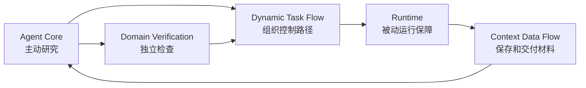
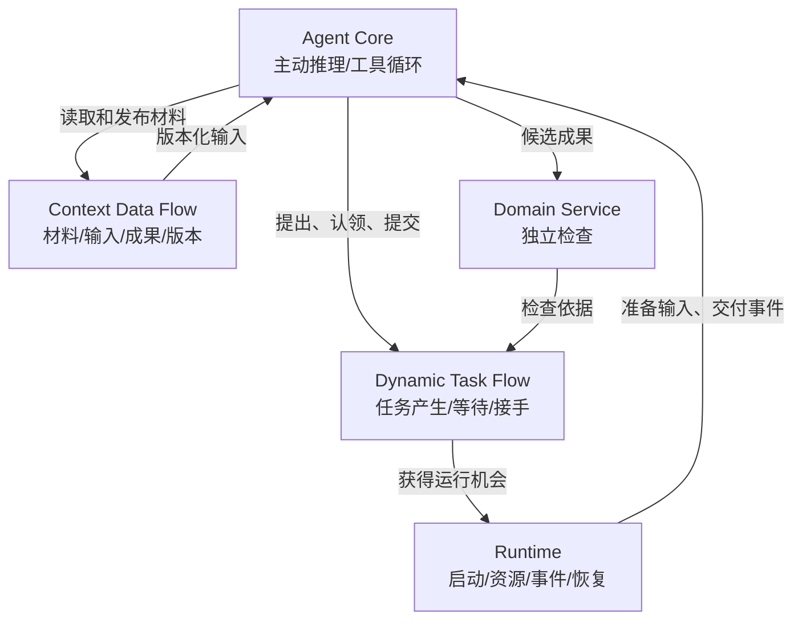
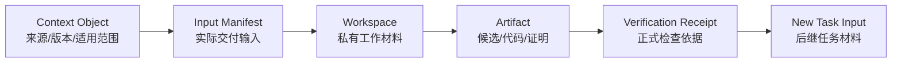
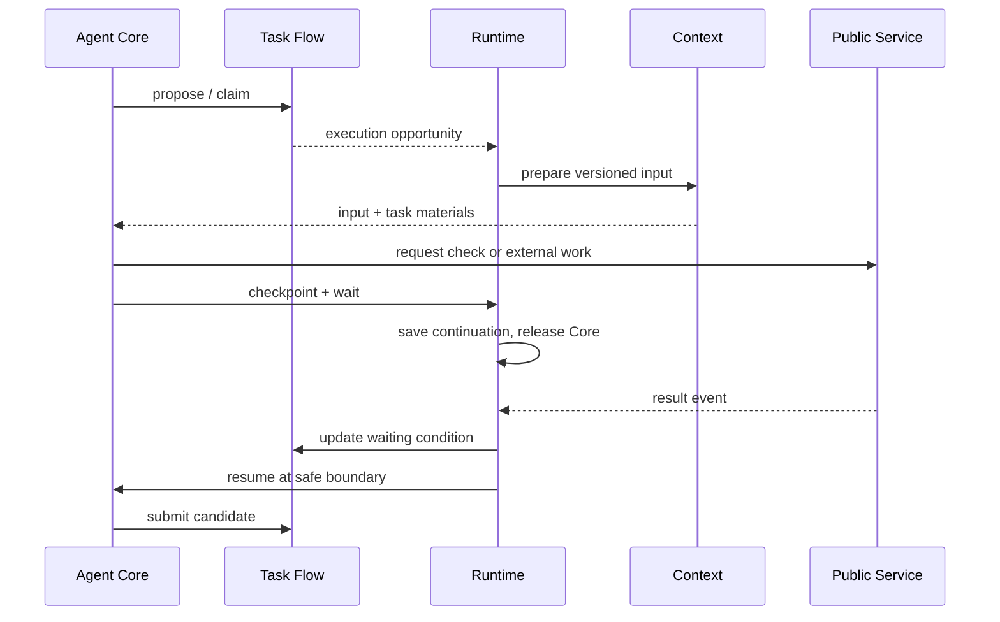

# SwarmEnv 架构汇报稿 v1

## 从主动研究到被动运行保障

版本：v1（架构师汇报版）  
日期：2026-10-17  
定位：面向架构讨论和方向确认的主文，不替代 `SwarmEnv_Design_v1.1.md` 的实现协议规范

---

## 0. 这份汇报先讲什么

这份文档不从 Task、Attempt、Lease 或数据库表开始。它先回答五个架构问题：

1. Agent Swarm 为什么需要一层独立的运行基础设施？
2. SwarmEnv 究竟固定了哪些系统对象？
3. Dynamic Task Flow 和 Context Data Flow 分别解决什么问题？
4. Agent Core、Runtime、Task 和 Context 如何分工？
5. 如何通过一个最小运行和恢复案例验证这套架构成立？

完整状态机、事件 Schema、租约、幂等、故障窗口和数据库实现细节保留在 `SwarmEnv_Design_v1.1.md` 中。架构汇报的任务是先建立正确的系统心智模型，再决定哪些协议值得实现。

---

## 1. 一页结论：SwarmEnv 要解决什么问题

SwarmEnv 不是把更多 Agent 放进同一个执行器，而是把一个不可预先完整规划、可以被中断、需要跨上下文协作并且必须通过检查的长任务，组织成一个能够持续推进的公共计算过程。

Agent Core 负责提出和解释研究行动；Runtime 负责让这些行动产生的任务责任、材料、等待和结果在 Core 离线时仍然能够被保存、交付和接续。

核心架构主张可以写成四句话：

1. **Dynamic Task Flow 组织控制流**：任务可以在运行中产生、分支、等待、接手、修订和汇合。
2. **Context Data Flow 组织数据流**：材料、Workspace、Artifact 和检查结果具有来源、版本和适用范围。
3. **Agent Core 负责主动研究**：它决定做什么、怎样分解、怎样解释反馈和怎样提交候选。
4. **Runtime 提供被动运行保障**：它负责启动、资源、事件、期限、保存、恢复、停止和对账。

两条流通过版本化输入、成果引用、事件和独立检查依据连接起来。



这套框架的首要目标是形成清晰、可替换、可分析的系统基础。首版不把“完整解决 FLT”或“所有任务完成率普遍提高”作为唯一验收标准。

---

## 2. 为什么普通的多 Agent 方式会失效

考虑一个抽象任务 T0。三个 Agent 分别完成了局部工作：

- Agent A 找到一个条件归约；
- Agent B 构造了一个局部引理；
- Agent C 发现了一个可能的连接方向。

这些工作可能已经被保存，也可能通过了各自的局部检查，但 T0 仍然没有推进。系统可能不知道：

- 哪个结果支持 T0 的哪一个未完成条件；
- 哪个 Agent 应该继续组合这些结果；
- 父 Agent 是否正在等待，还是已经失联；
- 结果是否真的进入了后继 Agent 的输入；
- 某个拒绝反馈是否送达并被采用；
- 某个检查请求是否仍在处理中；
- 一个等待中的 Agent 是否继续占用执行容量。

因此，更多并发调用只能增加活动量。它不会自动形成一条可接续的共同工作路径。

普通方案容易把以下几件事混在一起：

| 容易混淆的事情 | 实际上需要分别表达 |
|---|---|
| Agent 正在运行 | Task 是否仍有执行责任 |
| Task 已经提出 | Task 是否获准投入资源 |
| 结果已经保存 | 结果是否进入公共状态 |
| 结果已经交付 | 后继 Agent 是否真正采用 |
| 子任务已经完成 | 共同目标是否满足完成合同 |
| Agent 已经停止 | 远端请求和工具是否已经停止 |

SwarmEnv 的出发点是把这些关系从 Agent 的提示词和单次会话中抽出来，交给公共环境维护。

---

## 3. 四个核心抽象：谁在做什么

### 3.1 Agent Core：主动研究单元

Agent Core 是一次模型和工具循环。它负责：

- 选择或认领一项工作；
- 解释任务目标和完成要求；
- 提出子任务或替代路线；
- 检索、读取和发布材料；
- 调用工具和公共服务；
- 解释反馈并修订路线；
- 提交候选结果。

Agent Core 具有研究主动性，但不拥有公共任务真值、预算或完成结论。

### 3.2 Runtime：被动运行保障

Runtime 负责：

- 启动和恢复 Process；
- 分配和回收执行容量；
- 交付事件和输入；
- 保存 Checkpoint；
- 管理等待、期限、停止和重启；
- 对账外部请求和迟到结果；
- 让旧执行者失效，避免它覆盖新的责任。

Runtime 不替 Agent 决定数学路线，也不通过隐藏的“主 Agent”承担额外研究预算。

### 3.3 Dynamic Task Flow：动态控制流

Dynamic Task Flow 表示任务在运行时产生和变化的过程。它允许：

- 任务提出和任务执行分离；
- 一个任务产生多个子任务；
- 一个子任务被多个路线支持；
- 父任务等待结果并释放执行位置；
- 子任务到期后由新的 Process 接手；
- 任务版本修订后重新检查已有结果；
- 多条路线在正式检查后汇合。

它不是预先写死的静态 DAG，也不是一个中心 Planner 的内部计划。

### 3.4 Context Data Flow：持续存在的数据流

Context Data Flow 表示材料怎样跨 Agent、跨 Process 和跨时间流动：

```text
Context Object
    → Input Manifest
    → Agent Core / Workspace
    → Artifact
    → Independent Verification
    → New Task Input
```

它关注的不只是“数据库里有哪些内容”，还关注：

- 材料的来源和版本；
- 材料是否适用于当前 Task；
- 材料是否真的进入了模型输入；
- 后继结果是否能够引用并验证这种依赖；
- 旧版本修订后，哪些工作需要重新检查。

### 3.5 四个抽象之间的关系



主文到这里先不展开数据库、租约和事件状态。它们属于实现这些关系所需的协议机制。

---

## 4. 两条主线一：Dynamic Task Flow 如何组织控制流

### 4.1 一个任务从哪里开始

任务可能由 Agent、规则程序或人工操作者提出。任务提出后，系统需要分别回答：

1. 这项工作是否已经登记？
2. 当前版本和输入要求是什么？
3. 它是否获准投入资源？
4. 谁取得了执行责任？
5. 当前是否有可用的运行位置？
6. 执行者是否需要等待其他工作？
7. 什么事件可以使它继续？
8. 什么证据能够关闭这项工作？

因此，任务流可以用下面的逻辑表示：

```text
propose
  → admit or defer
  → claim
  → execute
  → publish or request service
  → wait or continue
  → resume or handoff
  → verify
  → close or revise
```

这些动作由不同组件完成。Agent 可以提出和认领，但不能自行签发任务完成；Runtime 可以恢复和停止，但不能改变任务完成合同；领域服务可以返回检查结果，但不能自己取得任务执行权。

### 4.2 创建关系不等于执行关系

父任务和子任务之间至少有三种不同关系：

- **创建关系**：T0 产生了 T1；
- **等待关系**：T0 的某个继续点需要 T1 的结果；
- **支持关系**：T1 的某个成果可能支持 T0 的某个条件。

它们不能被压缩成一条简单的父子树。T0 可以等待一个由其他分支创建的任务；一个已验证成果也可以支持多个后继任务。

### 4.3 根 Agent 的位置

首版可以从一个根 Task 和一个初始 Process 开始，这便于验证完整闭环。但根 Process 只是一个启动策略，不是系统的永久规划中心。

后续系统应允许：

- Runtime 从公共任务队列直接恢复工作；
- 已登记任务没有父 Agent 也能被认领；
- 集成工作作为普通 Task 被调度；
- 根 Process 崩溃后，其他 Process 继续接手。

这样才能保留 Agent Swarm 的开放性，同时避免把所有协作重新收缩为一个主 Agent 的工作流。

---

## 5. 两条主线二：Context Data Flow 如何组织数据流

### 5.1 材料的四个阶段

对一份公共材料，系统需要区分四个阶段：

1. **存在**：材料已经被保存并有稳定身份；
2. **可访问**：后继 Process 有权限读取它；
3. **进入输入**：材料实际出现在某次 Executor 输入中；
4. **形成采用证据**：后续 Artifact 能够说明它实际依赖该材料。

这四个阶段分别对应不同的记录。保存成功不等于后继 Agent 已经看到，Agent 看到也不等于后续证明或代码真的使用了它。

### 5.2 数据流的基本路径



Context Service 负责公共对象和输入构造。Workspace Manager 负责私有副本和快照。Domain Service 负责检查 Artifact。Task Service 根据检查结果决定哪些任务状态可以更新。

### 5.3 为什么不能只共享一份对话历史

共享完整对话历史会带来几个问题：

- 很难判断哪个结论适用于哪个 TaskVersion；
- 旧定义、旧环境和新环境容易被混用；
- 长上下文会遮蔽关键材料；
- Agent 读到了某段话，不代表它理解了其中的前提；
- 不同执行者不能稳定地从同一份材料继续工作。

因此，SwarmEnv 将公共 Context 组织成有身份、有版本、有来源的对象，同时由 Input Builder 根据当前任务构造有限输入。

---

## 6. 主动责任与被动责任

这是整个设计中最需要强调的分工。

### 6.1 Agent Core 主动决定什么

Agent Core 主动决定：

- 当前做哪项工作；
- 是否提出子任务；
- 是否检索或发布材料；
- 是否请求检查；
- 是否等待；
- 如何解释反馈；
- 是否申请继续投入或更换路线。

这些行为具有开放性和研究判断，系统不能完全预先规划。

### 6.2 Runtime 和公共服务被动保障什么

系统自动保障：

- 已登记任务不会因为某个会话消失而消失；
- Checkpoint 和等待条件能够被持久保存；
- 等待中的 Process 可以释放执行容量；
- 结果和事件可以在 Agent 离线后继续路由；
- 期限、取消和预算不依赖模型是否记得；
- 旧 Process 失效后不会继续覆盖新责任；
- 长服务请求完成后可以脱离原 Process 继续应用；
- 未确认的外部副作用不会被简单当成失败。

### 6.3 双泳道示例



Agent 主动调用 `wait`，但等待成立后的保存、资源归还、事件路由和恢复机会由 Runtime 负责。

---

## 7. 一个最小运行闭环

用一个不依赖具体数学细节的 T0 示例说明完整流程：

### 第一步：启动

Runtime 为项目启动一个 Process。它获得有限的初始化输入，可以查看候选任务，但还没有一项任务的正式执行责任。

### 第二步：认领

Process 主动认领 T0。Task Service 记录执行责任，Runtime 为它准备 Task 指定版本的输入和 Workspace。

### 第三步：动态分解

Agent Core 判断 T0 需要两个辅助工作 T1 和 T2，并将它们正式提出。Runtime 根据资源容量为 T1、T2 提供后续执行机会。

### 第四步：等待并释放

T0 当前没有其他可独立推进的工作。Agent Core 保存继续点并声明等待 T1、T2。Runtime 持久保存等待条件并释放这个 Core。

### 第五步：局部成果进入公共环境

T1 完成候选并经过领域检查。结果保存为带版本和来源的 Artifact，并产生结构化检查依据。T2 仍在运行，T0 不会因为一个子任务完成就被误判为完成。

### 第六步：恢复

当等待条件满足或出现明确异常时，Runtime 恢复 T0。它交付具体的结果版本、触发原因和当前项目状态，而不要求 T0 重新猜测发生了什么。

### 第七步：最终检查

T0 组合 T1、T2 的成果，提交最终候选。只有候选在目标、依赖、环境和检查规则均匹配的情况下通过验证，T0 才关闭。

这个闭环体现了三个关键语义：

- 等待者不必持续占用 Core；
- 子任务完成不等于共同目标完成；
- Agent 的自述完成不等于正式完成。

---

## 8. 为什么被动运行保障是架构核心

考虑 T2 的执行者 P2 在等待前崩溃，或者本轮执行期限结束。此时系统应该保留：

- T2 的任务责任和当前版本；
- P2 已确认的 Checkpoint；
- 已经产生的 Artifact；
- 尚未完成的等待条件；
- 仍在途的公共服务请求。

Runtime 需要完成以下动作：

```text
保存 Checkpoint
    → 使旧执行段失效
    → 保留未完成任务责任
    → 为新 Process 提供接手机会
    → 处理迟到结果
    → 恢复等待者或继续等待
```

这组机制解决四个系统问题：

1. 成果不随单个 Process 消失；
2. 等待有持久出口；
3. 旧执行者不能覆盖新责任；
4. 迟到服务结果有明确的应用、归档或复核路径。

完整的 lease、generation、Saga 和 Reconciler 细节放在实现规范中。架构层只需要确认：这些责任属于 Runtime 和公共服务，不能继续依赖 Agent 自己在线处理。

---

## 9. 模块边界与可替换性

| 模块 | 主要责任 | 不负责什么 |
|---|---|---|
| Task Service | Task 版本、准入、执行责任、等待条件 | 不负责模型推理和数学路线判断 |
| Runtime | Process、Core、事件、期限、恢复和停止 | 不替 Agent 选择研究路线 |
| Executor | 模型调用、工具循环和局部安全边界 | 不直接修改任务数据库 |
| Context Service | 公共对象、版本、来源和输入构造 | 不负责 Task claim 和资源调度 |
| Workspace Manager | 私有文件、快照、Sandbox 和恢复 | 不改变数学语义 |
| Domain Adapter/Judge | 领域检查和 VerificationReceipt | 不负责通用调度 |
| Reconciler/Observation | 中间状态对账、指标和诊断 | 不产生第二套任务完成真值 |

这组边界支持三类后续研究：

### 9.1 任务策略替换

可以替换任务生成、选择和投入策略，而不重新实现 Context、Workspace、Judge 和恢复机制。

### 9.2 Context 策略替换

可以比较近期记录、关系检索和语义检索，而不改变 Task 的完成语义和 Runtime 的生命周期。

### 9.3 Executor 和领域服务扩展

可以接入不同模型、不同单 Agent harness、数学 Judge 或代码测试器。它们通过能力声明和公共结果接口接入，而不直接改写其他模块的私有状态。

“可替换”需要通过实际扩展验证，不由模块名称自动推出。评估时需要记录跨模块修改范围、私有接口依赖、资源外溢和调试返工。

---

## 10. 实施路线：先证明运行基础，再接入真实任务

首版按三个阶段推进：

### 阶段一：协议闭环

使用确定性 ScriptExecutor 和简单领域服务，验证：

- 任务提出和认领；
- Checkpoint 和 wait；
- Core 释放和 resume；
- 事件交付；
- Runtime 重启；
- 迟到结果和重复请求；
- 旧执行者隔离。

### 阶段二：一个真实领域

接入数学证明或代码测试任务，验证同一组 Task、Context 和 Runtime 接口能够承载真实执行。

### 阶段三：替换、故障和负载

接入第二种 Executor 或领域服务，随后开展：

- Process 和 Runtime 故障；
- Context 修订；
- 长服务延迟；
- 事件重复和乱序；
- 多资源拥塞；
- 16—32 个真实执行位置；
- 更大规模的合成负载。

架构师在这一阶段需要审查的是接口是否稳定、责任是否清晰、失败是否可解释，而不是先要求框架立即在困难数学任务上取得最高完成率。

---

## 11. 如何判断架构是否成立

评估分成三层。

### 11.1 协议正确性

检查：

- 等待和恢复是否可靠；
- 旧执行者是否被隔离；
- 重复事件是否安全；
- 任务完成是否有正式依据；
- 结果是否能够脱离原 Process 应用。

### 11.2 运行可靠性

检查：

- Process 崩溃；
- Runtime 重启；
- 服务延迟；
- 数据库和队列拥塞；
- Context 暂不可读；
- 预算和存储耗尽；
- 迟到和未确认请求。

### 11.3 架构可替换性

检查：

- 更换任务策略需要改哪些模块；
- 更换 Context 策略是否改变核心状态机；
- 接入新 Executor 是否需要重写 Runtime；
- 接入新领域服务是否需要修改 Task 核心；
- 一个模块优化时是否把压力转移到其他模块。

真实任务完成率、时间和成本作为应用层证据，同时报告框架的恢复能力、修改范围、系统开销和可观察性。

---

## 12. 架构汇报结束时希望确认的决策

在进入详细实现前，架构评审主要需要确认以下问题：

1. 是否认可 Agent Core、Runtime、Dynamic Task Flow 和 Context Data Flow 的四层划分？
2. 是否认可任务责任、Process 执行实例和 Core 容量需要分离？
3. 是否认可等待、事件交付、期限和接手属于系统运行保障，而不能继续依赖 Agent 在线？
4. 是否认可 Root Process 只是首版启动策略，不能成为永久中心规划器？
5. 是否认可 Domain Judge 通过正式 VerificationReceipt 参与完成判断？
6. 是否同意首版先验证协议闭环，再接入真实领域和规模负载？
7. 是否同意把状态机、租约、事件 Schema 和故障矩阵放在实现附录，而不是放在主汇报叙事中？

如果这些决策得到确认，后续工作就可以转入详细接口、协议测试和 MVP 实现；如果其中任何一项不成立，需要先调整系统边界，而不应直接进入代码实现。

---

## 附录：主文与实现规范的边界

### 架构师主文保留

- 问题背景；
- 核心系统主张；
- 四个核心抽象；
- Dynamic Task Flow；
- Context Data Flow；
- Agent Core 与 Runtime 的主动/被动分工；
- 一个最小运行例子；
- 一个故障恢复例子；
- 模块边界和可替换性；
- 实施阶段与评估原则。

### 实现规范保留

- 完整状态枚举和合法转移；
- TaskVersion/CAS；
- ExecutionLease、RunLease、CoreLease 和 fencing epoch；
- outbox/inbox、幂等、序列、TTL 和 dead-letter；
- wait Saga 的中间状态和补偿；
- Artifact、Request、VerificationReceipt Schema；
- 资源账本、连接池和 Sandbox；
- 权限、凭据和多租户隔离；
- 故障注入矩阵；
- 数据库表和具体部署方式。
