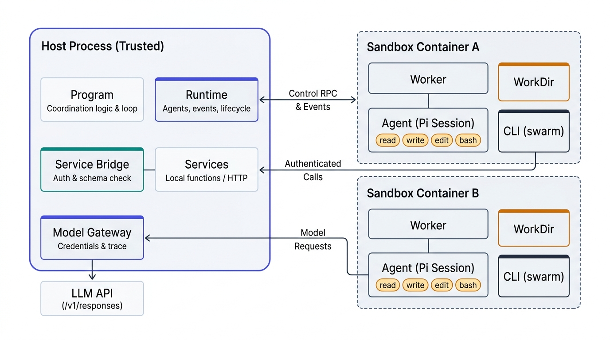

Every `murm` run operates across two explicit trust boundaries: the **Trusted Host** executes your Program, holds all upstream secrets, and writes authoritative logs; **Isolated Sandboxes** contain each agent's filesystem, shell execution, and network access.



## 1. Host vs. Sandbox responsibilities

- **Trusted Host**: runs your **Program** and **Runtime**. Creating a Runtime automatically starts two run-scoped local HTTP servers:
  - **Service Bridge**: receives `swarm` CLI requests from containers, verifies identity and schemas, and dispatches to registered Services.
  - **Model Gateway**: proxies `/v1/responses` calls from Pi, injects upstream API keys on the host, enforces timeouts/limits, and records raw traces.
- **Isolated Sandboxes**: each `runtime.spawn()` launches a dedicated Docker container through OpenSandbox with enforced disk quotas and network allowlists, running a **Worker** supervisor alongside the **Pi Agent**.

## 2. Inside the container: why Worker and Agent are separate

Containers do not run a bare Pi process. A lightweight trusted **Worker** launches and supervises an unprivileged Pi subprocess configured with only four local tools (`read`, `write`, `edit`, `bash`).

Separating Worker from Pi solves two practical multi-agent problems:

1. **Controlled file handoffs**: `files.prepare`, `files.grant`, and `files.snapshot` execute through the Worker. It can briefly pause active writers, capture a consistent snapshot, or flip directory write permissions without granting Pi extra OS privileges.
2. **Archive-before-delete teardown**: when stopping an agent, the Runtime instructs Worker to terminate Pi first (freezing disk state) while keeping Worker alive to stream the native Pi session and `collect` artifacts back to the host before deleting the container.

## 3. How a Service call crosses the Bridge

When an agent executes `swarm <service> <operation>` inside Bash, the call moves through a five-stage verified pipeline:


1. **Container command**: `swarm` automatically attaches the container-scoped `SWARMENV_BRIDGE_TOKEN` and posts JSON to the host Service Bridge.
2. **Token & ACL check**: the Bridge resolves the real `agentId` and `profile`, then verifies `Profile.services` permits the requested operation. Unauthorized calls fail immediately with `403 NOT_ALLOWED`.
3. **Strict JSON Schema validation**: `ServiceRegistry` validates inputs against `manifest.input_schema` (draft-07) before business code ever runs.
4. **Trusted caller injection & execution**: the Bridge constructs an unforgeable `caller` (`runtimeId`, `botId`, `profile`, and optional `binding`) and invokes either the in-process function or remote HTTP Service.
5. **Output validation & trace tape**: responses are checked against `output_schema`, returned to the agent, and durably appended to `service-calls.jsonl`.

### How agents discover available Services

Agents can inspect their permitted capabilities at any time via `swarm service list` and `swarm service view <id>`, complemented by role instructions in `Profile.prompt`.

As the `murm` prompt model evolves, this discovery path unifies into **`system prompt + tools + services`**: at startup, the Runtime generates a compact capability index directly from `Profile.services` and registered manifests (keeping detailed schemas on-demand via `swarm service view`), so registering a new Service automatically surfaces to every authorized agent without repetitive prompt boilerplate.

## 4. Model Gateway path

All `/v1/responses` calls from Pi flow through the host **Model Gateway**:

- **Keys stay on the host**: upstream `Authorization` headers live solely in host configuration; containers never see raw model credentials.
- **Unified limits and recording**: the Gateway enforces per-request timeouts (default 120s) and output caps, saving redacted request/response traces under `model-trace/<attemptId>/`.
- **Optional `modelAccessPolicy` gate**: lease-based Programs such as [Flat](../programs/flat/) can attach a synchronous authorization hook to abort streaming calls the instant a task lease expires or changes fencing version. Most Programs (Subagents, Agensh, ScaleMAS) leave this unset.

## 5. Durable Run directory layout

All run records are written under `outputDir/<runId>/` with secrets and `secretEnv` automatically redacted to `[redacted]`:

```text
outputDir/<runId>/
├── runtime.json                 # Effective config, stop receipts, cleanup verdict
├── evidence.jsonl               # Ordered lifecycle, input, and event timeline
├── service-calls.jsonl          # Every Service call: caller, input, output, error
├── service-state.<id>.json      # Optional per-Service state snapshots on close
├── model-trace/<attemptId>/     # Raw request.json, response.txt, result.json
├── bots/<agentId>/
│   ├── session/                 # Native Pi JSONL conversation archive
│   └── artifacts/files/         # Files exported via Profile/Spawn collect specs
└── environment-report.json      # Program delivery outcome & independent error slots
```

Next, read [Anatomy of a Run](../run-lifecycle/) to walk through these primitives inside a concrete multi-turn collaboration.
