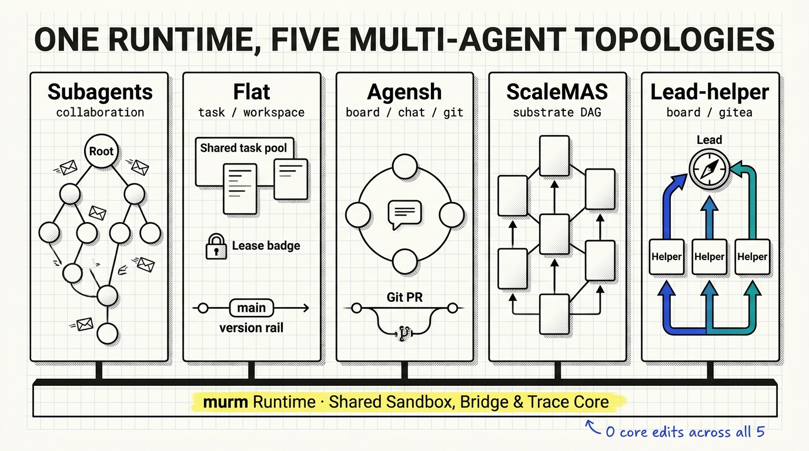

In `murm`, the five built-in multi-agent systems are not hardcoded "modes" inside the engine. They are five ordinary TypeScript **Harnesses** built on the exact same Runtime API. Changing how agents collaborate means swapping the registered **Services** and the host **control loop** — the sandbox, Bridge, and trace archive remain untouched.

> **Repository module names**: in the source tree, `TaskPool` lives at `src/environments/flat`, `PeerMesh` at `src/environments/agensh`, `Substrate` at `src/environments/scalemas`, and `Lead-Worker` at `src/environments/lead-helper`.

## Side-by-side comparison from a Harness author's perspective

| Harness | Registered Services | Key Runtime Primitives | Host Control Loop | Deliverables & Verification |
| --- | --- | --- | --- | --- |
| **[Subagents](./subagents/)** | `collaboration` (6 ops: spawn, message, followup, wait, interrupt, list) | `spawn(forkFrom)`, `send(wakeIfIdle: false)`, `interrupt(discardedInputHashes)`, shared `workspace` | **Event + mailbox loop**: listens for child `settled` and peer messages; busy targets get immediate `steer`, idle targets buffer until `wait_agent` or `followup_task` | Shared workspace files or message payloads |
| **[TaskPool](./taskpool/)** | `task`, `material`, `workspace`, `judge` | Read-only `writable: false`, `files.prepare` + `files.grant`, `modelAccessPolicy`, slot refill `stop`/`spawn` | **Reconciliation loop**: `take` triggers file handoff and write grant; `settled` continues unfinished executions via `followUp`; heartbeat renews leases and replaces expired workers | Immutable Materials + verified merges into shared `main` |
| **[PeerMesh](./peermesh/)** | `message` (Mattermost), `gitea`, `agensh-context` (soft-claim Board) + native `git` | `bindings`, `network.allow`, `secretEnv`, `collect(includeGit: true)` | **Per-peer serial router**: ingests chat/PR events, injects current Board view, dispatches `followUp` batches into the existing session, triggers idle nudges | Personal Git branches + PRs merged after host delivery checks |
| **[Substrate](./substrate/)** | SQLite `substrate` (`publish`, `search`, `visit`) | `spawn(files)`, `runInput` serial turn helper | **Parallel fixed rounds**: zero task queues and zero routing — `Promise.all` drives every equal peer through `maxRounds` independent exploration cycles | Content-addressed immutable records (`content:<sha256>`) + read audit table |
| **[Lead-Worker](./lead-worker/)** | SQLite `board` (direction, assignment, transactional claims, feedback) + `gitea` | Fixed-team `spawn`, per-role `bindings` and `secretEnv` | **Alternating staged orchestration**: `lead` publishes direction → workers claim concurrently, ship commits, and post feedback → `lead` revises direction → same workers execute next round | Personal branch commits verified by commit SHA, path, SHA-256, and direction read gate |

## One conflict, five different policies

The quickest test of where coordination logic belongs is asking: **"What happens when two agents pick the same piece of work?"**

- **TaskPool** enforces hard mutual exclusion inside the `task` Service using database leases and `fencing_version` — only one execution receives write permission.
- **PeerMesh** treats `CLAIM` on its Board as an overlapping soft intention so peers negotiate splits in chat.
- **Lead-Worker** locks a single permanent `owner` inside SQLite using `BEGIN IMMEDIATE` transactions and `expected_revision` optimistic locking.
- **Substrate** drops claiming altogether — peers explore freely and converge through immutable publishing and explicit citations.
- **Subagents** partitions work at delegation time via `spawn_agent`, and `/root` corrects overlaps mid-flight using `send_message` or `interrupt_agent`.

## Pick your starting point

- Dynamic delegation, mid-flight user steering, and mailbox buffering → **[Subagents](./subagents/)**
- Long-running pools, worker turnover, lease guards, and versioned `main` → **[TaskPool](./taskpool/)**
- Peer engineers collaborating via chat channels, boards, and Git PRs → **[PeerMesh](./peermesh/)**
- Open-ended parallel research around an immutable citation store → **[Substrate](./substrate/)**
- Staged lead-and-worker loops with causal read gates and Git verification → **[Lead-Worker](./lead-worker/)**
