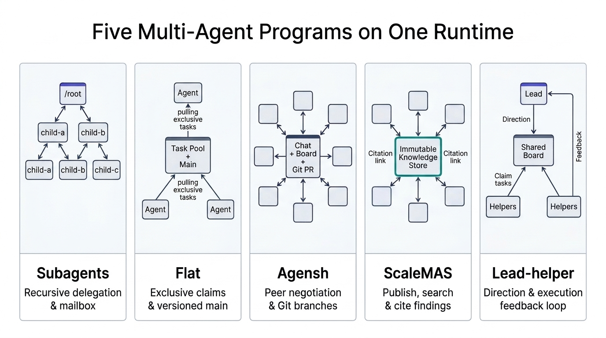

在 `murm` 中，五种多智能体系统不是内置在引擎里的五种“模式开关”，而是五个使用同一套 Runtime API 编写的 **Program**。改变协作方式，只需更换注册的 **Service** 和宿主侧的**控制循环**，底层沙箱、桥接与留痕设施完全复用。

## 从 Program 开发者视角横向对照

与其抽象地比较“谁更聪明”，不如直接看每种 Program 在代码层面究竟**注册了什么 Service**、**调用了哪些 Runtime 原语**，以及**宿主控制循环怎么驱动整场协作**：

| Program | 注册的 Service | 用到的关键 Runtime 原语 | 宿主控制循环如何驱动 Agent | 交付与验证方式 |
| --- | --- | --- | --- | --- |
| **[Subagents](./subagents/)** | `collaboration`（6 个操作：委派、消息、追问、等待、打断、列队） | `spawn(forkFrom)`、`send(wakeIfIdle: false)`、`interrupt(discardedInputHashes)`、共享 `workspace` | **事件与邮箱驱动**：监听子 Agent `settled` 与成员消息；对方忙碌则实时 `steer`，空闲则暂存邮箱等待 `wait_agent` 或 `followup_task` | 共享工作区文件或消息文本；[在 Trace Viewer 查看 fd 实测](../../trace-viewer/) |
| **[Flat](./flat/)** | `task`、`material`、`workspace`、`judge` | `writable: false` 启动、`files.prepare` + `files.grant`、`modelAccessPolicy`、自动补位 `stop`/`spawn` | **状态对账循环**：`take` 触发准备并解锁写权限；`settled` 未 `finish` 则自动发续轮输入；定时心跳续约与超期换人 | 不可变 Material 引用 + 检查通过后合入公共 Workspace `main` |
| **[Agensh](./agensh/)** | `message`（Mattermost）、`gitea`、`agensh-context`（软意向 Board）+ 原生 `git` | `bindings`、`network.allow`、`secretEnv`、`collect(includeGit: true)` | **每成员串行 Router**：拉取外部聊天/PR 事件、拼接最新 Board 视图，以 `followUp` 逐批喂入原会话，空闲时触发 nudge | 各 peer 推独立分支提 PR，宿主 `createAgenshDelivery` 核对提交合并到 `main` |
| **[ScaleMAS](./scalemas/)** | SQLite `substrate`（`publish`、`search`、`visit`） | `spawn(files)`、`runInput` 串行回合封装 | **并发固定轮次**：不设任务池也不做消息路由，宿主用 `Promise.all` 并发驱动每只 peer 跑完 `maxRounds` 轮自主探索 | 不可变内容地址 `content:<hash>` 与显式引用图，配合宿主读取审计 |
| **[Lead-helper](./lead-helper/)** | SQLite `board`（方向、分工、事务排他认领、反馈）+ `gitea` | 固定团队 `spawn`、每角色独立 `bindings`/`secretEnv` | **分阶段交替编排**：`lead` 定方向 → `helpers` 并发认领执行并留反馈 → `lead` 读反馈改方向 → 原 `helpers` 续做下一轮 | `helper` 推送个人分支提交，Board 核验真实 commit/SHA-256 与方向读取记录 |

## 同一个冲突，五种截然不同的代码规则

判断一个协作规则该写进 Service 还是 Program，最好的检验问题是：**“两只 Agent 同时看中了同一项工作，怎么办？”**

- **Flat** 把互斥规则写进 `task` Service：数据库租约与 `fencing_version` 保证同一时刻只有一个 Execution 拿到写权限，另一只 Agent 收到冲突后改选其他任务。
- **Agensh** 在 Board Service 里把 `CLAIM` 实现为允许重叠的软意向声明，让两位 peer 通过 Mattermost 频道商量分工。
- **Lead-helper** 在 SQLite `board` Service 里用 `BEGIN IMMEDIATE` 事务和 `expected_revision` 乐观锁锁定唯一 `owner`。
- **ScaleMAS** 干脆没有“认领”操作，允许多人探索相近问题，靠不可变发布与相互引用自然收敛。
- **Subagents** 由 Root 在任务源头通过 `spawn_agent` 划分边界，中途发现重叠时由 Root 调用 `send_message` 或 `interrupt_agent` 实时纠偏。

## 按场景挑选阅读顺序

- 想看如何结合 `wakeIfIdle: false`、`forkFrom` 和邮箱打造动态团队：先读 **[Subagents](./subagents/)**。
- 想看如何把只读发现、`files.prepare/grant` 与 `modelAccessPolicy` 租约保护组合起来：先读 **[Flat](./flat/)**。
- 想看如何把 Gitea、Mattermost 等外部工具通过串行 Router 接入多 Agent 会话：先读 **[Agensh](./agensh/)**。
- 想看最轻量的无任务并发研究与持久化 SQLite 成果库：先读 **[ScaleMAS](./scalemas/)**。
- 想看带严格因果校验（“必须先读反馈再发新方向”）的分阶段团队编排：先读 **[Lead-helper](./lead-helper/)**。
