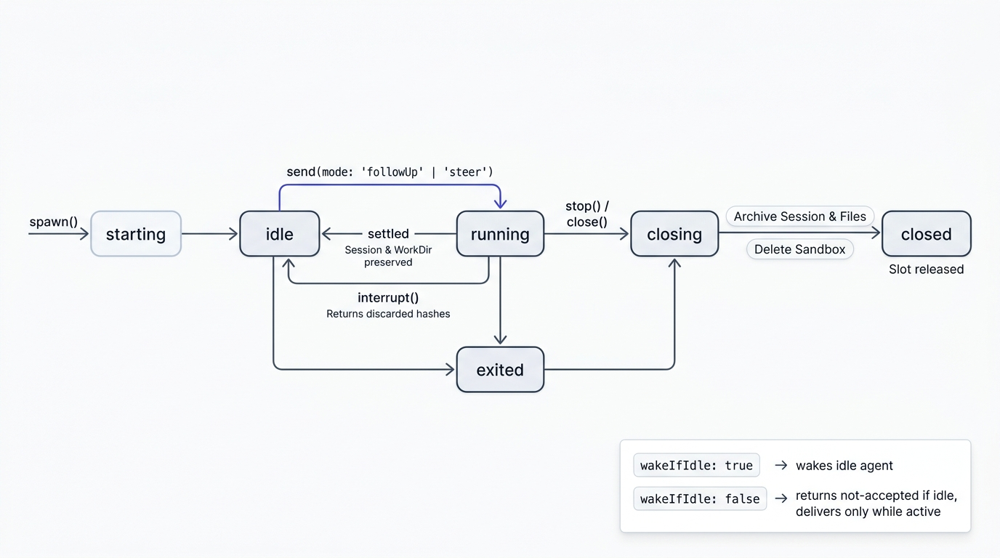

光看 API 列表很难记住什么时候该用哪个原语。这一章我们跟着一个真实场景走完全程：**假设你要让 `architect` 与 `tester` 两只 Agent 协作重构一个解析器模块并补全回归测试**——途中用户追加了需求，测试员一度跑偏需要被打断，最后安全导出代码并复盘全过程。



## 阶段一：启动 Run 并创建待命的 Agent

Program 先调用 `createRuntime()` 冻结 Profile 与 Service 注册表，建立本次 Run 的输出目录 `outputDir/<runId>/`。此时还没有创建容器。

接着调用 `runtime.spawn()` 启动两只 Agent。Core 会先登记 `agentId`、占用容量池（`maxBots`）中的一个 **Slot**，再创建沙箱与 Pi 会话。`spawn()` 返回时，Agent 处于 **`idle`** 状态，尚未开始推理：

```ts
// 在投递第一条输入前先订阅事件，确保不错过任何快速返回的进展
const unsubscribe = runtime.onEvent((event) => {
  handleEvent(event);
});

const architect = await runtime.spawn({
  requestId: 'spawn-architect',
  profile: 'architect',
  workspace: { id: 'parser-repo', mode: 'read-write' },
});
const tester = await runtime.spawn({
  requestId: 'spawn-tester',
  profile: 'tester',
  workspace: { id: 'parser-repo', mode: 'read-write' },
});
```

因为 `spawn` 和“开始第一轮工作”是分开的两步，Program 可以在第一条消息发出前把路由表、父子关系和事件监听全部挂稳。

## 阶段二：投递任务与选择输入时机

现在给 `architect` 和 `tester` 派发各自的工作。Runtime 的统一投递入口是 `runtime.send(agentId, text, options)`，它通过两个参数精确控制“何时进会话、是否唤醒空闲 Agent”：

- **`mode: 'followUp'`**（顺序排在当前工作之后）：适合下达一项独立的新任务，或等待当前这一整轮收束后再处理的批次消息。
- **`mode: 'steer'`**（默认值，当前工具批次完成后立即插入）：适合在 Agent 正在执行时实时补充约束或纠正方向（不会粗暴杀死正在运行的长 Bash，而是在当前工具返回后、下一次模型请求前送入）。
- **`wakeIfIdle: false`**（条件投递，默认 `true`）：**仅当目标 Agent 正在运行时才把消息插入当前轮次；如果它此刻已经 `idle`，Core 直接返回 `{ status: 'not-accepted', reason: 'idle' }` 而不唤醒它。**

看看这个特性在协作里有多顺手：

```ts
// 1. 启动 architect 开始重构（唤醒 idle Agent）
await runtime.send(architect.id, '重构 src/parser.ts，把接口变更通过 notes Service 同步给 tester。', {
  requestId: 'task-arch-1',
  mode: 'followUp',
});

// 2. 运行中途，tester 发现了一条边缘假设，想顺手提醒正在干活的 architect
const notice = await runtime.send(architect.id, '提醒：大小写敏感模式在路径含斜杠时有特例。', {
  requestId: 'notice-1',
  mode: 'steer',
  wakeIfIdle: false,
});

if (notice.status === 'not-accepted') {
  // architect 此刻恰好已空闲，把通知暂存在 Program 的邮箱里，不产生多余的模型调用
  mailbox.push(architect.id, '提醒：大小写敏感模式在路径含斜杠时有特例。');
}
```

### 区分“接纳回执”与“本轮结束”

`runtime.send()` 返回的只是**接纳回执**（`accepted`、`not-accepted` 或 `unknown`），不代表模型已经回答完毕。当一轮模型思考与工具调用全部完成时，`onEvent` 会收到一条 **`settled`** 事件（`outcome` 为 `'completed'`、`'failed'` 或 `'aborted'`），同时该 Agent 回到 `idle`，继续保留完整的 Session 与工作目录。

如果网络抖动导致回执返回 `unknown`，保留原来的 `requestId` 和参数再次调用核对即可——Core 会查询原提交状态，绝不会重复向 Pi 注入第二条相同消息。

## 阶段三：三种文件协作与交接方式

重构过程中，两只 Agent 产出和交接代码文件有三种标准做法，Program 按协作需要选用：

| 协作场景 | 使用的 Core 文件原语 | 实际效果 |
| --- | --- | --- |
| **同组并行改同一套代码**（如本场景与 Subagents） | `spawn({ workspace: { id, mode: 'read-write' } })` | 多只 Agent 挂载同 Runtime 共享目录；各自会话与凭据依然隔离 |
| **先只读选工，认领后才给写权限**（如 Flat） | 先 `writable: false` 启动 → 认领后 `files.prepare()` → `files.grant()` | 在业务层确认任务归属前，Agent 无法改动目录；`grant` 校验 `prepare` 签发的受信对象后解锁写入 |
| **运行中抓取稳定快照做检查或发布** | `runtime.files.snapshot(agentId, { requestId, paths })` | Worker 协调暂停写入者，返回一致的文件字节、版本号与内容摘要 |

除了运行中交互，还可以用 `Profile.collect` 声明停止时自动导出的交付清单（路径、`includeGit`、字节上限与 `required` 策略）。

## 阶段四：发现跑偏时的安全打断（`interrupt`）

假设运行到第 6 分钟，你发现 `tester` 正在针对旧接口写一大堆无效测试。你不想销毁它（因为它的上下文里已经积累了完整的环境探查结论），只想立刻打断当前轮次并改派新方向：

```ts
const interrupted = await runtime.interrupt(tester.id, {
  requestId: 'interrupt-tester-1',
  timeoutMs: 15_000,
});

if (interrupted.status === 'interrupted') {
  // 如果打断前有尚未被 Pi 消费的排队消息，Core 会在 discardedInputHashes 里列出它们的哈希
  recoverDiscardedMailboxMessages(tester.id, interrupted.discardedInputHashes);

  // 原 Session 与工作目录完好保留，直接接着发新指令
  await runtime.send(tester.id, '接口已定稿，请基于最新的 src/parser.ts 重写过滤测试。', {
    requestId: 'task-tester-2',
    mode: 'followUp',
  });
}
```

`interrupt` 会同时取消该 Agent 在途的 Bridge Service 调用、终止当前推理并清空未消费队列，而 `discardedInputHashes` 让 Program 能够精确恢复被清空的协作通知，做到打断不丢消息。

## 阶段五：有序关闭与三项独立结论

所有测试跑通后，Program 准备收尾。标准关闭顺序是固定的：

1. 先停止 Program 自己的定时器、事件轮询器与外部消息入口；
2. 调用 `await runtime.close({ timeoutMs: 30_000 })`；
3. Core 依次执行：**拒绝新请求 → 停止所有 Pi 执行进程 → 归档每只 Agent 的完整原生 Session 与 `collect` 声明文件 → 删除沙箱并释放 Slot → 关闭 Bridge/Model Gateway 并写出 `runtime.json`**；
4. 待 Core 确认清理完毕，Program 再关闭自己创建的数据库或撤销临时外部凭据。

关闭回执将两个维度严格拆开报告：
- **`execution`（`'stopped'` / `'unknown'`）**：执行进程是否已确认停下；
- **`cleanup`（`'complete'` / `'pending'`）**：必需的会话归档、必选文件导出与容器删除是否全部完成。

只要 `collect.required: true` 的交付文件或 Session 归档失败，Core 绝不会擅自删除容器导致成果丢失，而是返回 `cleanup: 'pending'` 与具体的 `pending` 项清单；排查后再次调用 `stop()` 或 `close()` 即可断点续推清理。

结束之后，把 `outputDir/<runId>/` 交给 [Multi-Agent Trace Viewer](../../trace-viewer/)，整场重构的并行泳道、工具调用、消息提醒与中断恢复便一目了然。

下一章进入 [五种协作机制总览](../programs/)，看看上述同一套原语如何拼出五种截然不同的多智能体系统。
